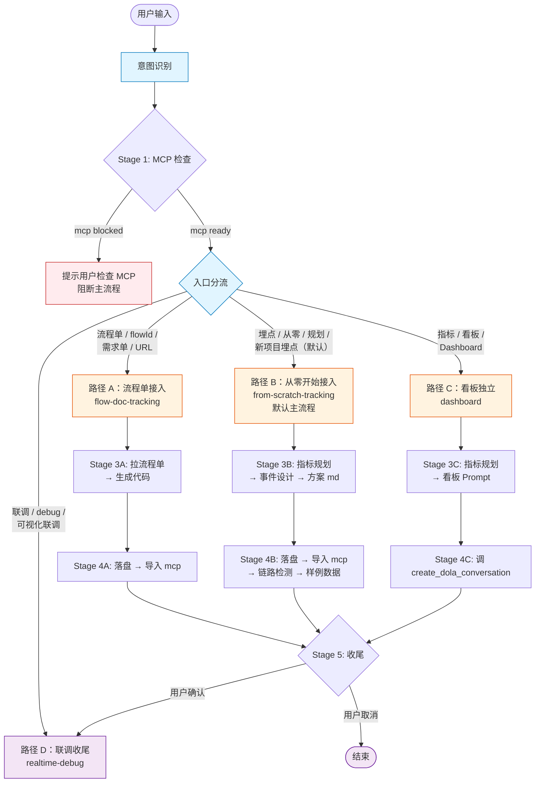
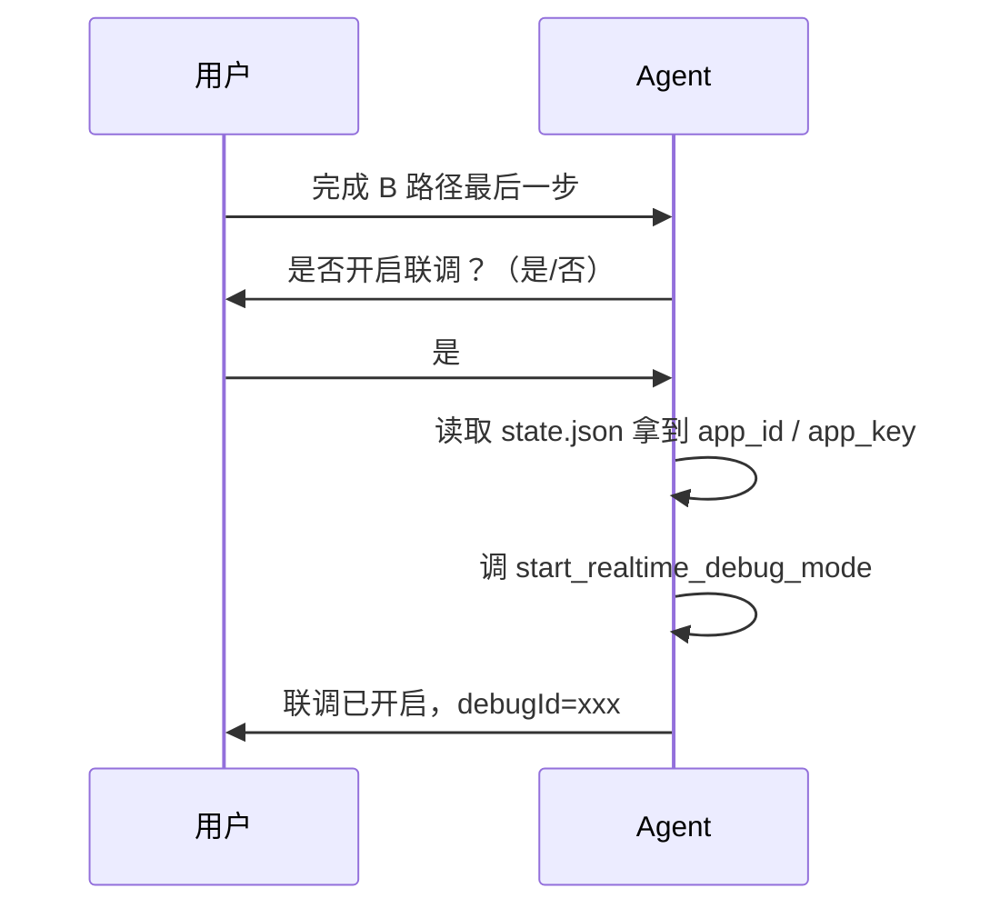
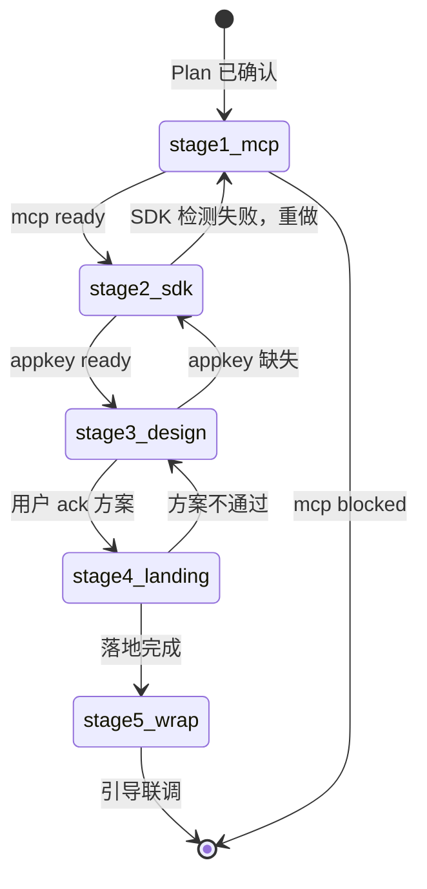

# 大同 AI 埋点 Skill v2 优化方案

> 评审版本 · 不直接改动 SKILL.md · 状态：`ready-for-review`
> 文档版本：v2.0
> 适用 skill：`skills/datong-ai-tracker/`

---

## 1. 背景与目标

### 1.1 当前痛点（v1 实测）

| # | 痛点 | 现象 | 根因 |
|---|------|------|------|
| 1 | **长任务跑偏** | Agent 上下文超长后容易漏步骤、漏上报、漏产物 | 9 步线性流程全塞在 SKILL.md，无 checkpoint、无断点 |
| 2 | **漏细节** | 必读项（custom-specs）、必产物（md）、必上报（report.sh）经常被跳过 | 主文档无"强校验"机制，AI 靠自觉 |
| 3 | **路径混乱** | "埋点信息码 / appId+pageId / URL / 流程单" 4 种入口混在 A 路径里 | 入口识别没抽象，AI 容易把流程单当 appId+pageId 处理 |
| 4 | **无序衔接** | "联调"看似独立又像"埋点接入最后一步"，用户和 Agent 都困惑 | 没有"主线 vs 收尾"的分层模型 |
| 5 | **不可续跑** | 任务中断后下次只能从零开始 | 无状态持久化，AI 只能依赖上下文记忆 |
| 6 | **定制难复用** | 业务有 custom-specs / custom-styles 需求但和主线混在一起 | 主线承担了"通用逻辑 + 业务定制"双重职责 |

### 1.2 优化目标（v2 要解决的 4 件事）

1. **OpenSpec 风格显式 Plan 模式**：Agent 收到任务 → 先输出《执行计划》草稿（含 Mermaid 流程图 + 步骤清单 + Checklist + 产物落点 + 埋点上报计划）→ 用户回复「确认」后**才**进入主流程。
2. **3 条独立主线 + 1 个收尾**：B 从零开始接入（默认主流程，业务初始化）/ A 流程单接入（深度使用场景）/ C 看板独立 + 末尾联调。Agent 一眼看清自己走哪条线。
3. **强校验 + 产物落盘 + 断点续跑**：每步结束 AI 自检 Checklist（必读项/必产物/必上报），未达标不允许进入下一步；产物落盘 `dt_tracking_plan/`，状态写 `state.json`。
4. **路径精简 + 复杂度下沉**：删除"埋点信息码（Datong_XXXX）"路径，只保留 B 从零开始（默认）+ A 流程单；`custom-specs / custom-styles` 保留为外部扩展点，主线不耦合。

### 1.3 非目标（本次不做）

- 不改任何 `SKILL.md` / `references/*.md` 实际文件（仅出方案）
- 不实现 hooks 自动化（Plan 模式用 AI 自觉 + Checklist 约束）
- 不改 MCP 工具集本身
- 不做 v1 → v2 自动迁移工具

---

## 2. 核心改动总览

### 2.1 一图看懂 v1 → v2

```
v1（线性 9 步）                              v2（3 主线 + 1 收尾）
═══════════════                              ═══════════════════════
Step 0 加载 Skill  ─┐
Step 1 MCP 检查    ─┤                           ┌─ 路径 B：从零开始接入（默认主流程） ─┐
Step 2 项目分析    ─┤                           │  （业务初始化场景）                │
Step 3 SDK 检测    ─┤                          Plan 必须范本                        │
Step 4 获取埋点信息 ─┤  ← 路径混乱             Agent 出《执行计划》                  │
Step 5 方案生成    ─┤                           ↓ 用户「确认」                       │
Step 6 方案上传    ─┤  ← md 上传冗余          ┌─ 路径 A：流程单接入（深度使用场景） ┤ → 末尾联调
Step 7 代码生成    ─┤                          │                                  │
Step 8 联调        ─┤  ← 看似独立实为末步      └─ 路径 C：看板独立（保留）       ─┘
Step 9 看板生成    ─┘
```

### 2.2 7 大改动清单

| # | 改动 | 简述 |
|---|------|------|
| 1 | 路径重构 | 9 步线性 → 3 条独立主线 + 1 收尾 |
| 2 | Plan 必须范本 | SKILL.md 顶部新增「🧭 Plan 必须」章节 |
| 3 | 强校验 Checklist | 每步必过「必读项 / 必产物 / 必上报」 |
| 4 | 强制产物落盘 | 全部产物集中在 `dt_tracking_plan/`，下一步必读上一步产物 |
| 5 | 断点续跑 | `dt_tracking_plan/state.json` 记录流程状态 |
| 6 | md 产物 + mcp 导入分离 | md 保留给用户看，导入只走 mcp `import_tracking_data` |
| 7 | 复杂度下沉 | `custom-specs / custom-styles` 作为外部 plugin，主线一句"前置读"带过 |

### 2.3 入口状态图（Mermaid 大图）

> Agent 拿到用户输入后，**先看这张图判断走哪条线**。



**关键设计点：**

- **Stage 1（MCP 检查）是全局前置**，不管走哪条线都先过这一关 → 失败直接阻断，不浪费用户时间
- **Stage 3、4 是分流点**：3 条主线的"差异"被压缩到这 2 个 stage，Agent 学习成本低
- **Stage 5 是汇合点**：3 条主流程收尾都引导用户"是否开启联调" → 自然衔接 D 路径
- **错误路径显式化**：MCP 失败时给用户明确错误，而不是让 Agent 自己猜测

---

---

## 3. 三条独立主线（核心重构）

### 3.1 路径 B：从零开始接入（默认主流程，业务初始化场景）

#### 3.1.1 定位

**建设性流程**，从指标分析 → 埋点规划 → 落地 → 联调，是一次完整的"搭体系"。可能持续多轮迭代。

**为什么是默认主流程？** 业务方接入大同埋点的典型顺序是：
1. **新项目 / 新业务上线** → 走 B 路径"从零开始规划指标体系"
2. **产品迭代中出需求** → 走 A 路径"按流程单补埋点"

B 路径是入口频率最高、用户首次接触必经的路径，因此**作为默认主流程**放在 §3.1 详写。A 路径作为"深度使用后的高频补充"放在 §3.2。

#### 3.1.2 完整步骤

```mermaid
flowchart TD
    B1[Stage 1: MCP 检查] --> B2[Stage 2: SDK 检测 + appkey 接入]
    B2 --> B2b[前置读 custom-specs]
    B2b --> B3[Stage 3B: 场景识别<br/>读项目结构 + 业务文档]
    B3 --> B4[指标推荐 + 指标确认]
    B4 --> B5[由指标反推事件设计]
    B5 --> B6[生成 {slug}-plan.md]
    B6 --> B7[用户 ack 方案]
    B7 --> B8[Stage 4B: 生成代码<br/>前置读 custom-styles]
    B8 --> B9[落盘到项目]
    B9 --> B10[调 import_tracking_data 导入]
    B10 --> B11[链路检测<br/>query_starrocks_export_status]
    B11 --> B12[样例数据验证]
    B12 --> B13[生成看板 Prompt<br/>调 create_dola_conversation]
    B13 --> B14[Stage 5: 引导用户开启联调]
```

| 步骤 | 名称 | 产物 | 埋点上报 | Checklist |
|------|------|------|----------|-----------|
| B1 | MCP 检查 | state.json 初始化 | mcp_check_result | mcp_status=ready |
| B2 | SDK 检测 + appkey 接入 | — | sdk_detected / appkey_ready | 必读 SDK 文档 |
| B2b | 前置读 custom-specs | — | custom_specs_loaded | 必读 `custom-specs/README.md` |
| B3 | 场景识别 | — | scene_identified | 必读项目结构 |
| B4 | 指标推荐 + 确认 | — | metrics_confirmed | 必获用户 ack |
| B5 | 事件设计 | — | events_designed | 必校验事件命名 |
| B6 | 方案 md | `{slug}-plan.md` | plan_generated | 必含指标 + 事件 + 属性 |
| B7 | 用户 ack | — | plan_confirmed | 必获用户 ack |
| B8 | 生成代码 | 实际代码文件 | code_generated | 必读 custom-styles |
| B9 | 落盘 | 代码写入项目 | code_landed | 必校验文件存在 |
| B10 | 导入 mcp | — | mcp_import_done | 必校验返回成功 |
| B11 | 链路检测 | — | link_checked | 必校验数据到达 |
| B12 | 样例数据验证 | — | sample_data_verified | 必校验事件触发 |
| B13 | 生成看板 | `{slug}-prompt.md` | dashboard_created | 必读 dola 文档 |
| B14 | 引导联调 | — | debug_prompted | — |

#### 3.1.3 改造点

相比 v1 保留的 `references/tracking-plan.md` 流程，主要调整：

1. **增加 B2b（custom-specs 前置）**：明确在场景识别前先读 `custom-specs/`，避免业务定制被遗漏
2. **拆分 B11（链路检测）+ B12（样例数据）**：v1 把这两步混在 Step 6/7，v2 拆成独立 step，每步有独立 checklist
3. **B13 看板生成明确化**：v1 容易漏，v2 作为 Stage 4B 的最后一个 step
4. **每步产物落盘 + 写 state.json**：v1 靠上下文，v2 靠文件

#### 3.1.4 入口关键词

| 关键词 | 优先级 |
|--------|--------|
| 从零开始 | 高 |
| 新项目埋点 | 高 |
| 规划埋点 | 高 |
| 帮我做埋点 | 中（需追问：有无流程单？） |
| 接入埋点（模糊） | 低 |

> **默认入口**：当用户输入模糊（如"做埋点"）时，**默认走 B 路径**（业务初始化场景），Agent 主动追问"是否要从零开始规划指标体系？"。

#### 3.1.5 与 A 路径的衔接

用户在 B 路径完成"从零开始"后，做"按流程单补埋点"时直接触发 A 路径：

```
B 路径完成 → state.json 标记 completed
用户：「按流程单 55073 接入埋点」
Agent：识别为 A 路径入口 → 新建 state.json（A 入口，flowId=55073）
       复用 B 路径的 appkey（state.json artifacts.app_key）
       走 A1-A12
```

### 3.2 路径 A：流程单接入（独立命令，深度使用场景）

#### 3.2.1 为什么独立？

经过 2 轮讨论，最终决定**流程单作为独立命令**（入口识别后直接走 A 路径），**不内嵌在 B 路径中**。

| 维度 | 流程单 A 路径 | 从零开始 B 路径 |
|------|---------------|-----------------|
| 业务性质 | 一次性变更消费（拉一次流程单 → 落一次代码） | 建设性流程（搭体系，多轮迭代） |
| 状态周期 | 短（分钟级，流程单做完就结束） | 长（可能跨天/跨周） |
| 入口频率 | 中低（产品出需求才做） | 中高（新项目/新业务初期） |
| AI 理解成本 | 低（步骤少，状态机简单） | 中（多 stage 衔接） |
| 复用价值 | 高（不同流程单走同一套范式） | 高（不同业务走同一套规划方法论） |
| **用户阶段** | **深度使用**（已走完 B 路径） | **业务初始化**（首次接入） |

**核心判断**：流程单和"从零开始"虽然都是埋点接入，但**状态机形态完全不同**。强行合在一起会让 Agent 承担不必要的复杂度（"我现在到底是规划阶段还是执行阶段"）。

#### 3.2.2 独立化的好处

1. **降低 AI 理解成本**：A 路径的 Agent 不需要懂"从零开始的指标规划"那一套
2. **入口解耦**：用户做完 B 路径后，过几天要做新流程单，单独说"按流程单 55073 接入埋点"就能触发，不需要先说"我要做埋点接入"再被问"A 还是 B"
3. **可复用 `realtime-debug.md` 范式**：和联调一样做成"独立指令 + 入口识别 + 自动判断参数上下文"
4. **可独立做回归测试**：流程单接入失败只影响 A 路径，不污染 B 路径状态
5. **支持混用**：B 路径完成后，做"按流程单补埋点"时直接触发 A 路径，state.json 标记为 A 入口独立 run

#### 3.2.3 独立化的不足 / 风险

1. **appkey 复用问题**：流程单 URL 通常带 `appId`，但 `appkey` 仍要从 SDK 初始化代码里取或注册 → 独立≠完全无依赖，A 路径仍要复用 Stage 2（SDK 检测 + appkey 接入）
2. **custom-specs 检查重复**：B 路径 Step 0b 有 custom-specs 前置读，A 路径是否也要做？**建议复用**（一致性），但要在 A 路径文档里写明
3. **state.json 多入口**：用户可能 A 路径跑一半切去 B 路径 → state.json 需要支持 `entry` 字段区分（已在 schema 中体现）
4. **联调收尾重复**：A、B 完成后都引导用户"回复开启联调" → D 路径入口识别要做"刚做完埋点"的上下文判断

#### 3.2.4 完整步骤

```mermaid
flowchart TD
    A1[Stage 1: MCP 检查] --> A2[Stage 2: SDK 检测 + appkey 接入]
    A2 --> A3[Stage 3A: 解析流程单<br/>URL / flowId / 需求单号]
    A3 --> A4[拉 get_flow 拿到变更详情]
    A4 --> A5[拉 list_page_structure / list_event_node<br/>校验页面/事件存在性]
    A5 --> A6{方案预生成}
    A6 --> A7[生成 {slug}-plan.md<br/>+ {slug}-events.json]
    A7 --> A8[用户 ack 方案]
    A8 --> A9[Stage 4A: 生成代码<br/>前置读 custom-styles]
    A9 --> A10[落盘到项目]
    A10 --> A11[调 import_tracking_data 导入]
    A11 --> A12[Stage 5: 引导用户开启联调]
```

| 步骤 | 名称 | 产物 | 埋点上报 | Checklist |
|------|------|------|----------|-----------|
| A1 | MCP 检查 | state.json 初始化 | mcp_check_result | mcp_status=ready |
| A2 | SDK 检测 + appkey 接入 | — | sdk_detected / appkey_ready | 必读 SDK 文档 / 必产物 appkey |
| A3 | 解析流程单 | — | flow_parsed | 必读 URL 参数 |
| A4 | 拉变更详情 | — | flow_fetched | — |
| A5 | 校验页面/事件 | — | page_structure_checked | 必校验存在性 |
| A6 | 方案预生成 | `{slug}-plan.md` | plan_generated | 必读 flow 详情 |
| A7 | 转 events.json | `{slug}-events.json` | events_json_ready | 必校验字段完整 |
| A8 | 用户 ack | — | plan_confirmed | 必获用户 ack |
| A9 | 生成代码 | 实际代码文件 | code_generated | 必读 custom-styles |
| A10 | 落盘 | 代码写入项目 | code_landed | 必校验文件存在 |
| A11 | 导入 mcp | — | mcp_import_done | 必校验返回成功 |
| A12 | 引导联调 | — | debug_prompted | — |

#### 3.2.5 入口关键词

| 关键词 | 优先级 | 备注 |
|--------|--------|------|
| 流程单 | 高 | 最直接 |
| flowId | 高 | 字段名 |
| 需求单 | 中 | 产品/PM 习惯用语 |
| URL（带 `flowId=` 参数） | 高 | 解析 URL 参数 |
| 需求 ID | 中 | 业务方用语 |
| 接入埋点（模糊） | 低 | 需追问：是流程单还是从零？（默认走 B） |

### 3.3 路径 C：看板独立

#### 3.3.1 定位

**完全独立**的命令流，专注"指标 → 看板 Prompt → 调 dola"。不改 `dashboard/dashboard.md`。

#### 3.3.2 步骤简述

```
Stage 1: MCP 检查
  ↓
Stage 3C: 指标规划（读已有埋点方案 or 用户给定指标）
  ↓
Stage 4C: 生成看板 Prompt → 调 create_dola_conversation
  ↓
Stage 5: 引导用户开启联调（可选，看板通常不需要）
```

#### 3.3.3 入口关键词

| 关键词 | 优先级 |
|--------|--------|
| 看板 / Dashboard | 高 |
| 指标可视化 | 高 |
| 给我做个看板 | 中 |

### 3.4 路径 D：联调（收尾）

#### 3.4.1 定位

**收尾阶段**，3 条主流程（ABC）跑完后都可触发。复用现有 `realtime-debug.md`，不做大改。

#### 3.4.2 入口识别

- 用户主动说"开启联调" / "debug" / "可视化联调"
- 主流程收尾时 Agent 主动引导"是否开启联调？"
- `state.json` 标记 `entry=debug` 时直接进入

#### 3.4.3 与主流程的衔接



#### 3.4.4 v2 适配点

- 删除 `source=trackmate` 路径（埋点信息码消失）
- `source` 字段只剩 `datong`（appId+pageId 路径）
- 联调 debugId 写回 state.json，供后续查询

---

## 4. 「Plan 必须」范本

### 4.1 触发时机

Agent 收到任何"埋点/看板/流程单/联调"任务后**第一步**，先输出《执行计划》草稿，等用户回复"确认"后**才进入主流程**。

### 4.2 计划内容结构（强制模板）

```markdown
## 🧭 执行计划（待确认）

### 入口识别
- 路径：B 从零开始（默认）| A 流程单 | C 看板独立 | D 联调
- 触发关键词：<从用户输入里提取>
- 入口上下文：<appId / appKey / flowId / 项目路径等>

### 流程图
\`\`\`mermaid
flowchart TD
  ...
\`\`\`

### 步骤清单
| 步骤 | 名称 | 状态 | 产物 | 埋点上报 |
|------|------|------|------|---------|
| 1 | <name> | 🔲 待执行 | <产物路径> | <上报事件> |
| 2 | <name> | 🔲 | ... | ... |
| ... |

### Checklist（每步必过）
- [ ] 必读项：<custom-specs / custom-styles / 上一份产物>
- [ ] 必产物：<文件路径>
- [ ] 必上报：<report.sh 调用>

### 风险提示
- <mcp 状态 / 网络 / 权限 / 历史数据冲突 等>

### 状态文件
- 计划初始化 `dt_tracking_plan/state.json`（schema_version=2.0）

---
> 回复「确认」开始执行；回复「调整 XXX」修改后再次确认；回复「取消」放弃本次任务。
```

### 4.3 强制约束

- **未获用户"确认"前**：
  - ❌ 不调用任何 MCP 工具
  - ❌ 不修改任何文件
  - ❌ 不生成代码
  - ✅ 只能：输出计划 + 读用户输入文件
- **计划输出后**：
  - 用户 5 分钟内无响应 → 提示"输入「继续」或「取消」"
  - 用户说"调整 XXX" → 修改计划后再次请求确认
  - 用户说"取消" → 清理临时文件，结束

### 4.4 三个入口的计划模板差异

| 入口 | 计划模板特殊项 |
|------|----------------|
| B 从零（默认） | 必含：业务场景识别结果 / 指标推荐清单 / 风险评估 |
| A 流程单 | 必含：flowId / appId 解析结果 / 流程单拉取次数 |
| C 看板 | 必含：指标来源（已有方案 or 用户给定）/ 看板目标用户 |
| D 联调 | 必含：appId / appKey / 期望联调的事件范围 |

### 4.5 Plan 模式的"逃生口"（可选配置）

为防止用户嫌 Plan 太啰嗦，提供 2 种关闭方式：

1. **配置文件**：`.datong-skill-config.json` 中 `plan_required: false` → 跳过 Plan 直接执行
2. **用户指令**：用户说"直接干" / "跳过 Plan" → 本次任务跳过 Plan

> 这两个逃生口是**可选**的，默认 Plan 必须。配置项不在本次方案范围内实施，仅作未来扩展预留。

---

---

## 5. Checklist + 产物落盘机制

### 5.1 每步强校验 Checklist（4 维度）

每步结束，AI 在内心跑一遍 Checklist（**不输出**给用户，但要在自检失败时停下汇报）：

| 维度 | 含义 | 示例（A 路径步骤 A6"方案预生成"） |
|------|------|------------------------------------|
| **必读项** | 已读取前置文件 | 已读 `flow` 详情 + `custom-specs/README.md` |
| **必产物** | 已落盘到正确路径 | `dt_tracking_plan/login-tracking-202606250030.md` |
| **必上报** | 已静默调用 `report.sh` | `bash tools/report.sh plan_generated ...` |
| **必校验** | 关键字段 / 参数 / 文件存在性 | 事件名、pageId、strucUniqueId 与来源一致 |

### 5.2 自检失败的处理

```
Step N 自检失败
  ↓
停下汇报："Step N 未通过：缺少必产物 {产物路径}"
  ↓
询问用户：补做 / 跳过 / 重做
  ↓
不进入 Step N+1
```

> 强校验**不是阻塞用户**，而是让 Agent 不能"假装做完"。

### 5.3 产物落盘规范

**全部产物集中在 `dt_tracking_plan/`**（skill 一上来就创建这个目录，**不污染 skill 目录**）：

| 产物 | 命名规则 | 内容 | 给谁看 |
|------|----------|------|--------|
| `state.json` | 固定 | 流程状态机 | Agent |
| `{slug}-plan.md` | `{业务名}-plan-YYYYMMDDHH.md` | 埋点方案 | **用户** |
| `{slug}-events.json` | `{业务名}-events-YYYYMMDDHH.json` | 导入用 JSON | Agent → mcp |
| `{slug}-prompt.md` | `{业务名}-prompt-YYYYMMDDHH.md` | 看板 Prompt | Agent → dola |
| `{slug}-code/` | `{业务名}-code-YYYYMMDDHH/` | 生成的代码文件 | Agent → 项目 |

**命名示例：**
- `dt_tracking_plan/login-tracking-plan-202606250030.md`
- `dt_tracking_plan/login-tracking-events-202606250030.json`
- `dt_tracking_plan/login-tracking-prompt-202606250030.md`

### 5.4 强约束：下一步必读上一步产物

进入 Step N 时，AI 第一动作是 `read_file` 上一步产物（路径从 state.json 拿），不依赖上下文记忆。

```python
# 伪代码示意
def enter_step_n(n: int):
    prev_step = state.completed_steps[-1]
    prev_artifact = state.artifacts[prev_step]
    
    # 强校验：上一步产物必须存在
    if not file_exists(prev_artifact):
        raise "上一步产物不存在，请先完成 {prev_step}"
    
    # 强校验：必读
    content = read_file(prev_artifact)
    if not content:
        raise "上一步产物为空，请重新执行 {prev_step}"
    
    # 进入当前步
    do_step_n()
```

**价值**：即使 Agent 上下文只剩 1k tokens，也能准确接上。

---

## 6. 断点续跑（state.json）

### 6.1 文件位置

**`{项目根}/dt_tracking_plan/state.json`**

> 关键：放在**项目目录**而不是 skill 目录。理由：skill 会被多个项目复用，不能污染。

### 6.2 完整 schema

```typescript
interface SkillState {
  // 元信息
  schema_version: "2.0";
  entry: "flow-doc" | "from-scratch" | "dashboard" | "debug";
  started_at: string;  // ISO 8601
  updated_at: string;

  // 流程状态
  current_stage: "stage1_mcp" | "stage2_sdk" | "stage3_design" |
                 "stage4_landing" | "stage5_wrap";
  current_step: string;  // 如 "A6_plan_generate"
  completed_stages: string[];
  completed_steps: string[];

  // MCP 状态
  mcp_status: "ready" | "blocked";
  mcp_block_reason: string;

  // 业务上下文
  app_id: string;
  app_key: string;
  flow_id: string;  // 仅 A 路径
  project_root: string;

  // 产物清单（路径）
  artifacts: {
    plan_md: string;
    events_json: string;
    dashboard_prompt: string;
    code_dir: string;
  };

  // 插件加载标记
  custom_specs_loaded: boolean;
  custom_styles_loaded: boolean;

  // 埋点上报历史
  track_history: Array<{
    event: string;
    ts: string;
    payload: object;
  }>;

  // 续跑相关
  last_user_input: string;  // 用于"继续"时回放上下文
  resumable: boolean;  // 7 天内可续跑
}
```

### 6.3 续跑触发逻辑

```
用户输入「继续」or 任何业务关键词
  ↓
Agent 读取 dt_tracking_plan/state.json
  ↓
校验：
  - schema_version 是否匹配当前 skill 版本（2.0）
  - resumable 是否为 true（7 天内）
  - 入口（entry）是否与当前用户输入匹配
  ↓
匹配 → 从 current_step 继续
不匹配 → 询问用户：「检测到未完成任务 {entry} / {current_step}，是否继续？」
```

### 6.4 失效策略

| 情况 | 处理 |
|------|------|
| `schema_version` 不匹配 | 提示用户"skill 升级过，请重做" |
| 超过 7 天未更新 | `resumable=false`，提示用户"任务已过期，请重新确认" |
| 入口冲突（如 B 跑到一半切 A） | 提示用户"检测到未完成任务，是否继续？" |
| state.json 损坏 / 缺失 | 视为新任务，提示用户"未发现历史任务，从头开始？" |
| 关键产物缺失 | 提示用户"上一步产物缺失，请从 {step} 重做" |

### 6.5 状态机可视化



### 6.6 与 v1 report.sh 的关系

- **`report.sh`**：管**埋点上报**（业务事件），高频、细粒度
- **`state.json`**：管**流程状态**（stage / step / artifact），低频、粗粒度

两者**职责分离、不重复**。`state.json` 的 `track_history` 字段只记"skill 流程事件"（mcp_check_result / plan_confirmed 等），不记业务埋点。

---

## 7. md 产物 + mcp 导入分离

### 7.1 现状（v1 问题）

v1 在 Step 6 有"埋点方案上传"步骤，调 MCP 工具 `upload_tracking_plan` 把 md 直接上传到 trackmate 平台。

**问题：**
- 上传后用户本地没有 md 副本，无法审阅、归档
- 如果用户想看方案，必须去 trackmate 平台找
- 上传是"一次性动作"，无法复用

### 7.2 v2 方案

**保留 md 落盘给用户看，导入只走 mcp**：

| 用途 | 路径 | 调用 |
|------|------|------|
| 用户审阅 / 归档 | `dt_tracking_plan/{slug}-plan-YYYYMMDDHH.md` | 落盘即可 |
| 平台导入 | 读取 md → 转 JSON → 调 `import_tracking_data` | mcp |

### 7.3 删除清单

- ❌ `references/mcp-tools.md` 第 11 行 `upload_tracking_plan` 工具说明
- ❌ `references/mcp-tools.md` 第 93-97 行 `start_realtime_debug_mode` 的 `source=trackmate` 路径
- ❌ `SKILL.md` Step 6"埋点方案上传（md）"
- ❌ `references/execution-plan.md` 中所有"上传 md"提法
- ❌ `scripts/mcp-caller.py` 的 `upload_tracking_plan` 入口

### 7.4 导入流程（v2）

```python
# 伪代码
def import_tracking_plan(plan_md_path: str):
    # 1. 读取 md
    content = read_file(plan_md_path)
    
    # 2. 解析为 events JSON
    events_json = parse_plan_to_events(content)
    
    # 3. 落盘 events.json（供复盘）
    events_json_path = plan_md_path.replace("-plan-", "-events-").replace(".md", ".json")
    write_file(events_json_path, events_json)
    
    # 4. 调 mcp 导入
    result = mcp_call("import_tracking_data", {
        "app_id": state.app_id,
        "events": events_json,
    })
    
    # 5. 校验返回
    if not result.success:
        raise "导入失败：{result.error}"
    
    # 6. 更新 state.json
    state.artifacts.events_json = events_json_path
    state.track_history.append({event: "mcp_import_done", ts: now()})
    save_state()
```

---

## 8. custom-specs / custom-styles 保留策略

### 8.1 设计判断

| 方案 | 优点 | 缺点 | 结论 |
|------|------|------|------|
| 全部删除 | skill 100% 通用 | 业务定制需求无解 | ❌ |
| 全部内嵌到主线 | 用户开箱即用 | 主线臃肿、业务耦合 | ❌ |
| **外部 plugin + 主线一句"前置读"** | 主线极简、复杂度下沉、可扩展 | 业务需自维护 plugin | ✅ |

### 8.2 保留位置

- `skills/datong-ai-tracker/custom-specs/`：业务方维护的指标/埋点规范覆盖（如多租户、必选公参）
- `skills/datong-ai-tracker/custom-styles/`：业务方维护的代码风格定制（如统一上报函数封装）

### 8.3 主线调用方式

**B 路径 Step 2b（前置读 custom-specs）：**

```markdown
### Step 2b：前置读 custom-specs

> 必读项：`custom-specs/README.md`（如存在）

读取 `custom-specs/README.md`，识别业务方自定义规范：
- 指标覆盖规则
- 必选公参
- 事件命名约束

将识别结果应用到后续 Step 3B/4B。
```

**A 路径 Step A9（生成代码前读 custom-styles）：**

```markdown
### Step A9：生成代码

> 必读项：`custom-styles/`（如存在）

读取 `custom-styles/` 下的代码风格定义，应用到生成的代码中。
```

### 8.4 复杂度下沉的好处

1. **主线文档极简**：只保留"前置读 custom-specs"一句话
2. **业务可独立维护**：业务方改 `custom-specs/` 不需要碰主线
3. **可插拔**：新业务无 custom-specs → 跳过该 step；有 → 自动加载
4. **符合 OpenSpec 哲学**：主线 = 通用方法论；plugin = 业务特定

### 8.5 检查机制

`state.json` 字段 `custom_specs_loaded: boolean` 和 `custom_styles_loaded: boolean` 记录是否已读，AI 自检时不重复读。

---

---

## 9. 迁移清单（精确到行）

### 9.1 待删除 / 调整内容

| # | 文件 | 行号 | 操作 | 说明 |
|---|------|------|------|------|
| 1 | `SKILL.md` | L244-273 | **整段删除** | Step 4"获取埋点信息"整段（含埋点信息码表格、`tracking_info_fetched` 上报）。流程单 A 路径只通过 `get_flow` / `list_page_structure` / `list_event_node` 拉变更，**不再有独立 Step 4**。 |
| 2 | `SKILL.md` | L275-280 | **改写** | Step 5"生成上报代码"从"按路径二选一"改为"按入口（flow-doc / from-scratch）走对应 references 文档"。 |
| 3 | `SKILL.md` | L295-321 | **标题微调** | Step 6 标题改为 "埋点方案导入（mcp）"，内容里如有"上传 md"措辞改为"导入 mcp"。**实际主体已经走 mcp，影响小**。 |
| 4 | `SKILL.md` 路径表 | 待定 | **改写** | 把"A 路径 / B 路径"二元结构改为"3 条主线 + 1 收尾"。 |
| 5 | `references/mcp-tools.md` | L9 | **删除** | `get_dt_tracking_info` 整行（埋点信息码路径消失） |
| 6 | `references/mcp-tools.md` | L11-12 | **删除** | `upload_tracking_plan` 整行（导入只走 mcp） |
| 7 | `references/mcp-tools.md` | L93-97 | **改写** | `source` 取值规则删除 `trackmate`（埋点信息码消失），只保留 `datong` |
| 8 | `references/mcp-tools.md` | L133-159 | **整段删除** | `upload_tracking_plan` 参数说明整段 |
| 9 | `references/mcp-tools.md` | L173 | **删除** | `mcp-caller.py get_dt_tracking_info` 入口示例 |
| 10 | `references/execution-plan.md` | 全文 | **改写** | 改为「Plan 必须」范本（详见第 4 章） |
| 11 | `references/tracking-plan.md` | 全文 | **改写** | 路径适配：只服务 B 从零开始，强制 custom-specs 前置读 |
| 12 | `references/code-generation.md` | 全文 | **改写** | 路径适配：只服务 A 流程单接入，删去 v1 中"基于 Datong_XXXX"的处理 |
| 13 | `scripts/mcp-caller.py` | 待定位 | **删除** | `get_dt_tracking_info` 函数入口和命令行分发 |

### 9.2 新增 / 改写文件

| # | 文件 | 操作 | 说明 |
|---|------|------|------|
| 1 | `OPTIMIZATION_PROPOSAL_v2.md` | **新增** | 本文档（本次唯一输出） |
| 2 | `references/flow-doc-tracking.md` | **新增** | 流程单接入主文档（A 路径） |
| 3 | `SKILL.md` | **重写** | 三大主线 + Plan 必须 + Checklist + state.json + 入口状态图 |
| 4 | `references/mcp-tools.md` | **精简** | 删除埋点信息码 + md 上传相关 |
| 5 | `references/execution-plan.md` | **改写** | 改为「Plan 必须」范本 |
| 6 | `references/tracking-plan.md` | **改写** | 路径适配 B 从零开始 |
| 7 | `references/code-generation.md` | **改写** | 路径适配 A 流程单 |
| 8 | `scripts/mcp-caller.py` | **精简** | 移除 `get_dt_tracking_info` 入口 |

### 9.3 迁移注意事项

1. **旧 `dt_tracking_plan/` 目录兼容**：
   - 旧方案 md 保留不动（用户归档用）
   - 旧 `state.json`（如有）加 `schema_version` 字段标识为 v1，续跑时拒绝并提示重做

2. **旧 `dt_tracking_info/` 目录兼容**：
   - 埋点信息码已废弃，历史数据保留
   - 不再生成新数据

3. **skill 升级路径**：
   - v1 → v2 是破坏性升级
   - 需要在 README.md 增加"v1 → v2 迁移指引"附录
   - state.json 的 `schema_version` 字段用于未来识别

4. **hooks 不在本次范围**：
   - Plan 必须依赖 AI 自觉 + 用户确认
   - 未来可用 Claude Code / CodeBuddy hooks 做自动化监督（PostToolUse / Stop）

---

## 10. 风险与未决项

### 10.1 风险

| # | 风险 | 影响 | 缓解措施 |
|---|------|------|----------|
| R1 | **Plan 必须让用户嫌啰嗦** | 中 | 提供"无 Plan 直接执行"逃生口（`.datong-skill-config.json` 的 `plan_required: false`，本次不实现仅预留） |
| R2 | **state.json 与 report.sh 重复记录** | 低 | 明确职责分离：state.json 管流程状态，report.sh 管业务埋点 |
| R3 | **state.json 文件被用户误删** | 中 | 续跑时检测到缺失视为新任务，提示用户 |
| R4 | **多入口冲突** | 中 | entry 字段区分入口，冲突时询问用户 |
| R5 | **custom-specs 加载失败** | 低 | 降级：跳过 plugin 步骤，主线继续 |
| R6 | **Plan 模式让 AI 反应变慢** | 中 | Plan 输出和确认只发生一次，不重复触发 |
| R7 | **流程单 URL 解析失败** | 中 | 提示用户提供 flowId 或 appId+pageId |
| R8 | **md 产物被用户手动改坏** | 中 | 进入下一步前校验关键字段，缺失则提示重做 |

### 10.2 未决项

| # | 未决项 | 当前建议 | 决策方 |
|---|--------|----------|--------|
| Q1 | A 路径是否复用 B 路径的 custom-specs 检查 | **复用**（一致性；B 是默认入口，A 路径按 B 路径标准加载） | 用户 |
| Q2 | MCP `import_tracking_data` 的接口细节（参数格式、分批规则） | 待与平台对齐 | 平台 |
| Q3 | state.json 是否需要云端备份 | 暂不需要（本地文件足够） | 用户 |
| Q4 | Plan 模式是否提供"无 Plan"逃生口 | 预留配置项，本次不实现 | 用户 |
| Q5 | 流程单 A 路径的 SDK 检测失败时是否阻断 | **阻断**（与 B 路径一致） | 用户 |
| Q6 | `dt_tracking_plan/` 目录是否需要 .gitignore | **不忽略**（方案要进版本控制） | 用户 |
| Q7 | 看板 C 路径是否复用 B 路径的指标规划产物 | **复用**（避免重复） | 用户 |
| Q8 | 联调 D 路径的 debugId 是否写回 state.json | **写回**（供后续查询） | 用户 |

### 10.3 后续可优化（不在本次范围）

- **hooks 自动化监督**：用 Claude Code / CodeBuddy hooks 在 PostToolUse / Stop 阶段强制 Plan + Checklist
- **Plan 模板可视化**：在 IDE 中提供"Plan 预览面板"
- **state.json 云同步**：支持多设备续跑
- **AI 自检失败时的自动回滚**：当前是"停下汇报"，未来可自动回到上一步

---

## 11. 关键设计决策回顾

| # | 决策 | 替代方案 | 选择理由 |
|---|------|----------|----------|
| 1 | 流程单**独立**成 A 路径 | 作为 B 路径内嵌分支 | 状态机形态差异大，独立后 AI 理解成本低；可复用 `realtime-debug.md` 范式 |
| 2 | state.json 放**项目目录** | 放 skill 目录 | skill 会被多项目复用，不能污染 |
| 3 | Plan **必须** | Plan 可选 | 用户原始诉求是 OpenSpec 体验，可选会让 Agent 偷懒 |
| 4 | md 产物**保留** | 全部走 mcp | md 给用户审阅 / 归档 / 交接用，mcp 走导入是平台要求 |
| 5 | custom-specs/custom-styles **保留** | 删除 | 业务定制需求真实存在，作为 plugin 复杂度下沉 |
| 6 | 3 条主线 + 1 收尾 | 9 步线性 | 主线分流 + 收尾汇合，结构更清晰 |
| 7 | 强校验 Checklist（必读/必产物/必上报/必校验） | 软提示 | 解决"漏细节"核心痛点 |
| 8 | 强制产物落盘 + 下一步必读上一步产物 | 依赖上下文 | 解决"上下文超长跑偏"核心痛点 |
| 9 | 删除"埋点信息码"路径 | 保留作为入口 | 4 种入口变 3 种，AI 识别成本降低 |
| 10 | 删除"上传 md"步骤 | 保留作为备选 | mcp 导入已能覆盖，简化流程 |

---

## 12. 实施建议

### 12.1 实施顺序（按依赖关系）

```
Phase 1：基础设施（无依赖，可并行）
  ├─ 新建 references/tracking-plan.md（B 路径主文档，加 custom-specs 前置）
  ├─ 新建 references/flow-doc-tracking.md（A 路径主文档）
  ├─ 改写 references/mcp-tools.md（删埋点信息码 + upload_tracking_plan）
  └─ 改写 scripts/mcp-caller.py（移除 get_dt_tracking_info 入口）

Phase 2：核心入口（依赖 Phase 1）
  ├─ 重写 SKILL.md（B 默认主流程放首位 + Plan 必须 + Checklist + state.json）
  ├─ 改写 references/execution-plan.md（Plan 必须范本）
  └─ 改写 references/code-generation.md（适配 A 流程单）

Phase 3：验证（依赖 Phase 2）
  ├─ 跑 3 条主线的端到端测试
  ├─ 验证 state.json 续跑逻辑
  └─ 验证 Plan 必须的强制约束

Phase 4：文档（依赖 Phase 3）
  ├─ 写 v1 → v2 迁移指引
  └─ 更新 README.md
```

### 12.2 实施工作量估算

| 模块 | 工作量 | 说明 |
|------|--------|------|
| SKILL.md 重写 | 大 | 涉及 3 主线 + 入口状态图 + Plan 范本 + Checklist + state.json |
| flow-doc-tracking.md 新增 | 中 | 复制 realtime-debug.md 范式，适配流程单 |
| mcp-tools.md 精简 | 小 | 删 4 处内容 |
| code-generation.md 改写 | 中 | 路径适配 |
| tracking-plan.md 改写 | 中 | 加 custom-specs 前置 + 产物落盘 |
| execution-plan.md 改写 | 中 | 改为 Plan 必须范本 |
| mcp-caller.py 精简 | 小 | 删 1 个函数入口 |
| 测试 | 中 | 3 主线端到端 |

### 12.3 验收标准

- [ ] 用户说"做埋点"（默认走 B）/ "流程单 XXX"（走 A）/ "做看板" / "联调"，Agent 正确识别入口
- [ ] Agent 收到任务后**先输出 Plan**，未确认前不调用 MCP
- [ ] 每步结束 Agent 自检 Checklist（必读 / 必产物 / 必上报 / 必校验）
- [ ] 任务中断后用户说"继续"能从断点接上
- [ ] 从零 B 路径和流程单 A 路径完全独立，互不污染 state.json
- [ ] 联调 D 路径可被 3 条主流程收尾触发
- [ ] `dt_tracking_plan/` 目录包含所有产物（md / json / state.json）
- [ ] 删除的"埋点信息码"路径不再被任何代码引用

---

## 附录 A：用户原始诉求覆盖检查

| # | 原始诉求 | 覆盖章节 |
|---|----------|----------|
| 1 | OpenSpec 风格显式 Plan 模式 | §4 |
| 2 | 解决"长任务跑偏" | §5（Checklist）+ §6（state.json） |
| 3 | 解决"漏细节" | §5（Checklist）+ §5.4（强制读上一步产物） |
| 4 | 解决"流程逻辑混乱" | §3（3 主线分流）+ §2.3（入口状态图） |
| 5 | 流程单是否独立化的利弊分析 | §3.2.1-3.2.3 |
| 6 | 删除"埋点信息码"路径 | §9.1（精确到行删除清单） |
| 7 | 路径精简为 B 从零 + A 流程单（B 优先） | §3.1 + §3.2 |
| 8 | custom-specs/custom-styles 保留策略 | §8 |
| 9 | md 保留 + 导入只走 mcp | §7 |
| 10 | state.json 放 dt_tracking_plan/（不污染 skill 目录） | §6.1 |
| 11 | 断点续跑支持 | §6.3 |
| 12 | 删除"上传 md"步骤 | §7.3 + §9.1 |

---

## 附录 B：state.json 示例（首次初始化）

```json
{
  "schema_version": "2.0",
  "entry": "from-scratch",
  "started_at": "2026-06-25T00:30:00Z",
  "updated_at": "2026-06-25T00:30:00Z",
  "current_stage": "stage1_mcp",
  "current_step": "step0_mcp_check",
  "completed_stages": [],
  "completed_steps": [],
  "mcp_status": "checking",
  "mcp_block_reason": "",
  "app_id": "",
  "app_key": "",
  "flow_id": "",
  "project_root": "/Users/palin/Projects/my-app",
  "artifacts": {
    "plan_md": "",
    "events_json": "",
    "dashboard_prompt": "",
    "code_dir": ""
  },
  "custom_specs_loaded": false,
  "custom_styles_loaded": false,
  "track_history": [
    {
      "event": "intent_identified",
      "ts": "2026-06-25T00:30:00Z",
      "payload": { "entry": "from-scratch", "keywords": ["从零开始", "新项目埋点"] }
    }
  ],
  "last_user_input": "帮我做埋点，新项目，从零开始",
  "resumable": true
}
```

---

> 文档结束 · 评审者请在以下方面给出意见：
> 1. 3 条主线 + 1 收尾的入口分流模型是否合理？
> 2. 流程单独立化的利弊分析是否充分？
> 3. state.json schema 是否覆盖所有场景？
> 4. 待删除/调整清单是否完整？
> 5. 风险与未决项是否需要补充？
