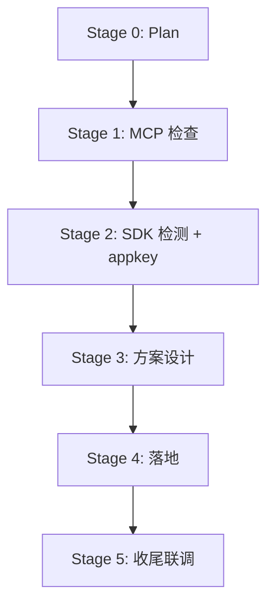

# Plan 必须范本（v2 改造）

> 收到任何「埋点 / 看板 / 流程单 / 联调」任务后，**第一步**先展示 Plan 草稿，等用户回复「确认」后才进入主流程。
> 本文定义 4 个入口（B / A / C / D）的 Plan 模板和强制约束。

---

## 1. Plan 必须的触发时机

- 入口识别完成
- MCP 环境检查通过
- 进入任何 Stage 1 之前

**未输出 Plan 之前**：❌ 不调用 MCP、❌ 不修改文件、❌ 不生成代码。

---

## 2. Plan 通用模板

```markdown
## 🧭 执行计划（待确认）

### 入口识别
- 路径：B 从零开始（默认）| A 流程单 | C 看板独立 | D 联调
- 触发关键词：<从用户输入里提取>
- 入口上下文：<appId / appKey / flowId / 项目路径等>

### 流程图


### 步骤清单
| 步骤 | 名称 | 状态 | 产物 | 埋点上报 |
|------|------|------|------|---------|
| 1 | <name> | 🔲 待执行 | <产物路径> | <上报事件> |
| 2 | <name> | 🔲 | ... | ... |
| ... | | | | |

### Checklist（每步必过）
- [ ] 必读项：<custom-specs / custom-styles / 上一份产物>
- [ ] 必产物：<文件路径>
- [ ] 必上报：<report.sh 调用>
- [ ] 必校验：<关键字段 / 文件存在性>

### 风险提示
- <mcp 状态 / 网络 / 权限 / 历史数据冲突 等>

### 状态文件
- 计划初始化 `{项目根}/dt_tracking_plan/state.json`
  - `schema_version=2.0`
  - `entry=<from-scratch|flow-doc|dashboard|debug>`
  - `current_stage=stage0_plan`

---
> 回复「确认」开始执行；回复「调整 XXX」修改后再次确认；回复「取消」放弃本次任务。
```

---

## 3. 4 个入口的 Plan 特殊项

### 3.1 路径 B：从零开始（默认主流程，业务初始化场景）

**入口识别必含**：
- 业务场景识别结果（如「内容社区 / 电商 / SaaS」等）
- 指标推荐清单（North Star + 核心结果 + 诊断）
- 风险评估

**步骤清单特殊项**：
- Stage 2b：custom-specs 前置读
- Stage 3B：场景识别 + 指标推荐 → **必获用户 ack**
- Stage 8B：链路检测 + 样例数据
- Stage 9B：看板 Prompt 生成

**Checklist 特殊项**：
- 必读：`custom-specs/` + `scenario-library/01-scene-index.md`
- 必产物：`{slug}-plan-YYYYMMDDHH.md` + `{slug}-prompt-YYYYMMDDHH.md`
- 必校验：指标推荐 1+3-5+2-3 上限；事件三字段主键无重复

> 📖 B 路径完整步骤 → `references/tracking-plan.md`

### 3.2 路径 A：流程单接入（深度使用场景）

**入口识别必含**：
- `flowId`（从 URL / 用户输入解析）
- `appId`（从 URL / 用户输入解析 / state.json 复用）
- 流程单拉取次数（预估）

**步骤清单特殊项**：
- Stage 3A：URL 解析 + `get_flow`
- Stage 4A：`list_page_structure` / `list_event_node` 校验存在性
- Stage 5A：方案预生成（**消费 Stage 4A 校验后的变更**）

**Checklist 特殊项**：
- 必读：上一份产物（如果是 B 路径完成后衔接的，复用 appkey）
- 必产物：`{slug}-plan-YYYYMMDDHH.md`
- 必校验：流程单所有变更已覆盖（无遗漏）

> 📖 A 路径完整步骤 → `references/flow-doc-tracking.md`

### 3.3 路径 C：看板独立

**入口识别必含**：
- 指标来源（已有方案 or 用户给定）
- 看板目标用户（运营 / 产品 / 高管）

**步骤清单特殊项**：
- 跳过 SDK 检测（看板流程不涉及代码）
- 跳过 appkey 接入
- 跳过上报代码生成

**Checklist 特殊项**：
- 必读：项目结构 + 业务文档
- 必产物：看板 Prompt + dola 对话链接
- 必校验：指标来源明确、目标用户明确

> 📖 C 路径完整步骤 → `dashboard/dashboard.md`

### 3.4 路径 D：联调收尾

**入口识别必含**：
- `appId`
- `appKey`
- 期望联调的事件范围（如「全部 / 指定 pageId / 指定 eventCode」）

**步骤清单特殊项**：
- 跳过 SDK 检测（直接调 `start_realtime_debug_mode`）
- 跳过方案生成
- 跳过代码生成

**Checklist 特殊项**：
- 必读：SDK 初始化代码（提取 appkey）
- 必产物：debugId 已插入 SDK 初始化代码
- 必校验：本地应用已启动

> 📖 D 路径完整步骤 → `references/realtime-debug.md`

---

## 4. 强制约束（必读）

### 4.1 未获用户"确认"前的禁止行为

- ❌ 不调用任何 MCP 工具
- ❌ 不修改任何文件
- ❌ 不生成代码
- ✅ 只能：输出计划 + 读用户输入文件

### 4.2 计划输出后的处理

| 情况 | 处理 |
|------|------|
| 用户 5 分钟内无响应 | 提示"输入「继续」或「取消」" |
| 用户说"调整 XXX" | 修改计划后再次请求确认 |
| 用户说"取消" | 清理临时文件，结束 |
| 用户说"直接干" / "跳过 Plan" | 本次任务跳过 Plan（**逃生口**，可关闭） |
| 用户说"继续" | 检查 state.json，判断是否续跑 |

### 4.3 state.json 初始化（Plan 输出后立即执行）

即使未获用户确认，Plan 输出后**立即**初始化 `state.json`（写在项目目录，不污染 skill）：

```bash
mkdir -p {项目根}/dt_tracking_plan
cat > {项目根}/dt_tracking_plan/state.json << 'EOF'
{
  "schema_version": "2.0",
  "entry": "from-scratch",
  "started_at": "<当前时间 ISO 8601>",
  "updated_at": "<当前时间 ISO 8601>",
  "current_stage": "stage0_plan",
  "current_step": "plan_draft",
  "completed_stages": [],
  "completed_steps": [],
  "mcp_status": "ready",
  "mcp_block_reason": "",
  "app_id": "",
  "app_key": "",
  "flow_id": "",
  "project_root": "<当前 cwd>",
  "artifacts": {
    "plan_md": "",
    "events_json": "",
    "dashboard_prompt": "",
    "code_dir": ""
  },
  "custom_specs_loaded": false,
  "custom_styles_loaded": false,
  "track_history": [],
  "last_user_input": "<原始用户输入>",
  "resumable": true
}
EOF
```

> 📖 state.json 完整 schema、断点续跑、失效策略 → `SKILL.md` §「状态文件」章节

---

## 5. Plan 模式的"逃生口"（可选配置）

> 为防止用户嫌 Plan 太啰嗦，提供 2 种关闭方式。

### 5.1 配置文件（未来扩展）

`.datong-skill-config.json` 中 `plan_required: false` → 跳过 Plan 直接执行。

> ⚠️ 配置项**不在本次方案范围内实施**，仅作未来扩展预留。

### 5.2 用户指令

用户说"直接干" / "跳过 Plan" → 本次任务跳过 Plan。

> 这两个逃生口是**可选**的，默认 Plan 必须。

---

## 6. Plan 输出后的处理流程

```
Agent 输出 Plan + 写 state.json
  ↓
等待用户响应
  ↓
├─ 用户「确认」→ 进入 Stage 1（MCP 环境检查）→ 走主流程
├─ 用户「调整 XXX」→ 修改 Plan → 重新请求确认
├─ 用户「继续」→ 检查 state.json → 判断续跑
├─ 用户「取消」→ 清理 state.json → 结束
└─ 用户 5 分钟无响应 → 提示「输入继续或取消」
```

> ⚠️ 续跑逻辑详见 `SKILL.md` §「状态文件」→「续跑触发逻辑」章节。
