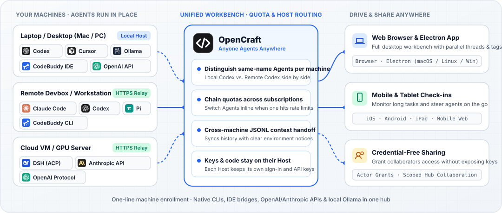

<div align="center">


# OpenCraft

### Anyone Agents Anywhere

**Connect your agents. Share what they can do.**

Connect the agents you run, wherever they live, and make them available to the people you choose.

[简体中文](README.md) · [English](README.en.md)

[](https://github.com/opencraft-app/opencraft/actions/workflows/build-matrix.yml) [](https://github.com/opencraft-app/opencraft/actions/workflows/security.yml) [](LICENSE) [](https://github.com/topics/typescript)

[](https://github.com/topics/ai-agents) [](plugins/acp-engine/README.md) [](docs/session-capabilities.md) [](docker/README.md) [](docs/actor-collaboration-api.md)

[Highlights](#highlights) · [Supported Agents](#supported-agents--model-providers) · [Who it's for](#who-its-for) · [Get started](#get-started) · [Documentation](#documentation) · [Contribute](CONTRIBUTING.md)

<br />

<picture>
  <source media="(prefers-color-scheme: dark)" srcset=".github/images/hero-architecture-en-dark.svg" />
  <source media="(prefers-color-scheme: light)" srcset=".github/images/hero-architecture-en-light.svg" />
  
</picture>

</div>

## Supported Agents & Model Providers

Connect the CLI agents, IDE bridges, custom API endpoints, and local models already installed across your machines into one workspace:

<div align="center">

<table>
  <tr>
    <td align="center" width="33%">
      <br />
      <strong>Codex</strong><br />
      <sub>Native CLI · Reasoning tiers & Fast · History & usage</sub>
    </td>
    <td align="center" width="33%">
      <br />
      <strong>Claude Code</strong><br />
      <sub>Native CLI bridge · Session history sync</sub>
    </td>
    <td align="center" width="33%">
      <br />
      <strong>Cursor</strong><br />
      <sub>Cursor Agent integration · Native model discovery</sub>
    </td>
  </tr>
  <tr>
    <td align="center" width="33%">
      <br />
      <strong>CodeBuddy (CLI & IDE)</strong><br />
      <sub>CLI agent & live IDE active-model bridge</sub>
    </td>
    <td align="center" width="33%">
      <br />
      <strong>Pi</strong><br />
      <sub>Built-in runtime & external Pi CLI support</sub>
    </td>
    <td align="center" width="33%">
      <br />
      <strong>DSH (ACP)</strong><br />
      <sub>External ACP execution engine integration</sub>
    </td>
  </tr>
  <tr>
    <td align="center" width="33%">
      <br />
      <strong>OpenAI Protocol APIs</strong><br />
      <sub>Any OpenAI-compatible endpoint · Per-model toggles</sub>
    </td>
    <td align="center" width="33%">
      <br />
      <strong>Anthropic Protocol APIs</strong><br />
      <sub>Any Anthropic-compatible endpoint · Capability probing</sub>
    </td>
    <td align="center" width="33%">
      <br />
      <strong>Ollama Local & Cloud</strong><br />
      <sub>Local open-weight models & Ollama Cloud discovery</sub>
    </td>
  </tr>
</table>

</div>

## Highlights

OpenCraft is an open-source Agent workbench built around **Anyone Agents Anywhere**—bringing agents scattered across subscriptions, quotas, and machines into one continuous workspace:

- **One workbench for all your Agents and quotas** — Connect installed **Codex**, **Claude Code**, **Cursor**, **CodeBuddy (CLI & IDE)**, **Pi**, and external **DSH (ACP)** agents alongside custom **OpenAI / Anthropic protocol** API providers and **Ollama** models. When one subscription hits its usage limit or another model fits the next step better, switch or hand off the conversation inline without losing momentum.
- **Cross-machine execution & conversation handoff** — Enroll remote Linux/macOS machines with a single command over HTTPS relay—no manual port-forwarding tunnels to maintain. Distinguish identical agents across machines (for example, Codex on your Mac vs. Codex on a cloud devbox) and hand off threads across machines with automatic JSONL context sync and clear environment-change notices.
- **Credentials stay on their Host, reachable anywhere** — Agents keep running where your code and credentials already live, while you drive them from desktop browsers, the Electron app, or mobile.
- **Explicit, credential-free sharing** — Grant chosen collaborators access to an Agent's capabilities without handing over its underlying account keys.

## Who it's for

- **Developers juggling multiple AI coding subscriptions** — If you split work across Codex, Claude Code, Cursor, CodeBuddy, and API keys with different quota windows and rate limits, OpenCraft lets you chain them together in one place instead of copy-pasting context between tools.
- **Engineers working across laptops, remote devboxes, and servers** — If your projects live across a local Mac/PC and one or more remote machines, you can manage every machine's agents side by side and move an ongoing conversation from a remote box back to your laptop (or vice versa).
- **Power users and small teams building a unified AI hub** — Anyone who wants native CLI agents, IDE bridges, custom API endpoints, local models, conversation history, and mobile check-ins connected into a single self-hosted workbench.

## The idea

OpenCraft is an open-source Agent workbench built around **Anyone Agents Anywhere**.
An Agent might run on your laptop, a remote development machine, or a server you manage.
Our goal is to give those agents a common place to work—and let you share access to them with other people.

- **Anyone** — Anyone should be able to own, use and share an Agent.
- **Agents** — Bring your existing agents, connect your model providers, or build an integration for your own runtime.
- **Anywhere** — Reach agents across machines and use the workbench from the browser, desktop or mobile.

### Connect yours. Share its capabilities.

1. **Connect** an Agent where it already runs, keeping its environment and credentials with its execution Host.
2. **Authorize** the people or agents you want to work with, choosing the access you grant.
3. **Collaborate** through conversations and execution requests, with ownership and permissions kept explicit.

The vision is broad: an Agent you connect should be something you can offer to others,
whether it is your personal coding assistant, a team's specialist, or a service you operate.
Sharing means granting access to its capabilities; recipients do not need to inherit its credentials.

## What you can do

| Capability | In OpenCraft |
| --- | --- |
| **Bring existing Agents** | Connect installed Codex, Claude Code, Cursor, CodeBuddy (CLI & IDE), Pi, and external DSH agents, check sign-in, discover native models, and select supported reasoning and Fast settings. |
| **Use your model providers** | Configure OpenAI-compatible, Anthropic-compatible, and Ollama endpoints through model settings. The execution Host owns the credentials. |
| **Work & hand off across machines** | Connect local and remote execution Hosts, distinguish same-name agents across machines, and hand off conversations with JSONL context sync and environment-change reminders. |
| **Keep conversations continuous** | Restore supported native history, keep drafts, inspect tool activity and reported token usage, and send or stop work from one workbench. |
| **Build collaboration** | Use authenticated Actor messaging, delivery/read receipts and explicit grants. The current single-Hub execution bridge supports bound local Codex sessions. |
| **Extend the workbench** | Add client extensions, MCP tools and Host-side capabilities through their existing integration boundaries. |
| **Choose your client** | Use the browser or Electron desktop app; the public Expo app packages the shared Web Workbench for mobile. |

**Current scope.** Each adapter exposes its actual capabilities. The first Actor collaboration loop
is single-Hub. Broader cross-Hub Agent sharing and a universal plug-and-play bridge for every Agent
remain development goals. See the [implemented collaboration API](docs/actor-collaboration-api.md),
[identity and Hub design](docs/architecture/actor-collaboration.md), and
[execution contracts](docs/execution-ownership.md).

## Get started

### Install the local service

On an **Apple Silicon Mac with Node.js 24 LTS**, run the following command. npx downloads the complete package from GitHub Releases.

```sh
npx --yes --package=https://github.com/sliverp/opencraft/releases/download/v1.0.2/opencraft-1.0.2-darwin-arm64-node24.tgz -- opencraft start
```

[Release notes and SHA-256 checksums](https://github.com/sliverp/opencraft/releases/tag/v1.0.2). For other platforms or Node major versions, build a matching archive using the [local installation guide](docs/web-deployment.md#npx-本地完整服务引导).

The command starts the local execution service and opens Workbench in your browser. Connect an installed, signed-in Agent or configure a model provider. On a machine without a desktop, pass `--no-open` and use the address printed in the terminal. Closing the browser leaves the service running. Press Ctrl+C to stop it.

### Check for updates and keep your data

1. Open **Settings → Website updates**. The running service checks at startup and every six hours by default. You can also select **Check updates**.
2. When an update appears, authorize it using the key from the `web/admin-key` file shown in the terminal and select **Update website**. Refresh when prompted. To restore the previous version, select **Roll back previous version**.
3. Updates and rollbacks reuse your data directory, retaining Agent settings, conversation history, and Server records. The default is `~/.opencraft`. You can set `OPENCRAFT_HOME` or pass `--data-dir`. Keep using the same directory when you restart.

The npm update channel for this GitHub preview is awaiting publication. The update page reports no published version while the channel is empty.

To keep data from `npm run dev`, first stop the old service. Append `--data-dir "$HOME/.opencraft/dev-local"` to the installation command above.

### Develop from source

For source development, use **Node.js 26.7.0** and **npm 11**. The repository pins the development version in [`.nvmrc`](.nvmrc). Choose a complete package built and tested for your Node version and platform.

```bash
git clone https://github.com/opencraft-app/opencraft.git
cd opencraft
nvm install && nvm use
npm ci
npm run dev
```

Open the printed URL. Connect an installed **Codex** or **Cursor** agent,
or configure a model provider in Settings. Local development requires no OpenCraft account.

`npm run dev` starts local execution and Web together. Development data persists in
`~/.opencraft/dev-local`; model credentials stay with the execution Host.

| Your next step | Start here |
| --- | --- |
| Run with Docker Compose | [Docker deployment](docker/README.md) |
| Install or manage a self-hosted website | [Web deployment and updates](docs/web-deployment.md) |
| Develop or package the desktop app | [Development guide](docs/development.md#desktop-with-the-bundled-local-agent) |
| Run Expo or build for mobile | [Mobile guide](apps/mobile/README.md) |
| Connect Hosts or customize a build | [Development and build guide](docs/development.md) |

## Documentation

| For | Read |
| --- | --- |
| A tour of the project | [Documentation index](docs/README.md) · [Repository layout](docs/repository-layout.md) |
| Agent identity, access and collaboration | [Actor and Hub design](docs/architecture/actor-collaboration.md) · [Collaboration API](docs/actor-collaboration-api.md) · [Server authentication](docs/server-authentication.md) |
| Execution and integration | [Execution ownership](docs/execution-ownership.md) · [Session capabilities](docs/session-capabilities.md) · [Plugin architecture](docs/plugin-architecture.md) |
| Building an extension | [Extension development](docs/extension-development.md) · [Runnable example](examples/extensions/README.md) |
| Architecture and design | [Platform architecture](docs/platform-architecture.md) · [Interface design](design.md) · [Build matrix](docs/build-matrix.md) |

## Build with us

Help make more agents reachable and useful to more people.
Contributions to adapters, collaboration, client experiences, documentation and examples are welcome.

- [Report a problem or propose an idea](https://github.com/opencraft-app/opencraft/issues).
- Follow the [contribution guide](CONTRIBUTING.md) for changes to the shared core.
- Build product-specific identity, branding and services through [downstream composition](docs/upstream-transition.md).
- Report security vulnerabilities through the private process in [SECURITY.md](SECURITY.md).

## License

Original OpenCraft contributions are licensed under [MIT-0](LICENSE).
Third-party components retain their own licenses and required notices.

<div align="center">

**Anyone Agents Anywhere**<br />
Connect what you run. Share what it can do.

</div>
