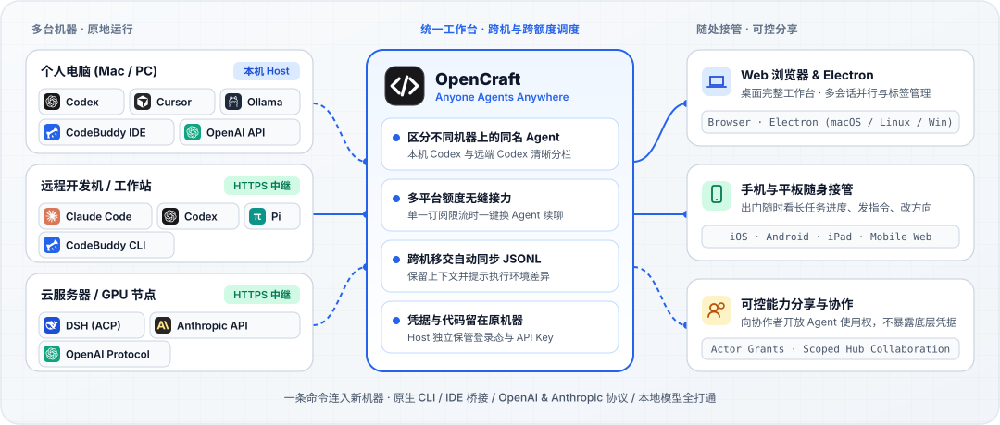

<div align="center">


# OpenCraft

### Anyone Agents Anywhere

**每个人的 Agent，连接每一个地方。**

接入运行在不同地方的 Agent，让你选择的人也能使用它们。

[简体中文](README.md) · [English](README.en.md)

[](https://github.com/opencraft-app/opencraft/actions/workflows/build-matrix.yml) [](https://github.com/opencraft-app/opencraft/actions/workflows/security.yml) [](LICENSE) [](https://github.com/topics/typescript)

[](https://github.com/topics/ai-agents) [](plugins/acp-engine/README.md) [](docs/session-capabilities.md) [](docker/README.md) [](docs/actor-collaboration-api.md)

[核心亮点](#核心亮点) · [已支持的 Agent](#已支持的-agent-与模型生态) · [适合谁用](#适合谁用) · [快速开始](#快速开始) · [文档导航](#文档导航) · [参与贡献](CONTRIBUTING.md)

<br />

<picture>
  <source media="(prefers-color-scheme: dark)" srcset=".github/images/hero-architecture-zh-dark.svg" />
  <source media="(prefers-color-scheme: light)" srcset=".github/images/hero-architecture-zh-light.svg" />
  
</picture>

</div>

## 已支持的 Agent 与模型生态

把各台机器上已经安装登录好的 CLI Agent、IDE 桥接、自有模型 API 与本地大模型全部接进同一个工作台：

<div align="center">

<table>
  <tr>
    <td align="center" width="33%">
      <br />
      <strong>Codex</strong><br />
      <sub>原生 CLI · 推理档位与 Fast · 历史与用量</sub>
    </td>
    <td align="center" width="33%">
      <br />
      <strong>Claude Code</strong><br />
      <sub>原生 CLI 接入 · 原生会话历史恢复</sub>
    </td>
    <td align="center" width="33%">
      <br />
      <strong>Cursor</strong><br />
      <sub>Cursor Agent 接入 · 原生模型发现与续聊</sub>
    </td>
  </tr>
  <tr>
    <td align="center" width="33%">
      <br />
      <strong>CodeBuddy (CLI & IDE)</strong><br />
      <sub>命令行与 IDE 当前模型双向联动</sub>
    </td>
    <td align="center" width="33%">
      <br />
      <strong>Pi</strong><br />
      <sub>内置引擎与外置 Pi CLI 双模式</sub>
    </td>
    <td align="center" width="33%">
      <br />
      <strong>DSH (ACP)</strong><br />
      <sub>外置 ACP 协议执行引擎接入</sub>
    </td>
  </tr>
  <tr>
    <td align="center" width="33%">
      <br />
      <strong>OpenAI 协议 API</strong><br />
      <sub>任意 OpenAI 兼容端点 · 按模型独立开关</sub>
    </td>
    <td align="center" width="33%">
      <br />
      <strong>Anthropic 协议 API</strong><br />
      <sub>任意 Anthropic 兼容端点 · 推理与多模态探测</sub>
    </td>
    <td align="center" width="33%">
      <br />
      <strong>Ollama 本地与云端</strong><br />
      <sub>本机开源大模型与 Ollama Cloud 自动发现</sub>
    </td>
  </tr>
</table>

</div>

## 核心亮点

OpenCraft 是一个围绕 **Anyone Agents Anywhere** 构建的开源 Agent 工作台，把分散在不同工具、不同账号额度和不同机器上的 Agent 接进同一个连续的工作界面：

- **多 Agent 统一接入，额度与长处无缝接力**：支持接入机器上已安装并登录的 **Codex**、**Claude Code**、**Cursor**、**CodeBuddy（CLI / IDE）**、**Pi**、外置 **DSH（ACP）**，同时支持按 **OpenAI 协议 / Anthropic 协议** 配置自有 API 模型服务及 **Ollama** 本地与云端模型。某一个工具额度见底、限流，或换到更擅长当前步骤的模型时，可在对话中直接切换或一键移交上下文继续推进。
- **跨设备连接与对话接力（本机 ⇄ 远程开发机 / 云服务器）**：一条命令即可通过 HTTPS 中继接入远程 Linux/macOS 机器，无需手工维护端口转发。即使多台机器上都装了同名 Agent（例如本机和远端都有 Codex），也能清晰区分执行机器，并支持跨机器移交对话（自动同步 JSONL 上下文并提示执行环境差异）。
- **环境与凭据留在原处，多端随时接管**：Agent 继续在它原本所在的机器和目录中运行，登录态与 API Key 由对应执行 Host 保管；你可以通过桌面浏览器、Electron 桌面端或手机端查看同一个工作台、恢复原生历史并随时接管任务。
- **可控的能力分享与协作**：在明确授权边界的前提下，把你接入的 Agent 开放给指定协作者或其他主体使用，共享执行能力而无需交出底层账号凭据。

## 适合谁用

- **同时使用多个 AI 编程工具、需要统筹额度的人**：手里同时有 Codex、Claude Code、Cursor、CodeBuddy 或多家模型 API，不同工具额度周期和计费方式不同，希望在一个入口里按剩余额度与任务难度随时换 Agent 接力，而不是在多个窗口来回复制粘贴上下文。
- **经常跨多台机器开发的工程师与研究者**：代码和环境分布在个人电脑（Mac / PC）、远程开发机、内网工作站或云服务器上，希望把所有机器上的 Agent 收拢到一起管理，并能在远端与本机之间自由切换继续同一段对话。
- **希望把零散工具整合成个人统一工作台的人**：不想每次换设备、换 CLI、换本地大模型都重配一遍工作流，想要统一管理历史会话、模型协议开关、运行状态与移动端查看体验的重度 AI 用户与小团队。

## 我们的理念

OpenCraft 是一个开源 Agent 工作台，围绕 **Anyone Agents Anywhere** 构建。
你的 Agent 可以运行在自己的电脑、远程开发机，或自主部署的服务器上。
我们希望让这些 Agent 在一个共同的工作台中发挥作用，也让你能把它们开放给别人使用。

- **Anyone · 任何人**：每个人都应该能够拥有、使用和分享 Agent。
- **Agents · 你的智能伙伴**：接入已经在用的 Agent，配置自己的模型服务，或为自定义运行时开发适配。
- **Anywhere · 任何地方**：连接不同机器上的 Agent，通过浏览器、桌面或手机使用同一个工作台。

### 接入你的 Agent，把它的能力分享出去

1. **接入**：让 Agent 继续在原来的地方运行，由执行 Host 保管环境与凭据。
2. **授权**：选择可以协作的人或 Agent，明确开放哪些访问权限。
3. **协作**：通过对话和执行请求开展工作，保留清晰的归属与权限边界。

我们的愿景是：你接入的 Agent，都可以成为能分享给他人使用的能力。
它可以是你的个人编程助手、团队的专项 Agent，也可以是你运营的一项服务。
分享的是使用能力，接收者无需取得 Agent 的底层凭据。

## 可以用来做什么

| 能力 | OpenCraft 中的体验 |
| --- | --- |
| **接入已有 Agent** | 连接已安装的 Codex、Claude Code、Cursor、CodeBuddy（CLI / IDE）、Pi 与外置 DSH，检查登录状态、发现原生模型，选择实际支持的推理档位与 Fast 设置。 |
| **使用自己的模型服务** | 按 OpenAI 协议、Anthropic 协议或 Ollama 配置 API 端点与凭据，由执行 Host 持有凭据。 |
| **跨机器工作与对话移交** | 连接本机与远程执行 Host，清晰区分不同机器上的同名 Agent；支持跨 Agent / 跨机器移交对话（同步 JSONL 历史上下文并提示环境变化）。 |
| **保持对话连续** | 恢复已支持的原生历史、保留草稿、查看工具活动与已上报的 Token 用量，在一个工作台里发送任务或停止执行。 |
| **构建协作流程** | 使用经过认证的主体消息、接收／已读回执与显式授权；当前单 Hub 执行桥接支持绑定的本地 Codex 会话。 |
| **扩展工作台** | 通过现有扩展边界接入客户端插件、MCP 工具与 Host 侧能力。 |
| **选择使用方式** | 使用浏览器或 Electron 桌面端；公开 Expo 应用在手机端打包复用同一套 Web 工作台。 |

**当前范围。** 每种适配器只提供实际接通的能力。首期主体协作闭环位于单个 Hub；
跨 Hub 分享 Agent、任意 Agent 的通用即插即用接入，是我们推进的方向。
已实现能力及具体范围见[主体协作接口](docs/actor-collaboration-api.md)、
[主体与 Hub 设计](docs/architecture/actor-collaboration.md)和[执行契约](docs/execution-ownership.md)。

## 快速开始

### 安装本地服务

**Apple Silicon Mac + Node.js 24 LTS** 可直接用下面的命令安装。npx 会从 GitHub Release 下载完整包。

```sh
npx --yes --package=https://github.com/sliverp/opencraft/releases/download/v1.0.2/opencraft-1.0.2-darwin-arm64-node24.tgz -- opencraft start
```

[发布说明和 SHA-256 校验文件](https://github.com/sliverp/opencraft/releases/tag/v1.0.2)。其他平台或 Node 主版本可按 [Web 安装与更新](docs/web-deployment.md#npx-本地完整服务引导) 构建对应归档。

命令启动本地执行服务和 Web 客户端，并自动打开浏览器。在引导页接入已安装并登录的 Agent，或配置模型服务。无桌面环境时可加 `--no-open`，再使用终端打印的地址。关闭浏览器后服务继续运行，按 Ctrl+C 停止服务。

### 检查更新与保留数据

1. 打开 **设置 → 网站更新**。只要服务在运行，启动后及默认每 6 小时会自动检查一次，也可以点击 **检查更新**。
2. 发现新版本后，用终端提示的 `web/admin-key` 文件里的管理密钥授权，再点击 **更新网站**。按页面提示刷新；需要恢复上一版时，点击 **回退上一版**。
3. 更新和回退复用安装时的数据目录，保留 Agent 配置、对话历史和 Server 记录。默认数据目录是 `~/.opencraft`，也可通过 `OPENCRAFT_HOME` 或 `--data-dir` 指定。更新后的启动命令继续使用同一目录。

当前 GitHub 预览版的 npm 更新频道尚未发布。频道空时页面会提示暂无新版本。

如果之前使用 `npm run dev`，先正常停止旧服务，再在上面的安装命令末尾加上 `--data-dir "$HOME/.opencraft/dev-local"` 来复用原数据。

### 从源码开发

从源码开发时使用 **Node.js 26.7.0** 和 **npm 11**，仓库通过 [`.nvmrc`](.nvmrc) 固定开发环境。运行完整安装包时，按该包验证过的 Node 版本和平台选择归档。

```bash
git clone https://github.com/opencraft-app/opencraft.git
cd opencraft
nvm install && nvm use
npm ci
npm run dev
```

打开终端打印的网址，连接已安装的 **Codex** 或 **Cursor**，
也可以在设置中配置自己的模型服务。本地开发无需 OpenCraft 账号。

`npm run dev` 会同时启动本地执行服务和 Web。开发数据保存在
`~/.opencraft/dev-local`，模型凭据由执行 Host 保管。

| 接下来想做什么 | 从这里开始 |
| --- | --- |
| 使用 Docker Compose 部署 | [Docker 部署指南](docker/README.md) |
| 安装或管理自主部署的网站 | [Web 部署与更新](docs/web-deployment.md) |
| 开发或打包桌面应用 | [开发指南](docs/development.md#desktop-with-the-bundled-local-agent) |
| 运行 Expo 或构建手机端 | [手机端指南](apps/mobile/README.md) |
| 配置 Host 或自定义构建 | [开发与构建指南](docs/development.md) |

## 文档导航

| 想了解 | 相关文档 |
| --- | --- |
| 项目全貌 | [文档索引](docs/README.md) · [仓库布局](docs/repository-layout.md) |
| Agent 身份、权限与协作 | [主体与 Hub 设计](docs/architecture/actor-collaboration.md) · [主体协作接口](docs/actor-collaboration-api.md) · [服务器登录](docs/server-authentication.md) |
| 执行与能力接入 | [执行所有权](docs/execution-ownership.md) · [会话能力](docs/session-capabilities.md) · [插件架构](docs/plugin-architecture.md) |
| 开发扩展 | [扩展开发指南](docs/extension-development.md) · [可运行示例](examples/extensions/README.md) |
| 架构与设计 | [平台架构](docs/platform-architecture.md) · [界面设计](design.md) · [构建矩阵](docs/build-matrix.md) |

## 一起建设

让更多 Agent 被连接，让更多人用上它们。
欢迎贡献 Agent 适配、协作能力、客户端体验、文档与示例。

- [反馈问题或提出想法](https://github.com/opencraft-app/opencraft/issues)。
- 修改共享核心前，阅读[贡献指南](CONTRIBUTING.md)。
- 产品专用身份、品牌和服务通过[下游装配](docs/upstream-transition.md)接入。
- 安全漏洞请按 [SECURITY.md](SECURITY.md) 中的流程私密报告。

## 开源许可

OpenCraft 原创贡献采用 [MIT-0](LICENSE) 许可。
第三方组件保留各自的许可证与必要声明。

<div align="center">

**Anyone Agents Anywhere**<br />
接入你拥有的 Agent，分享它能做到的事。

</div>
