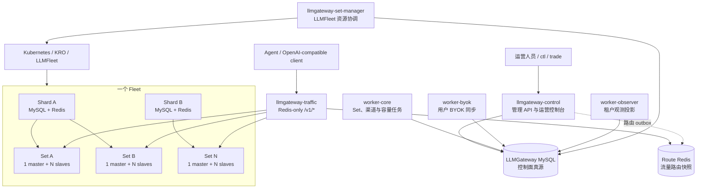
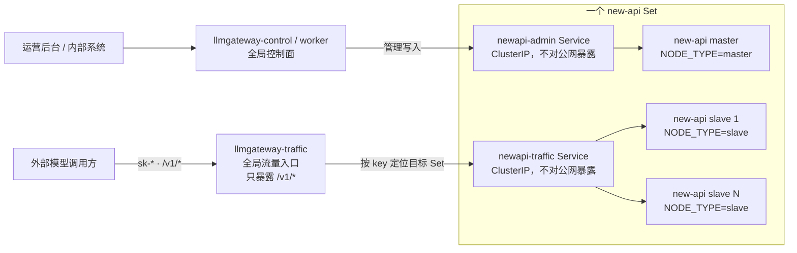

# llmgateway

`llmgateway` 是构建在 `new-api` 之外的多租户、多 Set 大模型网关。它不修改
`new-api`，而是复用其模型接入、渠道路由、额度和订阅能力，在外层补齐租户分片、
统一流量入口、BYOK、渠道一致性、自动扩容和跨 Set 版本发布。

## 架构定位

系统遵循四个核心边界：

1. **new-api 负责 Set 内能力**：模型渠道、API token、订阅额度、计费和实际推理转发。
2. **LLMGateway 负责跨 Set 能力**：租户归属、外部 key、Set/Shard、BYOK 意图、渠道包和版本发布。
3. **控制面与流量面分离**：控制面使用 MySQL；流量面只依赖 Redis 路由快照，不回源 MySQL。
4. **Kubernetes 负责运行资源，不负责业务发布决策**：KRO/LLMFleet 渲染 Pod 和 Service，发布顺序由 LLMGateway 的持久化状态机控制。



## 核心组件

| 组件 | 职责 | 是否访问 LLMGateway MySQL |
| --- | --- | --- |
| `llmgateway-control` | 管理 API、运营控制台、租户/订阅兼容层、Set/Shard、渠道和版本发布 | 是 |
| `llmgateway-traffic` | 校验外部 key、定位 Set、替换上游 key、透明代理 `/v1/*` 和 SSE | **否，只访问 Redis** |
| `llmgateway-worker` `core` | Set facts、容量水位、渠道漂移、准入检查和控制面后台任务 | 是 |
| `llmgateway-worker` `byok` | 合并同一用户的最新 BYOK 意图并异步下发目标 Set | 是 |
| `llmgateway-worker` `observer` | 分页刷新租户、权益和用量观测投影 | 是 |
| `llmgateway-set-manager` | 消费 Set provision/upgrade 状态，协调 LLMFleet 资源 | 是 |
| `llmgateway-runtime-cleaner` | 在蓝绿排空窗口后清理旧 traffic runtime | 是 |
| `new-api master/slave` | Set 内管理、计费、渠道选择和模型转发 | 使用所属 Shard 数据源 |

## 资源模型

### Fleet、Shard 与 Set

- **Fleet** 是一套完整服务集群的逻辑边界。
- **Shard** 是数据资源边界，描述一组 MySQL/Redis 容量；一个 Shard 可以承载多个 Set。
- **Set** 是租户分片和故障隔离单元。租户首次分配后固定归属一个 Set，常规请求不进行动态一致性哈希迁移。
- 每个 Set 拥有独立 new-api 数据库名和 Redis DB，不允许两个 Set 复用同一份 Redis 逻辑空间。
- Set 水位通过 `max_users / warn_users / reserved_users` 描述；新租户选择健康且水位最低的 Set，容量不足时生成新的 provision request。
- Shard 扩容从运营台提交意图，不直接手填事实。Terraform/Agent 创建 MySQL、Redis 和 Secret，set-manager 从 LLMFleet 回传真实投影，worker 核对资源并等待冒烟验证；只有完整流程结束的 Shard 才应加入容量策略。

### 租户、密钥与权益

- LLMGateway 保存租户归属、new-api 用户绑定和外部 key；new-api 保存实际用户、token、订阅和额度。
- 外部 key 使用固定长度的 `sk-<Base64URL payload>` v2 格式；payload 内含版本、稳定路由槽、256 bit Key ID 和 256 bit Secret。Redis 按路由槽分片保存路由快照；中央 MySQL 只保存 Key ID、哈希、路由槽和状态，完整 key 仅在签发成功时返回一次。
- `ctl/trade` 通过兼容 API 创建或续发权益；LLMGateway 只负责命令幂等和周期 overlay，实际额度由 new-api subscription 承担。
- 余额查询聚合用户当前 active subscriptions，不维护另一份完整余额账本。

### 渠道与 BYOK

- 平台渠道以不可变渠道包 revision 表达，支持跨 Set 检查漂移、批量发布、失败停止和回滚上一版。
- LLMGateway 保存期望状态，new-api 只是下发目标；不会反向读取某个 Set 的内存 JSON 参与全局合并。
- 用户 BYOK 保存为本地意图，通过独立 worker 异步同步到用户所属 Set。
- 当前支持 `byok_first` 和 `platform_first` 两种简单策略；用户私有渠道进入私有 group，并使用零倍率避免平台计费。

## 两条关键请求路径

### 模型流量

```text
客户端 sk-* → llmgateway-traffic
             → Redis key route snapshot
             → Redis Set runtime snapshot
             → 替换为 new-api upstream key
             → 目标 Set newapi-traffic Service
             → 模型上游
```

该路径不解析模型请求正文，不承担格式转换。它只理解 HTTP、鉴权 header、流式转发和连接生命周期；MySQL 故障不会使已有路由立即失效。

### 管控与权益

```text
ctl/trade/运营台 → llmgateway-control
                 → 租户 assignment / 幂等命令
                 → 目标 Set newapi-admin Service
                 → new-api 用户、token、subscription API
                 → 本地观测投影与 Redis 路由 outbox
```

## new-api 版本发布

版本发布分成两个层次：

1. **单 Set 数据库感知蓝绿**：先暂停管理写并以 `Recreate` 升级唯一 admin/master，由它完成 Schema 迁移；旧 Blue traffic 在新 Schema 上通过兼容性探针后，再创建 Green。Green 连续探针成功后通过 Redis `route_revision` 原子切流，Blue 固定排空后删除。
2. **跨 Set Release Campaign**：一个 Fleet 长期维护 Canary、Early、Stable 等 Ring；Campaign 按 Ring 顺序自动推进，Ring 内固定 `max_parallel=1`，逐个 Set 发布，完成完整 soak 和健康门禁后才进入下一 Ring，任一失败立即暂停。

Release 镜像必须固定到 `@sha256:<digest>`。Rollout 创建会在一个 MySQL 事务中锁定 Ring 和目标 Set，同时写入发布快照、Set 目标版本和单 Set upgrade runs，避免多个 control 实例并发发布或产生孤儿状态。

```text
Fleet
├── Canary  → release-v3 → set-01
├── Early   → release-v2 → set-02, set-03
└── Stable  → release-v1 → set-04 ... set-40

Stable rollout to v2:
set-04 完整蓝绿升级 → set-05 → set-06 → ...
```

新扩容 Set 会固化健康且允许准入的 Ring、Release ID 和镜像 digest，不依赖修改 Fleet 全局镜像触发升级。详细设计见 [`docs/release-rings.md`](docs/release-rings.md) 和 [`docs/set-blue-green-upgrade.md`](docs/set-blue-green-upgrade.md)。

## 数据真源与故障边界

| 数据 | 真源 | 说明 |
| --- | --- | --- |
| 租户归属、外部 key、Set/Shard、任务、渠道包、Release Ring | LLMGateway MySQL | 控制面持久化状态 |
| 用户、上游 token、subscription、额度、渠道实例 | 各 Set 的 new-api 数据库 | 通过 new-api API 管理，不直接改库 |
| 外部 key 与 Set runtime 路由 | Redis | traffic 热路径唯一依赖；MySQL outbox 负责可靠发布 |
| Deployment、Service、Secret 引用 | Kubernetes `LLMFleet` | 运行资源事实，不承担业务发布顺序 |

系统不承诺在 Redis 完全不可用时继续接收模型流量，而是快速失败；也不会在 traffic Redis miss 时回源 MySQL，避免数据库故障演变为流量雪崩。

## 当前能力边界

- 不修改 new-api，不直接写 new-api 业务数据库。
- 不引入 Kafka、Temporal、Service Mesh 或 ArgoCD per Set；后台任务使用 MySQL job/lease。
- traffic 生产模式为 Redis-only；control、worker 和 set-manager 可以独立扩缩。
- 多 Set 发布编排由 LLMGateway 状态机完成，不要求自定义 Kubernetes Controller。
- 本地可使用内存 store 快速开发；生产必须使用 MySQL、Redis 和拆分进程部署。

## Runtime Topology: Traffic, Master, And Slave

生产拓扑中有三类容易混淆、但职责不同的运行角色：

| 角色 | 作用域 | 数量与职责 |
| --- | --- | --- |
| `llmgateway-traffic` | 整个 LLMGateway 集群 | 全局无状态流量入口。解析外部 `sk-*`，从 Redis 路由快照定位 Set，替换上游 key，然后把 `/v1/*` 转发到目标 Set。它不是 `new-api` 节点。 |
| `new-api master` | 每个 Set | 固定 1 个，使用 `NODE_TYPE=master`。只通过 admin Service 承接管理写、后台任务和 Schema 迁移，不进入生产 traffic Service。 |
| `new-api slave` | 每个 Set | N 个，使用 `NODE_TYPE=slave`。通过版本代际组成纯 traffic 运行面，不执行 master 专属后台任务。 |



slave 不在 `llmgateway-traffic` 进程内部，而是在它后面的目标 Set 中。公网只暴露
`llmgateway-traffic`，后者只注册和转发 `/v1/*`；new-api 的内部 Service 不配置
Ingress 或公网负载均衡。因此 slave 虽然仍由同一个 new-api 二进制注册 `/api/*`，
普通模型调用方无法从公网到达这些管理路由。

`new-api` 自身只识别 `master` 和 `slave` 两种 `NODE_TYPE`。Kubernetes 中名为
`<fleet>-<set>-newapi-traffic` 的 Deployment 运行的是 **new-api slave**；这里的
`traffic` 是工作负载用途名称，并不是第三种 `new-api` 节点类型。

每个 Set 暴露两个内部 Service：

- `<fleet>-<set>-newapi-admin` 只选择该 Set 的单个 master，保证管理写入固定进入
  同一进程。
- `<fleet>-<set>-g<generation>-newapi-traffic` 只选择对应版本代际的 slave。Set runtime
  路由指向当前 active generation；master 即使具备 relay 能力也不承载生产推理流量。

`LLMFleet.spec.sets[].replicas` 只表示每个 Set 的 **new-api slave 数量**。因此单个
Set 的生产推理端点数是 `replicas slaves`；单个 master 独立存在于管理面，这两个值
都不包含全局 `llmgateway-traffic` Deployment 的副本数。

## Production Caller Surface

当前北京生产入口：

```text
管理面：https://llmgw-control.lightvela.com
流量面：https://llmgw-inner.lightvela.com
```

模型调用面兼容 OpenAI `/v1/*`，调用方使用自己的模型访问密钥：

```bash
curl -sS https://llmgw-inner.lightvela.com/v1/chat/completions \
  -H 'authorization: Bearer sk-...' \
  -H 'content-type: application/json' \
  -d '{"model":"auto","messages":[{"role":"user","content":"你好"}]}'
```

管理 API 属于 control 面，不使用用户模型 key，也不通过 traffic 域名承载。内部系统接入管理面使用 `https://llmgw-control.lightvela.com`；如果直接调用 `/api/admin/*`，当前仍需要 `Authorization: Bearer <CLUSTER_ADMIN_TOKEN>` 或后续替换成上层服务身份。内部系统接入时看 [`docs/operator-p0.md`](docs/operator-p0.md)；生产域名、证书和 TKE Service 绑定细节看 [`deploy/k8s/prod/README.md`](deploy/k8s/prod/README.md)。

甲方和 Agent 可以使用 Go 命令行客户端模拟 trade/ctl、运营管理和模型调用，见
[`CLIENT.md`](CLIENT.md)。客户端不落地 profile，所有地址和凭证均由本次命令显式传入。

## Run Locally

For a fresh Mac setup, including Docker/OrbStack dependencies, two local
`new-api` sets, split control/traffic processes, and the React console, see
[`docs/mac-local-setup.md`](docs/mac-local-setup.md).

```bash
cd /Users/skipzhang/code/mono2newapi/llmgateway

PORT=18080 \
CLUSTER_ADMIN_USERNAME=cluster-admin \
CLUSTER_ADMIN_PASSWORD='Qq373866172!' \
CLUSTER_ADMIN_TOKEN=dev-cluster-token \
INTERNAL_SERVICE_TOKEN=dev-internal-token \
LEGACY_SUBSCRIPTION_CLIENT_COMPAT=false \
NEWAPI_SET_ROOT_USERNAME=set-root \
NEWAPI_SET_ROOT_PASSWORD='Qq373866172!' \
go run ./cmd/llmgateway
```

The default command starts the full local surface: control APIs, embedded admin
console, console proxy, and `/v1/*` traffic. Production deployments should split
that surface into a control pod and a traffic pod.

Control-only process:

```bash
PORT=18080 \
LLMGATEWAY_SQL_DSN='user:pass@tcp(mysql:3306)/llmgateway?parseTime=true' \
LLMGATEWAY_KEY_ROUTE_CACHE_REDIS_URL='redis://:password@redis:6379/0' \
LLMGATEWAY_TRAFFIC_BASE_URL='http://llmgateway-traffic' \
go run ./cmd/llmgateway-control
```

Traffic-only process. It only exposes `/healthz`, `/readyz`, optional e2e hooks,
and `/v1/*`; admin APIs and console proxy routes return 404.

```bash
PORT=18082 \
LLMGATEWAY_KEY_ROUTE_CACHE_REDIS_URL='redis://:password@redis:6379/0' \
go run ./cmd/llmgateway-traffic
```

Worker processes do not expose HTTP. The same binary runs three independently
scalable pools selected by `LLMGATEWAY_WORKER_POOL`: `core` for Set/Fleet jobs,
`byok` for user BYOK synchronization, and `observer` for tenant projections.
Production should run separate Deployments for all three pools.

```bash
LLMGATEWAY_SQL_DSN='user:pass@tcp(mysql:3306)/llmgateway?parseTime=true' \
LLMGATEWAY_WORKER_POOL=core \
LLMGATEWAY_WORKER_POLL_INTERVAL=5s \
LLMGATEWAY_WORKER_LEASE_TTL=1m \
go run ./cmd/llmgateway-worker

LLMGATEWAY_SQL_DSN='user:pass@tcp(mysql:3306)/llmgateway?parseTime=true' \
LLMGATEWAY_KEY_ROUTE_CACHE_REDIS_URL='redis://:password@redis:6379/0' \
LLMGATEWAY_WORKER_POOL=byok \
go run ./cmd/llmgateway-worker

LLMGATEWAY_SQL_DSN='user:pass@tcp(mysql:3306)/llmgateway?parseTime=true' \
LLMGATEWAY_WORKER_POOL=observer \
go run ./cmd/llmgateway-worker
```

The first P0 operator loop, APIs, UI, metrics, and alert rules are documented in
[`docs/operator-p0.md`](docs/operator-p0.md).

Optional production-oriented storage and key-route cache knobs:

```bash
LLMGATEWAY_SQL_DSN='user:pass@tcp(mysql:3306)/llmgateway?parseTime=true'
LLMGATEWAY_KEY_ROUTE_CACHE_ENABLE=true
LLMGATEWAY_KEY_ROUTE_CACHE_TTL=1m
LLMGATEWAY_KEY_ROUTE_CACHE_CAPACITY=100000
LLMGATEWAY_KEY_ROUTE_CACHE_REDIS_URL='redis://:password@redis:6379/0'
LLMGATEWAY_KEY_ROUTE_CACHE_NAMESPACE=llmgateway
```

When `LLMGATEWAY_KEY_ROUTE_CACHE_REDIS_URL` is set, Redis is used as the shared
route snapshot store. This is required for `llmgateway-traffic`: Redis miss or
Redis failure never falls back to MySQL. New keys are fixed-length
`sk-<Base64URL payload>` v2 keys. Their payload contains a stable 32-bit route
slot, and route snapshots use Redis keys such as
`llmgateway:route:{kr-00000007}:key:<external_key_id>`. Redis Cluster sharding is
therefore driven by the route slot rather than by MySQL lookups. Route snapshots are persistent Redis
records rather than short-TTL cache entries: key revoke and tenant disable remove
them, while Set disable marks matching snapshots disabled so traffic returns 503
without losing the key secret needed for a later re-enable.

Key issuance is fail-closed: reserve the v2 identity in central MySQL with a pure
insert, create the upstream new-api token, publish the Redis route, and only then
mark the key active and return it. MySQL stores the complete key for fixed probe
reuse and disaster recovery, alongside the Key ID, full-key hash,
domain-separated Secret hash, route slot and state. Redis, logs and metrics never
store or emit the complete key. Random identity collisions retry at most five
times; user/purpose conflicts do not retry. `crypto/rand` failure aborts issuance.

LLMGateway only recognizes keys issued into its own new-api Set inventory.
Unknown keys return `401`; there is no traffic or control-plane fallback to any
external gateway. Existing users must be provisioned through the explicit
migration/provisioning API before switching their base URL and key.

Set `LEGACY_SUBSCRIPTION_CLIENT_COMPAT=true` only when an existing
`subscription` service still calls the old `ai-gateway`
`/api/internal/subscriptions/apply|cancel` endpoints without an internal bearer
token. In that mode, only those two POST endpoints accept no Authorization, and
`apply` returns the naked subscription JSON shape expected by that legacy
client.

Current ctl callers should send `idempotency_key`. Paid delivery uses
`trade:<deal_name>` and trial delivery uses `trial:<user_id>:<bundle_id>`.
Different keys create independent active new-api subscriptions whose remaining
quota is aggregated. Legacy callers may omit the key; those requests are not
deduplicated and every call is treated as a separate delivery. LLMGateway does
not retry an `unknown` keyed upstream outcome.

## Local Smoke Flow

```bash
curl -sS -X POST http://localhost:18080/api/admin/login \
  -H 'content-type: application/json' \
  -d '{"username":"cluster-admin","password":"Qq373866172!"}'

curl -sS -X POST http://localhost:18080/api/sets \
  -H 'authorization: Bearer dev-cluster-token' \
  -H 'content-type: application/json' \
  -d '{"id":"set-a","name":"local set A","base_url":"http://localhost:13001","status":"active"}'

curl -sS -X POST http://localhost:18080/api/sets/set-a/bootstrap \
  -H 'authorization: Bearer dev-cluster-token'

curl -sS -X POST http://localhost:18080/api/users/user-1/keys \
  -H 'authorization: Bearer dev-cluster-token'
```

## Reproducible E2E

发布前的统一回归入口位于 [`test/regression/`](test/regression/README.md)。它用同一套 Go Case/Scenario
覆盖租户准入、渠道交付、普通推理、SSE，以及 `llmgateway-traffic` 的真实滚动升级；完整场景必须以集群内 Job 运行。

The E2E suite does not depend on an already-running developer machine setup. It
creates a disposable Docker Compose cluster with:

- one `llmgateway`
- two isolated `new-api` sets
- one MySQL and Redis pair per set
- one test runner container

Run it from this directory:

```bash
bash test/e2e/run.sh
```

The runner always starts from a clean slate with `docker compose down -v`, waits
for container health checks, and then executes the integration tests inside the
Compose network:

```bash
docker compose -p llmgateway-e2e -f test/e2e/compose.yaml run --rm e2e
```

`test/e2e/cluster.compose.yaml` is the checked-in cluster inventory consumed by
the tests. It uses Compose service DNS names, so it does not require fixed
localhost ports on the host. If you need a local host-based variant, copy it to
`test/e2e/cluster.local.yaml`; that file is intentionally ignored.

The Compose cluster also starts a local OpenAI-compatible fake upstream through
[`kagent-dev/mockllm`](https://github.com/kagent-dev/mockllm). The fixture lives
at `test/e2e/mockllm/config.json`, and `cluster.compose.yaml` exposes it as:

```yaml
mock_llm:
  api_key: sk-mockllm-local
  base_url: http://mockllm:8080
  model: llmgw-mock-chat
```

The E2E suite syncs that provider into every managed `new-api` Set through the
channel bundle engine. The bundle carries both pricing options such as
`ModelRatio`/`CompletionRatio` and channel desired state, so the test verifies
that model pricing is present before both non-streaming and streaming
`/v1/chat/completions` go through `llmgateway`. Real provider keys are now
optional for local correctness checks; use them only when you explicitly want
to compare against an outside model service.

The same Compose network includes an optional Go load runner behind the `load`
profile. Its default profile models 1000 users, one new user every 500ms, each
user calling chat every 3s, each user configuring two BYOK providers one second
apart, and four platform channels backed by `mockllm`.

Smoke run:

```bash
docker compose -p llmgateway-load -f test/e2e/compose.yaml --profile load run --build --rm \
  -e LOAD_USERS=5 \
  -e LOAD_RUN_DURATION=20s \
  -e LOAD_USER_ARRIVAL_INTERVAL=100ms \
  -e LOAD_CHAT_INTERVAL=1s \
  load-runner
```

Full default profile:

```bash
docker compose -p llmgateway-load -f test/e2e/compose.yaml --profile load run --build --rm load-runner
```

Set `LOAD_PREPARE=false` to reuse an already prepared cluster and skip Set
bootstrap, platform channel sync, and plan creation.

The default `new-api` image is pinned by digest in `test/e2e/compose.yaml` so
the test cluster is not affected by a moving `latest` tag. To validate a newer
upstream build without changing the checked-in scenario, override it explicitly:

```bash
NEWAPI_IMAGE=calciumion/new-api:latest bash test/e2e/run.sh
```

## ctl/trade API Coverage

`llmgateway` currently targets the backend compatibility surface used by `ctl`
and services that reach model entitlement through `ctl`.

| Caller | Requirement | E2E coverage |
|---|---|---|
| `ctl` bundle/pass/instance | internal plan lookup, ensure user, apply/get/extend/cancel subscription, admin create/revoke key, admin usage, credit lookup | `TestReproducibleComposeClusterDropInScenario` subtests for ctl bundle validation, pass subscription lifecycle, renewal/rollback alignment, key lifecycle, credit facade, usage, and disabled-set routing |
| `trade` | no direct `ai-gateway` HTTP client; it completes paid pass delivery through `ctl` | covered indirectly by the `ctl` apply/extend/cancel contract |

During migration, callers can query or set the thin user assignment:

```bash
curl -sS http://localhost:18080/api/internal/users/usr_123/assignment \
  -H 'authorization: Bearer dev-internal-token'

curl -sS -X POST http://localhost:18080/api/internal/users/usr_123/assignment \
  -H 'authorization: Bearer dev-internal-token' \
  -H 'content-type: application/json' \
  -d '{"backend":"new","set_id":"set-a"}'
```

Unknown users default to `pending`. Provisioning or creating a new key through
`llmgateway` marks the user as `new` for the selected Set. Renewal/apply/cancel
requests for pending users fail explicitly until provisioning completes.

Credit lookup is exposed as:

```bash
curl -sS http://localhost:18080/api/internal/users/usr_123/credit \
  -H 'authorization: Bearer dev-internal-token'
```

The response includes both the compatibility field `token_balance` and the
business-facing `credit_available`. `llmgateway` does not persist a complete
credit projection; it aggregates active `new-api` subscriptions for provisioned
users and returns a pending error for users that are not yet provisioned.

User-level BYOK settings are a two-step flow: save desired state locally, then
explicitly sync it to the user's target `new-api` set. The provider key is never
returned in API responses. After sync, `/v1/*` chooses the BYOK upstream token
for `byok_first`; `platform_first` keeps using the platform upstream token. The
platform token is pinned to the `default` group, while the BYOK token and
private channels are pinned to the user's private BYOK group with zero ratio.

```bash
curl -sS -X PUT http://localhost:18080/api/internal/users/usr_123/llm-settings \
  -H 'authorization: Bearer dev-internal-token' \
  -H 'content-type: application/json' \
  -d "{
    \"routing\":{\"mode\":\"byok_first\"},
    \"providers\":[{
      \"id\":\"tencent-maas\",
      \"name\":\"Tencent MaaS\",
      \"protocol\":\"openai_compatible\",
      \"base_url\":\"https://tokenhub.tencentmaas.com\",
      \"api_key\":\"${USER_BYOK_API_KEY}\",
      \"model_mappings\":{\"auto\":\"minimax-m2.7\"},
      \"enabled\":true
    }]
  }"

curl -sS -X POST http://localhost:18080/api/internal/users/usr_123/llm-settings/sync \
  -H 'authorization: Bearer dev-internal-token'
```

The optional no-auth `POST /api/internal/subscriptions/apply|cancel` client is
guarded by
`LEGACY_SUBSCRIPTION_CLIENT_COMPAT=true`. The E2E subtest
`subscription service legacy client can apply and cancel without internal auth`
keeps that migration path explicit without making it part of the core contract.

## Controlled Resource Admin

The cluster console can inspect and low-frequency maintain selected
LLMGateway-owned tables through:

```bash
curl -sS http://localhost:18080/api/admin/resources \
  -H 'authorization: Bearer dev-cluster-token'

curl -sS 'http://localhost:18080/api/admin/resources/tenants/rows?limit=50' \
  -H 'authorization: Bearer dev-cluster-token'
```

This is intentionally not a generic database browser. The service exposes only a
fixed resource whitelist, masks secret fields, allows `PATCH` only on
`editable=true` columns, and routes stateful changes through actions such as
`tenants.disable`, `tenants.route_new`, `sets.bootstrap`, and
`user_bindings.clear_error`.
