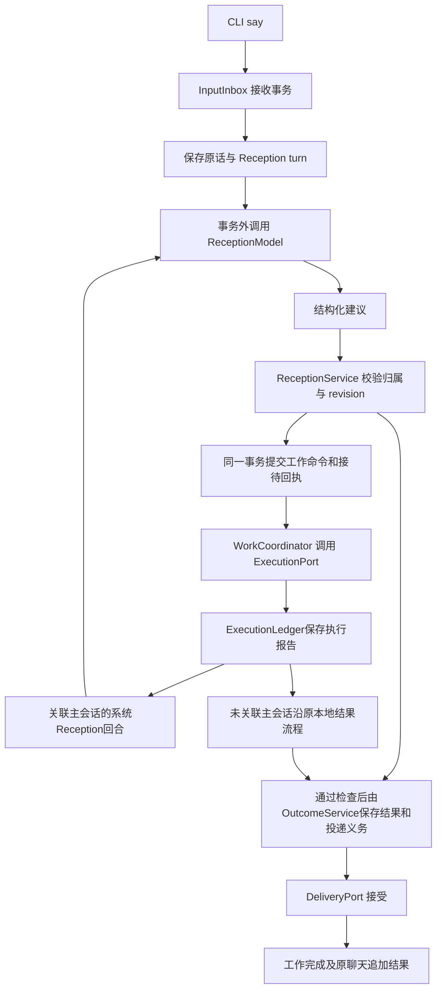
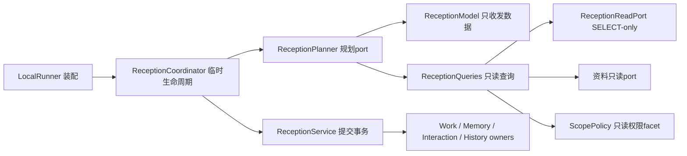

# 独立个人助理内核：目录、类与所有权

状态：0.15.0/schema17，development。当前能力见[台账](superapp-capabilities.md)，分治入口见[模块地图](module-map.md)。本文第1节与owner表描述当前结构，后续各轮细节保留其原实现背景；认证/技能/学习等已扩展部分以当前摘要及对应新章节为准。真实模型质量和外部服务仍未验收。

## 1. 目录与依赖方向

```text
src/
  domain/                    业务规则、对象身份和不可变委托；无存储/模型/进程
    assistant.mjs            Assistant、Delegation
    work-item.mjs            WorkItem 的版本、修改、取消、完成规则
    completion-contract.mjs  目标、语义要求和程序完成条件
    conversation.mjs         Conversation、ReceptionDecision
    continuation.mjs         系统报告决策与自动续接上限
    interaction.mjs          工作版本、问题与回答的约束
    memory-entry.mjs         MemoryEntry 更正/遗忘与版本规则
    routine.mjs              Routine 触发、到期、有限次数规则
    skill.mjs                技能内容定义和版本摘要
    notification-policy.mjs  来源和通知规则
    reception-query.mjs      查询契约/原范围/界限
    run-policy.mjs           局部执行限制与错误
    usage.mjs                计数/未知项纯规则
    values.mjs               稳定编码、身份键和输入约束
  application/               用例、业务状态写入与跨对象事务
    assistant-application.mjs 命令入口和服务装配，不依赖具体 adapter
    input-inbox.mjs          可靠接收、冲突拒绝和稳定命令回执
    work-service.mjs         WorkItem 变更的唯一业务入口
    execution-ledger.mjs     执行绑定与业务执行观察的唯一写入入口
    execution-service.mjs    快照、输入交付和动作前校验的用例协调
    outcome-ledger.mjs       Result/Delivery 记录的唯一写入入口
    outcome-service.mjs      结果、回执和工作完成的事务协调
    completion-ledger.mjs    执行依据/评估唯一写入入口
    completion-service.mjs   可信I/O依据登记和条件检查
    conversation-history.mjs 主会话历史及事项关联
    conversation-context/    主会话派生摘要/原文游标/有限重试，不接管Pi压缩
    reception-service.mjs    接待输入、模型建议校验和命令提交
    reception/
      context-builder.mjs    原输入锚点与有界初始上下文
      query-service.mjs      只读查询、投影、分页、trace及局部界限
      planner.mjs            模型/查询交换，不提交命令
    interaction-ledger.mjs   Interaction 记录唯一写入入口
    interaction-service.mjs  提问/回答/拒绝的事务协调
    memory-service.mjs       显式/自动记忆值、来源和epoch
    memory/                  MemoryLearningService的证据/提议任务
    skills/                  SkillService内容/启用/加载
    automations/             事件规则/基线与关注状态
    usage/                   模型与Pi用量观察的写入/查询owner
    notification-service.mjs 后台条件/合并通知
    routine-service.mjs      安排定义与 Occurrence
    scope-policy.mjs         从已配置能力形成委托，执行时核验
  ports/contracts.mjs        执行/接待模型/资料/产物/交付的语义接口
  adapters/
    sqlite/                  单一连接/UoW、schema、各领域 repository
    pi/                      PiExecutionAdapter 和 Pi 工具注册
    models/                  模型目录、接待模型与隔离 fixture
    filesystem/              明确资料目录、产物与本地信箱
    local/                   profile 配置和 Unix socket 资源
  interfaces/                入站协议与请求 envelope
  runtime/                   本机装配、调度、进程资源及关闭顺序
bin/assistant.mjs            CLI 参数与输出
test/                        领域、运行、所有权与接待集成验收
```

domain 只依赖自身及纯计算；application 依赖 domain/ports 和注入的 repository/UoW，不导入 SQLite、Pi、网络、filesystem 或 runtime。adapters 实现具体 I/O，runtime 将它们装配起来。`ownership.test.mjs` 检查这条依赖边界，以及 SQL 不进入领域/应用层。

原 `src/store.mjs`、`runner.mjs`、`profile.mjs`、`files.mjs`、`pi-executor.mjs` 仅保留旧路径兼容 facade/re-export。真实入口已经使用分层实现；不存在平行运行的旧状态库或旧引擎。

## 2. 对象与类的所有权

| 状态/规则                         | 唯一业务 owner                          | 存储/执行承载                   | 其他类可以做什么                                    |
| --------------------------------- | --------------------------------------- | ------------------------------- | --------------------------------------------------- |
| 稳定助理身份                      | Assistant；本机装配核验 profile 绑定    | profile.json + meta.identity    | 模型/进程只能引用，不能改归属                       |
| 输入接收与命令去重                | InputInbox                              | InputRepository                 | 服务在同一 UoW 回调内执行用例                       |
| 用户目标、revision、取消和完成    | WorkService + WorkItem                  | WorkRepository                  | Reception/Execution/Outcome/Routine 服务请求它变更  |
| 委托主体、能力与资源范围          | ScopePolicy + 不可变 Delegation         | WorkItem.delegation_json        | 模型只提出目标；配置中的既有能力决定范围            |
| 执行快照及后端绑定                | ExecutionService 经 ExecutionLedger     | ExecutionRepository             | Pi adapter 报告接收；不修改工作目标或宣称完成       |
| 模型回合、工具任务、checkpoint    | Pi durable                              | 每项工作自己的 Pi SQLite        | 应用仅保存引用和观察事实，不复制或重放其账本        |
| 业务结果与交付义务                | OutcomeService 经 OutcomeLedger         | OutcomeRepository               | 运行器调用投递 port，再报告真实回执                 |
| 用户可见主聊天历史                | ConversationHistory                     | ConversationRepository          | 接待/结果/通知服务请求历史owner写入                 |
| 接待 turn 的处理状态和决策        | ReceptionService                        | ReceptionRepository             | ReceptionModel 只返回结构化建议                     |
| 用户待答问题与回答                | InteractionService 经 InteractionLedger | InteractionRepository           | Pi 提问、接待/CLI 回答；绑定原 work/revision/callId |
| 个人事实、来源和遗忘版本          | MemoryService + MemoryEntry             | MemoryRepository/meta epoch     | 执行读取快照；不以摘要/工具输出替换记忆             |
| 持续安排和本次触发身份            | RoutineService + Routine                | Routine/Occurrence repositories | runtime 定期 tick；不自行构造新任务身份             |
| 技能内容/启用/读取                | SkillService                            | SkillRepository                 | 模型只list/load原快照版本                           |
| 证据学习任务                      | MemoryLearningService                   | MemoryLearningRepository        | 模型提议/复核，MemoryService写值                    |
| 事件规则/基线/匹配                | EventTriggerService                     | TriggerRepository               | 文件adapter报告观察，WorkService建工作              |
| 通知队列/合并                     | NotificationService                     | NotificationRepository          | 不改变Result/Delivery接受语义                       |
| 关注水位/提醒                     | AttentionService                        | AttentionRepository             | RoutineService据评估暂停/恢复                       |
| 本地资料正文                      | DirectoryKnowledgeSource 的配置 owner   | 显式 workspace 路径，只读       | 模型通过相对路径工具读取，不能改根目录              |
| 产物字节                          | LocalArtifactStore                      | artifacts/                      | 执行以稳定 executionId 发布并核对已有字节           |
| 本地渠道实际接受                  | LocalMailboxDelivery                    | mailbox/                        | 只处理同一 deliveryId 的发送，不启动业务执行        |
| 连接、timer、锁、并发槽和取消句柄 | LocalRunner/各 Coordinator              | 进程内临时资源                  | 它们不是业务事实真源，重启根据服务状态恢复          |

领域类承载约束，repository 承载存取，应用服务承载用例。没有为每张表造一个同名可写状态机；Result/Delivery 当前由 OutcomeLedger 统一写入，OutcomeService 协调工作结算。WorkService 的取消/更正经这两个 ledger 撤回绑定和投递，不直接修改它们的 repository；Routine 触发同样经 InputInbox 登记输入。现有静态检查覆盖部分依赖与直接写入入口；新增owner仍需代码审阅和行为证据，不能宣称静态规则已穷举。Skill、证据学习、事件触发、通知与关注状态已实现，详见第13至16节；跨平台SourceThread/远程Subscription尚未接入，不放空类冒充能力。

## 3. 三类会话/执行身份

1. **主 Conversation**：一个 assistantId 有稳定接待会话，保存用户原话、接单回执、追问和交付结果。用户不需要管理多个 Bot。
2. **WorkItem**：用户交代的一件事，有独立 workId、目标和 revision。普通聊天不强制创建事项；一个主会话可以关联多个事项。
3. **Pi Conversation / Submission**：后台执行上下文和实际模型执行身份。每个 WorkItem 复用其 Pi 会话，目标修改创建新 Execution/Submission；业务 ID 不使用 Pi opaque ID 代替。

Pi transcript 是执行证据，主 Conversation 是用户可见历史。将一个明确目标注入执行会话时，记录原输入及 work/revision 引用；不把内部工具对话全部复制到主聊天。

## 4. 接待链路与事务边界



模型没有 repository、UoW、Shell 或业务写入工具。用户回合可建议 reply、clarify、delegate、amend、cancel、answer、reject、remember、forget、routine.create/pause/resume，或最多4项非嵌套batch。系统报告回合只允许continue/deliver/silent/blocked。应用服务忽略模型提供的 actor、工具列表、资源或权限；引用现有工作时还要验证会话关联和 expectedRevision。动作前再次检查原 Delegation 和当前配置。

接待模型调用在事务外，进程中断可能重复推理，但没有在模型调用中执行外部业务动作。**决策保存、子命令提交和接待回执追加在同一 UoW 中完成**；中断后使用固定 child input ID，不会因模型重试创建第二份工作。

`SqliteUnitOfWork` 是同步本地事务，支持受控嵌套 savepoint 并拒绝异步回调。事务不能等待模型请求、Pi submit或网络/异步外部调用；文件发布在事务外取得回执。当前Interaction.resolve在同步事务内调用本地Vault.describe核验引用，这是已有本地接缝，不能直接替换为事务内等待远程Vault。未来远端存储适配需明确新的提交/对账契约，不能直接给当前 repository 方法加 async 就宣称兼容。

## 5. 执行、产物和交付

WorkCoordinator 只维护并发槽和取消句柄；启动、快照、绑定、结果保存由各应用服务处理。接待有独立 Coordinator，不消耗后台工作槽。

PiExecutionAdapter 负责注册工具、打开原生 Harness、使用稳定 requestId 找回 Submission。后端原生接收与本地绑定不处于同一事务，通过 requestId 恢复核对。关闭挂起、取消中止、更正先停止旧 revision，再将新目标交给原工作会话。

`list_materials/read_material` 只在原 Delegation 允许、并且本机配置了对应资料源时安装。scope 同时保存资源 ID 与根目录 binding；改配置不会让旧工作获得新目录访问权。legacy v1 工作只保留原有 context/note 能力。

资料 adapter 只读明确目录中的相对 UTF-8 文本，限制格式和大小，拒绝路径穿越与符号链接。Linux 下检查实际打开的 fd 路径，防止读到根目录外。它是一个有限文件能力，不是操作系统级沙箱。

Result 与 Delivery 意图先提交。LocalMailboxDelivery 用稳定交付 ID 核对落盘后，OutcomeService 才请求 WorkService 完成，并通过 ConversationHistory 追加对应结果。回复文案不决定交付 ID。当前回执等级是本地文件接受，不是外部 IM 接受或用户已读。

## 6. 文件数据的归属

| 路径                          | 写入者                           | 含义                                                      |
| ----------------------------- | -------------------------------- | --------------------------------------------------------- |
| profile.json                  | 本地操作者/init                  | 助理身份、模型配置、显式 workspace 绑定；不是模型可写记忆 |
| assistant.sqlite              | UoW/repositories，经应用服务调用 | 本地领域权威，schema v11                                  |
| executions/<workId>.sqlite    | Pi durable                       | 该工作的原生执行权威；跨业务 revision 复用                |
| artifacts/<execution hash>.md | LocalArtifactStore               | 不可变本地产物；取消后已发生文件保留                      |
| mailbox/<delivery hash>.json  | LocalMailboxDelivery             | 稳定本地交付事实                                          |
| credentials/key、\*.json      | LocalCredentialVault             | 本地密钥和密文，核心只持引用                              |
| runner.sock、profile.lock     | 本机装配                         | 临时控制入口和执行租约；不是用户状态                      |
| 配置的 workspace              | 用户/资料源自身                  | runner 只有受约束读取能力，不写回源资料                   |

一个 profile 当前只承载一个本地 owner/Assistant。owner label 不等于平台认证；多用户及 OpenCraft 连接适配仍需由既有 Actor/权限 owner 承接。当前独立 repository 是实验适配，不直接上线为第二套 Tasks/记忆/通知权威。

## 7. 扩展应进入的位置

| 能力                    | 应扩展的位置                                                | 不应塞入                                       |
| ----------------------- | ----------------------------------------------------------- | ---------------------------------------------- |
| 更强意图识别/多意图决策 | ReceptionModel port + ReceptionDecision/Service 契约        | CLI、Socket 或 WorkCoordinator                 |
| 用户问答/认证/接管      | 扩展已有 Interaction 的认证/接管类型，保留原工作和 revision | 内存 Promise 或提示词里的 TODO                 |
| 自动记忆与召回          | MemoryService 的来源/冲突/遗忘模型与检索 port               | Pi checkpoint 或替换全部 profile 文件          |
| 外部消息与订阅          | Source/Input port、SourceThread/Subscription 领域           | 把外部事件伪装成新的人类授权                   |
| 技能                    | 独立 Skill owner 和按需读取 port                            | 将长正文永久复制到所有会话                     |
| 新执行后端/Temporal     | ExecutionPort、调度装配及跨存储对账                         | 重写 Assistant/WorkItem 身份或复制 Pi 工具账本 |
| OpenCraft 内置装配      | 新 composition root 和既有 owner adapters                   | 将独立 SqliteStore 直接复制到平台再写一套状态  |

当前仍为development：已验证边界、保存、恢复和实际本地读取；没有以 fixture 覆盖率证明自然语言能力、语义完成质量、真实服务或成熟产品体验。

## 8. 信息不足时的协作与恢复

`Interaction` 是一个必要信息请求，不是 WorkItem 的替身，也不是新的权限审批流程。本段记录普通question/answer/reject链路；第十一轮已扩展secret/authorization/handoff与期限，见第16节。具体远端OAuth服务尚未接入。

1. Pi `ask_user` 的稳定 `executionId + callId` 生成 Interaction ID。InteractionService 在同一事务经 ledger 保存问题、经 WorkService 将工作转为 waiting_input、经 ConversationHistory 向关联主会话追加一次问题。
2. PiExecutionAdapter 关闭 Harness，使原生工具任务挂起；WorkCoordinator 释放槽。waiting_input 不进入执行队列，重启不会为每个待答问题常驻一个 Harness。native checkpoint 仍只在 Pi。
3. answer/reject 必须给出问题 ID 和 expectedRevision。应用核对本地 owner、问题状态、原 work/revision；接待还核对会话关联。回答和 InputInbox 回执同事务保存。
4. 同一版本的所有问题均有答案后，经 WorkService 将原工作重新排队；使用原 execution/requestId/native Submission 继续。replay-safe ask_user 读取持久答案后返回，模型才继续。回答回执表示已保存，不等于模型已使用或结果已完成。
5. 修改/取消经 InteractionLedger 退役旧问题；旧答案不能恢复新方向。拒绝使该版本所有未答问题退役、原工作 blocked，需要明确修订目标继续。等待时拒绝其他工具动作，不生成虚假完成结果。

问题事务与 Pi 挂起不假装原子。进程在提交问题后退出，业务侧仍等待；答案到来后打开原 Pi 会话，原调用按稳定 ID 读取答案。恢复测试同时检查一条原生输入和一份问题。

## 9. 对话记忆与诊断的边界

ReceptionModel 可建议 remember/forget，但只有 MemoryService 写入。接待提议使用expectedRevision，目录向接待提供当前值与删除版本；删除项只暴露 key/revision/deleted，不召回已删除正文。新事实使用版本0，遗忘后重新记住使用保留版本。模型没有自动从资料写入记忆的工具；真实接待是否可靠遵循显式意图仍需真实模型验收。

`local-diagnostics.mjs` 是 runtime 的离线配置探针，调用模型目录和资料 adapter，不打开业务数据库，不请求模型。doctor 仅报告当前进程指定环境变量是否存在，不输出值，也不把凭据存在当作认证或服务通过。

`accept:real` 在新的独立 profile 和合成资料中执行真实模型场景，拒绝 fixture。自动断言、模型模式、对话、来源、事件和错误写入独立证据。自动通过仍保留 development 与 quality-review 状态，不使用测试开关宣布产品成熟。

## 10. 完成标准与执行依据

当前WorkItem的目标/条件仍归WorkService拥有；Execution快照包含该版本的CompletionContract，旧revision的评估也独立保存完整contract与摘要。当前支持note_published、material_read（相对路径/可选SHA256）、note_contains（原文字面包含）。新工作默认笔记条件不可关闭，交付等级固定本地文件接受；语义要求单列并标记未验证。

CompletionLedger是completion_evidence/completion_assessment的唯一写入owner；CompletionService经可信I/O适配链路登记读取/发布事实，再按本执行依据评估。模型不能直接提交成功证明，业务依据不接管Pi工具checkpoint。发布成功后、工具checkpoint前崩溃仍可通过幂等发布重建同一依据。

OutcomeService在同一事务内结算评估与业务状态。失败评估可持久化并阻塞工作；不通过抛异常回滚丢掉失败详情。通过后才保存Result/Delivery并转awaiting_delivery。交付回执仍由OutcomeLedger负责，主历史仍由ConversationHistory追加。通用语义质量评审与外部可用性证明未实现。

schema3→4保留旧工作的legacy条件和原生/业务快照；不对旧工作强加笔记证明，不补写不存在的历史依据。旧工作明确修订后采用当前标准。接待查询和通知策略已在后续章节扩展；未来预算按roadmap.md开发，不能绕过这些owner直接修改业务状态。

## 11. 接待查询的高内聚、低耦合边界



query模块不导入业务命令服务、具体adapter/runtime或SQL，不持有整个AssistantApplication。SqliteReceptionReadModel有私有连接，只暴露SELECT投影。Planner只持有model/query port，ContextBuilder只构建有限上下文；fixture从模型服务调用adapter中分离。原ReceptionService继续拥有接收、建议校验、命令和最终回执，不负责网络模型调用或查询循环。

ScopePolicy是资料范围规则owner，给query只读forTurn/permits facet；接待创建工作时也核验原捕获范围。即使资料adapter仍存在，当前策略撤销能力后查询与委托都会拒绝。input接收、query grant、用户原话同事务保存。schema5为reception增加可空query_scope_json；旧消息不回填新授权，旧任务和执行快照保留。

查询中不持业务事务等待模型。观察带时间/来源，命令仍经owner的revision校验。host产生的轻量trace由ReceptionService随最终提交或失败保存，query模块本身无持久写入。进程中断后只重做读取和提议，不回放尚未发生的业务动作。

接待协议限制次数、返回字节、分页和初始窗口；它不是已实现的完整预算系统。当前保持development，真实模型的轻查询质量和内容安全边界还需实际模型验收。

## 12. 回应与通知

接待活动由 ReceptionService 从原接待表投影 queued/running，Host 只持过期观察，私聊页在原状态槽呈现；不再把五秒延迟回执写成历史。ExecutionService 的真实工作进度/失败通知仍保留，进度不完成工作；最终交付继续由 OutcomeService 独立结算。历史设计见 iterations/0006-responses.md，当前边界和问题分析见 [reception-lifecycle](reception-lifecycle.md)。

## 13. 技能内容 owner

application/skills/SkillService负责安装、启用和版本读取回执；domain/skill.mjs验证内容定义与哈希身份；SkillRepository独占skill/skill_version/skill_load持久化。ExecutionService只在原执行快照中捕获摘要目录。adapters/pi/skill-tools.mjs只接受list/load/guard窄接口，不拥有安装或启用权。内容插件沿本地JSON包和原Unix socket装配。详见iterations/0007-skills.md。

## 14. 自动证据记忆

application/memory/MemoryLearningService拥有持久任务、原交互证据与提议状态；MemoryService继续独占所有值和来源写入。两者用snapshot/epoch/apply窄接口协作，同一UoW确保批量应用和完成标记原子提交。runtime/MemoryLearningCoordinator持有临时模型请求，adapter/MemoryLearningModel分提议与复核，不接收业务写接口。详见iterations/0008-evidence-memory.md及superapp-capabilities.md。

## 15. 事件、通知与关注状态

application/automations/EventTriggerService拥有规则/事件/匹配/观察基线，通过create窄port调用WorkService；FileEventSource只读取显式材料路径并报告观察。NotificationService独占后台通知队列，只读工作来源，通过主历史facet合并消息，不拥有工作完成状态。AttentionService独占关注信号，RoutineService根据其评估暂停/恢复安排。模型不获得事件订阅、通知队列或关注状态的原始写入权。详见iterations/0009-events-notifications.md和0010-attention.md。

## 16. 分型等待与安全输入

Interaction仍是唯一业务等待；InteractionLedger独占其状态。授权、安全输入和人工操作复用Pi原生挂起与原版本绑定。LocalCredentialVault在适配层加密用户显式提供的值，核心只注入describe引用facet，不可获取明文；CLI安全输入只通过socket发送引用。主接待读模型包含kind/期限，普通answer不能完成敏感等待。详见iterations/0011-interventions.md。

自动记忆更新使用全局memory epoch进行CAS；新工作另捕获显式变更屏障，自动提炼不打断正在执行的普通工作，而用户明确更正/遗忘仍阻止旧快照发布。旧执行快照未含新屏障时保留原全局检查语义。

## 17. 主助理续接（0.8.0）

执行报告与系统Reception turn、awaiting_review同事务，回到原主助理重新判断。报告由ExecutionLedger写入，消费归ReceptionService，完成依据、工作状态、Result/Delivery与通知仍分别属于原owner。原始报告与主助理最终回应分别保留，默认笔记与显式文本契约分别检查。请求原话、最新修正、相关消息和续接次数随执行固定；旧执行快照不改写。

完整当前协议、恢复语义与局部上限见[assistant-continuation.md](assistant-continuation.md)；schema11迁移、实际Pi和真实进程崩溃证据见[本轮记录](iterations/0013-continuation.md)。pump故障隔离已实现；运行保护按[当前对标范围](runtime-guardrails.md)推进，统一金额预算不作为前置，真实模型质量仍需验收。本目录保持独立，不接管Join/Core/router。

## 18. 运行保护与用量的所有权（0.9.0 / schema12）

RunPolicy纯规则 → ExecutionService检查 → ExecutionLedger.guard保存每Execution步数/最后运行观察；PiRunGuard只持有本次timer和原生abort。Pi仍独占generation、工具checkpoint和原生usage，不增加宿主工具账本。

新目录application/usage由UsageService保存观察与有界投影；Pi累计采样按稳定身份覆盖，接待/记忆直接模型回执按调用ID去重，SQL按mode聚合。runtime只装配窄facet和故障回调。价格估算、未知项、fixture与实际model分开；用量持久化失败不重新执行模型或工具，不代替任何Work/Outcome状态。详见[运行保护说明](runtime-guardrails.md)及[usage导航](../src/application/usage/AGENTS.md)。

## 19. 执行接口与验收分治（0.10.0）

runtime/execution-ports.mjs是装配投影，没有业务状态：PiExecutionAdapter只接收ExecutionHostPort、toolsFor和usage/report回调。WorkToolPort在每次run时绑定原work和snapshot，assistant-tools只通过它读取上下文、检查动作、登记依据、请求等待和加载技能；资料/产物I/O继续在具体adapter。原生身份、revision校验、显式记忆epoch和各owner事务没有迁移。

scripts/scenarios将memory/work/automations/skills的断言分开，context只管理临时runner与采证，catalog只定义有限选择。personal-scenario只编排，共用采证文件保留逐模块状态/断言/质量复查项。场景通过不改写产品quality状态；失败/未跑、fixture/真实服务分别记实。原ReceptionService、WorkCoordinator与本地Vault同步校验的后续边界见[总地图](module-map.md)。

## 20. 持续安排与分层召回（0.11.0）

日历纯计算在domain/calendar-schedule.mjs，Memory scope/kind/查询约束在domain/memory-recall.mjs。原RoutineService、MemoryService、ConversationHistory承担真实变化与读用例；新SQLite memory-read/history-read共享SELECT规则，新Pi memory-tools通过WorkToolPort接入。schema13只新增元信息和日历状态，模型/工具checkpoint仍归Pi。详见[持续助理说明](long-running-assistant.md)。

## 21. 内容事实与持续整理（0.12.0）

MemoryService仍独占事实/来源/内容墓碑/epoch/复查时间，MemoryLearningService独占批次/证据/提议/重试；原UoW完成提交和任务结算。MemorySynthesisPolicy纯规则，MemoryLearningCoordinator只管理临时请求/截止。SQLite唯一权威；模型无服务对象或写权。Grokbot行为、配置、差异与替代旧legacy保护的范围见[记忆对照](grok-memory-parity.md)。

## 22. 文件记忆权威与分片（0.13.0）

事实权威由本轮用户决定转为Markdown/旁车，SQLite memory表退为可重建索引，业务任务/回执仍原权威。MemoryFileAuthority作为本地UoW参与者，用提交标记与前后像判别崩溃；不伪装跨媒介物理事务。agent/user/project按单写者分片，ScopePolicy把成员grant固定到原输入/执行；MemoryProjectService经inbox处理显式命令。工作不因别的助理自动积累而被显式屏障打断，更正/遗忘和撤销仍生效。具体端口、迁移和未验收边界见[实现说明](memory-files-and-shards.md)。

## 0.14主会话工作上下文

[ConversationContextService](../src/application/conversation-context/context-service.mjs)独占派生checkpoint。SQLite存储有界原输入和不可变成功版本；原文仍在ConversationHistory。Coordinator仅在接待前调用一次有界模型交换，摘要与命令分开提交。ReceptionContextBuilder只得view，接待模型只得JSON；新委托固定workingContext，旧执行不补写。原文锚点、消息内游标、父版本CAS、来源角色和gap见[契约](conversation-working-context.md)。当前任务/等待状态仍由原owner实时查询，不从摘要写回。

## 0.15用户交互与交付

[MessageService](../src/application/messages/message-service.mjs)管理用户可见封套与outbox/接受回执。History仍写canonical回退文字和messageId，在同UoW调用消息owner；Interaction/Vault管理问题与敏感输入；原Outcome/local-mailbox完成契约不变。AttachmentStore保存真实不可变字节，模型只拿ID；MessageDispatcher只协调在途传输。实际协议和剩余边界见[用户消息](user-messages.md)。
