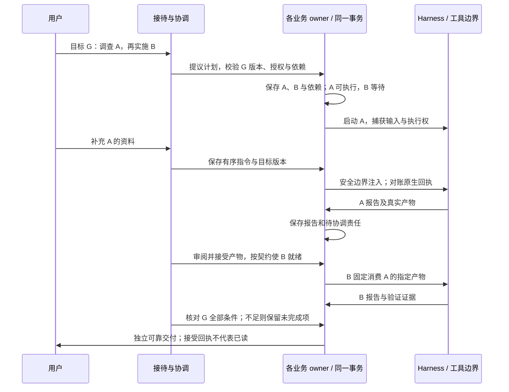

# 持续管家的生命周期与一致性：深入分析

2026-11-10。接续 [Grokbot 对照](grokbot-coordination-design.md)，本轮继续沿实际调用链分析。我们的审计基线为 `82c542b`，Grokbot 参考为 `a9f633e09d49a85829b8236331b9e21f7e612634`。后者是 0.18.0 非官方发布物恢复源码，不能用静态代码推断官方现网的完整行为。本文提出的协议、实体拆分和验收矩阵尚未实现。

## 1. 核心判断：先把连续工作的含义做对

用户要的管家行为是：记得多个目标，能解释当前优先顺序，持续安排工作；用户随时补充或改口，系统能准确作用到原工作；独立工作并行，依赖和冲突工作等待；用户回来时拿到结果和真实阻塞原因。

这包含三个相互独立的能力：

1. **协调判断**：模型理解意图、拆解目标、审阅结果、调整下一步。
2. **可靠控制**：宿主保存责任、校验版本、传递指令、限制并发、恢复中断。
3. **实际执行**：执行者持有上下文，使用有权限的工具完成外部工作。

Grokbot 的优势主要在第一和第三项的衔接，以及运行中可干预的体验。我们已有的持久业务记录和回执在第二项有明确价值。全面改造应连接这三项，而不是将 Todo、Goal、Agent、Session 都视为同一种“任务”。

## 2. Grokbot 的主助理实际承担什么

### 2.1 委托的单元是连续工作流

`sand-multitask.ts` 要求一个独立交付由一个 executor 负责；调查、实施、测试共享上下文时连续做。`system-prompt.ts` 同时要求主助理接话、检查执行者活动、纠偏、综合返回结果。主助理保留用户语境，执行者保留技术工作语境。

因此，“每次进展建新会话”会损失它的重要收益：刚读过的文件、试过的失败方案、工具返回、局部决策全部需要重新传递。反过来，所有长期目标一直塞在一个原生会话里也不好：上下文污染、压缩负担、授权边界和错误扩散都会增加。

建议保留稳定 Work 身份；相同工作在许可和上下文仍有效时复用原生会话。会话丢失、授权收窄、明确要求清洁重做时允许换会话，并记录原因。会话是执行资源，不是目标身份。

来源：[多任务约定](../../grokbot-reference-a9f633e/source/host/sand-multitask.ts)、[实际主提示](../../grokbot-reference-a9f633e/source/host/runner/system-prompt.ts)、[运行时](../../grokbot-reference-a9f633e/source/host/runner/subagent-runtime.ts)。

### 2.2 纠偏依赖中断和下一轮，不是任意时刻修改模型思想

`steerSubagent` 将文字放进 Map，调用 runner.interrupt；旧轮 settle 后，优先取出文字，在同一 runner 上启动下一轮，并暂不向父助理报告最终完成。这保证了“还在工作”的连续性。

但它有两个明确边界：

- 尚未消费的消息槽只有一个，多条快速补充可能互相覆盖。
- 中断不能撤销已经发生的外部效果。工具完成、停止和新指令注入之间仍要确定顺序。

已完成后的 Task resume 是另一条路径。`agent-adapters.ts:createOrResumeSession` 在 sessions 中找不到旧对象时用原 ID 调用 createRunner；`subagent-runtime.ts` 在完成后会移除 session。**沿用 ID 本身不证明复用了原 runner 或完整上下文。** 恢复能力要看创建器及其底层状态路径，不能仅凭工具描述概括为“所有 resume 都无缝”。

来源：[纠偏与完成清理](../../grokbot-reference-a9f633e/source/host/runner/subagent-runtime.ts)、[会话创建/恢复](../../grokbot-reference-a9f633e/source/host/runner/agent-adapters.ts)、[管理工具](../../grokbot-reference-a9f633e/source/host/runner/tools/sand-subagent-management-tools.ts)。

### 2.3 全局视野和硬调度是不同能力

持久 Todo 和每次醒来的清单核对，让模型具备多工作视野；父回合能再次调用 Task，才可以根据结果调整计划。唤醒调度器按 user/agent/background 排队，解决的是谁先得到主助理一轮，不是哪个业务目标更重要。

这份参考没有让我们确认完整的跨目标优先级和依赖硬调度。并且，严格优先取 user lane 在持续输入时存在 background 饥饿可能；watchdog 关注的是等待中的用户，不负责保证后台公平性。我们的三次用户回合后保留一次报告机会值得保留，但它只约束回合数，不保证墙钟延迟。

### 2.4 活动观察有价值，不能当完成证明

CheckSubagent 返回耗时、工具调用数、近期活动和 transcript 路径；主助理据此检查、纠偏、停止。这比只看 running 更实用。Goal 的三次无工具续接暂停则是另一种防空转启发式。

二者都不能自动证明有效进展：反复更新 Todo、反复读相同日志也会增加工具计数。更好的监督需要分开观察原生心跳、真实工具活动、产物变化和验收覆盖，并允许长计算在有真实活动时继续。

来源：[队列与 watchdog](../../grokbot-reference-a9f633e/source/host/extensions/transcript/run-scheduler.ts)、[CheckSubagent](../../grokbot-reference-a9f633e/source/host/runner/tools/sand-subagent-management-tools.ts)、[Goal 续接](../../grokbot-reference-a9f633e/source/packages/agent/actions/goal-continuation-action-handler.ts)。

## 3. 我们当前有四处语义耦合

### 3.1 continue 被实现成 amend

当前链路：

```text
报告回合决定 continue
  → ReceptionService.applyReport
  → WorkService.amend
  → Work.revision + 1
  → retire 原执行/交互，撤回原待交付
  → 创建 workId:r新版本
  → 新 Execution 没有原生绑定，创建新原生线程
```

这不是偶发 bug，而是当前模型主动选择的边界。它为旧结果失效提供了明确保护，却把“按原要求继续补证据”和“用户改变要求”放在同一条路径。原执行上下文只通过请求快照和截断的 previousReport 等资料交接，不等于保留原生完整历史。

只把 amend 改名为 resume 不够：当前 Execution ID 固定为 `workId:rN`；报告对 execution_id 唯一且不可变；Codex adapter 发现 `__final__` 就直接返回旧结果。若原地继续，会碰到旧终态和新一轮结果之间的身份冲突。

建议把 **要求版本、一次执行、原生轮次** 分清：要求没有变，继续不增加要求版本；已结算执行不可改写，可以创建后继执行，在明确的会话交接协议下复用上下文；未结束执行收到补充，可以在同次执行内新增原生轮次。原生 turn 数和历史由 Harness 管理，业务层只保存必要的边界关联，不复制原生任务图。

来源：[报告提交](../src/application/reception-service.mjs)、[修改工作](../src/application/work-service.mjs)、[执行身份/报告](../src/application/execution-ledger.mjs)、[原生 final 快捷返回](../src/adapters/codex/codex-execution-adapter.mjs)。

### 3.2 依赖就绪不能等同 Work.completed

当前 completed 包含 local-mailbox 接受；它不表示用户已读，外部消息渠道的接受也另有状态。串联任务 B 真正需要的是 A 的指定产物和约定检查，而不是 A 的通知已经发出。

因此建议建立结果选择规则：依赖边声明所需上游工作版本、产物/检查；下游开始时固定具体 result/evidence/hash。除非用户明确要求人确认，否则通知失败不应阻止已经合格的产物被使用。不能简单把 `awaiting_delivery` 全当成就绪，也不能只判断 `completed`。

上游变更时：尚未开始的下游重新判断；已经开始的下游保留消费旧产物的事实，标记需要复核并根据目标的新鲜度要求处理。禁止悄悄把正在运行的下游输入替换成“最新”。

来源：[结果与交付](../src/application/outcome-service.mjs)、[Work 状态](../src/domain/work-item.mjs)。

### 3.3 机械检查通过不等于目标语义达成

`CompletionContract.evaluate` 检查结果非空和 note_published/material_read/note_contains；`requirements` 仍以 `semanticReview: unverified` 返回。

本轮无网络探针直接调用真实方法，确认：即使“每条结论有真实证据”被列入 requirements，只有一句“做完了”的 text 输出仍可能 `passed=true`，同时正确保留 unverified。这是现有检查定义，不是已验证的语义完成。

长期目标验收应逐条保留 `met / unmet / unknown`、证据引用、验证方式和适用的目标版本。可机械检查的由宿主验证；内容质量的模型评审标记为模型判断；需要用户确认的交给用户。新检查不能倒推修改历史 completed 的含义。

来源：[完成契约](../src/domain/completion-contract.mjs)、[完成检查服务](../src/application/completion-service.mjs)。

### 3.4 看到所有工作，不等于能够推进所有工作

当前概览提供 6 个关注项和分页入口，是对既有 Work 的真实投影。结果回合却只接受 deliver/continue/silent/blocked，并只能继续原工作；不能根据 A 的结果推进 B 或调整同一目标计划。

应给报告回合受限的计划命令，而不是复制一套拥有一切写权的模型工具。模型提出“接受 A 的结果，按既定依赖释放 B，补一个验证 C”；宿主检查 Goal/Work 归属、目标版本、依赖、授权及动作前提，然后调用原 owner 提交。系统报告是证据输入，不能作为用户授权扩大范围。

来源：[续接协议](../src/domain/continuation.mjs)、[接待提交](../src/application/reception-service.mjs)、[概览投影](../src/application/reception/query-service.mjs)。

## 4. 建议的数据与控制边界

下表是目标模型，不是当前 schema；先确定这些约束，再做 SQL 迁移。

| 对象                 | 保存的事实                                                                        | 明确不承担                          |
| -------------------- | --------------------------------------------------------------------------------- | ----------------------------------- |
| Goal                 | 人的目标、原始请求、成功条件、授权范围引用、重要性、期限、显式暂停/撤回、要求版本 | 原生会话、子任务执行状态的副本      |
| Plan                 | 当前被接受的 Work 关系、依赖与计划版本，可修订                                    | 用模型文字覆盖实际 Work 状态        |
| Work                 | 独立交付单元、要求版本、Goal 归属                                                 | 一次模型调用或一个任意会话          |
| Execution            | 某 Work 要求版本的一次执行、前驱、有效执行权、固定 Harness、输入快照              | 用户目标、模型完整 checkpoint       |
| 原生会话             | Harness 保存的上下文与轮次；可供符合条件的后继执行使用                            | 业务授权与验收真相                  |
| Directive            | 用户/协调者给工作的有序指令、目标版本、接受与注入回执                             | 任意转发到模型指定的 nativeThreadId |
| Result / Evidence    | 哪次执行产生什么、按哪些条件检查                                                  | 用户已收到或已读                    |
| Reception / Delivery | 谁还欠一次协调处理、谁还欠一次结果交付                                            | 工作者执行 checkpoint               |

关键约束：

- 一项 Work 初期只有一个 Goal 所有者。跨目标共享不可变结果，并重新检查读取授权；不共享可变 Work 的控制权。
- Goal 要求版本、Plan 版本、Work 要求版本分别变化。调优先级不重跑整个项目；修改一个子工作不使所有无关工作失效。
- 同一 Work 同时只有一个有效执行者。若多个独立分支值得并行，应拆 Work，而不是让两个 writer 对同一 Work 争先结算。
- 同一原生会话同一时刻只有一个执行持有者。复用前完成旧轮结算、效果对账和执行权移交；新轮工具闭包必须绑定新执行，不能沿用旧 work/snapshot 引用。
- 异步提案带它读取的实体版本，提交时检查实际受影响对象。版本变化返回可解释冲突；不静默使用最新版本，不因无关目标变化重算全部计划。
- Markdown 记忆继续保存可学习事实和偏好；Goal/Work 的运行状态留在业务账本。摘要只能帮助理解，不能授权、解除依赖或宣告完成。

“Plan”首先是 Goal 管辖的关系和修订，不必先做独立计划服务。Directive 也可以归现有工作/执行 owner 管理。新的独立事实需要持久记录，新的名词不必对应新的通用 manager。

## 5. 追加指令必须明确哪一步算成功

建议 CLI、API、模型工具共用业务操作：

| 意图               | 行为                                                       |
| ------------------ | ---------------------------------------------------------- |
| 回答已有问题       | 原 Interaction.resolve，绑定问题身份和原执行               |
| 补充资料、调整方法 | work.instruct，捕获 Work 要求版本和有序指令                |
| 改变目标/验收/权限 | work.amend 或 goal.amend，显式作废受影响旧授权与证据适用性 |
| 继续未满足的原要求 | work.continue，保留要求版本；选择可复用会话的后继执行      |
| 暂停/取消          | 先落停派/撤销事实，再要求引擎停止；已发生效果保留          |
| 查看进度           | work.inspect / goal.inspect，只读当前事实，不触发重新执行  |

以上名称是拟议协议。自然语言入口可以分类，但取消、改范围等不能只依赖自由文本“顺便告诉子 Agent”。精确 CLI/API 操作不需要模型再猜一遍。

指令可区分 `accepted`（账本已收）、`submitted`（原生已接受）、`observed`（对应轮次消费了指令）、`superseded/rejected`。这些回执都不自动等于“按要求完成”。只有引擎能证明消费时才写 observed；不支持时就保留较弱回执。

快速连续两条补充不能覆盖。合并成一次原生输入时保留每条 ID 和顺序；“改成英文”“还是中文”可以最终中文，但两条事实都存在，后一条是否撤销前一条也须明确。自动摘要不可删除尚未确认的指令。

发送原生输入后、保存回执前崩溃，会造成接受状态未知。要通过原生历史/稳定标记对账；若引擎无法确认，就展示 unknown 并按能力选择恢复，不能盲重发后声称 exactly-once。业务请求去重、原生输入去重和外部副作用去重是三件不同的事。

## 6. 一条完整因果链比一个全能调度器重要



模型调用和外部 I/O 在事务之外。计划与 Work 创建、报告与接待责任等必须一致的事实，在现有 UoW 和各 owner 间原子提交。调度器只查就绪工作、占临时槽；重启丢掉 Map 后，从持久状态找回责任。

## 7. 并发不能只靠工作版本号

当前 revision 检查有效防止用户修改后的旧工作提交，但未来同一要求版本的后继执行，需要额外区分 executionId/有效执行代际。否则旧执行晚返回时，两者 Work revision 一样，版本检查不能判断谁还有写权。

在新的执行权模型中，工具提交和报告结算检查 `workId + requirementRevision + activeExecutionId/epoch`。这是一项必须先补的前提，而不是先放开同版本重试、事后再补锁。

对共享资源也要区分：

- 独立读取、不同隔离目录可以并行；共享桌面和同一部署切换需要互斥。
- 资源占用有 owner、能力范围和撤销语义。单独 TTL 过期不证明旧进程停了；不支持 fencing 的外部工具必须确认停止或进入隔离状态后才交接。
- 多资源申请采用统一顺序或一次性取得，避免 A 等 B、B 等 A；等待资源释放工作槽。
- 不可逆效果先记录稳定 action 身份，使用目标系统提供的幂等/查询能力对账。数据库事务不能撤销已经发出的远程操作。

Grokbot 的 computerUse 创建入口已经有“一个桌面一次一个执行者”的实际约束；这说明资源排他确有必要，但不能据此推断它具有通用分布式租约体系。来源：[agent-adapters.ts](../../grokbot-reference-a9f633e/source/host/runner/agent-adapters.ts)。

## 8. 长期调度、响应性与进度

就绪检查先考虑授权、未暂停、依赖产物、能力与资源，再考虑优先级。优先级建议先采用显式等级、同级 FIFO/轮转、等待老化和每 Goal 并发上限；重要目标所依赖的工作可获得临时调度提升。用户重要性和这种临时提升分别记录。不应直接让 LLM 每秒给所有任务打分。

主助理的响应性独立处理：新用户指令不等工作槽；状态读取尽量直接返回账本；慢规划可被更紧急输入抢占，但抢占前必须撤销旧提案提交权。现有 `withRequestDeadline` 会丢弃超时提案，这是可复用基础；新增抢占不能让旧回合迟到提交，也不能把每次让路记成业务失败并用光重试。

当前 `ExecutionService.reportProgress` 按 running 持续 30 秒发提示，不能单独证明任务正在取得进展。建议同时提供：最近引擎活动、最近工具结果、最近产物/验收变化、当前等待对象及下一次检查时间。只保存 OTel 事件不足以承担重启后的恢复责任；OTel 用于诊断，业务上的停滞/检查安排由原业务 owner 持久化。

长期目标不应每隔几秒无条件调用模型。事件到达或明确 nextCheckAt 才协调；按目标合并同一时段事件并保留其 ID，使用持久消费水位防止丢掉处理中新增事件。醒来没有新证据时允许安静结束；观察到变化才安排下一步。沿用现有 Routine 的时间触发，不再造第二套 cron。

来源：[接待协调器](../src/runtime/reception-coordinator.mjs)、[请求截止](../src/adapters/local/request-deadline.mjs)、[进度观察](../src/application/execution-service.mjs)、[工作调度器](../src/runtime/work-coordinator.mjs)。

## 9. 落库前的兼容性决定

推荐保留旧 ID、报告、原生目录与已完成含义；旧 Work 可以没有 Goal，用户明确整理时再关联。不能为了让每行有 goal_id 自动编造目标。

当前一个 Work revision 对应一个 Execution 的假设散布在 repository.get(work)、report 唯一约束、证据主键和原生目录派生处。支持同要求版本后继执行时，需显式 activeExecution 引用和新的执行身份规则；旧 `workId:rN` 作为历史实例保留。报告继续“一次执行一个不可变终报告”，而不是放宽唯一约束后覆盖旧报告。阶段进展另有事实，不能冒充终报告。

会话复用的元数据可以放在 Execution 边界中：固定引擎/配置、原生会话引用、前驱与移交记录。无需先建通用 Session 服务。但若复用会话，必须验证 dynamic tools 在恢复后绑定新执行，旧 `__final__` 只结束旧执行，以及旧 native call 不会重放到新授权范围。

新旧契约要明确版本。新目标的语义验收不把历史 local-mailbox completed 改成“未完成”；旧档案缺少的目标、指令或验收证据不能伪造回填。

## 10. 实施次序和验收

建议调整上一轮“先消息、后目标”的次序：**先解开要求版本与执行续接，再在此基础上同时设计 Goal/Plan 和指令协议。** 如果继续把同要求的推进做成 amend，后面所有依赖、预算、完成检查都会建立在错误的版本含义上。

| 阶段            | 实际交付                                                            | 必须证明                                                                               |
| --------------- | ------------------------------------------------------------------- | -------------------------------------------------------------------------------------- |
| A：身份与连续性 | 要求版本和执行身份分离；有效执行权；明确的继续/修改；原生上下文移交 | 继续不改要求；修改仍失效旧写权；旧执行晚到不污染新执行；已有等待恢复不退化             |
| B：可干预工作流 | 持久有序指令；真实活动查询；原生接受对账                            | 两条连续纠偏都保留；完成竞态/注入崩溃有确定结果；暂停不盲重跑未知效果                  |
| C：多目标协调   | Goal/Plan、版本依赖、产物输入、受限计划提交、聚合验收、公平性       | A 返回能推进 B；C 独立继续；上游改口能识别下游旧输入；所有任务绿色也不能覆盖未满足目标 |
| D：真实长期工作 | 针对实际工具的资源约束、事件复查、消息交付、外部适配器              | 重启后责任可恢复；共享资源不双写；通知失败不重复执行；没有事件时不空转模型             |

D 的资源防护要随危险工具一起交付，不能先开放共享写入再等最后一阶段补。统一金额预占/扣账不作为本轮前置，保持原有限重试/并发/时间保护；只补有实际需要的跨续接计数，不能靠换执行无限重置限制。

用管家场景评估，而不是只看模型答题分数：两个目标并行，一个依赖，一个用户等待；连续插话；上游产物变更；执行、原生注入、报告、交付各窗口崩溃；目标暂停后旧结果到达；长计算有活动但暂时无产物；用户离线后回来查看全局进展。

机制指标包括丢失/重复指令、过期写入、重复效果、恢复成功、依赖违规、通知遗漏；产品指标包括目标达成、额外人工干预、无用重做、用户等待和每个成功目标成本。真实模型测试单独评价拆分、纠偏理解和验收判断，不用 fixture 通过宣称智能管家质量已达标。

## 本轮核验范围

静态追踪上述 Grokbot 与本地调用链；另运行无网络、注入存储替身的真实方法探针，四项断言通过：语义 requirements 不自动成为检查、continue 调用 amend、amend 升版本、执行 ID 随版本变化。该探针不等于 SQLite 恢复或真实原生续接测试。本轮只新增设计文档，没有改运行逻辑、数据库或部署，也没有运行付费模型。
