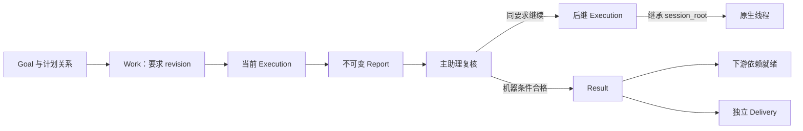

# 长期目标与连续执行：所有权和实现

2026-11-10，0.17 / schema20，独立 runner 的 development 能力。本轮沿用[生命周期分析](coordination-lifecycle-analysis.md)与[Grokbot 对照](grokbot-coordination-design.md)，实现业务层协调，不部署 Join，不把非官方恢复源码等同于 Grokbot 正式产品。

## 对象与唯一写入者

| 事实                                                    | owner                                  | 边界                                                                                 |
| ------------------------------------------------------- | -------------------------------------- | ------------------------------------------------------------------------------------ |
| Goal 的目标、验收条件、状态、优先级、并发限额、计划关系 | GoalService                            | 不保存第二份子工作状态；通过窄 Work port 创建、取消、修改                            |
| Work 要求与 revision、生命周期、active_execution_id     | WorkService                            | 改要求或依赖契约升版本；普通续接不升版本，原子移交有效执行引用                       |
| Execution 尝试、前驱、原生存储根、快照、报告、运行步数  | ExecutionLedger                        | 一次执行一个不可变终报告；Harness 独占原生 checkpoint                                |
| Directive 受理与生命周期                                | WorkService 校验；ExecutionLedger 落账 | InputInbox 去重；顺序 seq；accepted → scheduled → submitted；修改/取消退役尚未提交者 |
| 上游结果及交付                                          | OutcomeLedger / OutcomeService         | 合格 Result 才是依赖依据，mailbox 接受是独立事实                                     |
| 完成依据与机器条件                                      | CompletionLedger / CompletionService   | 不把 passed 当语义成功；不能凭模型文字补造工具证据                                   |
| 依赖定义与执行消费的 resultId                           | GoalService                            | 定义钉住上游要求版本；首次执行钉住具体不可变结果，不重写旧快照                       |
| 父助理报告接收与决策                                    | ReceptionService                       | 原事务提交报告消费、交付和可选计划扩展/目标复核；模型在事务外                        |
| 原生线程/工具 checkpoint                                | Pi 或 Codex adapter 对应引擎           | 引擎固定在 Execution；续接不静默换引擎                                               |
| 当前运行槽与中止句柄                                    | WorkCoordinator                        | 只持临时 Map，从持久业务事实恢复，不另建持久调度队列                                 |

这不是新的万能 Manager，也不是内容插件。Goal 是工作组合的领域对象；Reception 负责提出并协调决定；CLI/API 是同一个内核的入口。将来接平台应映射平台现有权威，不把此 SQLite 直接搬上 Join 网络主线程。

## 要求版本与执行尝试分离



初次执行仍使用 `work:r1`，下一次为 `work:r1:a2`。保持原 workId、text、revision，记录 predecessor_id，固定原引擎，创建独立上下文、工具收据、完成证据和结果。工作引用与新执行、输入回执同事务提交。执行工具、父报告、迟到失败和结果结算都检查当前 executionId，解决仅检查 revision 时同版本旧执行仍有写权的问题。

Codex 沿 session_root 复用原生目录/线程；每个后继有自己的 requestId、最终结果收据。前一尝试在原生绑定之前失败时，仍可找到此前有绑定的同根祖先。旧轮 `__final__` 不得当成新轮答案。Pi 继续使用原 Work 原生数据库，每次重开工具闭包绑定当前快照。

步数跨同要求续接累积，继承时清空前一执行的最后 taskId 去重标记，避免新尝试复用编号而漏计。Codex 累计 usage 以 session_root 覆盖观察，不能把同一线程累计值按每个 Execution 再相加。显式要求改版才重置步数。自动父回合续接上限 3 次；显式用户补充/继续重置自动续接连续次数，但不重置累计步数。

## 补充不是重新委托

`work.instruct` 保存与原要求版本绑定的补充。当前运行/等待输入时先排队，当前轮成功结束后合并为一个后继；已经结束的工作直接安排后继。最多 32 条未安排补充，总正文不超过 24000 字符。失败轮保留未处理指令，等待显式继续，不吞掉错误或擅自重跑未知效果。

回执区分：accepted 是系统保存；scheduled 是已绑定后继；submitted 是原生引擎接受。没有声称“模型已落实”的 applied 状态。重复 inputId/payload 去重；同 ID 不同内容拒绝。执行轮次边界指整个委托轮结束，不是每个 token 或工具调用；当前版本不支持原生实时 steer。

`work.continue` 对 settled/blocked 工作显式续接；`amend` 用于更改完整要求，旧快照和证据仍保留。未对账的原生宿主效果阻止跨执行继续。等待问题要经原 Interaction 回答，普通补充不能绕过等待。

## 目标、依赖、调度与失效恢复

一个 Goal 最多 32 项工作、16 条验收条件；目标和条件合计最多 6000 UTF-8 字节，作为简明契约而非无限上下文。每个 Work 只属于一个 Goal；旧 Work 不自动归入新 Goal。创建/追加计划验证 key 唯一、引用存在、无环，与子 Work/主会话关联和回执原子提交。

依赖要求上游当前版本有通过机器检查的 Result，不等待通知成功。执行首次快照保存实际消费的 resultId；依赖正文共享 12000 字符注入预算并明确标记截断，不能当成全文已读。上游修改要求、继续产生替代结果、取消或其输入失效，都会阻止依赖者执行、工具动作、结果接受及尚未发生的交付；失效沿 DAG 传递。已发生的外部/文件效果与历史通知不伪装回滚。

恢复使用显式 `goal.rebase`：带 Goal revision、下游 Work revision 和每条上游当前 revision。它只更新现有边的版本，不暗改拓扑；原 Work 经 WorkService 改版重新执行，旧快照/结果保留。依赖它的下一层也要显式 rebase。模型不能无用户指示自动刷新契约。

优先级为 0..2，每 Goal 并发 1..8，还受全局并发限制。调度按优先级加等待时长排序；等待时间从该目标成员最近业务进展计算，从持久事实恢复，同优先级不永久偏向最早目标；单次候选分配在目标间轮转。它是本地调度策略，不是跨机抢占、硬实时 SLA 或成本预留。

暂停会阻止新执行/动作并中止当前运行，保留执行身份和已保存报告；恢复继续原线程。原生中止并不证明远端未发生效果，仍使用宿主收据对账。取消通过原 WorkService 退役未完成工作；已完成历史保留。达成后的目标拒绝继续修改子工作，显式 `goal.reopen` 后才可变更，旧复核回执仍在输入历史。

## 目标达成不等于任务全部变绿

`readyForReview` 仅代表所有计划成员有当前有效结果。`goal.review` 逐条件提供说明与真实 resultId，记录 `model-reviewed`；只有本地显式 `goal.confirm` 记录 `owner-attested`，该命令不暴露给模型。两者均不叫机械证明或外部认证。

系统报告的 deliver 可携带 `goalPlan` 或 `goalReview`，两者互斥；只能作用于报告所属 Goal。先接受当前 Result，再扩展计划或逐条件复核，整体在同一事务；错误 Goal、版本或结果引用会回滚交付决定。当前报告提供 candidateResultId，只有该原子交付接受后才能作为证据。完整语义是否正确仍依赖模型或人工，不由引用存在性代替。

主助理可以查询 goals.list、goal.get；后者按成员分页，返回 next 游标、完整简明目标条件和明确截断的工作摘要。完整工作报告通过 report.read 读取。查询均为 SELECT，不把观察当作后续命令的 CAS。

## 本地入口

CLI 与 socket 共用 inputId 去重、版本校验和原事务。示例定义：

```json
{
  "objective": "比较两个方案并形成建议",
  "criteria": ["建议有比较证据和明确取舍"],
  "priority": 1,
  "maxParallel": 2,
  "tasks": [
    {
      "key": "compare",
      "text": "比较两个方案",
      "dependsOn": [],
      "completion": { "output": "text" }
    },
    {
      "key": "recommend",
      "text": "依据比较形成建议",
      "dependsOn": ["compare"],
      "completion": { "output": "text" }
    }
  ]
}
```

```bash
node bin/assistant.mjs goal-create --profile DIR --definition '{...}'
node bin/assistant.mjs goal-list --profile DIR
node bin/assistant.mjs goal-get --profile DIR --goal GOAL_ID
node bin/assistant.mjs goal-pause --profile DIR --goal GOAL_ID --revision 1
node bin/assistant.mjs goal-resume --profile DIR --goal GOAL_ID --revision 2
node bin/assistant.mjs instruct --profile DIR --work WORK_ID --revision 1 --text '请补充来源日期'
node bin/assistant.mjs continue --profile DIR --work WORK_ID --revision 1 --text '继续核对尚缺证据'
node bin/assistant.mjs goal-extend --profile DIR --bundle PLAN.json
node bin/assistant.mjs goal-rebase --profile DIR --bundle REBASE.json
node bin/assistant.mjs goal-confirm --profile DIR --bundle REVIEW.json
```

PLAN 为 `{goalId,expectedRevision,tasks}`；REBASE 为 `{goalId,expectedRevision,workId,expectedWorkRevision,dependencies:[{workId,revision}]}`；REVIEW 为 `{goalId,expectedRevision,evidence:[{criterionId,statement,resultIds}]}`。没有指定 completion 的子任务沿用原默认笔记契约，不能以纯文字伪造已发布笔记。

## 迁移、验证及范围

schema19 重建 execution，仅解除每 revision 一次执行的唯一键，保留全部旧 ID、原生目录、快照和外键；旧执行 session_root=id，active_execution_id 指向原当前版本。schema20 增加 Goal/成员/依赖/消费依据。升级前私有备份为 `backups/schemaN-before-coordination.sqlite`，迁移检查 foreign_key_check；不伪造旧 Goal、报告或验收证据。

验证入口为 test/goal-coordination.test.mjs、test/codex-execution.test.mjs、test/execution-harness.test.mjs、test/codex-harness.test.mjs 与完整回归。最终结果与失败留证见 [本轮验收](coordination-validation.md)。真实 Codex 二进制 + loopback 模型、真实 Pi fixture 证明协议与恢复机制，不证明真实模型规划质量。

有意保留的范围：单助理 profile 的本机协调，无跨服务器分布式 lease；无任意 shell/外部非幂等工具；没有自动重写 DAG、任意删除/替换计划节点或自动变更目标验收条件。若单独取消必需子工作，目标保持未达成，可取消整个 Goal 并显式建立修订计划；不将取消算完成。接下来应以相同真实模型跑多目标中断/更正/依赖变更的产品验收，再决定平台接入，而不是据本地绿灯宣称“成熟管家”。

## 2026-11-10：修改契约、续办答案与批次独立性

模型 `amend` 是完整的新目标与验收契约提议，必须同时提供 `completion.output / requirements / checks`（数组允许空）。局部修改也要明确携带仍有效的条件；完整替换移除撤回的旧条件。`instruct` 只追加不改变要求的指示，`resume` 继续同要求版本。底层 typed `work.amend` 的省略契约语义仍用于显式部分更新和 `goal.rebase`；不能把模型的缺参解释为保留旧要求。结构校验保证完整提交，不证明模型已正确理解所有语义。

同 revision 的 `WorkService.continue` 移交执行所有权，退役 pending 交互及敏感介入，保留普通已答问题。`InteractionService.confirmedInputs` 只投影当前 Work/revision 的未过期普通答案，携带原 interactionId、sourceExecutionId、回答时间和到期时间；最多 32 条、正文对象合计 16000 UTF-8 字节，过大条目整条省略并标 omitted，不截断答案冒充完整事实。ExecutionService 仅为后继执行的新不可变快照捕获此投影；旧快照不补写，改版或取消仍退役旧答案。没有新数据库表或迁移。

这些答案是已获输入，不是新的工具效果、完成证据或授权。旧执行依旧不能调用工具或覆盖当前执行；原生任务/线程身份仍归 Harness，原发布/读取收据不迁移到新执行。新执行仍须完成当前契约要求的效果。明确更正和到期优先于旧答案；没有为普通自由文本实现自动语义去重/真值裁决。

定向用户输入在模型路由和 ReceptionService 两层限制为一个动作。非定向 batch 仍最多四项，但在调用写 owner 之前检查影响范围：同 Work 的 amend/cancel/resume/reject/rebase 与其它动作、重复 interaction、同 Goal 的多动作及 Goal 与成员 Work 混改均拒绝。独立工作仍可同事务批量修改；不会重排命令或静默丢弃冲突分支。失败回执仅增加宿主诊断 `{code,index,commands}`，不记录原始提案、问题或回答。既有原子回滚、CAS 和 inputId 幂等继续有效；已结算旧输入可直接重放原回执，不重新按新契约解码。

机制验证入口：`test/work-revision-contract.test.mjs`。真实模型结果另存 evaluation，不能由本节机制说明推断质量通过。

首轮真实复测进一步发现：只给执行器补答案不够，主助理复核也需要同一事实来源；只保留首次消费指令的执行也不够，后续继续核验仍须看到有效补充。现在报告接收时捕获同一 confirmedInputs 投影，报告 ContextBuilder 直接消费宿主 source 中的投影，缺少投影的旧报告明确 omitted，不把空 pendingInteractions 或搜索不到聊天原文解释成没有回答。ExecutionLedger.contextDirectives 投影同 revision 已提交的历史指令和当前 scheduled 指令，最多 32 条、24000 字符，整条省略并标 omitted；按原 seq 顺序使用，不重新分配 execution_id 或伪造再提交回执。新快照和报告复核共用该投影，排除尚未调度的 accepted 指令，改版后不沿用。投影不证明指令已满足；产物复核仍独立。
