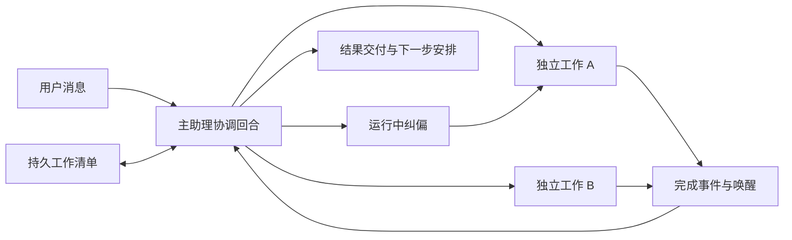
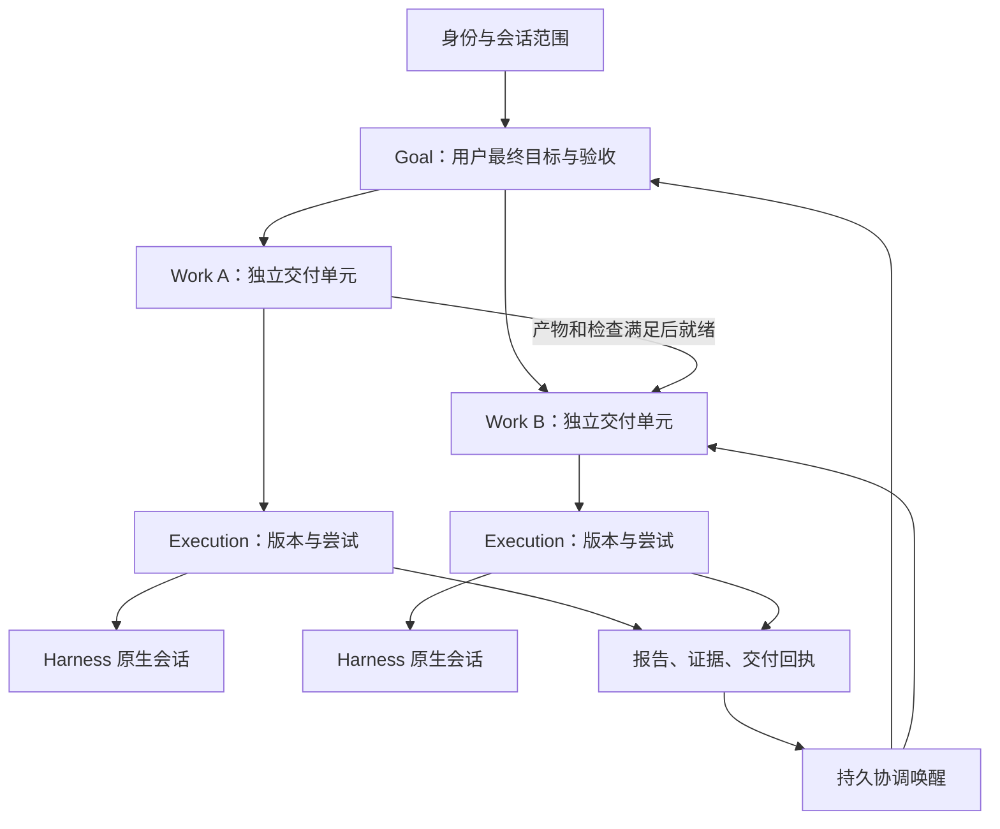

# 持续目标协调：Grokbot 对照与设计

2026-11-10。用户要求不以“最小”为先，重新看 Grokbot 的思路与实现。本轮是代码审计和设计建议，没有实现下述新增 Goal、依赖调度、资源租约或运行中消息协议，也没有修改数据库、发起模型评测或部署服务。

参考为本机非官方恢复仓库 `grokbot-reference-a9f633e`，固定提交 `a9f633e09d49a85829b8236331b9e21f7e612634`，其 [PROVENANCE](../../grokbot-reference-a9f633e/PROVENANCE.md)声明来自 0.18.0 发布物。它不是官方完整源码或线上运行验证。我们的比较基线为 `ef3d2d8`，实际能力见[上一轮实现](work-coordination.md)。

后续[生命周期深入分析](coordination-lifecycle-analysis.md)追踪了 continue→amend、执行/报告身份、原生续接、依赖产物与交付边界，并据此细化和调整本文第五节的实施次序；尚未修改运行实现。

## 一、Grokbot 的中心是持续协调

参考设计把前台主助理当成持续在线的协调者：接话、管理工作清单、安排独立执行者、处理返回结果、交付给用户。每项独立交付有一个工作流；调查、修改、验证共享上下文时应由同一个执行者完成，不为每个动作创建一个顶层 Agent。独立任务才并行，同一任务的更正进入已有执行者。

这套设计的价值是用户可以随时插话、纠正并获得真实进展。持久清单、执行会话、唤醒队列和交付是相互配合的不同对象，不能用增加一个 TodoWrite 工具替代整条链路。

来源：[sand-multitask.ts](../../grokbot-reference-a9f633e/source/host/sand-multitask.ts):16、53、72；实际主提示中的后台工作规则见 [system-prompt.ts](../../grokbot-reference-a9f633e/source/host/runner/system-prompt.ts):176；多任务模式的拆分建议见 [multitask-mode-user-reminder.ts](../../grokbot-reference-a9f633e/source/packages/agent/prompts/multitask-mode-user-reminder.ts)。提示词是行为要求，不等于宿主已强制全部规则。

## 二、已确认的实现及边界

| 关注点       | 实际代码                                                                                                                                                            | 对我们的含义                                                                                                                       |
| ------------ | ------------------------------------------------------------------------------------------------------------------------------------------------------------------- | ---------------------------------------------------------------------------------------------------------------------------------- |
| 多工作清单   | 多任务 TodoWrite 提示允许多个 in_progress，要求每次唤醒先核对清单、交付后再完成。Todo 随 conversation state 通过 blob 引用保存；更新还同步计划文件。                | 每次醒来都有全局视野，不只记住最近一个任务。我们的 Work 应继续是实际工作状态来源，不再增加另一份可手改完成状态的 Todo。            |
| 执行者装配   | executor 配置和多任务 TodoWrite 均有实际工厂、composition、feature gate；不是只存在描述字符串。                                                                     | 需要验证提示、工具、运行器完整装配。`SAND_MULTITASK_PROMPT_SECTION` 符号本身在本机 source 中仅找到定义，不能据此声称该整段已注入。 |
| 运行中纠偏   | MessageSubagent 调用 steerSubagent；保存待注入文字，中断当前轮，settle 后在同一 runner 上执行新指令。完成后跟进另走 Task resume。                                   | 回答等待、运行中补充和修改目标是三种操作；我们只有前者同线程恢复、后者新版本，通用运行中纠偏尚缺。                                 |
| 主助理响应性 | 每个 agent 一个活动协调回合，排队按 user、agent、background 优先；用户等太久触发 watchdog 中断及宽限后的脱离，generation 区分迟到结束。                             | 这是唤醒类型的优先级，不是业务目标重要性。我们的接待已经分离工作槽，也有用户/后台公平性；还需明确长回合下的插话与迟到提交屏障。    |
| 结果回流     | 子任务结束进入父会话 completion 队列，再以 hidden/background 回合唤醒父助理，保留 quietOrigin，并可带未回答问题。                                                   | 回流要驱动审核、下一步和用户交付；“后台已返回”不能等同整个目标完成。我们已有 Report/Reception/Outcome，可以扩展原链路。            |
| 重启恢复     | pending wake 标记原子改名写入 JSON 文件，启动后按 shell/cloud-agent/subagent 重挂。丢失的进程内 subagent 明确报告 interrupted/unknown，再让主助理检查记录或重派。   | 恢复了唤醒责任，不代表全部执行无缝续跑。我们已有原生持久绑定和效果回执，不必降级成只剩提示词和内存 Map。                           |
| 持续目标     | 一个 conversation state 持有单个 goalState，绑定 conversation/session；保留 objective、状态、活动时长及续接计数，三次无工具续接后暂停。                             | 有跨轮持续推进，但尚不能据此称为跨多个长期目标的完整管理器。工具次数也不等于有效进展。                                             |
| 依赖关系     | TodoItem 有 dependencies，执行计划可导入；Build in Parallel 提示让模型分阶段执行。TodoWrite 的模型 schema 没暴露依赖，更新重新构造 TodoItem 时未保留 dependencies。 | 已看到依赖表达和模型分阶段要求，尚未找到可靠的依赖就绪判定/硬调度链路。不能声称已实现完整 DAG 调度。                               |

主要代码入口：

- 清单：[todo.ts](../../grokbot-reference-a9f633e/source/packages/agent/tools/core/todo/todo.ts):135，[schema.ts](../../grokbot-reference-a9f633e/source/packages/agent/tools/core/todo/schema.ts):24，[state.ts](../../grokbot-reference-a9f633e/source/packages/agent/state.ts):1641、2098、2622。
- 装配：[turn-agent-composition.ts](../../grokbot-reference-a9f633e/source/host/runner/turn-agent-composition.ts):1692，[turn-toolset.ts](../../grokbot-reference-a9f633e/source/host/runner/tools/turn-toolset.ts):866、1365。
- 纠偏：[sand-subagent-management-tools.ts](../../grokbot-reference-a9f633e/source/host/runner/tools/sand-subagent-management-tools.ts):110，[subagent-runtime.ts](../../grokbot-reference-a9f633e/source/host/runner/subagent-runtime.ts):268、425。
- 调度：[run-scheduler.ts](../../grokbot-reference-a9f633e/source/host/extensions/transcript/run-scheduler.ts):202、282，[run-lifecycle.ts](../../grokbot-reference-a9f633e/source/host/extensions/transcript/run-lifecycle.ts):28。
- 回流和恢复：[completion-revivals.ts](../../grokbot-reference-a9f633e/source/host/extensions/transcript/completion-revivals.ts):122，[sand-pending-wake-store.ts](../../grokbot-reference-a9f633e/source/host/extensions/transcript/sand-pending-wake-store.ts):133，[pending-wake-rearm.ts](../../grokbot-reference-a9f633e/source/host/extensions/transcript/pending-wake-rearm.ts):233。
- 持续目标：[agent_pb.ts](../../grokbot-reference-a9f633e/source/packages/proto/generated/agent/v1/agent_pb.ts):3645，[goal-continuation-action-handler.ts](../../grokbot-reference-a9f633e/source/packages/agent/actions/goal-continuation-action-handler.ts):18、94，[goal-pursuit-guidelines.ts](../../grokbot-reference-a9f633e/source/packages/agent-core/goal-pursuit-guidelines.ts)。
- 依赖：[todo_tool_pb.ts](../../grokbot-reference-a9f633e/source/packages/proto/generated/agent/v1/todo_tool_pb.ts):46，[execute-plan-action-handler.ts](../../grokbot-reference-a9f633e/source/packages/agent/actions/execute-plan-action-handler.ts):240，[multitask-action-prompt.ts](../../grokbot-reference-a9f633e/source/packages/agent/multitask-action-prompt.ts):25。

## 三、哪些细节不能直接照搬

1. 当前参考的 pendingSubagentSteers 是 `Map<subagentId,string>`，连续写入尚未消费的指令可能覆盖前一条。我们的跟进必须是有序、可确认、可重放的指令，不能只有“已送到”的自然语言回执。
2. Todo 的 completed 主要由模型更新；多任务提示要求交付后更新，代码本身未将它与渠道回执绑定。我们保留完成检查和本地接受回执，不让模型手动涂绿。
3. completion 队列在调用父回合前清除 pending marker；存在需要单独验证的崩溃窗口。JSON `.part` + rename 防止部分文件，却不等于跨回流、消息交付的事务。我们的持久报告和系统 turn 不应替换成内存队列。
4. watchdog 能让后续用户回合继续，但旧 promise 会暂留 zombies。必须同时防止旧回合继续写入；调度 generation 对迟到 settle 的检查，不等于已证明所有外部副作用都有 fencing。
5. Goal 的无工具计数是防空转启发式。更新待办或重复读取也会调用工具，不能因此判定目标有实质进展。

上述是静态代码可见的边界与风险，不是本轮复现的线上事故。

## 四、建议我们的完整模型

按用户真正需要的终态建模：一个人可以拥有多个长期目标，每个目标跨多次执行与会话持续推进；主聊天是统一接待和交付入口。规模随这些语义决定，不先把范围压成最小，也不增加职责重复的状态。

### Goal：保存终态，不复制执行状态

Goal 应独占用户目标、原请求锚点、验收条件、优先级、期限、暂停/撤回及目标修订。Work 继续独占工作执行状态，Execution 继续独占原生绑定与尝试。子工作全绿不能直接证明目标完成，仍需核对最终交付、证据和未满足条件。

目标的运行/等待/阻塞概览从子工作和交互投影；不另外维护一套可以与 Work 打架的手工进度百分比。普通一句问候不创建 Goal。初期每项 Work 归一个 Goal，跨目标复用引用不可变结果，避免多个目标共同修改一项 Work 的所有权。

身份由宿主绑定，Goal 的展示会话不决定它的授权；不能从主模型正文接受 human/owner/grant。这里尚未决定具体 SQL 表结构，需在实现前一起评审历史 Work 的归属和迁移，不自动把旧工作合成一个虚假目标。

### 协调：模型规划，宿主检查可执行性

模型可以提出拆分、顺序、并行、补充和收尾；宿主在提交时验证依赖引用、循环、版本、授权、资源和预算。某工作未就绪时不能只靠提示词要求它等待。

目标重要性、入站唤醒优先级、资源容量分别建模：高优先级目标不会绕过权限，也不能让用户消息长期等在后台报告后面；持续高优先级工作还需公平性策略。依赖完成应检查约定的成功状态与产物，不能把取消/失败当成依赖已满足。

每次用户输入、执行返回、问题回答、定时检查、运行失败与资源释放产生持久协调触发。协调回合可以决定跨工作下一步，但必须沿已授权目标、现有 Work/Outcome owner 提交；不能借系统报告创造新的用户意图。保留有限续接与预算，耗尽进入可解释状态，不能把固定三次续接当成已支持任意长期目标。

### 跟进：会话指令与目标修订分别处理

已有 Interaction 回答维持不变。新增运行中补充需要稳定 instructionId、工作/执行目标、有序序号、捕获版本，以及 accepted/applied/superseded/failed 等事实回执；重复提交不重复注入，多条指令不能互相覆盖。

执行器在安全边界处理补充，原生引擎可中断/续接的具体语义由各 Harness 验证。涉及目标或完成条件改变时仍走原 amend/revision 屏障，旧效果和证据保留。原生会话接收消息不等于模型已执行，更不等于外部效果成功。

### 资源与执行能力

共享桌面、写同一仓库、切同一部署等冲突资源需要明确占用者和过期/撤销屏障；独立阅读和不同仓库不应被一个全局大锁串行化。资源约束落实到执行与工具边界，不能依赖模型彼此礼让。

Grokbot executor 设计携带 Shell/网页/MCP/云代码等可用工作工具；我们的[实际工具](../src/adapters/work-tools/assistant-tools.mjs)主要是上下文、资料、笔记与提问及现有受限工具。协调架构完善后，还需接入真正可完成用户工作的执行适配器。工具提供者可以插件化；目标、授权、协调状态和交付责任属于核心能力。

## 五、实现顺序与退出标准

建议按完整管家行为分批交付，而不是继续只改概览：

1. **连续工作流控制**：运行中有序跟进、完成后续接、停滞检测与真实进展查询。保留已有 Work 身份、修订屏障和原生持久性。
2. **目标与计划协调**：Goal、工作归属、依赖就绪、优先级/公平性、聚合验收。新增的业务事实有明确 owner，落库前评审兼容性。
3. **跨目标长期可靠性**：预算、冲突资源、定时复查、外部执行适配器、唤醒/交付恢复及可观测性，按具体接入面补齐。

验收不能只看 API 返回成功。至少要覆盖：目标 A/B 并行；B 等 A 的真实产物；用户连续两次纠偏不丢指令；用户改口只影响目标工作；执行/回流/发送各窗口崩溃；旧版本迟到结果；共享资源冲突；长任务卡住时用户仍能插话；所有子工作完成但目标验收未满足；预算耗尽后诚实停下。真模型场景再验证自然语言拆分与协调质量，和机制检查分开报告。

**结论：采用 Grokbot 的持续协调与工作流身份思路，保留我们已有的持久账本和校验，再补真实目标、运行中跟进、依赖及资源控制。上一轮是可用基础，不应成为最终架构的范围上限。**
