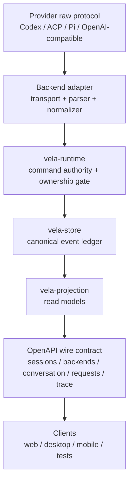

# Agent 能力模型

Vela 的 client-facing contract 以 OpenAPI 为唯一 wire contract。Codex app-server、ACP、Pi RPC、OpenAI-compatible
chat completion 等 provider raw protocol 都不能直接成为客户端契约。

但是，provider 被归一化之后形成的能力面必须进入 OpenAPI：客户端需要知道 session 能做什么、可以提交什么输入、有哪些 request
需要用户处理、哪些 agent work 可以展示、哪些 diagnostics 可以读取。否则 Web、桌面、移动端和测试 harness 会各自猜 provider 行为。

## 分层

OpenAPI 不描述 provider 原始 notification、JSON-RPC method、JSONL event 或 CLI flag。OpenAPI 描述 Vela 归一化之后的稳定面：

- `Session`：当前会话、runtime info、operations。
- `Backend`：可用模型、thinking、mode、feature、capabilities。
- `Input`：用户消息、图片、文件、skill、request response。
- `Read Models`：conversation/work、pending requests、diffs。
- `Diagnostics`：timeline、trace、logger-safe provider records。

## 能力发现

`/backends` 是创建 session 和渲染 composer controls 的能力发现入口。客户端不能硬编码 “Codex 支持什么”、
“ACP 支持什么” 或 “Pi 应该显示哪些按钮”。

Backend capability 应该表达 provider-agnostic 能力，而不是 provider implementation detail。Day 1 的 OpenAPI schema 应保持克制，只承诺客户端已经需要稳定依赖的粗粒度能力：

| Capability | 语义 |
| --- | --- |
| `streaming` | backend 能持续返回 assistant / reasoning / work output |
| `reasoning_stream` | backend 有独立 reasoning/thinking stream |
| `agent_work` | backend 能输出结构化 agent work/tool lifecycle |
| `multimodal_input` | backend 可以消费图片、文件引用或附件输入 |
| `permission_requests` | backend 可以发起用户确认或提问 |
| `structured_diff` | backend 能输出结构化文件变更 |
| `session_agent_config` | session 支持运行时更新 model/thinking/mode/feature |
| `session_persistence` | backend 有 provider-native durable session/thread handle |
| `history_resume` | backend 可以恢复历史 session/thread |
| `mcp_servers` | backend 支持 MCP server 配置 |

更细的行为，例如 `image_input`、`file_input`、`queue`、`guide`、`client_tools`、`rewind_conversation`、`rewind_files`
可以先作为文档 vocabulary 和 implementation TODO 存在；只有当客户端确实需要跨端稳定判断时，才提升为 OpenAPI 字段。

这条规则很重要：OpenAPI 不是想法收纳箱。进入 OpenAPI 的字段就是 client-facing wire promise。

## Session Operations

`Session.operations` 是某个具体 session 当前能执行的操作。它比 backend capability 更动态：同一个 backend 在不同 session 状态下可能有不同可用操作。

推荐的 session operation vocabulary：

| Operation | 语义 |
| --- | --- |
| `send_message` | 普通用户输入 |
| `interrupt` | 停止当前 running turn |
| `guide` | 对 running turn 追加指导，仅 provider 支持 runtime input 时可用 |
| `update_agent_config` | 更新当前 session 偏好，通常对下一 turn 生效 |
| `respond_to_request` | 响应 permission、question、tool confirmation |
| `rewind_conversation` | 回退对话历史 |
| `rewind_files` | 回退文件变更 |
| `rewind_both` | 同时回退对话和文件 |
| `resume` | 恢复 provider-native session/thread |
| `close` | 关闭 session |

客户端应优先根据 `Session.operations` 渲染当前按钮状态；`Backend.capabilities` 用于创建前发现和解释某类能力是否存在。

## Agent Config

`AgentConfig` 是 Vela 的统一配置词汇。Provider adapter 负责把它映射到自己的协议。

| Vela config | 语义 | Provider 映射示例 |
| --- | --- | --- |
| `model` | 后端模型 id | Codex model、ACP `session/setModel`、Pi `--model` |
| `reasoning_effort` | 思考/推理强度 | Codex effort、Pi thinking、ACP config option |
| `permission_mode` | 本地权限和审批策略 | sandbox、approval policy、provider permission profile |
| `feature_values` | backend-discovered feature values | `fast_mode`、`plan_mode`、web search 等 |

`model`、`reasoning_effort`、`permission_mode` 是 Day 1 一等字段；其他 provider-specific 但可发现、可验证的开关进入
`feature_values`。如果后续多个 backend 都出现互斥 mode 概念，再把 `mode_id` 提升为 OpenAPI 一等字段。`feature_values`
不能成为 raw config tunnel，feature id 和 value type 必须来自 `/backends/{backend}` discovery。

运行中的 turn 不读取被修改后的 session config。Runtime 在 `turn.started` 时冻结 `resolved_agent_config`；session-level
`agent_config` 表示用户当前偏好，下一次 input command 使用它。

## 输入模型

用户输入必须通过 OpenAPI input event 表达。Provider prompt shape 不进入客户端契约。

Day 1 应支持这些 input part：

| Part | 语义 |
| --- | --- |
| `text` | 用户文本 |
| `image` | inline base64 图片，适合本地-first Day 1 |
| `image_ref` | 未来 blob/upload 引用 |
| `file_ref` | 本地或 workspace 文件引用 |
| `skill` | skill/resource 引用，adapter 映射到 provider prompt block 或 instruction |

`user.message`、`user.request_answer`、`user.tool_confirmation`、`user.custom_tool_result` 应该在 OpenAPI 中表达成
`oneOf + discriminator` branch，而不是一个宽松 object。这样客户端、Rust DTO 和红测可以共享同一个 wire contract。

## Agent Work

UI 上叫 `ConversationView`，领域语义上更接近 `AgentWorkItem`。它不是“工具列表”，而是 agent 正在做或已经做过的工作。

推荐的 work detail vocabulary：

| Detail | 例子 |
| --- | --- |
| `shell` | terminal command、stdout、stderr、exit code |
| `read` | 读取文件 |
| `edit` | 编辑文件、old/new string、diff |
| `write` | 写入文件 |
| `search` | code search、file search、web search |
| `fetch` | URL fetch、文档读取 |
| `browser` | 浏览器操作 |
| `mcp_tool` | MCP server tool call |
| `dynamic_tool` | provider/host 动态工具 |
| `sub_agent` | 子 agent / delegated task |
| `plan` | plan / todo / approval plan |
| `image_generation` | 图片生成 |
| `image_view` | 图片查看 |
| `plain_text` | provider 给出的结构化但非工具文本 |
| `unknown` | 仍需吸收但尚未归一化的 business signal |

Provider normalizer 应尽量把 Codex、ACP、Pi 的 tool/event vocabulary 吸收到这些 detail branch。普通 UI 不应显示 provider raw event name
作为 work title；unknown 只能作为降级展示，并应在 diagnostics 中保留 raw。

## Requests

`PendingRequestsView` 是所有用户确认和提问的唯一 UI contract。它不从 conversation text、timeline 或 provider raw event 中推断。

Request 应支持：

- `permission`
- `question`
- `tool_confirmation`
- `plan_approval`
- `mode_switch`
- `custom_input`
- `other`

每个 request 可以带：

- `actions`：用户可选动作，例如 allow、deny、implement、dismiss。
- `suggestions`：provider 建议的 permission/config 更新。
- `detail`：可安全展示的 `ActivityItemDetail`，例如命令、文件变更、MCP tool。
- `backend_ref`：adapter 用来映射回 provider request id 的 opaque reference；普通 UI 不依赖它。

## Diagnostics

控制面 telemetry、unknown provider notification、normalization warning 和 raw provider payload 不进入普通 read model。它们进入 diagnostics：

- `/sessions/{session_id}/trace`
- provider cassette / test fixture
- adapter logger

例如 Codex app-server 的 `remoteControl/status/changed`、`mcpServer/startupStatus/updated`、`account/rateLimits/updated`
是控制面 telemetry；它们可以帮助调试，但不应渲染成聊天内容、agent work item 或 warning bubble。

## Paseo 对比

Paseo 的成熟之处在于它把 provider runtime 显式建成：

- provider snapshot / models / modes / features；
- `AgentSession` 能力面；
- `AgentStreamEvent`；
- `AgentTimelineItem`；
- provider-specific mapper 和大量 fixture tests。

Vela 应学习这个形状，但落点不同：

| Paseo | Vela |
| --- | --- |
| Zod message union 是 app/server wire guard | OpenAPI 是唯一 client-facing wire contract |
| `AgentStreamEvent` 直接喂 app runtime | backend output 先进入 canonical event ledger |
| app 侧 timeline item 承担较多 normalization | Rust adapter + projection 先归一化，再输出 read models |
| provider persistence 更偏 app provider session | `SessionRuntimeInfo.native_session_id` + event ledger |
| tool mapper 在 TS provider 内 | Vela 应在 Rust backend normalizer 建 `AgentWork` mapper |

Vela 的目标不是比 Paseo 更轻，而是把 Paseo 证明有效的 provider runtime 思想，下沉到 Rust daemon 和 OpenAPI 契约中。

但 Vela 不能把所有 Paseo 概念一次性塞进 OpenAPI。Paseo 的很多能力可以先进入架构 vocabulary、adapter test fixture 和 Rust internal enum；
只有已经被 Web、桌面、移动端或外部 SDK 稳定依赖的形状，才进入 OpenAPI。

## Requirements

### Requirement: OpenAPI 只暴露归一化能力

Provider raw method、notification、event type MUST NOT 成为 client-facing API。

#### Scenario: Codex app-server 输出 notification

- **WHEN** Codex 输出 `thread/status/changed`
- **THEN** adapter 可以记录 diagnostics trace
- **AND** OpenAPI 不增加 Codex-specific notification schema
- **AND** 普通 UI 不渲染该 notification

### Requirement: Client 不硬编码 backend kind

Client MUST 通过 `Backend.capabilities`、`Backend.models`、`Backend.features` 和 `Session.operations` 决定 UI。

#### Scenario: Hermes ACP 支持图片但 Pi 暂不支持

- **WHEN** client 渲染 composer add menu
- **THEN** 它检查当前 session/backend 是否有 `multimodal_input`
- **AND** 不通过 `backend === "acp"` 判断是否显示图片上传

### Requirement: Provider work 必须归一化

Provider tool/work output MUST 先映射成 Vela work detail branch，再进入 `ConversationView`。

#### Scenario: Codex 输出 command execution item

- **WHEN** Codex app-server 输出 command execution thread item
- **THEN** normalizer 映射为 `shell` work detail
- **AND** `ConversationView` 显示稳定 title、summary、status 和 detail
- **AND** provider raw item 只进入 diagnostics

### Requirement: Request 是唯一确认面

Permission、question、tool confirmation MUST 通过 `PendingRequestsView` 暴露给 UI。

#### Scenario: ACP 请求用户批准工具调用

- **WHEN** ACP backend 发起 permission request
- **THEN** adapter 映射为 `request.opened`
- **AND** client 刷新 `PendingRequestsView`
- **AND** 用户响应通过 input event 返回
