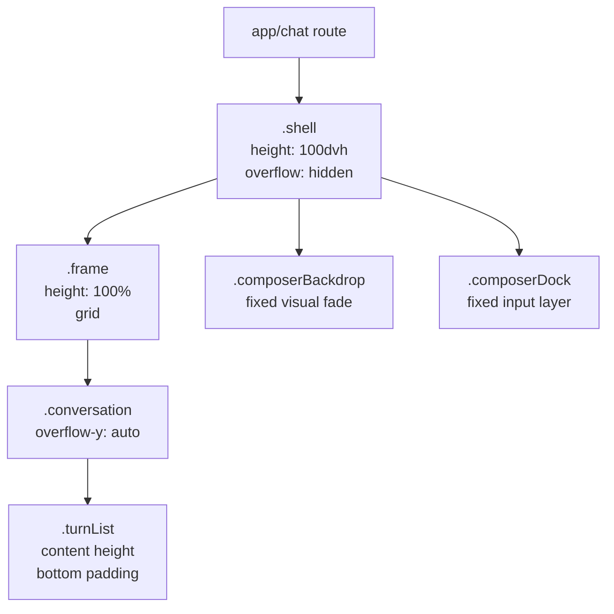

# Chat Scroll Runtime

Chat 主列滚动是 `vela-chat-web` 的 renderer concern，不进入 OpenAPI，也不由
`velad` 决定。后端只提供有序的 `ConversationView` window 和 event cursor；
Web renderer 负责把这个 window 放进正确的 viewport、滚动容器和 bottom-anchor
状态机。

这页是维护契约：后续改 ChatUI 时，先保持这些不变量，再改视觉和交互。

## 核心不变量

Chat 页面只有一个实际滚动容器：

- `document` / `html` / `body` 不承担聊天主列滚动。
- `.shell` 固定为 `height: 100dvh`，并且 `overflow: hidden`。
- `.frame` 固定为 `height: 100%`，并且 `min-height: 0`。
- `.conversation` 是唯一主列滚动容器，使用 `overflow-y: auto`。
- `.turnList` 是内容高度来源，不是滚动容器。

这个约束很重要。只用 `min-height: 100dvh` 会让 `.frame` 和 `.conversation`
被长消息撑高，实际滚动落回 document。此时 scroll controller 还在控制
`.conversation`，会出现“controller 以为已贴底，但用户看到没有贴底”的错位。

正确的浏览器指标应该类似：

```text
conversation.clientHeight ~= viewport height
conversation.scrollHeight >= conversation.clientHeight
conversation.scrollTop + conversation.clientHeight ~= conversation.scrollHeight
document.scrollingElement.scrollHeight ~= viewport height
```

当内容足够长时，`conversation.distance_from_bottom` 应接近 `0`，而不是
document 在滚。

## 布局边界



Composer 和 conversation 没有父子滚动关系。Composer 是固定的输入层；
conversation 内容通过 `--vela-composer-height` 预留底部空间，让消息在输入框
后方渐隐，而不是被输入框挤压或成为 composer 的子内容。

因此：

- composer 高度变化由 `ResizeObserver` 测量。
- `--vela-composer-height` 写到 frame style。
- `.turnList` 用 `calc(var(--vela-composer-height) + 28px)` 作为底部 padding。
- `.composerBackdrop` 只负责视觉渐变，不负责滚动或布局。
- `.composerDock` 不能设置成滚动容器，也不能包住 conversation。

## Runtime 模块

滚动逻辑集中在 `packages/vela-chat-web/src/conversation-runtime/scroll`：

| 文件 | 职责 |
| --- | --- |
| `bottomAnchorDriver.ts` | 纯 bottom-anchor 状态机。处理 sticky/detached、route/local request、测量阻塞和 post-layout verification。 |
| `useConversationScrollController.ts` | React/DOM adapter。读取 DOM 测量、绑定 scroll/resize observer、调用 driver。 |
| `historyPaging.ts` | 近顶部分页触发和 prepend 后的 scrollTop 修正。 |
| `routeResume.ts` | session-scoped scroll resume。只恢复 detached 位置。 |
| `viewportHandle.ts` | Workbench / composer 能调用的 imperative contract。 |

DOM hook 不能长出第二套状态机。新滚动行为必须先放进 `bottomAnchorDriver.ts`
的纯逻辑，再由 hook 翻译 DOM 事件和测量。

## Bottom Anchor

Bottom anchor 有两种模式：

| Mode | 含义 |
| --- | --- |
| `sticky_bottom` | 用户正在跟随输出。内容增长、发送消息、viewport 变化时保持贴底。 |
| `detached` | 用户主动上滑离开底部。新输出不抢滚动位置。 |

请求来源分三类：

| Source | Reason | 用途 |
| --- | --- | --- |
| route | `route_initial_entry` / `route_resume` | 首次进入 session 或恢复滚动。 |
| local | `message_sent` / `jump_to_bottom` | 用户发送消息或点击回到底部。 |
| maintenance | `viewport_changed` / `content_mutated` | 内容和 viewport 变化时维持 sticky bottom。 |

关键阈值：

- near bottom threshold: `180px`。
- at bottom threshold: `1px`。
- user scroll-away delta: `24px`。
- post-layout verification 最多重试 `3` 次。

发送消息时有两个 anchor intent：

1. Composer submit 立即调用 `requestBottomAnchor("message_sent")`。
2. `loadReadModels()` commit 后递增 `messageFollowToken`，conversation 在新 DOM
   提交后再请求一次 `message_sent`。

第二次请求不是兼容逻辑，而是解决 React commit 时序：发送后新增 user row /
status row 可能在第一次滚动后才进入 DOM。

## Signals

`deriveConversationScrollSignals` 把 stream item 分成两类：

| Signal | 来源 | 用途 |
| --- | --- | --- |
| `followSignal` | `user_message`、`assistant_markdown` | 决定输出跟随和 bottom-anchor。 |
| `layoutSignal` | `turn_meta`、`agent_work` 等非正文 item | 触发尺寸测量和布局更新。 |

Agent work、turn timer、工具展开收起不应该直接驱动“跟随最新消息”的语义。
它们可以改变高度，所以进入 layout signal，但正文跟随以 user/assistant 消息为准。

## History Paging

向上翻历史时：

- `scrollTop <= 96px` 才触发 older history load。
- 必须 `hasOlderHistory=true` 且 `isLoadingOlderHistory=false`。
- prepend 前记录 `previousScrollHeight` 和 `previousScrollTop`。
- prepend 后用高度增量修正 `scrollTop`，保持用户视野不跳。

这部分只处理“向上加载老消息”。它不应该参与普通发送、streaming 贴底或 composer
位置计算。

## Route Resume

Scroll resume 用 `sessionStorage`，key 形如：

```text
vela-chat:conversation-scroll:<encoded route key>
```

只存小状态：

```json
{
  "version": 1,
  "route_key": "session-id",
  "scroll_top": 1234,
  "follow_output": false
}
```

恢复规则：

- 如果 `follow_output=true`，不恢复旧 `scrollTop`，直接走 bottom-anchor。
- 只有 detached 状态才恢复旧位置。
- 恢复前必须等 history ready、viewport 可测、content 可测。
- sessionStorage 失败只影响舒适性，不影响聊天功能。

## Virtualization

Conversation strategy 由 host policy 和 item 数量决定：

- 小窗口走 `web-plain`，直接挂载 recent items。
- 长窗口走 `web-partial-virtualized`，历史区用 `@tanstack/react-virtual`，
  recent mounted window 和 live head 保持真实 DOM。

虚拟列表必须使用 `.conversation` 作为 `getScrollElement()`。不要让 virtualizer
读 document scroll，也不要把滚动状态放到 page shell。

Virtualized history 只处理历史 item。Live head 仍然真实挂载，保证 streaming
assistant、running turn meta 和当前工具状态不被虚拟化破坏。

## Debug Signals

`window.__VELA_CHAT_DEBUG__.getSnapshot()` 会暴露 compact scroll summary：

```ts
interface ConversationScrollDebug {
  followOutput: boolean;
  bottomAnchorMode: "sticky_bottom" | "detached";
  bottomAnchorBlockedReason: string | null;
  bottomAnchorPendingReason: string | null;
  bottomAnchorLastFulfilledReason: string | null;
  routeResumeStatus: "idle" | "pending" | "restored";
  routeResumeScrollTop: number | null;
  lastFollowSignal: string;
  lastLayoutSignal: string;
}
```

定位滚动问题时，先看 DOM 指标：

```js
const el = document.querySelector('[aria-label="Chat transcript"]');
({
  scrollTop: el.scrollTop,
  scrollHeight: el.scrollHeight,
  clientHeight: el.clientHeight,
  distance: el.scrollHeight - el.scrollTop - el.clientHeight,
});
```

如果 `clientHeight === scrollHeight` 且页面内容很长，通常是高度链坏了。
如果 `distance > 0` 且 `followOutput=true`，再查 pending/block reason 和
post-layout verification。

## 禁止事项

- 不要让 `body` 或 `html` 成为聊天主列滚动容器。
- 不要把 composer 放进 conversation 内容流里。
- 不要在 `app/chat` 用 `querySelector` 手动滚动主列。
- 不要在 React component 里复制 bottom-anchor 状态机。
- 不要让 agent work detail、tool timer 或 request dock 直接决定是否跟随输出。
- 不要把 scroll state 写入 OpenAPI read model。
- 不要为了视觉渐隐修改滚动容器边界；改 `.composerBackdrop` 和 bottom padding。

## 修改 Checklist

改滚动相关代码时至少检查：

- `npm test -- packages/vela-chat-web/tests/dependency-direction.test.ts`
- `npm run build`
- 浏览器中 `Chat transcript` 是否是真实滚动容器。
- 发送消息后 `distance` 是否回到 `0`。
- streaming 增长时 `scrollTop` 是否随 `scrollHeight` 增长。
- 用户主动上滑后是否进入 detached，不抢回滚动。
- 加载 older history 后当前视野是否保持。
