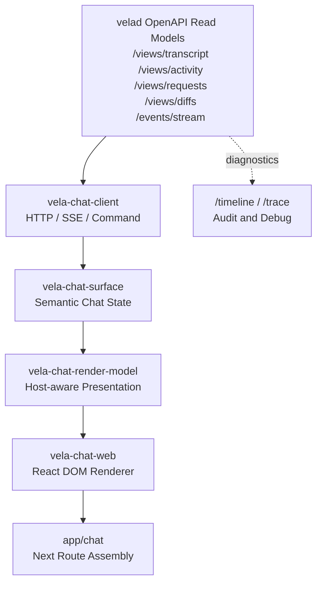
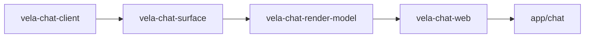

# Chat Surface Architecture

velaChat 的 ChatUI 不应该从某个大组件开始。它应该从一个可回放、可验证、可定位问题的 **Chat Surface** 开始。

这套设计的目标是让 Web、移动 Web、桌面壳共享同一套核心代码，同时让后续 Agent 维护时能快速判断问题属于 API、client、surface、render model、React 组件还是页面装配。



## 分层职责

### velad OpenAPI read models

后端 API 是唯一 wire contract。OpenAPI 定义 client-facing JSON 字段、required 规则、错误 envelope、command ack 和 read model 形状。

普通 ChatUI 主列 MUST 优先消费：

- `GET /sessions/{session_id}/views/transcript`
- `GET /sessions/{session_id}/events/stream`
- `POST /sessions/{session_id}/events`

辅助区域 SHOULD 消费：

- `GET /sessions/{session_id}/views/activity`
- `GET /sessions/{session_id}/views/requests`
- `GET /sessions/{session_id}/views/diffs`

诊断和审计面板 MAY 消费：

- `GET /sessions/{session_id}/timeline`
- `GET /sessions/{session_id}/trace`

`timeline` 和 `trace` 是主 Agent API / audit resource，不是普通 transcript 的拼装输入。

### `vela-chat-client`

`vela-chat-client` 只回答一个问题：如何和本地 `velad` 通信。

职责：

- 构造 API URL。
- 读取 transcript、activity、requests、diffs。
- 发送 `user.message`，并生成或接收 `Idempotency-Key`。
- 连接 session SSE stream。
- 将 HTTP、SSE、JSON parse 失败变成结构化错误。

禁止：

- import React 或 Next。
- 持有 UI 组件状态。
- 把多个 read model 合成页面状态。
- 直接决定一条消息是否折叠。

### `vela-chat-surface`

`vela-chat-surface` 负责把多个 OpenAPI read model 合成稳定的语义状态。它是跨端共享的展示契约，不是 React props 的随意集合。

它回答的问题是：当前 session 在 Chat surface 上“是什么状态”。

典型输出：

```ts
interface ChatSurface {
  session: ChatSurfaceSession | null;
  transcript: ChatSurfaceTranscript;
  activity: ChatSurfaceActivity;
  pending_requests: ChatSurfacePendingRequests;
  diffs: ChatSurfaceDiffs;
  stream: ChatSurfaceStreamState;
  cursors: ChatSurfaceCursors;
  diagnostics: ChatSurfaceDiagnostics;
}
```

这一层保留可定位信息：

- `source_event_ids`
- `cursor`
- `projection`
- `session_id`
- `request_id`
- `tool_id`
- `debug_hints`

`source_event_ids` 只能来自 OpenAPI read model 明确提供的 provenance：
`ChatTranscriptRow.source_event_ids` 或 `ActivityShelfItem.event_range`。如果
`PendingRequestsView` 或某个 activity item 没有给出 event provenance，surface
必须保留空数组，而不是用 row/item/request id 伪造 event id。

禁止：

- import React。
- 做 markdown block 分块。
- 做移动端 / 桌面端布局判断。
- 读取 raw provider event。

### `vela-chat-render-model`

`vela-chat-render-model` 负责把稳定的 `ChatSurface` 转成某个 host 上最适合展示的 render model。

它回答的问题是：在当前 host 上应该如何展示。

职责：

- 长 user message 折叠策略。
- assistant markdown block 分块。
- settled turn 的 work / narration 折叠策略。
- mobile / desktop / desktop-shell host policy。
- row stable key。
- loading、empty、error 的展示状态。
- accessibility label 和可交互 affordance 的抽象。

典型 host policy：

```ts
type ChatHostPolicy =
  | { kind: "mobile_web"; pointer: "touch"; activity: "sheet" }
  | { kind: "desktop_web"; pointer: "mouse"; activity: "rail" }
  | { kind: "desktop_shell"; pointer: "mouse"; activity: "dock" };
```

禁止：

- fetch。
- 认识 OpenAPI raw wire 字段。
- import React。
- 改变 command 行为。

### `vela-chat-web`

`vela-chat-web` 是 React DOM renderer。它只把 `ChatRenderModel` 画出来。

职责：

- `ChatShell`
- `TranscriptPane`
- `TranscriptRow`
- `UserMessage`
- `AssistantMessage`
- `MarkdownBlock`
- `Composer`
- `ActivityRail`
- `RequestPanel`
- `DiagnosticsDrawer`

禁止：

- 直接调用 `fetch`。
- 直接读取 `/timeline` 拼普通聊天。
- 在组件里解析 OpenAPI DTO。
- 在一个 `ChatView.tsx` 里隐藏 projection、transport、render policy。

### `app/chat`

`app/chat` 是 Next route assembly。它是胶水层，不应该藏核心逻辑。

职责：

- 读取 `session_id`、`base_url` 和 host mode。
- 创建 `vela-chat-client`。
- 拉取 read models。
- 订阅 SSE。
- 把 wire DTO 交给 `vela-chat-surface`。
- 把 `ChatSurface` 交给 `vela-chat-render-model`。
- 把 `ChatRenderModel` 交给 `vela-chat-web`。

## AI 友好定位

每一层都必须能独立回答“问题是不是在我这里”。

### 问题定位矩阵

| 现象 | 优先检查 |
| --- | --- |
| 请求打不到 daemon | `vela-chat-client` URL、base URL、CORS、network error |
| user message 返回 rejected | `velad` response、`CommandAck`、`Idempotency-Key` |
| transcript 少消息 | `/views/transcript` response、`vela-chat-surface` normalizer |
| activity/tool 没显示 | `/views/activity` response、surface activity merge |
| 长消息卡顿 | `vela-chat-render-model` markdown block split、row memo key |
| 移动端布局不合理 | host policy、render model，而不是 surface |
| 视觉错位 | `vela-chat-web` component 和 CSS |
| 需要审计 raw event | `/sessions/{session_id}/timeline` 或 `/trace` |

### 模块 README 要求

每个 package 和重要目录 MUST 有 `README.md`，至少说明：

- 这个模块负责什么。
- 这个模块不负责什么。
- 允许依赖哪些层。
- 禁止依赖哪些层。
- 出问题时从哪里开始看。
- 关键测试和 fixture 在哪里。

### 依赖方向

依赖方向必须单向：



约束：

- `surface` MUST NOT import React、Next 或 browser APIs。
- `render-model` MUST NOT import React、Next、fetch 或 OpenAPI route helpers。
- `web` MUST NOT inspect raw wire-only fields such as `created_at` or `event_range` unless they have already been normalized.
- `app/chat` MAY import all lower layers, but MUST keep logic thin.

这些约束 SHOULD 由 dependency-direction tests 固化。

## 渲染策略

### 长 user message

长 user message 应在 render model 层折叠。原始完整文本必须保留为 `copy_text`，折叠只影响展示，不影响复制、重发、审计。

### 长 assistant markdown

长 assistant message 应在 render model 层按 markdown block 分块：

- 空行可以作为 block 边界。
- fenced code block 内部不能拆。
- 表格、列表、代码块尽量保持完整。
- streaming 时尽量只重渲最后一个增长中的 block。

这个策略来自 Paseo 的移动端长消息经验，但在 velaChat 中属于 render strategy，不进入 API 或 surface contract。

### 工具和中间 narration

普通 transcript 不应该被 tool noise 淹没。Chat 正文和 agent work 是两个不同 surface：正文只渲染 user/assistant message-like rows，agent work 从 `ActivityShelfView` 进入独立 work rows。

所有工具调用都应该进入 activity projection，无论是长运行命令还是短 search/read/list。`timeline` 保留完整事实，`activity` 保留 UI-safe 工具语义，前端可以折叠或虚拟化，但不从普通 activity model 丢工具。

`Worked for ...` 不由 backend 写死，也不是 activity item 字段。它由前端 render model 按消息时间边界派生：从本轮 user row 的 `created_at` 到 terminal assistant row 的 `updated_at`。这个规则避免 provider/backend 对 turn 概念不一致时污染 UI 契约。

折叠策略属于 render model；原始 activity、tool detail 和 source event IDs 必须留在 surface diagnostics 中。

## 第一版落地边界

第一版 WebUI 只需要跑通：

- 指定 `velad` base URL。
- 指定或创建 session。
- 拉取 `/views/transcript` row window。
- 发送 `user.message`。
- 订阅 `/events/stream`，由隔离 live adapter 把相关 canonical events 转成本地 transcript row patch。
- 展示 transcript、composer、基础 running/error 状态。

第一版不需要：

- 完整右侧 diagnostics 面板。
- diff review。
- request approval UI。
- timeline raw replay UI。
- native desktop host integration。
- projected `/views/transcript/stream`。这是下一阶段把 live adapter 下沉到 Rust projector 后的 API，不是 Day 0 组件层职责。

但目录和类型必须为这些后续能力留出位置，避免后面把所有逻辑塞进页面组件。

## 设计判断

ChatUI 的核心不是 `ChatView`，而是可测试的 surface pipeline：

```txt
OpenAPI DTO
  -> client
  -> surface normalizer
  -> render model
  -> React DOM renderer
  -> Next route assembly
```

这样 Web、移动 Web、桌面壳可以共享大部分代码；如果未来需要真正原生移动端，也可以复用 OpenAPI、client、surface、render model fixtures，再单独实现 Native renderer。
