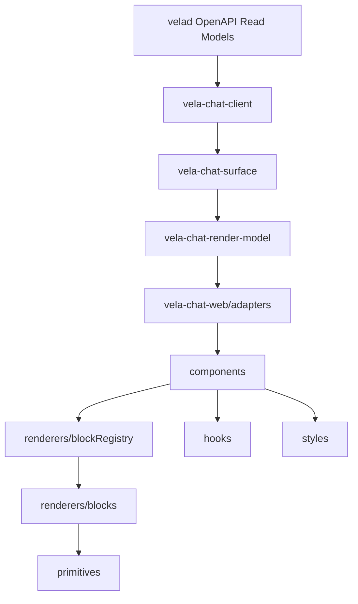

# Chat Web Renderer Architecture

`vela-chat-web` 是 `ChatRenderModel` 的 React DOM renderer。它不是数据层、不是 OpenAPI client，也不是 timeline projector。

这一层的目标是：让桌面 Web、移动 Web 和未来桌面壳共享同一个 DOM renderer，同时让后续 Agent 在很少上下文里定位问题。

## 终局目录

```txt
packages/vela-chat-web/src/
  adapters/
    README.md
    toWebBlocks.ts

  conversation-runtime/
    README.md
    model/
      README.md
      buildConversationStreamItems.ts
      buildConversationRuntimeSegments.ts
      estimateStreamItemHeight.ts
      virtualizationPolicy.ts
    scroll/
      README.md
      bottomAnchor.ts
      historyPaging.ts
      useConversationScrollController.ts
    strategy/
      README.md
      strategyResolver.ts
      strategyRegistry.ts
      strategy.ts
      webPlainStrategy.tsx
      webVirtualizedStrategy.tsx

  renderers/
    README.md
    blockRegistry.tsx
    blocks/
      README.md
      AssistantMarkdownRenderer.tsx
      UserMessageRenderer.tsx
      StatusRenderer.tsx
      ActivityRenderer.tsx
      ReasoningRenderer.tsx
      ToolCallRenderer.tsx

  primitives/
    README.md
    message/
      README.md
      Message.tsx
      MessageResponse.tsx
    conversation/
      README.md
      Conversation.tsx
    prompt-input/
      README.md
      PromptInput.tsx
    reasoning/
      README.md
      Reasoning.tsx
    tool/
      README.md
      Tool.tsx

  components/
    README.md
    workbench/
      README.md
      ChatWorkbenchView.tsx
    conversation/
      README.md
      VelaConversation.tsx
      VelaTurnList.tsx
      VelaTurnGroup.tsx
    composer/
      README.md
      VelaComposer.tsx

  hooks/
    README.md
    useVelaScrollController.ts
    useAutoResizeTextarea.ts
    useComposerKeyboard.ts

  styles/
    README.md
    desktop.module.css
    mobile.module.css

  index.tsx
```

第一版不需要一次性创建所有文件。可以先落必要目录，但目录哲学必须按这个形状走。

## 数据流



`vela-chat-render-model` 是跨端语义模型。`vela-chat-web/adapters` 只做 Web 平台适配，不把 Web-only 概念反向塞回 render model。

## 目录职责

### `adapters/`

Change here when `ChatRenderModel` needs to be converted into Web-specific block props.

职责：

- 把 `ChatRenderModel` 映射成 Web renderer 可消费的 blocks。
- 补 Web-only affordance，例如 DOM key、ARIA label、renderer hint。
- 隔离未来 `ChatRenderModel` 结构演进和 React 组件 props。

Do not:

- fetch 数据。
- import React component。
- 解析 OpenAPI raw wire fields。
- 决定 CSS、滚动、输入框行为。

### `conversation-runtime/`

Change here when the main conversation list strategy changes.

职责：

- 把 Web blocks 转成稳定的 `ConversationStreamItem`。
- 切分 history / mounted recent window / live head。
- 按 host policy 决定是否启用 Web partial virtualization。
- 管理 near-top history paging、prepend scroll anchor、sticky-to-bottom 和 session route resume。

Do not:

- 读取 OpenAPI wire DTO。
- 解析 provider raw events。
- 渲染具体 message、tool、markdown 内容。
- 把移动端 native list 语义塞进 DOM primitive。

Host policy 是这一层的一等输入：

| Host | Runtime policy |
| --- | --- |
| `desktop_web` | 使用 Paseo-style `head/tail + partial virtualization + bottom anchor` |
| `desktop_shell` | 与 `desktop_web` 同策略，外层 host shell 只处理窗口和系统能力 |
| `mobile_web` | 同样使用 Web partial virtualization；触控布局属于 CSS/host shell，不通过关闭虚拟化解决 |

这和 Paseo 的路线一致：平台策略先分派，再进入列表实现。区别是 Vela 的基础窗口仍来自 OpenAPI read models：`ChatTranscriptView` 与 `ActivityShelfView` 分别分页，client runtime 再合成 conversation window。

注意：`mobile_web` 仍然是 DOM/WebView renderer，不等于未来真正 native mobile renderer。原生移动端如果采用 inverted list，应新增 host-specific renderer，而不是让 Web 退回全量 DOM。

Day 1 的 route resume 是浏览器 session 级体验能力：`conversation-runtime/scroll/routeResume.ts` 用 `sessionStorage` 按 session route key 保存 scroll state，只恢复用户已经脱离底部的阅读位置；如果用户仍在 following output，则继续使用 bottom anchor。它不是 OpenAPI wire contract，也不承担跨设备或原生移动端列表恢复。

`strategyResolver.ts` 只做纯策略名决策，必须可被 Node tests 直接 import；`strategyRegistry.ts` 才把策略名映射到具体 React strategy。组件层只能调用 registry，不能自己 import `webPlainStrategy` / `webVirtualizedStrategy` 并写判断。

### Paseo 对照与本轮不改项

Paseo 的 app-side agent stream 已经验证了 `head/tail + bottom anchor + partial virtualization` 路线。Vela 当前采用同一方向，但有几个需要显式记录的差异：

- Paseo Web 在 mobile breakpoint 下不会切出 partial virtualized history；它的真正移动端由 native inverted list 承担。Vela 的 `mobile_web` 仍是 DOM/WebView renderer，所以当前继续使用 Web partial virtualization。不要在没有移动 WebView 实测前直接照搬 Paseo 的 mobile breakpoint 分支。
- Vela 只把 assistant markdown 按空行和 fenced-code 边界拆成 item。一个超长代码块或超长单段 markdown 仍然是单个 item；本轮不在 renderer 内部再切，因为那会影响 copy、markdown 语义和 Streamdown streaming 行为。
- Paseo 的 render model 接收显式 `tail` / `head`。Vela 的基础窗口来自 OpenAPI read models：`ChatTranscriptView.rows` 提供正文行，`ChatTranscriptView.turns` 提供 window-scoped turn lifecycle，`ActivityShelfView.items` 提供 work detail。Web runtime 可以据此合成 history/live head，但不能只看 assistant row 的 `streaming` 或 activity row 的状态来推导 turn lifecycle；如果真实 Codex / ACP / Pi cassette 证明需要更省流的 read-model patch stream，应先升级 OpenAPI projector contract，再改 JS 分段算法。
- Paseo 的 pending permission 是 agent-stream 的 `liveAuxiliary`，和 running / completed turn footer 一起参与列表底部布局。Vela 当前故意不同：pending request 是 OpenAPI `PendingRequestsView`，Web 只在 workbench shell 里渲染 floating `RequestDock`，不把 request 伪装成 transcript row。这样能保持 read-model 分层清晰，但它不是 Paseo auxiliary lane 的完整等价物：如果后续真实弱网、移动 WebView 或多 request 场景证明 dock 会遮挡 live head / composer / bottom anchor，下一步应该新增明确的 `conversation-runtime/auxiliary` 布局入口，或先升级 OpenAPI conversation view，而不是让 `RequestDock` 读取 timeline/raw event。
- Paseo 的 bottom-anchor 已经抽成带 measurement ownership 的 pure driver：container key、viewport/content measurement key、pending verification 和 retry disposition 都在一个状态机里。Vela 当前是 `bottomAnchor.ts` 纯规则 + `useConversationScrollController.ts` DOM hook，已经覆盖 route readiness、settle retry、ResizeObserver 和 prepend anchor，但还不是 Paseo 那种完整 driver。不要继续在 hook 里叠加零散 `useEffect`；如果后续出现“切 session / 切策略 / virtualizer 重测后贴底错乱”的确定 bug，应先抽 `conversation-runtime/scroll/bottomAnchorDriver.ts`，用 pure tests 对齐 Paseo 的 blocked reason 和 stale measurement cases。
- 当前 SSE 仍是 canonical event stream，前端只做 local overlay 与 scoped read-model refresh。更省流的 read-model patch stream 可以后续进入 OpenAPI，但这不是本轮 ChatUI renderer 的 JS 小修范围。

### 2026-06-20 renderer audit notes

This audit checked the current JS renderer against the OpenAPI read-model
contract and Paseo's agent-stream shape. Do not turn these into heuristic fixes:

- `ActivityShelfItem.kind` in `public/openapi/velachat.v1.yaml` is already
  `tool` / `command` / `task` / `warning` / `runtime`, and
  `vela-chat-client` uses the same allowlist. Do not add `request` / `diff`
  activity kinds unless OpenAPI changes first.
- The JS render model now preserves projected `tool`, `command`, `task`, and
  `warning` activity rows, and still surfaces failed runtime activity as a
  failed status row. It intentionally does not render every non-failed
  `kind: runtime` item as agent work: `turn.started` / `turn.completed` can
  duplicate session status and `ChatTranscriptView.turns`. Turn headers and
  `已处理 ...` / host-localized worked labels must come from transcript turn summaries, not from
  runtime activity rows. If runtime lifecycle rows should become visible,
  first define a presentation rule that separates user-visible progress from
  lifecycle bookkeeping, then add tests. Do not fix this by simply adding
  `runtime` to the activity work predicate.
- Transcript and activity history paging already use the OpenAPI
  `direction + anchor_row_id` / `direction + anchor_item_id` contract. Legacy
  row-anchor options are rejected at the client boundary.
- `assistant.message.delta` is intentionally planned as local overlay only.
  `ChatWorkbench` schedules scoped read-model refreshes for non-delta events,
  and requests transcript refresh only when a delta has no local assistant row
  target.
- `streamReadModelRefreshPlan` can return `diffs: true` for `diff.updated`
  and `affected_views: ["diffs"]`, but the example `/chat` route currently has
  no `DiffReviewView` state, no `ChatSurfaceDiffs`, and no review lane renderer.
  Treat this as an unmaterialized OpenAPI/client capability, not a rendering
  bug in the conversation list. Do not route `diff.updated` through transcript,
  activity work rows, or timeline/raw events to make it visible. Add a dedicated
  review lane and tests before consuming `refreshPlan.diffs` in `ChatWorkbench`.
- `ChatTranscriptView` and `ActivityShelfView` are still handwritten TypeScript
  wire interfaces, but their OpenAPI-required envelopes are now enforced in both
  `vela-chat-client` and `vela-chat-surface`: `session_id`, `window`, and full
  `cursor` are required before UI layers consume them. Do not reintroduce local
  fallback DTOs that omit those fields.
- `Backend.models`, `Backend.permission_modes`, and `Backend.features` are
  optional in OpenAPI. `vela-chat-client` currently normalizes missing arrays to
  `[]` so the example ChatUI can render controls without nullish branching. This
  is a client-normalized response shape, not a raw wire mirror; revisit the
  naming if generated validators/types replace the handwritten client boundary.
- The package-level renderer has `desktop_web`, `mobile_web`, and
  `desktop_shell` host policies, but the example `/chat` route still constructs
  the render model as `desktop_web`. Do not treat that as a renderer-layer bug:
  the missing decision is the host shell / route breakpoint policy. Add a
  tested host selector before changing `ChatWorkbench` to pass `mobile_web`.
- User message rendering currently displays OpenAPI `TranscriptPart.type =
  image` only when the projected part carries inline base64 `data` plus
  `mime_type`. `image_ref` / `file_reference`-style transcript rendering is not
  yet specified by the `TranscriptPart.data` shape. If remote/blob-backed media
  needs to render in transcript, extend the OpenAPI part data contract or blob
  API first; do not guess field names such as `url`, `uri`, or `blob_id` inside
  `UserMessageRenderer`.
- `CursorWindow.next_event_id` still needs a sharper OpenAPI description before
  changing JS freshness logic. The current client treats it as an optional cursor
  alias for duplicate suppression, but the contract should explicitly state
  whether it is an already-consumed event waterline or only a forward-page token.
- The remaining deliberate looseness is the SSE parser: it still accepts
  canonical `VelaEvent`-like messages and `sync.reset` messages through one
  tolerant stream reader. Tighten that only after real Codex / ACP / Pi stream
  cassettes prove which malformed frames should be rejected at the browser
  boundary.
- Paseo has a dedicated `layoutStream` layer that computes neighbor-aware
  assistant spacing, tool sequences, footer ownership, and history/live-head
  boundary relationships before React renders rows. Vela currently encodes a
  smaller subset through `ConversationStreamItem.continuation` and CSS sibling
  selectors such as `agent_work + assistant_markdown`. Do not keep extending
  those selectors for more agent-work states; the next proven need should add a
  pure `conversation-runtime/layout` model with tests modeled after Paseo's
  split-history/live-head cases.
- `AgentRequest` currently has no OpenAPI action/options list for provider
  permissions. Web may render generic allow/deny or answer affordances from
  `PendingRequestsView`, but it must not infer provider-specific action labels
  from `payload` or `backend_ref`. If Codex / ACP / Pi need richer permission
  choices, extend the OpenAPI request contract first, then flow it through
  client -> surface -> render-model -> `RequestDock`.
- `vela-chat-web` is render-model driven for the conversation surface, but it
  still contains two input/control adapters: `components/requests/requestResponses.ts`
  maps a `RequestDockResponse` into OpenAPI `ClientInputEvent`, and composer
  controls use `SessionWire` / `BackendWire`-derived capability data. This is a
  deliberate Day 1 boundary, not permission to parse transcript/timeline wire
  DTOs in renderers. If the package must become strictly render-only, move these
  adapters into the route shell or a dedicated `vela-chat-input-model` package
  instead of letting block renderers import `vela-chat-client`.

### `renderers/`

Change here when a `block.kind` needs a different DOM output.

职责：

- 用 `blockRegistry.tsx` 集中维护 `block.kind -> renderer`。
- 在 `renderers/blocks/` 中放专用 block renderer。
- 让新增 `reasoning`、`tool_call`、`activity`、`diff` 时不需要改主列表。

Do not:

- 读取 `/timeline` 或 `/trace`。
- 管理 composer state。
- 持有 transport / SSE state。
- 把无业务 UI 原语写死在业务 renderer 外层。

第一版 `blockRegistry.tsx` 可以是一个简单 `switch`，不需要复杂 plugin API。

### `primitives/`

Change here when replacing UI primitives, shadcn components, AI Elements components, or Streamdown wrappers.

职责：

- 承载无 Vela 业务语义的 UI 原语。
- 吸收或 fork AI Elements / shadcn 组件。
- 封装 `MessageResponse(Streamdown)`、conversation scroll primitive、prompt input shell、reasoning disclosure、tool disclosure。

Do not:

- 知道 `session_id`、`event_id`、`turn_id`。
- 读取 `ChatRenderModel`。
- 调用 velad API。
- 决定某个 Vela block 是否应该出现。

AI Elements 是 primitives 来源，不是 Vela 数据模型。

### `components/`

Change here when layout composition changes.

职责：

- 页面和区域装配，例如 workbench、conversation、turn list、composer。
- 决定桌面 Web 的整体布局。
- 把 blocks 交给 renderer registry。

Do not:

- 为每个 `block.kind` 写分支渲染。
- 解析 OpenAPI DTO。
- 直接实现 Markdown parser。
- 把滚动状态散落到多个组件。

### `hooks/`

Change here when browser behavior changes.

职责：

- sticky-to-bottom / scroll controller。
- textarea auto resize。
- composer keyboard behavior。
- debug-friendly DOM behavior。
- 未来 safe-area / visual viewport 适配。

Do not:

- 修改 `ChatRenderModel`。
- 读取 velad API。
- 决定 block 内容。

### `styles/`

Change here when visual spacing, typography, color, or responsive layout changes.

职责：

- 桌面 Web 和移动 Web 的视觉策略。
- CSS Modules 或 Tailwind migration glue。
- 代码块、Markdown、composer、turn group 的尺寸和排版。

Do not:

- 用 CSS 隐藏本应在 render model 层决定的业务状态。
- 依赖 OpenAPI 字段名。

### `index.tsx`

Change here only when public exports or top-level assembly changes.

职责：

- 暴露 `VelaChatWeb`。
- 连接 `components/workbench`。
- 保持薄入口。

Do not:

- 内联 markdown renderer。
- 内联 composer。
- 内联 block switch。
- 直接读取 wire DTO 字段。

## AI 定位导航

| 现象 | 优先看 |
| --- | --- |
| velad 数据字段映射错了 | `adapters/`，然后回到 `vela-chat-render-model` |
| assistant Markdown 渲染坏了 | `renderers/blocks/AssistantMarkdownRenderer.tsx`，再看 `primitives/message/MessageResponse.tsx` |
| 新 block kind 没显示 | `renderers/blockRegistry.tsx` |
| user bubble 样式错了 | `renderers/blocks/UserMessageRenderer.tsx` 或 `styles/` |
| turn header、`已处理 ...` / worked label 位置错 | `components/conversation/VelaTurnGroup.tsx` |
| activity/tool 展示错 | `renderers/blocks/ActivityRenderer.tsx` 或 `ToolCallRenderer.tsx` |
| 超长历史是否虚拟化、live head 是否被挂住 | `conversation-runtime/model/virtualizationPolicy.ts`、`buildConversationRuntimeSegments.ts` |
| 桌面/移动应该选哪种列表策略 | `conversation-runtime/strategy/strategyResolver.ts`、`strategyRegistry.ts` |
| sticky scroll、发送后贴底、用户上滚暂停有问题 | 先看 debug snapshot 的 `conversation.scroll`，再看 `conversation-runtime/scroll/useConversationScrollController.ts` |
| 切 session / 切渲染策略后 sticky bottom 被旧测量误导 | 先看 `conversation-runtime/scroll/bottomAnchor.ts` 是否缺 pure 状态，再考虑新增 `bottomAnchorDriver.ts`；不要只补一个 hook effect |
| 路由进入后没有贴到底、首帧滚动被过早触发 | 先看 `conversation.scroll.bottomAnchorBlockedReason`，再看 `conversation-runtime/scroll/bottomAnchor.ts`、`useConversationScrollController.ts` |
| 刷新或返回 session 后阅读位置没恢复 | 先看 `conversation.scroll.routeResumeStatus` / `routeResumeScrollTop`，再看 `conversation-runtime/scroll/routeResume.ts`、`useConversationScrollController.ts` |
| 上拉旧历史、prepend 后视口跳动 | `conversation-runtime/scroll/historyPaging.ts`、`components/conversation/VelaConversation.tsx` |
| pending permission / request dock 遮挡 live head、composer 或 bottom anchor | 先看 `PendingRequestsView` 是否正确刷新，再看 `components/requests/RequestDock.tsx` 和 `components/workbench/ChatWorkbenchView.tsx`；不要从 transcript/timeline 猜 request |
| 输入框高度、Enter / Shift+Enter 行为错 | `hooks/useAutoResizeTextarea.ts`、`hooks/useComposerKeyboard.ts` |
| 桌面和移动间距不对 | `styles/desktop.module.css`、`styles/mobile.module.css` |
| 页面装配、空状态、错误条位置错 | `components/workbench/ChatWorkbenchView.tsx` |

## README 规则

所有二级目录 MUST 有 `README.md`。

每个 README MUST 包含：

- `Change here when`
- `Do not`
- `Depends on`
- `Used by`

示例：

```md
# renderers

Change here when a ChatRenderBlock kind needs different DOM output.

Do not:
- Fetch data here.
- Parse OpenAPI fields here.
- Manage composer state here.

Depends on:
- adapters/
- primitives/

Used by:
- components/conversation/
```

这条规则比目录名本身更重要。Agent 维护时先读最近目录的 README，再改最小文件。

## AI Elements 取舍

可以采用：

- `Message` / `MessageContent` 的边界。
- `MessageResponse` 作为 `Streamdown` leaf renderer。
- `Conversation` 的 sticky-to-bottom primitive。
- `Reasoning` 的流式展开 / 结束收起状态机。
- `Tool` 的状态映射和 disclosure 设计。
- `PromptInput` 的 composer primitive。

不能采用：

- AI SDK `useChat` 作为主状态。
- `UIMessage.parts` 作为 Vela 内部主模型。
- AI Elements 默认视觉风格不加改造地照搬。
- 让 `Conversation` 负责 Vela 列表语义。

Vela 的主链路仍然是：

```txt
OpenAPI read models -> surface -> render-model -> web adapters -> renderers
```

AI Elements 只进入 `primitives/`。

## Streamdown 边界

`Streamdown` 只属于 Markdown leaf renderer。

它可以解决：

- streaming incomplete markdown。
- CJK markdown 细节。
- code block rendering。
- completed block memoization。

它不解决：

- turn 分组。
- activity/tool/reasoning block 生成。
- `已处理 ...` / host-localized worked header。
- timeline 到 transcript 的 projection。
- sticky scroll policy。

因此 `AssistantMarkdownRenderer` MAY 使用 `primitives/message/MessageResponse`，但 `components/conversation` MUST 不知道 Streamdown。

## Conversation Runtime 边界

`Conversation` primitive 只负责提供 DOM scroll shell。列表语义属于 `conversation-runtime/`。

当前支持：

- 用户在底部时自动贴底。
- 用户上滚阅读时暂停自动贴底。
- 最后一条 assistant block 流式增长时维持 bottom anchor。
- 上拉旧历史时维护 prepend scroll anchor。
- route/session 切换后，等 history readiness、可测 viewport/content、post-layout verification 都满足后才尝试贴底。
- 同一浏览器 session 内保存 detached scroll position，刷新或返回 session 后恢复阅读位置。
- Desktop Web / Mobile Web 的 item-level partial virtualization。
- live head 上限，避免单个长 running turn 把所有 live work 永久挂在 DOM 上。
- transcript/activity 两个 read model window 的 app-side conversation composition。

仍不承诺：

- 多列 diagnostics 同步滚动。
- 原生移动端 inverted list。
- 跨浏览器/跨设备持久化滚动恢复。
- 多路 diagnostics 的同步 route resume。

这些能力后续继续进入 `conversation-runtime/scroll` 和 host-specific renderer，不进入 OpenAPI contract，也不进入 Markdown renderer。

## 测试策略

优先测试纯函数和目录边界：

- `adapters/toWebBlocks.ts` golden tests：输入 `ChatRenderModel`，输出 Web blocks。
- `renderers/blockRegistry.tsx` coverage：每个 supported `block.kind` 都有 renderer。
- dependency-direction tests：`vela-chat-web` 不读取 raw wire-only fields。
- README presence tests：二级目录必须有 README。
- Browser smoke：真实 velad session 打开 `/chat`，确认 transcript、composer、debug snapshot、`conversation.scroll`、sticky scroll 基本可用。

UI visual 微调不应依赖巨大 snapshot。Agent 失败时应该能从测试名定位到单个目录。

## 演进顺序

推荐从最小可落地切片开始：

1. 建立 `adapters/`、`renderers/`、`primitives/message`、`components/workbench`、`components/conversation`、`components/composer`、`hooks/`、`styles/`。
2. 把现有 `VelaChatWeb` 拆成薄入口和组件目录。
3. 用 `blockRegistry.tsx` 替换入口内的 row switch。
4. 把现有伪 Markdown renderer 收进 `AssistantMarkdownRenderer`。
5. 再引入 `Streamdown` 和 `MessageResponse` primitive。
6. 再引入 Tailwind/shadcn/AI Elements primitive。
7. 最后补 `ReasoningRenderer`、`ToolCallRenderer`、更完整 scroll controller。

这样可以站到成熟架构的下一节点，但不会为了终局感提前制造空层。
