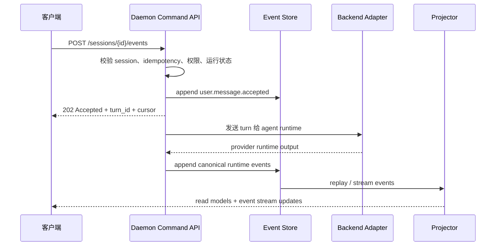

# Command / Event 边界

velaChat 必须把 **用户意图**、**运行时事实** 和 **客户端投影** 分开。这个边界是为了避免我们之前反复遇到的问题：UI、后端 adapter、事件流、本地 cache 都能各自创建 chat row，最后导致重复消息、乱序、工具日志进正文、切会话 replay 错乱。

规则很简单：

- Command 是客户端请求 daemon 做事的方式。
- Event 是 daemon 已经接受并排序的事实。
- Projection 是事实面向客户端的渲染形态。

客户端不能直接追加正式聊天行。后端不能分配 canonical 顺序。Pulsar 不能在 v1 取代 daemon 成为用户输入的权威入口。

## 心智模型

```txt
User / UI
  |
  | command: send / stop / approve
  v
Daemon Command API  <---- only authority for user input
  |
  | accepted/rejected/queued
  v
Event Store append
  |
  +--> BackendAdapter -> Agent Runtime
  |         |
  |         v
  |      Raw Events
  |         |
  v         v
Normalizer / Sequencer
  |
  v
运行时事实事件
  |
  v
Projectors
  |
  +--> SessionListView
  +--> ChatTranscriptView
  +--> ActivityShelfView
  +--> PendingRequestsView
  +--> DiffReviewView
  |
  v
Desktop / Mobile / Web / Embed
```

这是核心防腐模型：

- 用户意图只能从 Command API 进入系统。
- 已接受事实只能从 Event Store 进入系统。
- 客户端只能渲染 Projector 输出。

## 控制流



## 架构要求

### Requirement: Input Event 是用户输入权威入口

用户消息、stop、permission response、session mutation 都必须通过 daemon input / command API 进入系统。

daemon 必须校验：

- session 是否存在
- session 当前状态
- idempotency key
- active turn 状态
- pending permission 状态
- backend 是否可用
- 当前策略是 queue、reject 还是 cancel

#### Scenario: 同一个客户端重复提交

- **WHEN** 客户端用同一个 idempotency key 提交同一个 turn 两次
- **THEN** daemon 返回同一个 accepted command result
- **AND** 只追加一个 `user.message.accepted` event
- **AND** timeline projection 只包含一条用户消息行

#### Scenario: 没有 idempotency key 的重复提交

- **WHEN** 客户端在第一个 turn 还没接受完成时提交两条相同 prompt
- **THEN** daemon 按 session state policy 处理
- **AND** 要么拒绝第二条 command，要么明确排队
- **AND** 这个决定必须由 canonical event 表达

### Requirement: Event 是 canonical fact

只有 daemon 拥有的 sequencer 可以追加带 `event_id`、`epoch`、`seq` 的 canonical event。

Backend adapter 可以产生 provider runtime output，但必须经过 daemon normalize 和 sequence 后，客户端和 projector 才能消费。

#### Scenario: Backend 回放或 echo 用户输入

- **WHEN** 后端 replay 或 echo 用户 prompt
- **THEN** daemon 把它和已接受的 user command 对齐
- **AND** 除非它明确表示一个新的用户 turn，否则不能再创建一条 user message fact

#### Scenario: Backend 输出 raw tool text

- **WHEN** 后端输出 shell 命令、wrapper JSON、provider-specific tool log
- **THEN** daemon 可以在允许时记录 raw provider data 用于调试
- **AND** 对外只产生 canonical tool / activity events
- **AND** 客户端不能把 raw provider output 当作 chat transcript text

### Requirement: Projection 不是事实源

Timeline、transcript、request、diff、session directory view 都必须从 canonical events 或 daemon 安全状态推导出来。

客户端可以为了响应速度缓存 projection，但当 event cursor 失效时，必须从 daemon API 重新拉取或重建 projection cache。

#### Scenario: 客户端切换会话

- **WHEN** 客户端离开 session A 并打开 session B
- **THEN** 客户端使用 session B 的 daemon read model
- **AND** session A 的 transcript row 不能被复用到 session B，除非它存在于 session B 的 canonical projection

#### Scenario: Timeline projection 被清空

- **WHEN** daemon 删除 projected timeline storage
- **THEN** daemon 可以 replay canonical events
- **AND** 重建同样的 timeline read model

### Requirement: Transcript 是窄投影

Chat transcript 必须是 message-like content 的窄投影。它不能直接渲染完整 timeline model。

工具调用、权限请求、diff、warning、task 可以通过明确的 structured transcript row 做摘要，但它们的主展示面应该是 activity、request、review、diagnostic projection。

#### Scenario: Tool command 完成

- **WHEN** 后端 command 执行完成
- **THEN** activity projection 可以展示 command summary
- **AND** transcript 不能把 raw command text 渲染成 assistant message
- **AND** 如果 transcript 需要标记，只能使用明确的 structured row kind，例如 `activity_marker`

### Requirement: Pulsar 是事件织物，不是 v1 command authority

Pulsar 可以镜像 canonical events，也可以在未来接收 raw provider output。但在 v1，它不能取代 daemon command API 成为桌面端或移动端用户输入的主入口。

#### Scenario: Agent 直接向 Pulsar 发布 raw output

- **WHEN** agent runtime 向 Pulsar topic 发布 raw output
- **THEN** ingest service 必须校验、normalize、sequence
- **AND** 客户端只能消费 daemon-compatible canonical events 或 projections

#### Scenario: 外部自动化发布 command intent

- **WHEN** 自动化系统向未来的 command topic 发布 command intent
- **THEN** daemon 或 command authority 必须先校验这个 intent
- **AND** 记录 accepted 或 rejected command event

## Command 返回形状

Command API 应该返回明确的 command acknowledgement：

```ts
export type CommandAck =
  | {
      status: 'accepted';
      command_id: string;
      session_id: string;
      turn_id?: string;
      cursor: EventCursor;
    }
  | {
      status: 'queued';
      command_id: string;
      session_id: string;
      queued_message_id: string;
      cursor: EventCursor;
    }
  | {
      status: 'rejected';
      code:
        | 'session_not_found'
        | 'session_closed'
        | 'turn_running'
        | 'permission_blocked'
        | 'backend_unavailable'
        | 'duplicate_command';
      message: string;
      command_id?: string;
      session_id?: string;
      cursor?: EventCursor;
    };
```

`202 Accepted` 只表示 daemon 已经接管 command，不表示 backend 已经完成 turn。

Malformed request、missing resource、path-level conflict 等 HTTP/resource failures 仍然使用 `ErrorEnvelope` 和对应 HTTP status。`CommandAck.status === 'rejected'` 表示 daemon 已经理解 command，但根据 session/request/backend 状态拒绝执行。

## Event Family

Canonical event vocabulary 必须区分 command acceptance 和 backend output：

| Event family | 示例 | 权威方 |
| --- | --- | --- |
| Command facts | `user.message.accepted`、`turn.cancel.accepted`、`request.response.accepted` | Daemon |
| Runtime lifecycle | `turn.started`、`turn.completed`、`turn.failed` | Daemon sequencer |
| Message content | `assistant.message.started`、`assistant.message.delta`、`assistant.message.completed` | Normalized backend output |
| Activity | `tool.started`、`tool.output.delta`、`tool.completed`、`command.output.delta` | Normalized backend output |
| Requests | `request.opened`、`request.resolved` | Daemon + backend adapter |
| Projection hints | `projection.invalidated`、`sync.reset` | Daemon |

完整事件词表见 [事件词表](/docs/api/event-vocabulary)。不在词表里的 provider raw event 只能进入 diagnostics 或先被 adapter/normalizer 映射。

## 反模式

### Anti-Pattern: 客户端本地追加用户气泡

客户端可以在 command in-flight 时显示 pending affordance，但它不是正式 transcript row。正式 transcript row 只能来自 daemon accepted command event 或包含 accepted user message 的 read model。

### Anti-Pattern: Backend replay 直接追加 transcript

Backend replay 不是 UI append 操作。它只是 normalization 和 reconciliation 的输入。Replayed user echo、assistant final message、streaming delta 都必须先对齐成 canonical message record，再进入 projection。

### Anti-Pattern: Timeline 决定 session state

Timeline item 不能决定 session 是 running、blocked 还是 closed。Session status 必须从 session events 和 turn events 投影出来。

### Anti-Pattern: 把 Pulsar topic 当 Chat API

Topic 可以承载 raw events 或 canonical facts，但用户面向的 chat client 仍然需要 command acknowledgement、state validation、conflict handling 和 read model recovery。

## 实现清单

- Command handler 在调用 backend side effect 前，先追加 accepted / rejected command event。
- 每个 command endpoint 都接受 idempotency key。
- Backend adapter 不直接把 provider raw events 暴露给客户端。
- Normalizer 为 message、part、tool、turn、request 生成稳定 id。
- Projector 生成窄 read model：transcript、activity、requests、diffs、sessions、backend status。
- Chat transcript renderer 消费 `ChatTranscriptView`，不消费 raw events，也不消费完整 `TimelineItem` 列表。
- SSE stream 使用 canonical `event_id` 作为 SSE id。
- 过期 cursor 返回 `sync.reset`，并说明受影响的 read model。
