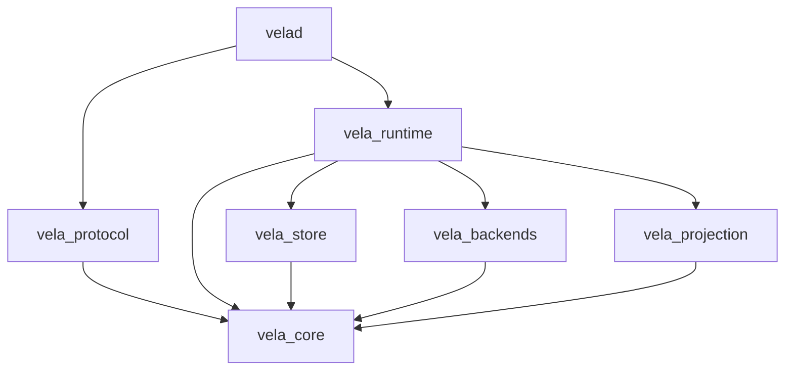

# Crate 边界

velaChat 是 crate 化项目。crate 边界必须表达架构边界，而不是按文件数量随手拆包。

## 推荐 workspace

```txt
crates/
  vela-core/
  vela-store/
  vela-backends/
  vela-runtime/
  vela-projection/
  vela-protocol/
  velad/
```

## 依赖方向



## Crate 职责

### `vela-core`

定义不会随 HTTP、SQLite、Pi、UI 改变的核心领域类型：

- `Command`
- `CommandAck`
- `CanonicalEvent`
- `EventCursor`
- `BackendKind`
- `SessionId` / `TurnId` / `RequestId`
- read model 基础类型

`vela-core` MUST 不依赖 `axum`、`sqlx`、具体 backend crate。

### `vela-store`

负责事实存储和游标窗口：

- canonical event append
- idempotency key
- `epoch + seq`
- event fetch / cursor stale / gap / reset
- SQLite schema

`vela-store` MUST 不知道 Pi、Codex、Claude。

### `vela-backends`

定义并实现 backend adapter：

- `BackendAdapter` trait
- `MockBackendAdapter`
- `PiBackendAdapter`
- 后续 `CodexBackendAdapter`、`ClaudeCodeBackendAdapter`

Adapter MAY 产生 `BackendRuntimeOutput`，MUST NOT 产生 canonical `seq`。

### `vela-runtime`

这是 command authority：

- 校验命令
- 处理幂等
- append command fact
- 调用 backend side effect
- normalize backend output
- append runtime facts
- 维护 session turn/request 状态机

### `vela-projection`

负责读模型：

- `SessionListView`
- `SessionView`
- `ChatTranscriptView`
- `ActivityShelfView`
- `PendingRequestsView`
- `DiffReviewView`
- `BackendStatusView`

### `vela-protocol`

负责外部 API 契约：

- REST request/response DTO
- SSE event envelope
- OpenAPI schema
- API error envelope

### `velad`

二进制 daemon：

- axum routes
- local auth / CORS / port selection
- dependency wiring
- graceful shutdown
- tracing

`velad` SHOULD 尽量薄。任何需要测试业务状态机的逻辑都应该下沉到 `vela-runtime`。

## Requirements

### Requirement: 依赖方向不可反转

低层 crate MUST NOT 依赖高层 crate。

#### Scenario: store 需要事件类型

- **WHEN** `vela-store` 需要事件结构
- **THEN** 它从 `vela-core` 引入类型
- **AND** 不依赖 `vela-protocol` 或 `velad`

### Requirement: command handler 可脱离 HTTP 测试

Command handling MUST 能在不启动 HTTP server 的情况下测试。

#### Scenario: 重复提交 turn

- **WHEN** 测试调用 `vela-runtime` 的 command handler 两次
- **THEN** 它返回同一个 `CommandAck`
- **AND** store 里只有一条 command fact
