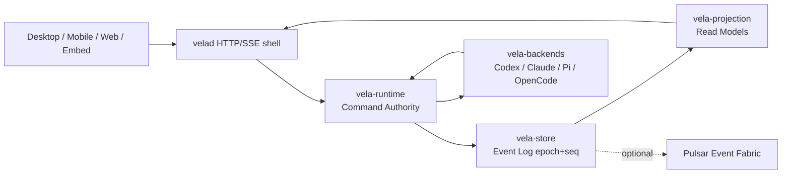

# 架构总览

velaChat 把 **agent 执行、事件归一、事实存储、状态投影、客户端渲染** 分开。这个拆法来自 Paseo 的验证经验，但我们会用 Rust crate 把边界做得更硬。

## 架构要求

### Requirement: 本地 daemon 是事实源

系统 MUST 由本地 daemon 持有 session、event、request、backend status 和 projection 的权威状态。

#### Scenario: 两个客户端观看同一 session

- **WHEN** 桌面和手机同时订阅同一个 session
- **THEN** 两端收到同一个 daemon 事件账本派生出的更新
- **AND** 任一客户端都不能单独创造 canonical session state

### Requirement: Provider 输出必须归一

系统 MUST 在进入 projection 之前把 provider-specific output 转换为 canonical runtime events。

#### Scenario: Pi 输出 tool event

- **WHEN** Pi RPC 产生 tool 执行事件
- **THEN** backend adapter 记录 raw event
- **AND** runtime 归一成 `tool.started`、`tool.output.delta`、`tool.completed`

### Requirement: 客户端只消费 projection 和 event stream

客户端 MUST 通过 API 读取 read models 和 recoverable event stream，不直接解析 provider raw protocol。

#### Scenario: 手机重连

- **WHEN** 手机带着最后一个 `event_id` 重连
- **THEN** daemon 返回缺失事件，或返回 `sync.reset`
- **AND** 手机按提示刷新受影响 read models

## 设计判断

Paseo 的 `AgentManager` 把 command、provider session、timeline append、permission、projection 和 stream dispatch 放在一个大对象里。它证明了方向可行，也暴露了复杂度来源。velaChat 应该把它拆成 crate 级硬边界。
