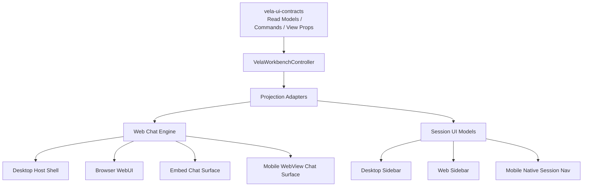
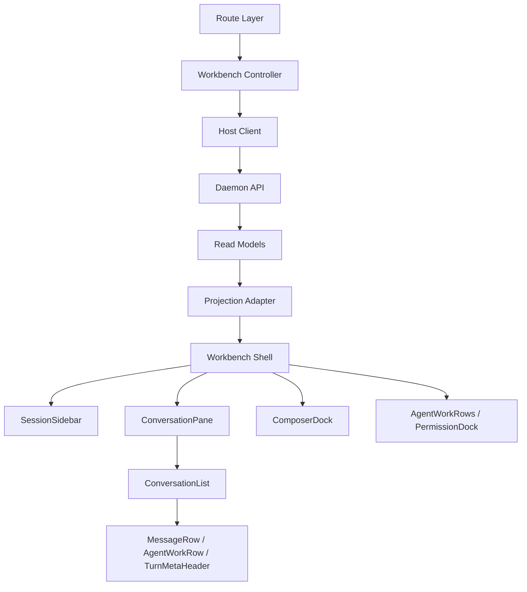

# WebUI First

velaChat 第一版应该先把 WebUI 跑通。这里的 WebUI 不是临时 demo，而是未来桌面、embed、移动 WebView 都能复用的 **Workbench Web Engine**。

这里的核心不是“只做网页”，而是先做一套可复用的 UI contract 和 Web Chat Engine：

- Desktop 通过桌面 host shell 承载同一套 workbench。
- Web 直接运行同一套 workbench。
- Embed 可以只挂载 Conversation / Composer / Requests 的子集。
- Mobile 可以用原生 shell 承载 Web Chat Engine，也可以逐步把 sidebar、composer 等 shell 部分换成原生。

所以 WebUI first 的复用边界必须从第一天就清楚：可复用的是 **contracts、controller、projection adapter、chat engine、markdown renderer、row logic**；不可强行复用的是平台 chrome、窗口控制、系统菜单、移动导航和原生输入法适配。

目标不是先做完整原生端，而是先把最容易出错的部分做硬：

- command 入口唯一
- event / projection 边界清楚
- conversation 不直接消费 raw timeline
- scroll 由列表层拥有
- composer 不让 conversation 热路径重渲染
- ChatUI 可以脱离 sidebar 单独嵌入

## 复用边界



### 必须复用

这些层跨 Desktop、Web、Embed、Mobile 都应该复用：

- command 类型和 `CommandAck`
- read model 类型：`SessionListView`、`ConversationView`、`PendingRequestsView`
- projection adapter 纯函数
- chat row derivation 纯函数
- markdown renderer 和代码块 renderer
- streaming row 更新策略
- conversation item 结构：`user_message`、`assistant_message`、`turn_meta`、`agent_work`、`status`
- scroll follow 逻辑的核心状态机

### 可以按平台替换

这些层可以按 host 替换：

- Desktop window chrome
- macOS sidebar material
- native menu / context menu
- Mobile navigation shell
- Mobile composer input shell
- safe-area / keyboard avoidance
- system permission UI

### 禁止跨平台泄漏

- Desktop chrome token 不能进入 `ConversationView`。
- Mobile safe-area 不能进入 row derivation。
- Web hover 逻辑不能决定 command 行为。
- Chat engine 不能知道后端是 Codex、CloudAgent、ACP 还是 Pi。
- Session sidebar 不能读取 conversation raw events。

## 参考结论

### 自研现状

当前 `velaChat` 还主要是 Fumadocs 文档站，没有正式 workbench UI。已有文档已经明确 daemon、event log、backend adapter、projection 的后端边界，但 React UI 边界还没有落代码。

所以 WebUI first 的第一步不是“补一个页面”，而是先建立 UI 层级：

- UI 只能发送 command
- UI 只消费 projection
- Chat conversation 只消费 `ConversationView`
- Sidebar 只消费 `SessionListView`
- Agent work / permission / review 不进 assistant 正文

### Paseo 的处理方式

Paseo 是跨端优先：

- `packages/protocol` 定义 wire schema 和共享类型。
- `packages/client` 封装 daemon WebSocket client。
- `packages/app` 是 Expo / React Native / Web 共享 UI。
- `SessionContext` 包住 daemon client 和 active session state。
- timeline reducer 处理 live stream、catch-up、gap detection、sequence dedup。
- markdown 按平台拆文件：web、iOS、Android 可以分别实现。

它的启发是：**协议、client、UI 必须分包；同步正确性不能靠 UI 猜。**

它不适合我们直接照搬的地方是：Paseo 的 UI 是 React Native first。我们现在要 WebUI first，Chat conversation 需要优先利用成熟 DOM markdown、选择、滚动、虚拟列表和 WebView 复用能力。

### Synara 的处理方式

Synara 是 Web chat 成熟度最高的参考：

- `ChatView.tsx` 是业务容器，很胖，接 store/query/mutation/provider/thread。
- 它把对话列表拆成 memo shell 和 list-owned scroll，用来隔离 composer 和右侧 dock 的重渲染。
- 列表滚动、行渲染、work log grouping 由专门的 timeline/list 层拥有。
- `MessagesTimeline.logic.ts` 是纯函数层，负责 row derivation、turn collapse、work log grouping、structural sharing。
- markdown 使用成熟库，ChatUI 不自研 markdown parser。

它的启发是：**ChatView 可以胖，但 conversation 热路径必须薄；row derivation 必须是纯函数；list 自己拥有滚动。**

我们不应该照搬它的业务对象，但应该学习它的层次：

```txt
Route
  -> ChatView container
    -> ConversationPane memo shell
      -> ConversationList list-owned scroll
        -> MessageRow / AgentWorkRow / TurnMetaHeader
    -> ComposerDock
    -> RightDock / AgentWorkDetail
```

## velaChat React 分层

WebUI first 建议分成八层。

### 1. Route Layer

负责 URL、layout shell、页面入口，不直接处理 session 业务。

建议文件：

```txt
app/workbench/page.tsx
app/embed/page.tsx
app/chat/[sessionId]/page.tsx
```

职责：

- 解析 route params
- 选择 workbench mode：desktop、web、embed
- 注入 `VelaWorkbenchProvider`
- 不直接 append message
- 不直接处理 SSE event

### 2. Host Client Layer

负责连接 daemon command API、read model API、SSE stream。

建议文件：

```txt
src/host/vela-host-client.ts
src/host/vela-command-client.ts
src/host/vela-stream-client.ts
```

职责：

- `sendMessage`
- `stopTurn`
- `approveRequest`
- `listSessions`
- `getConversationView`
- `subscribeSessionEvents`

这一层只知道 HTTP/SSE，不知道 React。

### 3. Workbench Controller Layer

负责把 host client 变成 React 可消费的 controller。

建议文件：

```txt
src/workbench/VelaWorkbenchController.tsx
src/workbench/useWorkbenchController.ts
src/workbench/useSessionSubscription.ts
```

职责：

- 管 active session id
- 管 command ack
- 管 stale cursor / reconnect
- 管当前 read models
- 暴露 command methods

这一层可以用 React Query / Zustand / useSyncExternalStore，但不能产生 conversation item。

### 4. Projection Adapter Layer

负责把 daemon read model 转成 UI props。

建议文件：

```txt
src/projections/conversationAdapter.ts
src/projections/sessionListAdapter.ts
src/projections/requestDockAdapter.ts
```

职责：

- `ConversationView -> VelaConversationItems`
- `SessionListView -> SidebarSections`
- `PendingRequestsView -> PermissionDockState`

这里是最重要的防腐层。它必须是纯函数，可单测。

### 5. Workbench Shell Layer

负责整体布局，不处理 backend 细节。

建议文件：

```txt
src/workbench/VelaWorkbenchShell.tsx
src/workbench/VelaWorkbenchLayout.tsx
src/workbench/VelaWorkbenchChrome.tsx
```

职责：

- 左侧 session rail
- 中央 chat pane
- floating composer
- activity shelf / permission dock
- desktop / embed / web mode 的布局差异

它只消费 controller 和 adapter 输出。

### 6. Feature Surface Layer

这是业务 UI surface。

建议文件：

```txt
src/sessions/SessionSidebar.tsx
src/chat/ConversationPane.tsx
src/chat/ConversationList.tsx
src/chat/ComposerDock.tsx
src/agent-work/AgentWorkRows.tsx
src/permissions/PermissionDock.tsx
```

规则：

- `SessionSidebar` 只消费 `SessionListView`
- `ConversationPane` 只消费 `ConversationView`
- `AgentWorkRows` 从 `ConversationView.items[kind=agent_work]` 派生
- `PermissionDock` 只消费 `PendingRequestsView`
- `ComposerDock` 只能发 command，不能本地创造正式消息行

### 7. Pure Logic Layer

负责 UI 行推导、分组、稳定引用、滚动策略。

建议文件：

```txt
src/chat/chatRows.logic.ts
src/chat/chatScroll.logic.ts
src/sessions/sessionSections.logic.ts
```

这里学习 Synara：

- row derivation 是纯函数
- structural sharing 保证 streaming 时少重渲染
- `turn_meta` 和 message item 是不同 kind
- `agent_work` 是结构化 item，不是普通文本
- user bubble 只来自 accepted user message fact

### 8. Primitive / Skin Layer

负责基础视觉和交互原语。

建议文件：

```txt
src/ui/Button.tsx
src/ui/IconButton.tsx
src/ui/Menu.tsx
src/ui/ScrollArea.tsx
src/skin/tokens.css
src/skin/mac.ts
```

规则：

- 视觉 token 集中管理
- macOS / web / embed 差异通过 mode token 控制
- 不在业务组件里写 host-specific hack

## 数据流



## v1 最小边界

第一版 WebUI first 不做全功能，只做可以验证架构的闭环。

必须做：

- session list
- active session 切换
- conversation 渲染
- composer 发送
- command ack 后出现用户消息
- assistant streaming
- working indicator
- tool/agent work 不进 assistant 正文，只作为 `ConversationView.items[kind=agent_work]`
- reload / reconnect 后不重复消息

暂时不做：

- 搜索索引
- 导入旧 session
- 本地多窗口状态同步
- 复杂 diff review
- 移动原生 UI
- Pulsar command path

## 第一版文件结构

```txt
src/
  host/
    vela-host-client.ts
    vela-command-client.ts
    vela-stream-client.ts
  workbench/
    VelaWorkbenchController.tsx
    VelaWorkbenchShell.tsx
    VelaWorkbenchLayout.tsx
  projections/
    conversationAdapter.ts
    sessionListAdapter.ts
    agentWorkAdapter.ts
  chat/
    ConversationPane.tsx
    ConversationList.tsx
    MessageRow.tsx
    ComposerDock.tsx
    chatRows.logic.ts
    chatScroll.logic.ts
  sessions/
    SessionSidebar.tsx
    sessionSections.logic.ts
  agent-work/
    AgentWorkRows.tsx
  permissions/
    PermissionDock.tsx
  ui/
    Button.tsx
    IconButton.tsx
    Menu.tsx
    ScrollArea.tsx
  skin/
    tokens.css
```

## 关键约束

### Conversation 不拥有 session

`ConversationPane` 不能知道 backend 是 Codex、CloudAgent 还是 ACP。它只接受：

```ts
type ConversationPaneProps = {
  items: VelaConversationItem[];
  isFollowing: boolean;
  onScrollIntentChange: (intent: ScrollIntent) => void;
};
```

### Composer 不追加正式消息

Composer 只发 command：

```ts
type ComposerProps = {
  state: ComposerViewState;
  onSend: (input: SendMessageInput) => Promise<CommandAck>;
  onStop: () => Promise<CommandAck>;
};
```

如果需要乐观反馈，只能显示 pending affordance。正式 user row 必须来自 `user.message.accepted` projection。

### Agent work 不伪装成 assistant text

工具调用和状态事件必须是结构化 projection：

```ts
type VelaConversationItem =
  | { kind: 'user-message'; id: string; text: string }
  | { kind: 'assistant-message'; id: string; parts: AssistantPart[] }
  | { kind: 'turn-meta'; id: string; status: string; startedAt: string }
  | { kind: 'agent-work'; id: string; title: string; detail: AgentWorkDetail };
```

`agent-work` 可以在 conversation 里出现，但它不是 assistant message，也不能参与 markdown 渲染。

## 测试策略

第一版至少要有这些红测：

- 同一个 `CommandAck` replay 两次，conversation 只有一条 user item。
- backend echo 用户输入，conversation 不新增 user item。
- tool raw text 进入 `agent_work`，不进入 assistant message。
- 切换 session A -> B -> A，items 来自各自 `ConversationView`。
- streaming delta 更新同一个 assistant item，不创建新 item。
- composer state 改变时，`ConversationPane` item 引用尽量稳定。

## 结论

WebUI first 的正确方向是：

```txt
Daemon read models
  -> Projection Adapter
  -> Workbench Controller
  -> Workbench Shell
  -> Conversation / Sidebar / AgentWork / Composer
```

不要让 React 组件直接接 raw event，也不要让 composer 或 timeline 自己成为事实源。Synara 的热路径隔离值得学，Paseo 的 daemon/client/protocol 分包值得学；velaChat 应该把两者合在一起：**Web chat engine 优先，daemon projection 为权威，多端只是不同 host shell。**
