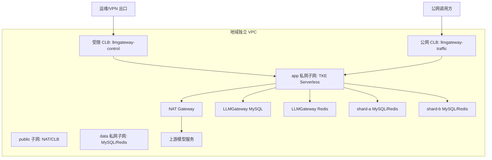

# 腾讯云多地域生产 Terraform

这个目录用同一套 Terraform 描述 LLMGateway 的独立地域集群：每个地域拥有自己的 VPC、TKE Serverless、控制面 MySQL/Redis 和业务 Shard。地域差异由 `environments/*.tfvars` 显式提供。这里不直接创建 new-api Set；Set 仍然是 LLMGateway control/set-manager 管理的业务资源。

## 拓扑



## 资源边界

- `llmgateway-control`：管理面、纳管、渠道包发布、worker 任务入口。不承载 `/v1/*`。
- `llmgateway-traffic`：数据面，仅承载 OpenAI-compatible `/v1/*` 流量。
- `llmgateway-worker`：后台任务，消费 set facts、检查渠道漂移、刷新租户观测、重试 BYOK sync。
- `Shard`：MySQL/Redis 资源池，一个 shard 可以承载多个 Set；生产首批默认预制 2 个 shard，既能验证跨 shard 分配，又避免首发成本过重。
- `Set`：new-api runtime，由 LLMGateway control/set-manager 动态纳管和扩缩。

## 凭证

不要把 SecretId/SecretKey 写入 `terraform.tfvars` 或提交到仓库。推荐用环境变量：

```bash
export TENCENTCLOUD_SECRET_ID="..."
export TENCENTCLOUD_SECRET_KEY="..."
```

如果凭证已经出现在聊天、工单或日志里，请先在腾讯云 CAM 里轮换或禁用旧凭证。

## 使用

生产目录应使用 COS remote state。先执行一次 `../tencentcloud-bootstrap-state` 创建 state 桶。每个地域使用独立 state prefix；backend 的 `region` 表示 COS 桶所在地域，不要求与业务集群地域相同。

以北京为例：

```bash
cp backend/beijing.hcl.example backend.hcl
cp environments/beijing.tfvars.example environments/beijing.tfvars
```

部署上海时改用 `backend/shanghai.hcl.example` 和 `environments/shanghai.tfvars.example`。真实 `backend.hcl` 和 `*.tfvars` 都被 Git 忽略。

新地域部署前，AI 或操作者必须逐项确认：

- `region` 和至少两个当前有库存的 `availability_zones`。
- 稳定且不会变更的 `region_alias`；北京保持 `bj`，上海使用 `sh`。
- 独立的 control/traffic DNS 子域。
- 首次 apply 后由 TKE Service 创建出的两个真实 CLB 默认域名。
- TLS 证书 ID。
- 本地域 TCR 实例和访问域名；独立 state 不得重复管理其他地域同一个仓库。
- backend state prefix，确保不与其他地域相同。

上海示例里的证书和 TCR `replace-*` 是有意保留的阻断值，Terraform validation 会拒绝它们。CLB 占位值只允许在 `edge_dns_enabled=false` 的首次基础设施部署阶段存在。

初始化 backend：

```bash
tofu init -backend-config=backend.hcl
```

需要替换：

- `admin_cidrs`：公司出口/VPN 出口，不要用 `0.0.0.0/0`。
- `region` / `availability_zones`：确认目标地域和当前可用区库存。
- `region_alias`：进入资源名，现有地域不得修改，否则可能触发资源替换。
- `tke_cluster_version`：确认 TKE 当前可购买版本。
- `tke_service_cidr`：需要和 `cluster_max_service_num` 对齐；当前 `/22` 对应 1024 个 Service IP。
- `tcr_instance_id` / `tcr_public_domain`：本地域生产镜像仓库。Terraform 会管理其中的 namespace/repository，所以不同地域的独立 state 不得复用同一仓库。
- `traffic_backend_cidrs`：TKE Serverless 的 CLB 直连 Pod 会保留客户端源 IP，traffic Pod 运行时安全组必须允许这些源 IP 访问后端端口。
- `dns_domain` / `*_dns_subdomain`：每个地域使用独立记录名；control 与 traffic 不能相同。
- `*_clb_domain`：TKE Service 创建出来的 CLB 默认域名。Terraform 只把 DNS CNAME 指向这些域名，不接管 CLB 本体。
- `*_cert_id`：已有腾讯云 SSL 证书 ID。证书生命周期暂不由 Terraform 申请，避免把证书验证和续期流程混进基础设施首发。
- `mysql_root_password`、`redis_password`：本地 `terraform.tfvars` 或 `TF_VAR_*`，不要提交。
- `tags`：默认不设置。腾讯云有系统保留 tag key，显式传 tag 时不要使用 `project`、`environment`、`region` 这类容易冲突的 key。

然后执行：

```bash
tofu validate
tofu plan -var-file=environments/beijing.tfvars -out prod-beijing.tfplan
```

确认预算、规格、网络、资源名都正确后，再由人手动执行：

```bash
tofu apply -parallelism=1 prod-beijing.tfplan
```

### 新地域首次部署

新地域存在一个正常的两阶段顺序：CLB 域名只有在 TKE 和 K8s Service 创建后才可获得。

1. 在地域参数中保持 `edge_dns_enabled=false`，填好证书、TCR、密码等其余真实参数，plan/apply 基础设施。
2. 按 `deploy/k8s/prod/README.md` 部署应用，等待 control/traffic Service 获得 CLB 默认域名。
3. 把两个 CLB 域名写回地域参数，设置 `edge_dns_enabled=true`，再次 plan/apply 创建 DNS CNAME。

北京现网保持 `edge_dns_enabled=true`。Terraform 中的 `moved` 声明会把既有 DNS state 地址迁移到条件资源地址，不删除或重建 DNS 记录。

腾讯云 CDB 下单阶段可能存在账号级订单锁，首发或补齐数据库资源时建议使用
`-parallelism=1`，避免多个 MySQL 订单同时提交导致 `OtherOderInProcess`。

## 通用生产默认

- Region、可用区、域名、证书、CLB 和 TCR：无默认值，必须由地域参数文件显式提供。
- 资源名地域后缀：由 `region_alias` 提供，北京现网固定为 `bj`。
- VPC：`10.64.0.0/16`
- App 子网：TKE Serverless/Pod 私网子网，通过 NAT 出网。
- Data 子网：CDB/Redis，仅允许 app 子网访问。
- Control 入口：只允许 `admin_cidrs`。
- Traffic 入口：公网 CLB；高防按需购买，WAF 不进 P0。HTTP/HTTPS 入口必须绑定自定义域名，腾讯云会阻断 `*.tencentclb.com` 默认域名访问。DNSPod CNAME 已由 Terraform 管理，CLB 仍由 K8s Service controller 管理。
- TLS 证书：显式引用已有证书 ID，Terraform 输出 `control_cert_id` / `traffic_cert_id` 给 K8s Service HTTPS Secret 使用。
- Traffic 回源：TKE Serverless 默认走 CLB-to-Pod direct access，客户端源 IP 会透传到 Pod ENI；因此 `tke_runtime` 安全组需要放通 `traffic_backend_cidrs -> traffic_backend_port`。
- Image Registry：每个独立地域使用本地域 TCR，避免两个 state 同时管理同一个 namespace/repository。
- MySQL：默认 MySQL 8.0，首发小规格 `2C/4GB/100GB`，`max_connections=1000`。
- Redis：默认 Redis 7.0 主从架构 `type_id=17`，首发 `1GB`、单副本，代理兼容单 endpoint 由腾讯云 Redis 提供；真实部署时云盘版小规格可能报库存不足，首发使用默认托管规格，后续可按 shard 水位切到多副本或 Redis cluster 架构。
- Shard：默认 `shard-a` 和 `shard-b`，分别落在两个地域可用区的数据子网。

## 已验证的腾讯云约束

- TKE 北京当前可用版本包含 `1.30.0`，`1.28.3` 已不可创建。
- TKE `serviceCIDR` 的 IP 数需要和 `cluster_max_service_num` 对齐；例如 `/22` 对应 1024。
- CDB 下单存在订单锁，首发建议 `tofu apply -parallelism=1`。
- Redis `product_version = "cloud"` 的小规格在本次北京可用区测试中报库存不足；去掉该字段使用默认托管规格后可创建。
- TKE 公网 kube-apiserver endpoint 使用 `tencentcloud_kubernetes_cluster_endpoint` 可以创建，但安全组过窄时 CLB 会返回 502/HTTPS 协议错误；临时验证可开放 443，生产应优先使用 VPN/专线访问内网 endpoint，或和腾讯云确认公网 endpoint 需要放通的健康检查来源后再收紧。

## 扩容方式

扩 Set：

1. LLMGateway 根据 `max_users/warn_users/reserved_users` 和真实绑定数写入扩容意图。
2. set-manager/kro 或后续 Operator 创建新的 new-api runtime。
3. LLMGateway control 消费 facts 后纳管 Set。
4. Admission checker 强制完成渠道包同步、倍率/定价检查、健康检查。
5. 只有 admission passed 的 Set 才进入新用户分配和 traffic 路由。

扩 Shard：

1. 运营台“数据分片”页面提交扩容流程，或调用 `POST /api/admin/shard-expansions`。这一步只记录意图，不产生可分配的 Shard。
2. 在 Terraform `shards` 中增加同名条目并执行唯一运维入口的 `plan/apply`，创建 MySQL 与 Redis。
3. 自动化把密码写入 TKE Secret，并调用 `POST /api/admin/shard-expansions/{id}/infrastructure` 回填 endpoint、Secret 名称和 Terraform run 链接；禁止回填密码或云密钥。
4. 把新 Shard 追加到 LLMFleet。set-manager 会将 MySQL、Redis、DB 区间和连接池事实投影回 LLMGateway；不要调用运营 `POST /api/admin/shards`，该接口已只读。
5. 通过正常 Set provision 路径创建一个验证 Set，完成数据库、Redis 与 `/v1/chat/completions` 冒烟，并调用 `POST /api/admin/shard-expansions/{id}/verification` 回填结果。
6. 流程变为“已可用”后，再把该 Shard 加入自动扩 Set 的候选池。后续新增 Set 由水位选择器按最低分配率挑选 Shard。

完整状态机、失败和取消语义见 `docs/superpowers/specs/2026-07-17-shard-expansion-workflow-design.md`。

## 后续必须补齐

- 生产部署执行入口：建议固定为 CI 或唯一运维入口，避免多人同时 apply。
- 证书自动化续期：P0 先引用已有 SSL 证书 ID，后续再评估是否让 Terraform 申请/续期证书。
- WAF/高防：traffic 入口建议前置，尤其是公开 SaaS 场景。
- CLS/Prometheus：接入日志、指标、告警规则。
- Secret 管理：生产建议使用 TKE Secret + KMS/Secrets Manager，而不是明文 YAML。
