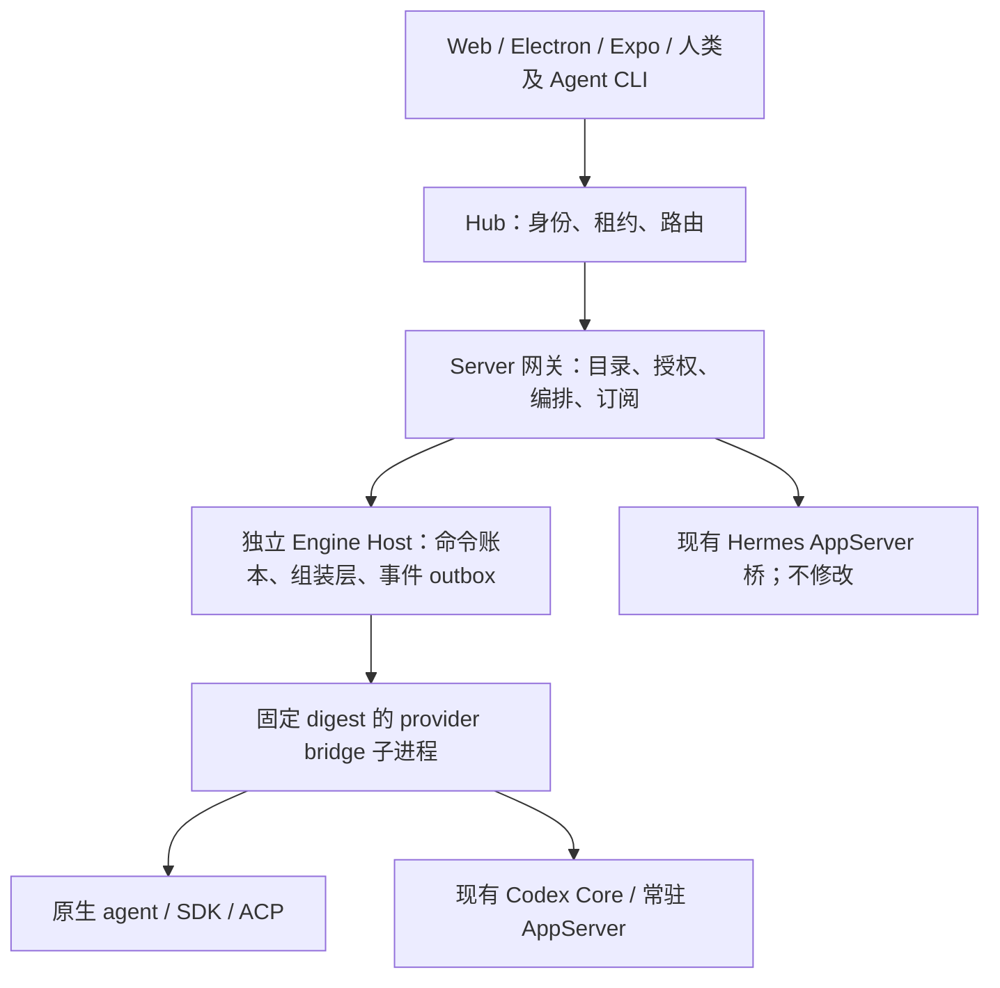

# Agent Bridge：agent 接入、automations 与 CLI 编排

状态：待评审的设计；2026-11-11；不代表已实现。本文只授权文字评审，不启动模型、不更换服务。基线为 OpenCraft `313a79e17e`（origin/main）。

建议采用 BB 的「provider 声明 → 独立 bridge → 中心语义组装 → 客户端投影」分层，同时保留 OpenCraft 的独立执行宿主、Actor 授权与编排账本。bridge 的中心组装结果投影到现有 AppServer 客户端协议，客户端协议本轮不重写；Codex 仍经 bridge 接入并复用 codex-core 和账号池。CLI 选择 R2 **候选 B**：保留 execution 签名凭据，改为 Host 主动准备并经环境发现；加稳定命令包装，不采用 PID 推断身份。

评审重点：确认下述协议边界、证据分级和批次退出条件。实现只能在本文评审后逐批开始。本轮只做三项：agent 接入（bridge 协议、组装层、各 agent 与真 steer）、项目 automations、agent 间 CLI 通信编排；Hermes 只兼容现有桥，桥与下游链路不动。

本轮不搬迁 BB 的其它功能：不重写客户端协议，不新增项目/环境目录 API，不重做线程状态体系，不迁移 IM 回复等平台工具，不导入 BB 旧历史或密钥。编排以外的 MCP 工具保持原样。以下范围以本次收窄决定为准，取代前版客户端重写及全部平台 MCP 迁移建议。

## 1. 哪些约束不再讨论

- bridge 由独立常驻引擎宿主持有，绝不是执行网关子进程；网页、网关与 daemon 升级不终止活动执行。
- 结果不明先对账，不重放原生 mutation，不用 interrupt 再发来掩盖不确定性。
- BB 上游作者实现只借鉴协议与状态模型后独立实现；用户自己的 fork/伴生插件实现可以按确认的代码范围直接移植。作者与版本证据见 [核验记录](evidence.md)。
- 所有实施验收在本机，真实账号每 agent 最小任务，选当前可用最便宜模型；本方案不运行付费任务、不部署服务器、不推送。
- 新旧长期分支不可作为迁移机制：每批独立审查、小步 PR 合入 main，新旧运行路径按线程固定选择。
- Hermes 不新写 provider、不迁 ACP、不补它的 steer；外围适配现有 AppServer 桥即可。

## 2. 谁拥有线程、进程与结果

Server 是逻辑 authority，不等于网关进程；Host 是资源载体，不决定主体身份。Thread 使用 `(serverId, threadId)`；Project、Environment、Host placement 分开。Bot/Session Actor、自然人委托、运行 incarnation、原生 sessionId、Turn、View/routeScope 都不能合并。编排复用现有父子关系、授权和生命周期规则，不新增 BB 式 fork、归档/删除或 lifecycle owner 功能。

| 层 | 唯一责任 | 禁止承担 |
| --- | --- | --- |
| Hub / Server 控制面 | Actor 准入、资源权限、目录、编排委托、幂等操作回执 | provider 方言、杀原生进程来恢复连接 |
| Engine Host | sandbox pool、准入预算、进程组清理、generation 固定路由、命令结算、组装和 durable outbox | 产品登录、从 cwd/进程推断 Actor |
| Provider 插件 | 声明、安装检测、原生会话与权限适配、原生事实翻译、历史读取端口 | 自造客户端时间线、绕过授权发子线程 |
| 中心组装层 | 标识映射、时序、item/turn 生命周期、流累计、输入证据状态 | 猜原生模型是否看见输入 |
| 客户端共享 runtime | 事件投影、快照追平、草稿/焦点/选区与滚动连续性 | provider 分支解析、另一套输入队列 authority |

建议新增窄 contract 包（bridge、测试套件），Host runtime 留 Node owner；插件各自打包固定内容 digest。安装信任不等于任意文件权限。bridge 可以复用一个进程承载多 session，但按插件 artifact + generation 隔离；具体 SDK 必须每 session 一进程时由 bridge 管理，不能把每 Thread 一个沙盒写进跨后端契约。所有子进程、PTY 和 worker 使用已有 createSandboxPool/createSandbox；失败即拒绝，不回退裸本机。

### 网关断线和 Host 升级是两种事故

Host 接命令前记录 commandId、输入摘要、execution epoch 和状态，写后才答接纳。Host durable outbox 持有有序事件直到 Server ack；网关重连提交游标补发，重复事件只投影一次。存储经专用 Worker，SQL/文件读写不能阻塞网络主线程。

原生发送前置 `dispatching`，回复成功结算；崩溃在发送与记账之间就为 `unknown`。只在原生 requestId/session 历史能证明已接纳或明确未发送时结算；无法证明保持未知并暴露对账动作。查询同一 commandId、重新传输同一已记账回执是允许的；再次执行原生请求不是。账本不能凭自己没找到成功行推导「未执行」。

断网不停止已执行任务：Host 持续写 spool。spool 达上限阻止新任务、保留活动任务和明确故障，不静默丢事件。已存在审批保持待答，不自动授权；网关恢复后重新展示同一 interactionId。权限撤销以到期租约和显式撤销为界，不为可用性延长授权。CLI 在网关短暂不可用时有界等待、查询相同幂等键；超时返回可查询的未知状态。

Host/bridge 自身升级用 generation draining：新线程进新代，旧线程、排队输入、审批与回调留旧代，全部结算才能退出；不能杀进程后宣称续接无损。Codex 的 Core/AppServer 已有独立与拆分形态，bridge 连接既有 owner，绝不另起同目录 writer。桌面显式启用本机常驻宿主后才获得同样连续性；不把现有内嵌 stdio 宣称为已具备此保证。

## 3. 组装结果投影到现有 AppServer

本轮保持现有客户端 AppServer 协议与连接、路由、订阅方式。新 bridge 输出语义 delta，由中心组装器统一标识、时序及生命周期，再经一个共享投影层输出既有 AppServer 通知、历史形状、审批和命令回执；客户端不解析 provider 方言。Codex 也经过该路径，不能因其原生使用 AppServer 就绕过 bridge 与组装器。

投影覆盖接入必需的消息、工具、turn、usage/context、交互和 steer 状态。逐条 steer 的接纳、原生证据、撤回和 unknown 若现有字段无法无损表达，只在既有协议扩展机制中增加必要的类型化字段及状态查询，兼容旧消费者；不另建 Client API、事件 envelope 或客户端读写迁移 adapter。不能把未知/仅接纳压成旧 injected 成功标签；旧消费者不能诚实表达的能力不向它宣告。组装映射与证据保持可查询，审批仍由既有交互通道答复。

保留当前原生日志正文/工具输出真源和可重建历史投影，不新建客户端历史体系。assembler checkpoint、native watermark、映射表和 schema 版本随 Host 保存；重建不重发命令。缺少可靠原生历史的 provider 只声明已验证恢复范围，不能拿 UI 缓存承诺恢复。

按 Thread 固定执行路径、providerId、generation 与 native session 引用；旧线程留原 owner，新线程 opt-in bridge。两条路径都输出现有 AppServer。空闲会话只有显式验证原生恢复后才可切 owner，活动会话不热迁。回滚只切新建默认，已经建立的新线程继续由原代服务，不自动降级重发。provider 内部子 agent 继续映射工具/委托呈现，不自动获得平台 Thread 身份或权限。

Hermes 保留现有 AppServer 桥及下游链路，外围只做兼容验证；源码、配置、部署、连接与能力声明不改，不新做 Hermes provider 或接入它的 /steer。

组装器与 AppServer 输出投影分离，保留将来更换客户端协议的边界；本轮不实施。

## 4. bridge 协议、语法与组装

借鉴 BB 的双向 JSON-RPC + 语义 delta 思路，独立实现 OpenCraft schema。Host↔bridge 使用有界 JSONL；双方独立 request id 空间、按 method 判请求、stderr 诊断、stdout 仅协议。无效帧和方法给明确错误，超长帧隔离故障，不静默无限等待。原生 Codex unix listener 是 WebSocket Upgrade，不当作 JSONL。

`initialize` 协商 protocolVersion、grammarRange、权限执行者与实例能力；注册声明为能力上限，实例探测只能收窄。无共同语法版本拒绝启动。模型、reasoning、history、usage、审批、输入内容类型和 CLI 可执行性分别声明；fork/checkpoint、skills 和安装管理只保留现有接入兼容所需部分，不作为本轮新增产品功能；未声明方法不得调用。声明要附最低原生版本与探测依据，不能保留无人消费的 steerMode。

命令面：`model/list`、`session/{create,resume,close}`、`turn/{start,steer,stop}`、`input/{query,withdraw}`、`interaction/resolve`、`history/read`、维护探测。回调面：`thread/delta`、`thread/identity`、`interaction/request`、类型化 `provider/recovery`。错误区分 invalid/unsupported、明确拒绝、stale target、auth、quota、unknown outcome；可重试表示可以重新查询/准备，不自动授权重做写入。

建议第一版语义语法：`turn.open/boundary/mainRun/close`、`item.open/progress/textDelta/textClose/close`、`input.accepted/delivery/evidence/withdrawal`、`usage/contextWindow`、`session.reset/ended`、`extension.state` 和 unhandled。delta 必须带原生 join key 和来源作用域；不能直接发送最终 ThreadEvent。中心组装持有 native↔canonical 映射，负责匿名流分段、重复 close 去重、乱序诊断、完整终态快照、Turn 内外后台工作区分；文本/工具流不能凭空开启 Turn。held turn 等待 steer 或原生后台任务时明确 mainRun idle，不能误显示模型正在生成。session reset 不覆盖历史 ID。

一致性套件是接入门槛：同一录制输入产生确定的规范事件；覆盖重复/乱序、delta-first、close-without-open、工具跨 turn、reset、孤儿事件、Unicode/超长帧、审批双答、steer 与结束竞态、重复文本、撤回与 claimed 竞态、bridge EOF、写后断线、spool 和重连。每个能力声明有正反契约用例；每个 provider 还有 native transcript fixture，不能只测 mock 自洽。

录制分两层：脱敏的 native→delta 与 delta→event。固定 provider/CLI/SDK、插件 digest、协议/语法、权限模式、mapper 版本、顺序和时钟种子；密钥/账号 token 不录，内容与路径脱敏保持关联 ID。回放只驱动纯 translator/assembler 或假原生端口，默认禁网络和真实工具，绝不执行录制里的 shell。真实账号烟测报告与录制分开保存，不把回放等同实机 steer。

## 5. steer：逐条证据，不靠默认标签

每条输入有稳定 inputId/clientRequestId、目标 native session/expectedTurnId、允许路径和 fallbackPolicy。能力声明 `deliveryMethods=[native-inject,next-turn,interrupt-replace]`、内容限制、`evidenceKinds`、`withdrawal=before-dispatch|native|none`；运行时使用它决定可选动作，每条回执仍写实际路径。默认只允许原生 inject，用户显式选择 queue 或 interrupt 才放行相应路径；对明确未发送的拒绝可按该预先选择降级，超时和证据缺失绝不降级重发。

| 事实 | 状态与证据 | 客户端含义 |
| --- | --- | --- |
| 平台收到 | registered（控制账本） | 已登记，尚未交给 agent |
| agent 接纳 | accepted + 原生 admission/SDK 返回 | 已接纳，进入上下文尚未确认 |
| 原生上下文证据 | context-confirmed + evidenceRef/nativeInputId/runId | 原生记录确认进入该 run 的上下文路径；不宣称模型理解或执行 |
| 只有 echo/队列变化 | evidence-observed，保留具体种类 | 有投递迹象，仍不能显示上下文已确认 |
| 撤回 | withdraw-requested → withdrawn / too-late / unsupported / unknown | 只有明确未发送或原生删除确认才显示已撤回 |
| 失败/不明 | rejected / failed / unknown | 保留已知事实，提供查询，禁止自动再发 |

状态不是一个强行线性的枚举：admission、deliveryMethod、evidence、withdrawal 各自保存版本，支持证据先于 RPC 回复；assembler 以 inputId 关联，晚到 admission 不倒退 context-confirmed。相同文本不能作为唯一 identity；没有原生 ID 的来源限制一个未决输入，出现歧义保持未知。撤回只能阻止未来投递，不能擦除已经进入上下文的内容或已经发生的副作用。Stop 不是撤回。DSH claimed、CodeBuddy 插入、AGY 原始 user 行最多证明各自原生边界，不等于下一模型请求实际包含该文本；严禁让模型口头回答「看到了」替代协议证据。

### 各 agent 的接入、来源与退出门槛

下表行为均为源码核验，不是本轮实机成功；具体位置及作者记录见 evidence.md。移植仅限用户 patch 的范围，整个 fork 不能当用户独有代码拷贝。

| Agent | 新路径与移植边界 | steer 证据及限制 |
| --- | --- | --- |
| Codex | 新独立 bridge 连接既有 codex-core/AppServer，沿用账号池代理、账号刷新和权限；BB 上游 bridge 独立实现 | 原生 turn/steer + expectedTurnId；返回仅 admission，须另映射原生输入事件才升级证据；stale 明确拒绝，不抢新 Turn |
| Claude Code | Agent SDK 流式输入 bridge；BB 上游实现独立重做，保留旧 ACP 路径 | SDK iterable 读入仅 admission；按可用 UUID/replay 结算，不能第一个 result 就提前关逻辑 turn；版本不支持则降级证据能力 |
| Pi | 新 bridge 适配现有 Pi owner/durable 执行能力，借鉴 BB RPC steer，避免并存两个 session writer | streamingBehavior=steer；队列移除只是推断，不用文本多重集假装逐条确认 |
| 通用 ACP | 独立 ACP bridge，初始化/会话 capability 探测，adapter 插件提供私有方言 | 标准 prompt accepted 不等于真 steer；无声明时仅 queue/显式 interrupt |
| DSH | ACP + 用户 acp-compat DSH proxy 与 acp-steering 伴生插件的可移植部分；DSH agent.steer 是上游 API，调用而非复制实现 | 私有 fd 通道 ready 才声明；messageId admission + inbox claimed；未 claimed 要等待删除确认；跨平台通道缺失则不声明 |
| CodeBuddy | ACP adapter 移植用户 session/steer probe/双回执逻辑 | 同 owner admission + messageId user_message_chunk；纯文本且非 slash；精确错误文本 probe 有版本风险 |
| Cursor | SDK adapter 移植用户 run.steer patch；底层上游 runner 独立实现或合法依赖 | complete_delivered 仅 SDK 交付；revert_to_followup 必须标 next-turn；本地 recordUserMessage 不是供应商上下文证明 |
| AGY | ACP adapter + 用户 hook 插件、私有 IPC、只读 SQLite 轨迹校验移植 | hook injectSteps 本身不足；新 user 行 + floor 是原生证据，但文本匹配有歧义；SQLite 读取在 Worker；Windows 不宣告现有 Unix 通道能力 |
| Amp | ACP/CLI streaming adapter，移植用户 native steer patch；上游混合提交按 hunk 分开 | 同进程 steer:true；echo 只做迹象；同文本未回显不重发；SDK/Orb 不自动宣告 |
| Copilot | 通用 ACP（copilot --acp），固定版本实际初始化探测 | 目前未核实本机原生 inject，默认 queue/显式 interrupt；不能用 Mission Control 字段证明本地 ACP 能力 |
| Hermes | 保留现有 AppServer 桥，仅做外围兼容验证 | 以旧桥实测为上限，不接 R1 建议的 /steer 改造 |

## 6. CLI 只替代 agent 通信与 automation 所需的编排入口

选择 **B + 稳定可执行包装**。复用 execution-signed capability、0600 connection 文件及 Broker.cli() 的每次权限重查，将原来调用 thread_cli 才创建 launcher 改为 Host 在执行准入后主动创建。Host 给 sandbox 注入 PATH 的 opencraft 与 `OPENCRAFT_THREAD_CLI` launcher 路径，非秘密 scope 信息只作发现；CLI 不信 argv/env 自报 Actor。包装只调用当前 execution launcher，不生成新的身份协议。

不选 A：ambient thread ID/loopback 不能证明授权。暂不选 C：SO_PEERCRED/PID/ppid/cwd 无法跨 Windows、远程 sandbox 和引擎工具执行边界统一证明 scope；新增绑定系统反而复制现有 admission。B 的私有文件是 bearer 载体，同 UID 任意进程并非真正安全隔离，因此要求按 sandbox 挂载当前 execution descriptor，不能向其它线程公开。模型有 shell/file 工具仍可能读取自己的凭据，不能声称路径注入使凭据对模型绝对不可见；限定权能、短期有效、日志脱敏和服务端逐次重查才是防线。

Host 是发行与撤销 owner：创建 reservation → 原生 execution 与领域准入绑定 → 原子发布 descriptor → 才允许写。每个执行 scope 使用单独文件，不能在持久 agent 进程全局覆盖一个 env 给并发 Turn 共享；通过引擎工具执行上下文注入或隔离 launcher namespace，旧 scope 到期即失效。压缩后 `opencraft context` 重新发现，重连用同 binding，退出/Stop/授权撤销/账号切换注销；启动失败回收。签名验证/发行从 SessionCapabilityMcp 类提取为 transport-neutral 服务，旧 MCP transport 并存消费；仅编排相关的 thread_* 注入及 thread_cli 发现工具在替代验收后下线，其它平台 MCP transport 和工具保持原样；不能只改 env 但仍依赖 MCP 初始化发凭据。

命令仅覆盖这三项工作所需通信和 automation，全部有 --help、--json、分页和有界输出：

- `opencraft context`；`thread list/show/output/spawn/tell/wait`。context 返回已授权执行与编排上下文；list 按现有 Broker parentage 发现线程，不扩建 project/environment/provider 目录。
- `thread tell --delivery native|queue|interrupt`；`thread operation show`、`thread input status` 查询操作与逐条投递证据。spawn/tell 及 automation mutation 强制幂等键；output 分页读取可授权的最终结果与 artifact 引用，不只截取 bounded show。steer 撤回和审批沿用既有客户端/引擎通道，不扩张 CLI 命令集。
- `automation list/show/create/update/pause/resume/delete/run/runs`；项目、执行环境、provider/model/权限显式指定或从已授权上下文解析，复用现有解析能力，不新增目录查询 API。延迟执行使用 once automation，不另加 send-at 命令。

本轮不增加 providers、capabilities 通用命名空间、IM reply、附件、fork、stop/archive、events 或 interactions 等 CLI 命令。现有这些能力及其 MCP 工具保持原样；只移除编排相关 thread_* 注入和 thread_cli 工具发现入口，不影响其它平台或用户自配 MCP。

受限权限不使用 full/auto 绕过：read-only 允许本地受限 launcher 执行并不授予 spawn/send；写动作仍经 bounded delegation + resource grant + execution policy。引擎如需 shell 批准，按原审批通道批准准确 launcher/参数；不能白名单任意 shell。若 agent 的受限模式连本地 CLI、descriptor 或 loopback 都不允许，bridge 报 cliUnavailable，UI 可继续人工操作，不能恢复编排 MCP 注入来补洞或偷偷提权。每 agent 的权限验收覆盖允许、拒绝和用户批准三条路径。

Server 从签名 executionSource 派生 sender；Broker 保留原有有界委托、共享写预算（现有 8 次）、conversationAllowed、权限动作与用量归属。CLI key 映射稳定 toolCallKey/operationId，参数变化同 key 返回冲突；网关重启查询不可变 receipt。waitTicket 与父通知批次照旧持久化。tell 不转移发送者授权，child 拿自己的 bounded binding。CLI 不能控制原生 SDK 内部子 agent；平台 Thread 和原生 subagent 两类在时间线区分。

### 项目 automation 是新实体

`Automation {id, projectId, creatorActorId, revision, enabled, schedule, target, permissionProfile, concurrencyPolicy, failurePolicy}`。schedule 支持 once 或 cron+IANA timezone；明确 DST：不存在时刻跳过、重复本地时刻只取一次，occurrenceId 使用规范化计划版本和选定 UTC instant。target 为 agent（新线程或 reprompt 已有线程，provider/model/reasoning/environment）或 script（显式 Host sandbox、cwd、argv，stdout/stderr/exit 与 artifact）。script 不是网关 shell。

Server 控制面调度、Worker 存 run 账本，Host 执行。run key=`automationId:revision:occurrenceId`；手动 run 也必须提供 key。默认每 automation 单并发且不补跑错过的历史 tick；重叠记录 skipped，失败连续 3 次暂停，unknown 立即阻止后续派发待对账，不能计作确定失败后继续。运行状态区分 planned/admitted/running/completed/failed/unknown/skipped；静默 tick 仍有审计记录，不必制造聊天噪声。

automation 不能持久保存短期 Thread bearer：保存 human 授权的可撤销项目 grant，触发时复核并签发本次 execution delegation，权限不高于原 grant。新线程复用 Broker，reprompt 走输入账本，脚本走同一 sandbox authority。automation 派生执行默认不许创建 automation，管理员显式有界授权才可例外。现有 thread schedule 不改表冒充此实体：先维持旧调度，用户确认导入时事务禁用旧 schedule 并记录迁移映射，杜绝双 tick。

## 7. 每批如何独立合入与本机验收

所有批次默认不开启新建默认路由；已有线程不变。每批只依赖已合入批次，附独立审查、能力负例与回滚步骤后提 PR。实现期每次检查相关实际进程版本，不能拿源码测试代替已运行客户端。

| 批次 | 可单独合入成果 / 依赖 | 本机退出条件 |
| --- | --- | --- |
| P1a | bridge/schema、纯组装器、现有 AppServer 输出投影、一致性与脱敏回放；无运行切换 | fixture 全矩阵、乱序/重复、写后 EOF 结算正确；既有客户端输出契约与 steer 必要扩展兼容，记录 schema 版本 |
| P1b | 独立 Host、sandbox、命令账本/outbox、generation；依赖 P1a | fake provider 长任务中重启网关，PID/Turn 不变，事件补齐；Host 崩溃发送窗口保持 unknown；存储锁下心跳正常 |
| P2a | Codex bridge + codex-core/账号池；依赖 P1b | 真实账号最便宜可用模型建一线程读临时文件，长工具中发一次 steer；留原生证据、不重复文件副作用；网关重启继续、账号池路径不变；现有 Web/Electron/Expo 经 AppServer 查看新旧线程，发送/工具/steer 状态及重连无重复，草稿焦点连续 |
| P2c | Claude SDK bridge；依赖 P1b | 最小真实任务+输入流 steer/收尾竞态，UUID 可用则核验，否则只 admission；旧 ACP Claude 仍可用 |
| P2d | Pi bridge；依赖 P1b | 最便宜模型一次最小任务+工具间 steer、重复文本、结束前未消费；原生 owner 与 session 无双写 |
| P3 | 通用 ACP bridge；依赖 P1b | 本机一个通用 ACP fixture + Copilot/Amp 各一次最小真实任务；实际 initialize 录制；Copilot 无原生声明时界面无真 steer 假标签 |
| P3c | ACP resume/history、model/list、客户端 fs/terminal/elicitation 与 Host 实机收尾；依赖 P3 | 真实 Copilot/Amp 经 Host 完成最小任务、一次 steer、close→resume 与 history；Web 仅核对现有 steering 组件不出现 native 假标签 |
| P3b | DSH ACP 伴生插件；依赖 P3 | 最便宜模型真实任务中 messageId admission→claimed；插件 absent/未 ready、撤回与 claimed 竞态、未消费清理；旧原生 DSH 保留 |
| P4 | CodeBuddy 用户 adapter 移植；依赖 P3；[实现与验收记录](../../packages/agent-bridge-acp/VALIDATION.md) | 确定性双回执、slash 拒绝和 unknown 不重放已覆盖；最便宜模型工具中 steer 的真实双回执：未验（外部阻塞），不视为全验收 |
| P5 | Cursor SDK 用户 steer 移植；依赖 P3 | 最便宜可用模型一次真实任务；complete_delivered 与 followup 分别验证，不能只看本地历史；取消无附件残留 |
| P6 | AGY hook/IPC/轨迹读取；依赖 P3；[实现与验收](p6-agy.md) | AGY 1.5.5 Flash Low 经 Host 工具中 steer，hook→新原始 user 行（idx 3 ≥ floor 1 且 > baseline 2）；同文本 unknown、schema/插件缺失拒绝、SQLite Worker 已验证；无模型理解或生产隔离声明 |
| P7a | CLI credential 中立化与主动发行、稳定入口、限定的 thread 通信与状态查询命令；依赖 P2a | 所有本机 agent 各执行 context 和一次有界 spawn/tell/wait/output 链，权限拒绝与撤销有效；网关重启同 key 不双 spawn；仅编排 thread_* 与 thread_cli 注入退出，其它 MCP 工具回归通过 |
| P7b | 项目 automation + CLI；依赖 P7a | once 新建子线程、cron reprompt、script 三类本机最小任务；timezone/DST 用假时钟，重启单次执行、连续失败暂停、unknown 不派后续、旧 schedule 不双投 |
| P9 | Hermes 现有桥兼容回归；依赖 P2a | 旧桥契约录制/替身与现有客户端读取和发送回执一致；旧桥与下游不变。缺真实本机环境则如实登记，不声称真实产品验收 |
| P8 | 切新默认和有条件移除旧 DSH owner/编排 MCP 注入；依赖 P2a/P2c/P2d、P3/P3b、P4–P7/P9 全验收 | 对本机 agent 配置逐条映射和冒烟，子线程/automation 真实闭环；旧活动代排空且可读历史；Hermes 和其它平台 MCP 保留；下线清单用户确认 |

P3b 的 DSH ACP 伴生插件、真实 messageId admission→claimed 录制、确定性负例及独立审查裁决见 [p3b-dsh.md](p3b-dsh.md)；旧原生 DSH 路径与默认引擎不变。

P9 的本机确定性兼容回归、旧桥录制与实机缺口见 [p9-hermes-compat.md](p9-hermes-compat.md)；该记录不代替真实 Hermes 环境验收。

每个真实任务限定临时目录、一个短响应与一次非破坏性工具操作；模型从当前安装/账号可用列表选最低价，不在方案里写死会漂移的型号。失败先查当前协议/日志，不能自动换贵模型多跑。已有真实账号最小验收授权保留，实现批次无需重复请求。若某能力无法在一次任务内触发，另用确定性 fixture 覆盖并明确实机缺口，不能伪称验证。P7a 的 agent 全量复验可与各 provider 批次共用一次真实会话以节约额度。

## 8. 相比 BB 的改进、代价与待决项

改进不是重新发明 provider 方言：采用 BB 的共同语法与中心组装思路，但让能力真正门控命令，让实际投递方式和逐条证据进入时间线；unknown 不隐式 interrupt/replay。保留 OpenCraft 授权、共享预算和幂等账本，避免 loopback/ambient ID 被当权限。独立 Host 与 durable outbox 使网关升级连续；统一组装结果投影现有 AppServer，避免每个 provider 重写客户端适配。项目 automation 与普通编排共用授权和执行 owner。

代价和未解风险：原生提供的 admission/echo 无法普遍证明模型上下文，更不能证明理解；跨平台 CLI 文件隔离/权限模式适配尚需逐 agent 验证；DSH fd、AGY hook/SQLite、CodeBuddy 私有方法和 Cursor SDK 都受版本影响；Amp 混合作者代码要逐 hunk 核权。缺乏原生稳定 inputId 的 provider 只能保守串行/未知。历史投影重建与外部原生日志丢失存在恢复边界；Host 灾难和账号服务中断不能承诺零中断。本轮只交付 agent 接入、automations 和 CLI 通信；BB DB、旧聊天历史、密钥和线上服务迁移均不做。现有 AppServer 对细粒度 steer 证据的表达能力仍须在 P1a 核验，必要扩展不能误导旧客户端，也不能借机扩成客户端协议重写。

需要评审者拍板（推荐已体现在正文，不阻塞本文交付）：

1. 受限 agent 模式禁止 shell/本地连接时怎么办？推荐明确标不可用并要求用户批准准确 CLI 调用，不放宽整个权限模式。
2. 无原生逐条上下文证据的 agent 是否算接入通过？推荐可用性通过、证据档位保留 admission-only，真 steer 只按实证结项，不承诺所有供应商都能证明消费。

硬约束、候选 B 与分层方案在本次文字评审后即可分批实施；以上问题不改变 Hermes 不动、结果不明不重放和常驻宿主三个前提。
