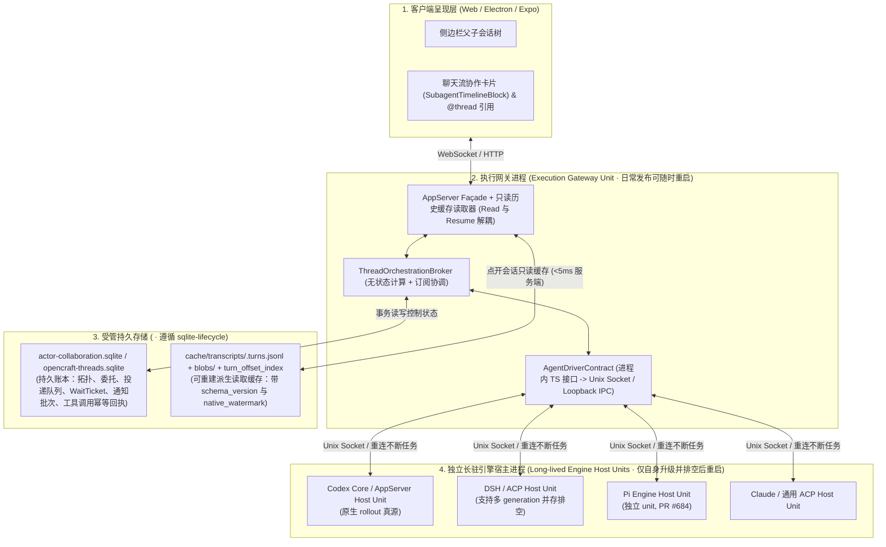

# OpenCraft 跨会话编排、3+1 引擎驱动与可重建读取缓存架构

> 状态：Stage 0 与 Codex Stage 1 已实现；Stage 2–3 及统一异构驱动仍为后续设计。当前实现以[协作契约](../docs/actor-collaboration-api.md#thread-orchestration-control-ledger)与[Core 契约](../docs/codex-core.md)为准，本文件保留整体目标架构。
> 适用范围：`opencraft/apps/opencraft-daemon`、`opencraft/apps/local-agent-host`、`opencraft/packages/appserver-protocol`、`opencraft/packages/chat-core`  
> 关联契约：[执行所有权](../docs/execution-ownership.md)、[平台架构](../docs/platform-architecture.md)、[SQLite 生命周期](../docs/sqlite-lifecycle.md)、[实施 Spec](thread-orchestration-spec.md)

## 1. 结论与核心目标

OpenCraft 已实现 Stage 0 读取缓存与 Codex Stage 1 跨会话消息、父子编排、独立宿主回调重放、恢复协同和有界授权。以下架构继续定义后续 UI 与异构引擎的共同目标；各引擎只有接通独立 Host 和实际能力后才声明可用。

核心架构原则如下：

1. **进程拓扑服从“执行侧平滑升级”原则**：`AgentDriverContract` 是代码层面的统一 TypeScript 接口，但**底层引擎进程（Codex、DSH、Pi、Claude SDK、ACP）严禁由频繁重启的执行网关（Execution Gateway）直接持有**，必须运行在各自独立长驻的 Engine Host 单元（如 `@opencraft/codex-core`、拆分后的 Codex AppServer 宿主、独立 DSH Host、独立 Pi Host）中；仅当某引擎自身升级且排空任务后才重启该宿主。
2. **下行采用“3 + 1”驱动契约（`AgentDriverContract`）**：上行（UI <-> 网关）保留现有 AppServer 协议与扩展；下行收敛为 **Codex（AppServer）、Claude Code（SDK）、Pi（stdio RPC）、ACP（通用协议，含 DSH `--profile acp`）** 四类 Driver。DSH 切换为 ACP 仅替换协议翻译层，完全保留独立 DSH Host 进程隔离与多代排空（Generation Draining）升级机制。
3. **编排协调器（`ThreadOrchestrationBroker`）跨网关重启无损恢复**：Broker 逻辑运行于执行网关/控制面，但其全部控制状态（等待票 `waitTickets`、通知批次 `parent_notification_batches`、投递状态与委托授权）持久化在受管 `dataDirectory` 的 SQLite 控制账本中；进行中的 Server-Owned 工具调用通过确定性幂等键与重连重放机制保证网关重启期间不中断、不丢回执。
4. **混合存储明确定义为“可重建的派生读取缓存（Rebuildable Projection Cache）”**：各引擎原生日志是对话正文与工具输出的唯一真源。`<dataDirectory>/cache/transcripts/<threadId>.turns.jsonl`、字节偏移索引与冷数据 Blob 仅作服务于“打开会话只读、不唤醒引擎”的可丢弃派生缓存；支持按水位（Watermark）追平、按 Schema 版本自动失效重建、以及与 Token 统计共用同一套 Codex rollout 增量读取器。
5. **多人共用身份、权限委托与 Token 归属对齐现有 `identity-core` 与 Token Spec**：Agent 发起的 `spawn / tell` 沿用 `access-control/collaboration` 的有界用户委托（Bounded User Delegation）校验权限；子会话由 Agent 触发的轮次在阶段 1 Token 看板中单列为 `sourceKind: "system"`（不冒充人工轮次），同时在控制账本完整保留委托链 `delegatorActorId`。

---

## 2. 进程拓扑与平滑升级连续性（最重要约束）

### 2.1 为什么不能把引擎进程放进执行网关？
在 共享服务器部署中，系统由多个独立生命周期的单元组成：
- **网站入口与执行网关（Execution Gateway）**：随日常业务迭代频繁重启。若引擎子进程（如 Pi、Claude SDK、ACP、DSH）作为网关的子进程运行，网关一重启就会中断正在执行的 Turn 与原生工具调用。
- **独立长驻引擎宿主（Long-lived Engine Hosts）**：包括 `@opencraft/codex-core`（及拆分后的 AppServer 宿主）、独立 DSH Host（`dsh-host.mjs`）、独立 Pi Host（`engine-host.mjs`）以及未来的 ACP/Claude Host。它们拥有独立 systemd unit 与 cgroup，日常网站/网关发布绝不重启它们。

### 2.2 全景进程与分层拓扑图

### 2.3 执行网关重启时的四项无损恢复机制

1. **Engine Host 侧进行中的 Server-Owned 工具调用不中断、不丢失**：
   - 当模型在 Engine Host 内调用 `thread_spawn / thread_tell / thread_inspect / thread_wait` 时，Engine Host 侧的轻量 Tool Stub 生成确定性幂等键 `toolCallKey = "${sourceThreadId}:${turnId}:${callId}"` 并向网关 Broker 发起调用。
   - 若调用期间执行网关正在重启（Unix Socket 短暂断开或 EOF），**Engine Host 的 Tool Stub 严禁立即向模型返回工具失败**：它在本地等待窗口（最高 15 秒指数退避）内自动重连新网关，并携带相同的 `toolCallKey` 重放请求。
   - 新网关 Broker 在 `opencraft_orchestration_operations` 表中先查 `toolCallKey`：若重启前已落盘执行，直接返回已保存的确定性回执；若未落盘，则接着完成执行。对模型而言，这次网关重启完全透明。
2. **等待票（`waitTickets`）恢复**：
   - `waitTickets` 持久化在 SQLite 中（含关注的目标会话列表、条件、到期时间戳 `expiresAtMs`）。网关重启后，Broker 扫描未结 `waitTickets`，立即与各 Engine Host 对账目标会话当前状态並恢复事件订阅。
3. **父子通知批次（`parent_notification_batches`）恢复**：
   - 子会话完成/阻塞事件先落盘到 `opencraft_parent_notification_batches`（记录 `first_queued_at_ms`、`deliver_after_ms`、`max_deadline_ms`）。网关重启后，Broker 按当前时钟重算剩余延迟：已到达 `deliver_after_ms` 或 `max_deadline_ms` 的批次立即合成通知入队，未到期的恢复定时器。
4. **跨会话投递状态（`queued / claiming / unknown`）恢复**：
   - 复用现有 `access-control/collaboration` 与 `OpenCraftHostQueue` 的 `actor-input:<requestId>` 对账机制。网关在提交前陷入 `unknown` 的投递，重启后先向对应 Engine Host 查询原生队列与已接纳历史中的 `clientMessageId`，确认未接纳才安全派发，确认已接纳则直接标为 `submitted/injected`，绝不重复投递。

---

## 3. 与在途工作的衔接（自动续跑 & DSH Host 平滑升级）

### 3.1 与“被打断轮次自动续跑”（`@opencraft/host-recovery`）的协同
`interrupted-turn-recovery.md` 规定：当引擎进程自身崩溃或维护重启时，Host 会对已接纳、未完成的根 Turn 自动发起最多 **3 次** 系统续跑（`interrupted-turn-recovery.sqlite`）。

若子会话发生中断，编排 Broker 必须与 `@opencraft/host-recovery` 严格协同，防止误报与重复唤醒：
1. **续跑期间抑制假失败通知**：当子会话收到底层 `turn/interrupted` 或连接断开，但 `@opencraft/host-recovery` 判定该根 `turnId` 仍在自动续跑预算内（状态为 `continuing`，尝试次数 `< 3`）时，Broker **不得**向父会话发送 `interrupted/failed` 通知，而是将子会话状态投影为 `working (recovering)`。
2. **仅在真实终态通知父会话**：只有当子会话续跑后正常 `completed`、或明确业务 `failed`、或 3 次续跑用尽进入 **`exhausted`**、或处于 **`unconfirmed`** 需人工介入、或被用户显式点击 Stop 时，Broker 才向父会话生成一次性的终态通知（以 `(childThreadId, rootTurnId, terminalOutcome)` 作为去重键）。

### 3.2 DSH 改走 ACP（`--profile acp`）与 DSH Host 无中断升级的关系
- **职责正交**：将 DSH 从两千行的 `dsh-appserver-adapter.ts` 迁移到 `AcpDriver`（`dsh --profile acp`），**只替换网关与 DSH 之间的协议翻译层，不改变 DSH 独立宿主进程拓扑，也不废除 DSH Host 的多代并存排空（Generation Draining）方案**。
- **如何配合多代排空**：
  - DSH Host 自身升级时，依然按照 `threadId → generationId` 路由表工作：新 `thread_spawn` 路由到新 generation 的 `dsh --profile acp` 实例；已有活跃会话的 `thread_tell / resume / 工具回调` 路由到旧 generation 实例，直到旧 generation 的活跃 Turn、原生工具、排队输入与待批交互全部排空后才退出旧进程。
  - 改用标准 ACP 协议反而消除了旧 `dsh-appserver-adapter` 在网关内耦合的私有状态转换，使跨 generation 路由更干净。

---

## 4. 多人共享部署下的身份、权限委托与 Token 归属

直接对齐现有 `opencraft/docs/actor-admission.md`、`opencraft/docs/architecture/actor-collaboration.md`、`opencraft/docs/architecture/conversation-interoperability.md` 与 Token 用量看板 Spec：

### 4.1 `MessageOrigin` 与已验证发送者（Actor）、企业身份的关系
三者不是平行重复的概念，而是同一套 `identity-core` 体系下的三个层次：
1. **企业身份 / 登录绑定（Authentication）**：用户通过可选身份插件、OIDC 或本地账号登录，由 `identity-core` 映射为 `actors.sqlite` 中唯一的持久自然人主体 `human://<domain>/<actorId>`。
2. **已验证行动主体（Verified Actor）**：每次请求在服务端入口完成认证后绑定不可伪造的 `ActorContext`（自然人 `human://...` 或持久会话主体 `session://...`）。客户端或模型工具参数绝不能自报 `actorId`。
3. **编排消息溯源（`MessageOrigin`）**：是在 `actor-collaboration.sqlite` 中记录某次具体 Turn 输入的因果信封，直接引用已验证的 Actor 主键：
   - `authorActorId`：本次输入的直接行动主体（人工输入为该自然人 `human://...`；子会话工具调用为源会话主体或受托执行上下文）。
   - `delegatorActorId`：触发该自动化链条的源头自然人 `human://...`（来自有界用户委托）。
   - `senderConversationRef`：`{ serverId, threadId }`（遵循 `opencraft://conversation/v1/...` 规范编码）。

### 4.2 Agent 发起的 `spawn` 和 `tell` 以谁的权限执行？能否 `tell` 别人的会话？
完全沿用并扩展 `conversation-interoperability.md` 的 **有界用户委托（Bounded User Delegation）** 模型：
1. **委托捕获**：当已认证自然人 A 向会话发起或 Steer 一轮对话时，服务端为该 Turn 签发持久、有界的委托记录（绑定 `issuerActorId = A`、`actorGeneration`、`sourceThreadId`、最长有效期 24 小时、单次委托最多创建/发送配额如 8 次）。
2. **权限边界（不能越权 `tell` 他人私有会话）**：
   - 会话内模型调用 `thread_spawn` 创建的子会话，其创建者与所有者归属 `issuerActorId (A)`，权限模式不能超过父会话与宿主上限。
   - 会话内模型调用 `thread_tell` 或 `thread_inspect` 访问目标会话 B 时，服务端以 `issuerActorId (A)`（或显式授权的 `Session Actor`）向目标资源权威核验权限：
     - 若会话 B 属于自然人 A 自己，允许操作；
     - 若会话 B 属于其他自然人 C，**除非自然人 C 或管理员已在 `actors.sqlite` 显式授予 A（或该 Session Actor）对会话 B 的 `message.send` / `execution.queue` / `execution.steer` 权限（或处于显式开放的共享实例公共作用域），否则直接拒绝（403 Permission Denied）**。
   - **权限不传染**：会话 B 收到来自会话 A 的消息后，会话 B 后续执行的工具调用**绝不继承**会话 A 的委托权限，仍严格按会话 B 自身的绑定授权执行；未绑定有效委托的后台轮次默认拒绝敏感跨会话写操作（Fail Closed）。

### 4.3 子会话与跨会话 `tell` 消耗的 Token 算谁的？
严格对齐《OpenCraft Token 用量看板 Spec · 第一期》（§1.2 与 §3.4）：
1. **由 Agent 自动触发的轮次（`origin.kind === "agent"` 或 `"parent_system_notice"`）**：
   - 在当前第一期 Token 看板中，Spec 已明确规定**“独立子 Agent 的完整触发链和人类费用归属不纳入本期人工分摊范围；若观察到其用量，单列系统来源，不冒认人工用量”**。
   - 因此，由父会话 `thread_spawn` 的首轮、Agent 调用 `thread_tell` 触发的轮次、以及系统自动续跑/父子通知触发的轮次，在用量采集时统一标记为 **`sourceKind: "system"`（细分原因 `subagent_delegation` / `cross_thread_message`）**，归入团队看板的**“系统已知量”**桶，保证全账本守恒式成立，且绝不污染自然人的人工均分统计。
   - 同时，控制账本持久保留该轮次的 `delegatorActorId`（发起委托链的自然人 ID）。未来二期看板若需支持“按委托人查看子 Agent 消耗”，可直接按 `delegatorActorId` 聚合，无需改动底层采集或猜测身份。
2. **人类直接介入子会话的轮次（`origin.kind === "user"`）**：
   - 当自然人 A 或 B 直接在子会话 UI 输入消息或成功 Steer 某一轮时，该轮拥有服务端确认的 `confirmed human` 参与者，正常按 `equal-turn-v1` 计入对应自然人名下。

---

## 5. 可重建的派生读取缓存（解决打开会话慢，且不违背原生日志真源）

### 5.1 定位澄清：只做可丢弃缓存，不做第二份历史真源
上一轮方案中将 `.turns.jsonl` + Blob 表述为“混合存储底座”，容易被误解为与原生日志并列的第二套权威库。特此明确：
- **唯一正文真源**：各引擎的原生会话记录（Codex rollout、DSH/Pi 原生 session 日志、Claude/ACP 原生记录）是对话正文与工具输出的**唯一真源**；控制事实（关系、委托、投递回执、`MessageOrigin`）的唯一真源是 `actor-collaboration.sqlite` / `opencraft-threads.sqlite`。
- **可重建派生缓存（Rebuildable Read Cache）**：`<dataDirectory>/cache/transcripts/` 下的 `.turns.jsonl`、Blob 预览缓存与 SQLite 中的 `opencraft_turn_offset_index` **纯粹是为了让 UI 打开会话时免于唤醒引擎和现场全量解析而设立的派生缓存**（对应 `docs/sqlite-lifecycle.md` 第 1 节“可重建的副本/索引”）。删除整个 `cache/transcripts/` 目录不会丢失任何权威数据。

### 5.2 缓存生命周期、重建与对账六条规则

1. **存储路径遵循既有 `dataDirectory` 约定**：
   - 严禁硬编码 `~/.opencraft`。统一使用 `docs/architecture/product-identity.md` 与 `docs/sqlite-lifecycle.md` 解析出的受管 Host `dataDirectory`（例如 `<dataDirectory>/cache/transcripts/<threadId>.turns.jsonl` 与 `<dataDirectory>/cache/transcripts/<threadId>.blobs/`，目录权限 `0700`，文件权限 `0600`）。
2. **与 Token 统计共用同一个 Codex Rollout 增量读取器**：
   - `CodexDriver` 的 `NativeHistoryPort` 与缓存构建器**必须直接复用**Token 统计使用的 Codex rollout 增量解析模块（共享字节游标与事件解析逻辑），严禁在仓库中维护两套 Codex rollout 解析器。
3. **如何从原生日志重建 & 投影格式变化时如何升级**：
   - SQLite 缓存元数据表记录当前 `projection_schema_version`（随代码中的 `chat-core` 投影格式版本递增）。
   - 启动或读取某会话时，若发现该会话缓存缺失、或 `projection_schema_version` 与当前代码不一致，直接丢弃该会话的旧 `.turns.jsonl`、偏移索引行和专属 `.blobs/` 目录，调用对应 Driver 的 `NativeHistoryPort` 从原生日志 + `actor-collaboration.sqlite` 的来源记录流式重建。
4. **崩溃后缓存落后于原生日志时的水位对账（Watermark Reconciliation）**：
   - 每条缓存索引记录保存源原生日志的水位 `native_watermark`（如 Codex rollout 文件的已读字节偏移 `byteOffset` + `inode/mtime`，或 DSH 的已提交 `eventSeq`）。
   - 当用户打开会话（`thread/read`）时，服务端先做一次轻量级原生文件 `stat` / 水位比对：
     - 若 `cached_watermark === current_native_watermark`：直接用 `pread` 读取 `.turns.jsonl` 最后 10 轮返回；
     - 若进程崩溃或后台引擎续跑导致 `cached_watermark < current_native_watermark`：增量读取原生日志中 `> cached_watermark` 的尾部片段，折叠追加到 `.turns.jsonl` 并更新索引后再返回，彻底杜绝返回陈旧截断历史。
5. **Blob 的引用计数与确定性删除**：
   - 冷数据 Blob 按会话隔离存放在 `<dataDirectory>/cache/transcripts/<threadId>.blobs/<sha256>.blob`，并在 `opencraft_cache_blobs(thread_id, turn_seq, blob_sha256, byte_size)` 中登记。
   - 单轮重算覆盖时，清理该 `(thread_id, turn_seq)` 不再引用的 Blob；会话归档清理、删除或整会话缓存重建时，直接整目录删除 `<threadId>.blobs/`，零孤儿文件残留。
6. **敏感输出保留与删除边界**：
   - 跨会话工具 `thread_inspect` / `read_thread` 严格遵循 `conversation-interoperability.md`：**只返回用户与助手文本摘要（单页上限 24 KiB），绝不向其他会话暴露工具输出或 Blob 内容**。
   - 用户删除会话或撤销授权时，同步物理删除对应 `.turns.jsonl` 与 `.blobs/` 目录；缓存层遵循与原生日志相同的脱敏规则，不缓存认证凭据或环境变量原文。

### 5.3 性能验收指标（区分服务端耗时与用户端体感耗时）
- **服务端缓存读取耗时**：命中水位一致的 `.turns.jsonl` 时，服务端 SQLite 偏移查询 + `pread` 尾部 10 轮耗时 **P95 < 5ms**（且零引擎进程唤醒、零模型目录 RPC）。
- **用户端实际打开会话体感耗时（E2E）**：从用户在 Sidebar 点击会话行，到浏览器完成首屏最后 10 轮 DOM 渲染可见（First Meaningful Paint of Turns），本机/内网环境下 **P95 < 150ms**（对比现有耦合 `thread/resume` 动辄 800ms~3s+ 有数量级提升）。

---

## 6. 修订后的分阶段路线（明确可提前独立落地的阶段）

按能力依赖，将原方案拆分为 **1 个可独立提前实施的性能先行包（Stage 0）** 和 **排在执行连续性改造/5 之后的远景编排包（Stage 1~3）**：

| 阶段 | 排期位置与前置依赖 | 核心内容 | 为什么这样排 |
|---|---|---|---|
| **Stage 0（可提前做）：会话打开读写解耦与可重建缓存** | **无平滑升级依赖**；仅需与 Token 统计共用 Codex rollout 增量读取器，可独立排期先行落地 | 1. 拆开 UI 点击会话的“只读历史预览（Read）”与“发消息时才唤醒引擎（Resume）” 2. 基于 Token 统计的共享 rollout 读取器 + DSH/Pi 原生读取，落地 `<dataDirectory>/cache/transcripts/` 可重建预折叠缓存与水位对账 3. 验收服务端读取 < 5ms、用户点击到首屏渲染 P95 < 150ms | 直接解决用户最敏感的“OpenCraft 打开会话特别慢”痛点，不涉及多会话工具注入或跨进程生命周期改动，风险极低 |
| **Stage 1（远景）：基于现有 `collaboration` 扩展父子会话与持久通知** | 排在**执行连续性改造（平滑升级前两步：拆 AppServer 常驻 + 自动续跑）**与**Token 统计（Token 改造）**完成之后 | 1. 在既有 `actor-collaboration.sqlite` 上扩展 `parentThreadId / lifecycleOwnerThreadId` 与持久 `parent_notification_batches` 2. 对接 `@opencraft/host-recovery`，实现续跑期间抑制假中断通知、终态 2s 有界合并汇报与 `hasDirectUserInput` 保护 3. 在长驻 Codex Core / AppServer Host 上打通跨网关重启不丢回执的 `thread_spawn / tell / inspect / wait` | 此时常驻宿主拆分与自动续跑已就绪，不会出现网关重启打断子会话或重复发送中断通知的问题 |
| **Stage 2（远景）：UI 协作卡片三态分离与侧边栏会话树** | 依赖 Stage 1 | 1. 修复 `chat-core` 的 `SubagentTimelineBlock`（分离工具调用状态、投递状态与子会话真实运行状态，解决 `wait` 完成误标 `done`） 2. 侧边栏支持父子会话树状缩进、`hidden` 后台会话过滤与点击跳转 | 纯客户端与共享投影层升级，消费 Stage 1 的权威状态 |
| **Stage 3（远景）：3+1 独立宿主驱动统一接入（Pi / DSH-ACP / Claude）** | 依赖 Stage 1 及独立 Pi/DSH Host 稳定运行 | 1. 在独立 Pi Host、独立 DSH Host（`--profile acp` + 多代排空）、Claude/ACP Host 上接入统一 `AgentDriverContract` 与工具回调重放 2. 打通跨异构引擎的父子派发与双向 `tell`（按有界用户委托校验权限，系统 Token 单列统计） | 完成最终的多引擎统一编排目标 |

## Stage 1 Codex implementation boundary

`ThreadOrchestrationBroker` and `ThreadOrchestrationLedger` share the existing
collaboration database owner and native Host input queue. The Codex APP Host owns
`orchestration-callback-lane.ts`; the gateway merely attaches, replays and
acknowledges stable callbacks. The generation registry remains the only writer
of Thread ownership and admission epochs. Both single APP and generation routing
use capability discovery; a gateway upgrade alone cannot advertise the four
orchestration tools against an older execution Host.

The execution port prepares and persists effective source settings before a
Native create. Explicit creation receipts are retained until the Broker commits
and acknowledges its result. Unknown outcomes after Host replacement are fenced
instead of creating another child. A child first becomes durable after its first
accepted Turn on the supported Native protocol; the spawn result reports
`pending_first_turn` until that acceptance rather than claiming immediate storage.

The recovery owner supplies explicit root snapshots. Broker notifications use
those snapshots, not the absence of a UI recovery notice. Authority, continuation
aliases and exact system input provenance are durable schema-v4 control facts;
transcript caches remain rebuildable. Stage 2 UI and non-Codex Stage 3 driver
integration are separate increments. The supported Native protocol cannot replace
an existing Thread dynamic-tool set during resume; new tools attach at creation,
and per-generation capability filtering keeps older APP payloads compatible.

Delegated Codex child creation follows the source Thread's registered generation,
using the source callback Host incarnation captured in immutable prepared settings.
This is an explicit exception to ordinary root creation on the current default.
Only the trusted Hub supplies this metadata; the router resolves the owner and
checks admission/retirement fences before Native submission. Default rollback
cannot move a pending or new delegated child to an incompatible APP payload.
