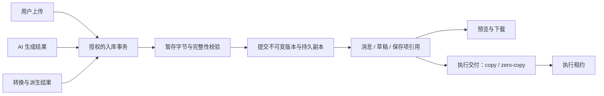

# 统一制品库：上传、AIGC 与资源回收

状态：目标设计及首版实现边界，2026-11-06。文末列出已落地内容；目标模型不等于所有能力已实现。
附件执行交付的 copy/zero-copy 与流式传输细节见
[附件资源与执行交付](chat-ui/attachment-delivery.md)。本设计扩展其资源所有权，
不另建上传协议，也不把制品登记等同于执行侧可读。

## 范围与当前事实

制品是用户上传、AI 生成或转换处理后，需要稳定引用与保存的内容结果。
统一的是身份、版本、引用、存储交付和回收语义；不要求所有字节进入同一个目录或同一台机器。
核心 Host 资源服务拥有制品目录及引用账本；存储 backend 拥有字节，执行 backend 拥有映射与租约。
Codex、Pi、DSH、ACP 和生成工具是生产者/消费者，不拥有各自平行的制品真源。

当前已核实：

- `packages/appserver-protocol/src/attachments.ts` 提供通用附件引用与分块上传协议。
- `apps/local-agent-host/src/attachments/` 提供 staging、内容摘要和提交 manifest。
- `apps/opencraft-daemon/src/opencraft-message-attachments.ts` 持久化消息附件引用并处理分叉，尚不是跨资源的 GC 账本。
- `packages/chat-core/src/builtin-projectors.ts` 将 imageGeneration 的 URL、Base64 或 savedPath 投影成图片，不能据此证明结果已入库或已持久保存。
- `packages/extension-runtime/src/artifact.ts` 定义扩展 ESM 快照；`apps/codex-core/src/generation-artifact-digest.ts` 校验运行程序文件。二者都不是用户内容制品库。

首批接入上传附件、AI 生成图片/音频/视频/文档以及转码、抽帧、缩略图等派生内容。
普通聊天文本保留在消息存储；明确导出的文本文件可以成为制品。
工作区文件不会因被 AI 写过就自动入库；用户保存或工具明确交付结果时才提交不可变快照。
构建发布产物、扩展包和模型权重暂不迁入，避免混淆其已有发布和信任规则。

## 对象与唯一写入者

| 对象 | 身份与关键属性 | 写入 owner |
|---|---|---|
| 制品 Artifact | 授权域内的稳定 ID、拥有者、展示名称、类型 | Host 制品服务 |
| 版本 Version | Artifact ID + 不可变 Version ID，内容对象、MIME、大小、来源 | Host 制品服务；生产者通过提交申请创建 |
| 内容对象 Blob | 存储域内身份、摘要算法/摘要、字节长度 | 内容存储 owner |
| 副本 Replica | Blob、backend、私有定位、完整性、持久/缓存角色、环境代次 | 对应存储/执行 backend，经目录登记 |
| 持久引用 Reference | 引用 owner 的身份、槽位、目标版本、保留语义 | 资源 owner 发起，制品账本确认 |
| 消费租约 Lease | 主体、目标版本/副本、消费者、环境代次、到期与撤销状态 | 消费资源 owner；执行租约是其一种 |
| 生产事务 Ingestion | 授权域、生产者、幂等键、预期元数据、提交结果 | Host 制品服务 |
| 来源关系 Provenance | 输出版本、输入版本/任务、操作和已知参数 | 生产者报告，服务校验并保存 |

同一内容可以承载多个独立制品及名称；摘要相同不合并权限、来源或删除行为。
首版仅在同一授权与存储域内去重，不以摘要作为凭证或暴露其他主体是否存有该内容。
版本的内容、来源记录不可原位改写；名称等展示元数据可以更新。
消息绑定明确版本，不能跟随“最新版本”悄悄改变。修改现有制品形成新版本，
独立生成结果默认是新制品；生产者不能仅凭相同文件名把结果归入已有制品。

物理路径、签名 URL、临时 blob URL 都不是制品身份。访问时授权并解析成可用定位，
短期 URL 不写成唯一历史引用。一个 backend 的失效不等于逻辑制品被删除。

## 附件与制品的统一边界

本文件是身份、入库、引用、权限和回收规则的唯一设计入口；
附件交付文档仅规定消息输入适配、执行准备与传输，不再拥有第二套原件生命周期。
“附件”是制品版本在消息/草稿中的使用角色，AIGC 是来源，二者不是互斥资源类型。
同一生成图片可以成为助手输出，再作为另一条用户消息的附件，整个过程无需重新入库。

逻辑关系为：消息槽位 → 持久引用 → 制品版本 → 内容对象 → 存储副本。
执行准备在这条关系上增加授权交付结果与租约；它不改变消息中的版本。
附件槽位保存自己的顺序、展示名称快照和用途，不能改写制品内容。
现有 clientAttachmentId 只标识上传/草稿槽位或兼容引用，不直接升级成全局 Artifact ID。
旧 AttachmentRef.location 只由兼容 resolver 解释，新的核心引用不包含执行路径。

### 引用不是授权，租约也不是业务引用

持久引用回答“是否还需要保留”，授权回答“当前谁可以读取/转交”，必须分别检查。
会话里出现一个制品 ID 不会自动授予访问；添加附件/分享/跨会话复用时，提交 owner
检查来源版本的转交权限，并为目标上下文建立明确的访问授权和引用。
来源属于私人会话时，派生制品可访问也不意味着完整来源记录可访问。
权限撤销可以让消息保留不可读占位，不自动删除其他主体仍合法引用的内容。
不同授权域之间首版通过显式授权的导入/交付建立目标域记录，不做透明跨域共享或去重。

租约也覆盖预览、下载、转换、模型原生媒体输入等实际读者，不只命令执行。
短期读取结束后释放；消息引用继续存在。后台转换期间需要固定输入版本，
源消息同时删除也不能破坏转换；转换结束后不必因来源记录继续保留输入。
已交给外部模型服务的内容无法靠本地撤销租约追回，交付策略不能承诺远端删除。

### 四种状态，分别报告

| 状态维度 | 成功意味着什么 | 不意味着什么 |
|---|---|---|
| 入库提交 | 某一不可变版本与持久副本已提交 | 已经挂到消息、任意环境可读 |
| 引用交接 | 消息/保存项已持有版本，恢复可对账 | 执行者有权限或媒体可解码 |
| 消费准备 | 指定主体和消费环境取得有效访问与租约 | 所有模型均支持该模态 |
| 内容使用 | 本次读取/解码/模型输入实际成功 | 内容今后不需要保留 |

UI 继续使用现有简短上传状态，不直接展示全部内部状态机。
模型原生图片消费和工具文件消费分别声明所需交付形式；支持原生图片的引擎不必为每次看图
强制复制一份工具文件。需要工具读取时仍须 prepare；不可读文件不能仅靠提示词伪装成功。
队列保存版本引用和权限上下文，出队时重新授权/准备，不能排队时生成路径后永久使用。
历史恢复从权威引用重新准备；旧模型上下文中的临时路径可能失效，不能保证历史路径永久有效。

## 统一审查后的取舍与默认决策

| 决策 | 默认选择 | 代价与边界 |
|---|---|---|
| 一个模型还是两套资源服务 | 统一制品目录，附件作为引用角色，复用已有上传入口 | 需要兼容旧协议；不增加平行附件数据库作为第二资源真源 |
| 入库与交付是否一起重写 | 最小目录/引用保护与附件交付形成首个完整闭环 | 不等全量 AIGC、GC 调度完成才修附件；也不先投放未登记的长期副本 |
| 是否所有本地访问都 zero-copy | 仅实际可验证只读隔离的 backend 使用，其他 copy | 同机仍可能复制；零拷贝是能力优化，不能牺牲历史原件完整性 |
| 上传时先全量保存再执行还是边收边用 | 首版校验并提交后再向引擎交付 | 首次执行多等一次提交，换取重试、版本与 GC 的确定性；生产中的预览可单独显示 |
| 生成结果是否自动保留 | 作为正式助手输出交付时自动入库并跟随消息引用 | 增加存储用量；工作文件及未完成预览不自动成为长期制品 |
| 去重范围与配额 | 首版仅域内去重；逻辑引用计费口径与物理占用分别记录 | 去重不自动扩大权限，也不意味着用户配额必然按物理节省打折；暂沿用现有限额 |
| 一条输入带多个附件 | 所有必需附件准备成功才投递；共享副本可复用 | 一个失败会阻止本条投递；不静默漏附件或重复投递已经成功的输入 |
| 传输重试与生产重试 | 传输复用原提交身份；用户重新生成才创建新生产尝试 | 幂等键中的“尝试”指生产尝试，网络重试不得变更；保存失败不重新付费生成 |
| 入库文件能否后续编辑 | 工作区可写副本，保存时形成显式新版本 | 多一次保存边界；内容哈希与历史引用保持可信 |
| GC 的完整性与可用性 | 未对账的引用交接/离线 owner 保守保留，提供诊断与对账 | 可能暂时多占空间；达到容量限制时停收而不猜测删除 |

以下产品边界尚未由用户确定，首版保持兼容行为，不能由实现偷偷扩展：

- **图片原件保留**：当前客户端可能先压缩/转码再上传。制品库“原件”指实际提交的字节，
  不声称保存了手机选择的完整源文件。默认不新增全量源文件上传；若要“随时下载真正原图”，
  则需保存源版本与模型适配版本，增加带宽与存储，并明确用户选择。
- **删除含义与期限**：默认删除消息只释放其引用，归档继续保留；原件自动 GC 尚未启用。
  “彻底清除全部位置”是独立操作，须处理其他引用、派生独立内容、备份和外部交付，不能包装成普通删除。
  宽限期、草稿保留期与未认领生成结果期限在启用自动删除前确定。
- **跨域分享与长期收藏**：默认不扩大已有分享权限、不额外为全部生成结果建立永久收藏引用。
  显式保存项独立于消息保留；是否提供个人/团队共享制品库页面属于后续产品范围。

以上默认允许继续附件闭环实现。真正需要新产品决策的是增加源文件保存、自动删除策略或跨域共享体验，
并非选择数据库表名、传输格式或 zero-copy 探测机制。

## 上传与 AIGC 共用入库事务

入库经历 receiving → verifying → committed，失败或取消进入待清理状态。
生产者身份、任务 ID、输出槽位与生产尝试 ID 组成作用域内幂等键（传输重试保持不变）；同一键同一内容重试返回同一结果，
同一键不同内容报冲突。多图/多文件各有输出槽位，重试不能重复生成引用或覆盖其他结果。

流式生成的预览帧是生产事务的临时输出，不是不断覆盖已提交版本；最终字节校验完成才提交。
任务整体失败时，已完整提交的某个输出可保留并明确显示其结果，未完成文件不能伪装成成功制品。
生成成功与保存成功分开记录：保存失败保留可恢复的生产事务及现有展示内容，不自动再次调用付费生成。

接收方式统一为已授权的字节流、受控本地文件快照或受支持 backend 的对象交接。
已有受管理不可变文件可以转交所有权或 zero-copy 登记；外部可变文件需要快照。
生成工具给出的路径只在工具所在环境解析，不能由 Gateway 按自己的文件系统解释。
外部 URL 需经已有受控下载能力获取并校验后才能声称持久保存；未获取的 URL 只能算外部引用，
不享有库内持久性或本地 GC 保证。不能让任意工具 URL 获得不受限的服务器网络读取能力。
Base64 型原生输出可以兼容接入，但不得宣称这一生产源已经实现全链路流式处理。

来源记录至少区分 upload、generation、transform；记录已知上传主体或工具/任务/轮次及输入版本。
模型版本、种子、提示词和转换参数仅在实际可得且有权保存时记录，不虚构可复现性。
凭据、签名 URL 和敏感完整工具参数不进入通用目录；提示词等敏感元数据服从原会话访问规则。

## 引用提交与消息一致性

上传完成先由草稿持有引用；AIGC 提交先由生产事务持有交接引用。
消息或保存项成功接收版本后，先建立新引用，再释放交接引用，不能出现“已显示但无引用”的回收窗口。
消息中的每个附件/输出槽位使用稳定引用身份；重试增删引用是幂等操作，不能用裸整数加减维护唯一真源。

同库操作使用事务。消息库与制品库分离时，消息 owner 通过持久 outbox 交接：
先获取版本的持久交接保护，再将消息和待确认引用事件一起提交；制品服务确认后完成交接。
响应丢失查询原事务，不能假定失败后释放保护。交接保护在 owner 恢复并对账前不会只因 TTL 到期被 GC。
消息提交失败则对账后释放，故障窗口允许暂时多保留，不能少保留。

引用例子：草稿附件、消息附件、助手输出、用户保存项、导出集合。
分叉为目标会话登记独立引用；归档默认继续保留；删除一个会话只释放它自己的引用。
浏览器刷新、视图卸载、切换引擎都不释放消息引用。
下载到用户工作区的可写副本由工作区管理，不属于制品库可以自动删除的副本。

## 来源关系与保留依赖分别建模

来源关系用于解释“怎么得到”，默认不阻止字节回收；保留依赖表示“缺少它就无法使用”。
两者不能共用一个无类型的 parent 字段。

| 情况 | 来源关系 | 阻止 GC 的关系 |
|---|---|---|
| 从视频生成独立 JPEG 帧 | 帧来源于视频及时间点 | 帧本身不强制保留视频；视频是否保留看自己的引用 |
| AI 使用参考图生成独立 PNG | 输出来源于参考图和生成任务 | 输出不自动保留全部输入；需要复现时显式保存输入集合 |
| 仅保存源视频片段范围的虚拟剪辑 | 剪辑来源于视频 | 剪辑需要原视频，建立保留依赖 |
| 缩略图/可重建预览缓存 | 缓存来源于原版本和转换配置 | 缓存可清理；不反向保留原件，原件引用也不必永久保留缓存 |
| 用户明确保存可复现项目 | 记录所有已知来源 | 保存项显式引用所需输入、输出和配置；不保证外部模型可重复执行 |

保留依赖必须在提交时授权并验证；从仍存活的根引用沿依赖边计算存活集合。
不使用单纯引用计数处理依赖图，避免无根循环永久泄漏。首版可拒绝依赖环。
来源对象字节回收后，可在允许的保留期内留下最小来源标识及“内容已回收”状态；
来源元数据同样需要删除与隐私策略，不默认永久保留完整名称或提示词。

## 执行交付、租约与持久性

执行准备解析版本与完整副本后，按附件交付设计选择本地只读复用或流式复制。
zero-copy 创建映射和租约，不创建新的内容对象；copy 登记目标副本，也不创建新的逻辑制品。
缓存复用必须重新授权，并验证内容版本与环境代次。执行路径只作为本次环境中的消费定位。

租约从准备事务转交实际消费者；编译完提示词、关闭页面或 Gateway 重启不能直接结束租约。
租约到期必须配合执行 owner 的代次隔离与撤销能力：分区或恢复时不能一边让旧进程继续读，
一边把它持有的 zero-copy 原件当作可删。无法确认失效时保守保留，待 owner 对账或明确终止。

一个被持久引用的版本至少保有一个可恢复的完整持久副本。执行缓存不是默认唯一持久副本。
如果 AI 输出最初只存在于短生命周期的执行环境，必须持久化成功后才能承诺已保存。
只读权限、写时复制快照和副本隔离按 backend 的真实能力实现，不以 chmod 或路径约定冒充隔离。

## GC：先识别，再删除

制品目录保存版本、引用、依赖、生产交接与租约；backend 只执行目录授权的具体回收操作。
消息/任务 owner 是其业务引用的真源，制品账本是回收决策的持久协调者。
通过幂等事件和对账保持一致，不各自运行一套“按目录年龄删除”。

回收分三类：

1. 失败/取消入库的暂存内容：确认事务终结、无未知提交结果后清理，重启扫描自己管理的临时区。
2. 可再获取的执行副本与派生缓存：无有效租约且不承担唯一持久副本时，可按容量策略优先逐出。
3. 原件/持久制品：无根引用、无可达保留依赖、无租约/生产交接保护，并超过配置的宽限期后才可回收。

采用标记与清扫：从根引用及保护关系计算可达版本，再映射到 Blob/Replica。
同一 Blob 被多个存活版本复用时不得删除；物理去重与逻辑版本删除分别计算。
候选记录包含目录代次和原因；删除前在事务内重新检查并取得排他删除状态。
新引用或租约与该状态串行化：标记阶段可撤回候选，进入删除状态后新使用须等待恢复或明确失败，
不能返回指向即将消失文件的成功引用。

清扫产生持久删除任务，按精确 backend 和对象身份幂等删除，成功后确认目录状态。
backend 离线/确认丢失保留待对账状态，不能虚报释放空间；清扫不递归删除未经登记的用户目录。
异常孤儿文件先核实提交记录，再按宽限策略清理；不能只看 mtime。
存储压力下先停收新内容、清可逐出缓存，不越过引用规则删除用户原件。

首版启用登记、引用对账、GC dry-run 和临时事务清理；持久原件自动删除保持关闭，
直到消息、分叉、AIGC 交接、执行恢复及旧数据迁移都有完整证据。
草稿、未认领生成结果、历史消息和缓存的保留期限分别配置；本设计不替用户决定永久保存或立即删除。
运维可观察占用、保护原因、候选数量、失败任务与实际回收量，诊断不暴露无权查看的私有路径和来源。

## 迁移与落地顺序

1. 在 Host 资源层建立最小制品目录与入库/引用事务，先接已有上传 staging 和消息引用。
   旧 AttachmentRef、manifest、目录和消息身份保持兼容；建立旧定位到制品版本的幂等映射。
2. 与步骤 1 共同交付首个可验收闭环：接通执行副本登记与 copy/zero-copy，交付结果返回真实执行侧定位；先解决现有附件不可读问题。
3. 为已支持的 AIGC 输出增加结果接收适配，复用同一入库事务；预览投影消费已登记引用。
   兼容旧 Base64/URL 历史，迁移失败保留旧展示，不把未抓取外部资源伪称已入库。
4. 接通转换派生及来源/保留依赖，随后验证 GC dry-run，再按既有授权与保留策略启用清扫。

目录可先随现有 Host 资源服务部署，使用仓库已有受管理数据库迁移机制；不为该设计新增网络服务。
共享包定义平台无关身份与语义，Node 文件操作放 Host/backend，Renderer 只消费授权引用与预览能力。
公开 RPC 与 schema 在真实调用方接入时确定，避免先发布没有 handler 的能力声明。
旧目录的引用扫描未完成或有未知生产事务时，对相应旧对象保持迁移保护，不参与原件自动 GC。

## 验收场景

- AIGC 输出在另一条消息中作为附件复用：同一版本、独立引用、重新授权，无第二次入库。
- 源消息删除时预览/转换仍在读：消费租约保护内容；完成后可释放且不会变成永久引用。
- 多附件中一个准备失败：本条消息不部分投递，重试不复制已提交版本或改变生产尝试 ID。
- 客户端仅上传压缩图片：历史只承诺保留提交版本，不把它标成未上传的原始照片。

- 上传与 AIGC 生成相同字节：可复用物理内容，逻辑来源及权限独立；删除一方不破坏另一方。
- 多个输出、重复回调、最终 ACK 丢失、生成完成但保存失败：恢复不重复发布、不重新付费生成。
- 两个会话引用同一版本，其中一个分叉/删除；剩余引用仍可读，归档和刷新不影响存活性。
- 入库提交、消息提交和引用交接任一步崩溃：恢复对账不丢内容，不把临时结果宣布为持久保存。
- copy/zero-copy 使用中遇到 GC、租约续期、网络分区和执行环境重建：旧代次不能错误续租，存活读者不被误删。
- 独立帧不强留视频；虚拟剪辑保留视频；无根依赖链可回收；共享 Blob 不提前释放。
- GC 标记后新增引用、删除任务 ACK 丢失、backend 离线：重新检查/幂等对账，不返回悬空成功引用。
- URL 过期、源工作区文件修改/删除、旧 Base64 历史：区分持久内容与外部引用，不静默换成同名文件。
- 所有支持引擎消费同一制品身份；未支持入口明确失败，不能仅靠目录命名宣称引擎无关。

## 首版实现与验证边界

已落地源码：

- `apps/local-agent-host/src/artifacts/catalog.ts` 提供受管理 SQLite 目录、不可变内容身份、来源类型、
  引用槽位、租约、入库事务记录和 GC 候选查询。初版 ID 绑定一个不可变版本，尚无可变“最新版本”别名。
  同身份重试校验内容与元数据；不同生产身份暂不做物理内容去重。
- 上传 staging 保持旧 manifest/path 兼容，提交时登记目录；消费旧附件时校验内容摘要后登记。
  未发送附件删除先在目录中排他标记，防止新增引用/租约与物理删除竞争。
- `scripts/host-filesystem.ts` 增加内部二进制流接收和按源身份查询已交付副本；接收目录由 Hands 选择，
  有长度/摘要校验、背压、并发限制与中断清理，查询可对账丢失的最终确认。身份映射到副本，不增加新的消息制品。
- 本地 backend 依据 Linux 实际只读挂载选择 zero-copy，普通可写文件域使用受管理副本；其他平台默认 copy。
  没有自动创建只读挂载，也没有把同 UID 下的 chmod 当成只读隔离。
- Codex、DSH 与 Pi 的已接通装配消费附件准备结果。Pi 出队时从原始引用重新编译；Codex 直接输入和队列输入均准备，
  直接输入的客户端断开会取消相应传输。独立 Brain/Hands 装配已增加接线，未在现网切换验证。
- `artifacts/generated-output.ts` 接收已有原生 imageGeneration 的最终 Base64 或可读文件结果，
  由 Codex 完成通知和历史读取触发登记；登记失败记录诊断，可再次读取原生历史重试，不触发重新生成。
  登记的生成图片可以再次解析为附件，正式展示仍兼容原生历史。

保守保留与后续范围：

- 当前使用草稿及会话级引用保护，分叉复制已登记引用；不是完整的逐消息 outbox/删除对账实现。
  准备失败和未知结果可能多保留引用。租约需要显式释放/对账，不做 TTL 自动失效；
  因而 GC 候选是保守结果，不能当作完整可回收空间统计。
- 入库前记录 receiving 事务；崩溃遗留可通过 incompleteIngestions 查询，检查是否已有提交结果。
  首版不自动清扫未知事务，不启用持久原件自动 GC；正常取消和失败会清理未提交文件。
- 新生成图片及 Codex 完成事件中的 MCP/动态工具/函数输出已接入；音视频与文档的交付格式见下文。
  外部 URL 不隐式抓取，旧 Base64/URL 展示未被批量改写。SSH 上传在远端校验后入库，旧 SSH 附件在重试上传或读取时补登记；未执行全量历史迁移。
- 派生依赖图、跨授权域分享、完整来源授权投影、全量历史迁移和自动 GC 调度仍按目标设计推进。
  不自动将所有工作区文件入库，不额外上传客户端未提交的源照片。

验证使用临时存储和真实本地 Unix socket，涵盖 40 MiB 交付、摘要、缓存复用、断流清理、
并发进程建库、重开目录、生成图片转附件以及提交确认丢失。源和目的位于不同目录，
这不是两套真实容器文件命名空间或现网模型链路验收；zero-copy 的真实只读挂载消费尚未实机验收。
本轮未部署，当前运行版本以部署回执为准。

## 音视频、文档及上传接入（2026-11-13）

成功提交的附件必须已经登记目录，不按 MIME 类型筛选；本地直传、分块上传及 SSH 上传均遵守这一点。
未知或空 MIME 类型按 application/octet-stream 保存。未完成、失败或取消的上传不是正式制品。
SSH 保留执行侧路径兼容，并把验证后的字节以 upload 来源保存到 Host 制品库；不把远端绝对路径登记为本地原件。
已发送 SSH 附件继续由现有消息引用阻止删除，目录中的 SSH 附件引用保守保留，草稿删除成功后释放。
旧附件按访问补登记不等于历史上传已完成全量回填；自动 GC 仍未启用。

生成结果由 Host 的 captureGeneratedOutputs 接收，复用目录的流式入库、不可变身份与会话引用。
Codex 的 item/completed 与历史分页读取均接通此入口；其他引擎需要明确调用相同入口，不能仅凭文件扩展名声称已入库。

- 原生 imageGeneration 保持已有身份与接入逻辑。
- MCP image/audio 内容块、resource 的 blob（Base64）或 text 内容入库。视频、PDF、Office、文本等均按 MIME 类型保留字节。
- 动态工具 inputImage/inputAudio 及函数输出 input_image/input_audio 的 Base64 data URL 入库。
- 大文件生产者可通过 MCP result.structuredContent.artifacts 显式交付：每项包含稳定 id、name、mimeType，
  以及绝对 savedPath 或 dataBase64。savedPath 通过装配的执行文件读取端口读取，不能把 Brain 路径当成 Hands 路径。
  每个输出槽位单独登记，重试不产生第二个原件，冲突内容被拒绝；一个槽位失败不阻止其他有效槽位入库。
- 普通工具文字、终端打印的路径、resource_link 和 HTTP URL 不会触发任意文件读取或联网下载。
  只返回 URL 的生产者仍须先按自身授权取得字节，再通过上述端口交付，不能把链接展示宣称为持久保存。

内嵌内容上限 32 MiB，文件读取采用流式入库并沿用 1 GiB 预算。入库失败产生 artifact-output-save-failed 诊断；
读取包含原始内容的历史可以重试，无须重新执行生成。正式管理界面、COS 存储与其他引擎生产者接线不属于本次接入。

聚焦验证覆盖音频/视频/PDF/文本多输出、Office 文件读取、重复与冲突回调、失败槽位重试、跨会话作为附件复用、
不同 MIME 上传、SSH 持久副本，以及真实 Adapter 的完成通知和历史分页回放。测试中的引擎和 SSH 端点为本地夹具；
这些证据不代表外部生成服务或线上环境已验收。
