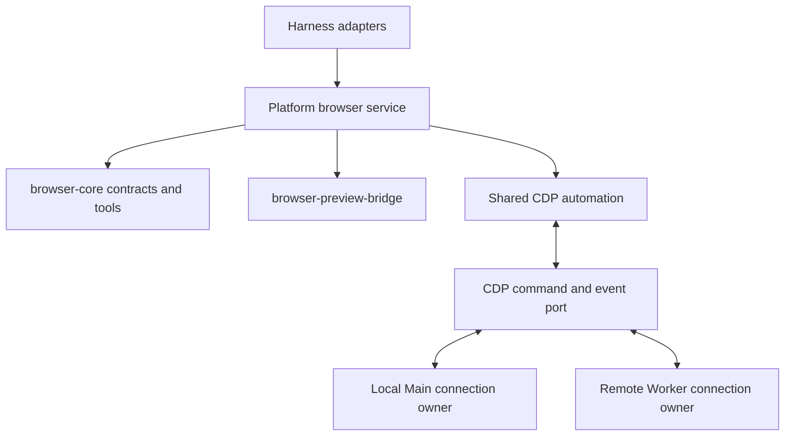

# Browser automation migration

Status: implementation in progress. The inventory below distinguishes existing
runtime behavior from the target architecture. This change does not deploy a
service or update an installed desktop client.

## Current inventory

| Area | Existing behavior | Target |
| --- | --- | --- |
| `packages/browser-core` | Separate automation contracts/policy/errors and neutral tool catalog/dispatch/results | Extend document/frame identity |
| `packages/browser-appserver` | Wire conversion over neutral catalog/dispatch, preserving compatibility exports | Verify each harness adapter |
| `packages/browser-preview-bridge` | Opt-in page runtime, semantic events, global DOM revision | Independent controlled-preview backend |
| `scripts/remote-browser/worker.cjs` | Electron pages; native CDP automation under existing control/document fencing | Shared CDP automation under existing control authority |
| `scripts/remote-browser/focus.cjs` | Shared owner initializes focus and nested frames | Keep a single physical owner |
| `scripts/remote-browser/touch.cjs` | Worker supplies the shared owner port with document guards | Reuse for native automation |
| `apps/workbench-web/src/browser/electron-browser-automation.ts` | Thin client of document-scoped Main IPC, with temporary native focus and per-operation cancellation | Thin client of owned-guest Main IPC |
| `apps/desktop/src/browser-guests.ts` | Main owns guests, CDP connections, document leases and cancellation | Host of shared CDP automation with trusted caller checks |
| `packages/session-capabilities` | Generic provider/gateway with bounded text/image wire conversion; headless registers a browser provider with execution-bound grants | Per-harness receipt and cancellation acceptance |

## Dependency direction

Each connection owner belongs to one physical WebContents. Focus, emulation,
touch and automation share it. Runtime code does not depend on native engine
turn types; trusted platform execution context is mapped by adapters.

## Sequence and acceptance

1. Split contracts, shared policy/errors and tool semantics into real modules;
   preserve existing imports and wire results. Compare both text and image paths.
2. Establish one owner per WebContents. Verify nested target setup/resume,
   event routing, configuration-before-input, timeout without detach/replay,
   cancellation before dispatch, disconnect and disposal during pending work.
3. Route remote focus/touch/emulation through the owner. Preserve existing native
   input, control fencing, immutable packaging and lifecycle tests.
4. Implement automation above the port. Ref identity includes instance/frame/
   document lifetime; unrelated mutations do not invalidate every reference.
   Revalidate actionability and ownership after waits. Native input must include
   real keyboard defaults, modifiers, pointer events and coordinate transforms.
5. Replace remote page injection, then use the same code in local Main through
   restricted guest IPC. An unsupported backend is explicit, never a silent
   PreviewBridge fallback. Keep screenshots and drawing resource leases bounded.
6. Verify the service through each harness adapter. Add typed image results and
   execution cancellation/receipts at the existing capability boundary. Keep
   state/authorization in the platform rather than the harness or renderer.

Real Electron acceptance includes unrelated DOM churn after inspect, detached
nodes, repeated/concurrent inspect, navigation with queued old actions, ordinary
and cross-origin nested frames, Enter/Tab/modifier behavior, React-controlled
inputs, sensitive fields, zoom/device changes, hidden-tab drawing, control loss,
unknown timeout outcomes and independently isolated pages.

The tracked implementation checklist is
[`packages/browser-cdp/AGENTS.md`](../../../packages/browser-cdp/AGENTS.md).

## Implemented foundation

Contracts/policy/errors and neutral tool dispatch are separated; AppServer keeps
its compatibility exports and wire conversion. `browser-cdp` owns connection and
nested target lifecycle, event routing, configuration barriers and bounded calls.
Remote focus, wheel/touch and device emulation use this owner. A host validation
callback is checked after waits so queued input cannot cross document replacement.

The native smoke uses the pinned Electron with isolated profile and loopback
fixtures. It checks trusted text input, real Tab defaults, two nested cross-site
frame targets, configuration ordering, page isolation and retired target sessions.
Parent detach retires descendant sessions even without individual detach events.
A blank native page must be initialized before creating the connection owner.

## Native automation and host integration

Both Electron hosts now use the same `browser-cdp/automation` implementation.
Only controlled webpage previews use PreviewBridge. Remote runtime packaging no
longer produces a bridge bundle. Inspection and context reads use isolated CDP
worlds; input uses native Input commands. Text selection is prepared within the
isolated world before native text insertion, including empty and whitespace fills.
No persistent page bridge, marker attributes or page-owned reference map is used.

References retain native node, frame, loader and isolated-context identity. Eight
snapshots of up to 500 elements coexist, so repeated inspect or unrelated DOM
mutations do not invalidate every reference. Removed nodes, changed semantic
identity, expired snapshots and replaced frames/documents are rejected. Each
operation rechecks trusted host guards across connection/configuration waits.

Native clicks test the intended element and ancestor iframe hit points. Same-
process frames share target coordinates; cross-site input is sent to its own
widget, with top-level page-scale compensation. Frame dimensions come from their
actual isolated worlds because Page.getLayoutMetrics can report the main viewport
for attached iframe sessions. Two render frames after scroll prevent using stale
compositor geometry. Hosts retain native rendering for the bounded operation and
release it on completion, cancellation and error, without starting viewer media.
Text inputs, textarea and contenteditable are supported. Other fill control types
and perspective frame transforms currently return explicit unsupported errors.

Local Main grants document-scoped leases only for its registered guests. Preload
exposes semantic operations and cancellation, never arbitrary debugger commands.
Renderer writes temporarily focus their webview: document focus alone can report
success while embedded native text input is ignored. A focus takeover cancels the
in-flight operation; restoring focus cannot override a newer user focus choice.
Disposing a client cancels its calls while preserving the shared connection.
Navigation expires old leases and guest/window destruction retires the owner.

Remote automation captures document identity at admission and rechecks existing
control tokens throughout native calls. A temporary drawing reference keeps hidden
pages responsive without a viewer/media lease. Connection loss or timeout after
admission carries an unknown outcome through IPC/gateway/tool errors and does not
advise replay. Per-harness cancellation/receipt acceptance remains TODO; provider
registration and the service entry are described below.

## Viewer-free invocation and capability results

`RemoteBrowserService.invokeAutomation` now operates on a committed logical tab
without attaching a viewer. Trusted composition supplies the account, Host,
conversation Scope and a synchronous live authorization guard. Each call checks
the committed metadata link and native document/runtime identity. Reads do not
take input control; writes use the same arbiter as human and viewer agents,
cannot preempt a human, and release their grant afterward. No visibility/media
subscription is created. The shared native backend retains temporary drawing.
Native activation/recovery and navigation share the viewer lifecycle and control
authority. Background logical tab creation is described below. Host screenshot
capture uses the shared connection and temporary drawing lease; it preserves PNG
bytes through the capability gateway without subscribing to viewer media.

Cancellation bypasses the native page command queue. Worker admission tracks
bounded requests before queueing; cancelled queued calls never dispatch. Page
close/navigation and control replacement cancel admitted work. Gateway timeout,
caller abort, viewer detach and shutdown forward cancellation without replay.
The persistent private Owner maps gateway IDs to its own Worker IDs and cancels
departed gateway automation before draining the adoption fence. Old owners that
do not advertise cancellation are rejected by the service entry. Cancellation
after dispatch retains an unknown outcome; it never claims an effect was undone.

The session capability contract distinguishes text and inline images. The MCP
gateway and independent Host attachment preserve content order and failure
status, bound payloads and reject unsupported blocks and remote image URLs.
ACP callback output uses the same conversion; a malformed received result is
final and cannot trigger reconnection/replay. Pi and DSH already consume typed
images. This does not establish paid-model or all-harness end-to-end parity.

## Validation record

Foundation tests, affected package/Workbench typechecks and boundary checks pass.
The native owner smoke passes on the pinned Electron 44.9.1. Existing native-owner
and production-demand tests also pass.

The full `smoke:remote-browser` reaches the visible video-frame assertion and
times out. Rebuilding its worker/focus from the unchanged base commit
`ab992202b487b9d1a10a1995845d41da4e56ae9a` reproduces the same failure in this
environment. This remains an unresolved presentation acceptance limitation; it
is not a passing end-to-end result and must be revisited before deployment.

## Native integration validation

- All 65 focused automation tests, five affected workspace typechecks, boundary checks
  and `git diff --check` pass.
- `smoke:browser-cdp-automation` passes on Electron 44.9.1 using actual target input
  events. It covers fill replacement/empty/whitespace, real Tab/Enter defaults, native wheel scrolling, stable and stale
  refs, sensitive policy, Shadow DOM, same-process and nested cross-site frames,
  overlays, page zoom, affine iframe transforms, mobile page scale, independent frame replacement and control
  guards. Successful command ACKs alone are not treated as click evidence.
- `smoke:desktop-browser-cdp` uses actual Preload, browser guest registry, Main IPC,
  shared CDP implementation and renderer adapter in an isolated Electron process.
  Real React controlled fields retain whitespace; native shortcuts work. It checks
  focus restoration/takeover cancellation, client disposal, expired document
  leases, unowned guests, foreign callers and guest privilege isolation. This is
  a component integration probe, not a launched installed Workbench, Mac/Windows
  validation or a login/model/harness acceptance result.
- The explicit automation-only remote smoke passes through a freshly packaged
  Worker, gateway, actual renderer surface/runtime and Dynamic Tool Host. Hidden
  inspect/fill/click/wait, sensitive-field redaction and thread ownership pass.
  The full video presentation limitation above remains open.
- Expanded browser tests: 275 pass, 7 fail, 1 skipped (283 total before the final
  receipt and tool-input tests were added). The same seven failures reproduce using the base
  Workbench source and tests at `ab992202b487b9d1a10a1995845d41da4e56ae9a`, with
  this checkout's dependencies. Three conversation-resource fixtures omit
  `setSessionClosedHandler`; four attachment/reconnect fixtures use obsolete
  constructor arguments or omit input-policy state. They are baseline test
  maintenance issues, not a passing all-browser gate; no unrelated runtime
  behavior was changed to accommodate them.

The controlled-preview Vite library build passes. With the actual Workbench Vite
config, the shared sensitive-control policy resolves to its prebundled browser
module in development, rather than raw CommonJS. This new leaf is explicitly
included because Workbench disables dependency discovery.

No commit, deployment or installed-client replacement is included.

## Service and result validation

- `test:browser-automation`: 65 passing tests.
- `test:browser-service`: covers viewer-free invocation, account/Host/Scope
  rejection, human priority/takeover, in-flight authorization revocation,
  cancellation before dispatch, bounded admission, private Owner ID translation,
  gateway disconnect, MCP mixed-content roundtrip and DSH image admission.
- Both `smoke:remote-browser-automation` and
  `smoke:remote-browser-owner-automation` pass on real packaged Electron. After
  every viewer disconnects, service inspect/fill/click/wait still change the
  original native document. Cancelling a 60-second wait permits another inspect
  within five seconds. The second smoke exercises the persistent private Owner
  transport and its request ID translation, using an isolated local owner rather
  than changing the installed system service.
- Session capabilities, ACP, Pi, Workbench and Desktop typechecks pass, as do
  platform boundary checks and whitespace validation. The focused ACP callback
  integration passes for both inline screenshots and rejected malformed output,
  with one invocation and no formatting-triggered replay.
- Full ACP regression is not green: two runs each hit one asynchronous JSON
  rename `ENOENT` in existing session persistence tests (different cases per
  run). The unchanged base ACP source/tests reproduce this in the Full-access
  restart case. This is separate from the earlier browser baseline failures;
  the new callback case passes, and no unrelated persistence fix is included.

Foreground presentation, receipts for all effects and
paid-model harness acceptance remain open.

## Headless capability composition

The headless application now registers `RemoteBrowserCapabilities` over the
existing service, rather than selecting a renderer callback owner. It declares
`opencraft_browser_browser_use`, `opencraft_browser_get_tab_context` and background
`opencraft_app_open_in_opencraft` from the neutral catalog. Runtime absence
suppresses declarations and rejects stale invocations. Foreground presentation
is not declared by this provider yet; close uses the resource service. The renderer tools
remain compatible during migration.

`createBrowserGrantResolver` consumes a trusted server/thread/execution binding.
Collaboration resolves its human and exact input/Turn authority through the
existing storage Worker, including conversation ownership policy. Permission
reads use the existing memory projection; the new delivery path performs no
main-thread SQL. A native `thread/turns/list` read must confirm the exact active
Turn before invocation; stale input credentials cannot borrow a later Turn's
different authority. Long calls recheck native liveness every 500 ms, while the
service checks account, Scope, document and control across asynchronous waits.
The provider closes active calls, refreshes and liveness checks before its native
service is released.

Authenticated accounts use their human Actor as browser owner. The explicitly
configured anonymous deployment maps only its reserved deployment operator to
`local-anonymous`; missing credentials never select that owner. Committed browser
bindings and canonical conversation aliases select the thread's tabs. A model
argument cannot select an account, Host, Scope or execution.

Validation includes the real headless assembly with a fixture execution Host:
native active-Turn inspection, configured anonymous browser ownership, matching
tab listing, completed execution rejection and Actor revocation pass. All 22
existing headless-server tests pass, including bundling and startup/shutdown.
The main-thread SQL prohibition test passes with actual managed storage and
Worker queries. Collaboration and execution-CLI regressions also pass.

The real packaged Electron/private Owner smoke now invokes the provider through
MCP after every viewer disconnects. Native fill/click/wait, sensitive-context
redaction and typed PNG output with actual viewport dimensions pass. Execution
admission is a fixture in this smoke; it is not a paid-model harness test. The
separate headless and storage tests exercise production authorization composition.
ACP catalog exposure and all-driver receipt/cancellation parity still require
their own native integration acceptance.

## Shared native activation and service navigation

`scripts/remote-browser/page-lifecycle.mjs` now owns native activation, recovery
configuration, unknown-outcome reconciliation and failure cleanup. Viewer open
and service invocation acquire the same per-page activation slot. A dormant
committed tab can become native without any viewer, media subscription or fake
presentation. Reattachment preserves live state; recovery restores the saved
URL, zoom and device viewport in the same native partition. Native lifecycle
updates leave the existing browser metadata values and CAS revisions unchanged.

The provider now declares navigate/back/forward/reload/stop. These operations
use the existing cancellable automation transport and input-control arbiter.
The Worker validates the original document and control before native dispatch.
The admitted navigation request can cross its own document replacement; queued
operations from the old document still expire, while control loss, caller abort
and shutdown can cancel navigation. An acknowledged navigation returns
`accepted: true`, without claiming that loading completed. Inspect/wait and
native navigation events remain the evidence for the resulting page.
Worker startup advertises navigation support through the private Owner
handshake. A retained older runtime rejects these calls before dispatch while
preserving its existing pages; the gateway never infers support from its own
installed source version.

Focused validation adds dormant recovery, viewer/recovery contention, restart
configuration, metadata revision preservation, revocation before saved-URL
dispatch, cancellation before creation and unknown create without replay.
The packaged Electron/private Owner/MCP smoke exercises actual navigation,
back/forward, reload, stop and expired references. It also terminates the real
Worker, starts a fresh one, restores the saved URL through the same logical tab
with zero viewers, and captures the recovered native document.
All 101 service tests, 65 focused automation tests and 23 headless composition/
server tests pass. The adapter's strict TypeScript check, platform boundary
checks and whitespace validation pass.

## Background tab creation and metadata synchronization

`tab-creation.mjs` commits the logical page, tab, storage partition key,
conversation binding, metadata versions and native capacity reservation in one
durable transaction. Native activation uses the shared lifecycle afterward.
The admitted account/Host/Thread/Turn/call determine a stable creation identity.
Repeated calls retain the same logical tab across acknowledgement loss and
restart; a changed URL conflicts, and a retired identity cannot create again.
An error after the logical commit is an unknown outcome and identifies the
committed tab for inspection. This is a creation receipt, not a claim that every
native effect or every harness already has durable replay protection.

The provider declares background open with `visible: false` as its default and
only supported visibility. Opening an existing tab checks conversation ownership
and activates it without inspecting its contents; an optional URL goes through
the existing navigation arbiter. No viewer or panel is synthesized. Foreground
presentation remains TODO. Service-owned close is described below. MCP assigns
each invocation a server-generated call identity while retaining execution identity;
model arguments cannot supply account, conversation or operation ownership.

Creation sends an account-scoped metadata invalidation after the durable commit.
`RemoteBrowserStorage` orders writes and snapshot reads, rechecks on reconnect,
and overlays pending edits onto complete committed snapshots. The shared
`browser-core/metadata-merge` merges independent records and rejects conflicting
changes to the same record, retaining local drafts and the committed server
record. Legacy clients retain strict key CAS. A merged key ACK cannot be
published independently: a tab may reference a page/binding that arrived in the
same remote transaction. Only a full dependency snapshot notifies consumers.
Read invalidations arriving during a read schedule another snapshot; transient
read disconnects use bounded retries without replaying native effects.

`browser-metadata-sync.ts` imports committed additions through the existing
binding, storage, page and workbench owners. It preserves existing page objects,
native surfaces and active presentation. Additions and durable retirement facts
are synchronized. This does not establish complete multi-client reconciliation
of arbitrary existing record edits or conversation rebinding; those remain
explicit follow-up work.
The existing sidebar resource collection consumes these owners; this change adds
no new visual control or layout.

Validation covers queued edits during creation, a held stale snapshot, reconnect,
same-record conflict/draft retention, owner-isolated invalidations, failed atomic
commit, unknown native create, restart identity and 17 concurrent creates under
the account limit of 16. The real packaged Electron/private Owner/MCP smoke
creates a native background page while a client is connected. Its existing
workbench receives the same page/tab/partition identity; no viewer attaches to
the new page. The client's textarea draft, focus and selection remain unchanged.
Native fill/click/wait then changes the created document. This verifies client
behavior in the integration fixture; full installed Shell visual acceptance,
paid-model harness acceptance and production deployment are not included.

Current checks pass: 101 service/metadata/capability tests, 23 headless composition
and server tests, affected Workbench/session-capability/browser-core typechecks,
the strict service-adapter typecheck, platform boundaries and whitespace checks.
The real private-Owner automation smoke passes with the creation/synchronization
checks above. The new CommonJS metadata merge entry is explicitly listed in
Workbench's Vite prebundles; the native integration fixture's browser bundle
also executes the shared merge implementation.

## Service close and authoritative retirement

The provider now exposes `browser_use(action: "close")` through `tab-close.mjs`.
Close is admitted against the current account/Host/Thread and fresh metadata
link; model arguments select only a tab ID. Live pages use Agent control before
admitting intent. Holding the existing control queue through the intent commit
ensures a preceding human takeover wins, while an accepted close prevents later
control grants. A closed conversation receipt can answer a repeat request after
the directory row has disappeared, without acquiring control or touching native.

`tab-retirement.mjs` owns one retirement path for service close, viewer close,
account discard and legacy storage removal. Its synchronous reducer commits the
retired lease, page/tab/storage removal, key revisions and resource retirement
facts together. The legacy storage mutation includes all of these in its own
transaction; it cannot publish a storage-only close followed by a later graph
repair. It keeps the conversation binding for surviving resources.

After intent publication, cleanup belongs to the tab owner. It cancels old
requests, retires viewer attachments, waits for an admitted creation to settle
and crosses the native close barrier. A positive dormant absence skips native
startup. A native ACK allows the completion commit to remove the canonical
record and release its reservation. Unknown ACK retains capacity and restart
continues that same close without creating a replacement page. Caller cancel
stops waiting with an unknown outcome while accepted cleanup continues; grant
revocation after commitment cannot strand cleanup. A rejected intent draft
neither retires the memory object nor schedules a later unauthorized close.
A state publication followed by a reported storage error remains an
accepted intent and still owns cleanup.

Completed close receipts are bounded to 256 per account and 512 KiB; unresolved
intents remain until resolved. Receipt reads require the original Host/Thread.
Permanent `retiredResources` facts keep minimal lease/page/tab identities separately
from those receipts, preventing logical and physical resurrection after compaction.
An older receipt that cannot establish ownership fails
closed rather than issuing a new destructive effect.

Metadata snapshots carry account-scoped retirement identities. Shared retirement
filtering drops only those page/tab/storage rows from stale and pending writes,
while independent drafts still use record conflict checks. The client imports
the facts through the existing workbench/page/surface owners, closing panels
and releasing local projections without another native destroy request or a
whole-table persistence write. Surviving page objects, editor drafts, focus and
selection remain unchanged. The scope is authoritative resource retirement;
it does not infer retirement merely from a missing arbitrary metadata row.

Validation adds dormant close, human control and queued takeover, revocation
before/after commitment, cancellation while native ACK is held, failed drafts,
post-publication storage error, unknown native ACK and restart, pending metadata
edits, legacy storage removal, late native creation and repeated owned close.
All 101 service tests and 65 focused automation tests pass. The 23 headless tests
and three page-state/background regressions pass, along with affected typechecks,
boundaries and whitespace checks. The packaged Electron/private Owner/MCP smoke
closes a viewer-free background page and then a page with a connected viewer.
It verifies native inventory removal, client page/tab/storage removal, repeated
close receipts, stale metadata protection and preservation of the other editor's
draft/focus/selection. This is integration-fixture evidence; installed Shell,
paid-model harness and deployment acceptance remain outside this validation.

## Codex CLI acceptance

Run `OPENCRAFT_CODEX_EXECUTABLE=/path/to/codex npm run smoke:browser-codex-cli`
(or omit the executable variable when `codex` is on PATH). The command extends
the existing private-Owner automation smoke, with a separate temporary Codex
home and task directory. It never copies a real login or profile. No installed
service is replaced. The CLI fixture config explicitly approves only these
three browser tools for this authorized synthetic sequence; production browser
declarations retain their existing approval policy. Without this per-tool
consent, CLI `approval_policy=never` rejects the MCP call before dispatch.

Two independent Codex CLI 0.162.1 `exec --json` clients share one execution
credential, each completing 15 actual MCP calls and 16 local Responses requests.
Their request numbering restarts, while their created tab identities remain
distinct. Each isolated profile is new. The local endpoint emits the next decision only after checking the
previous tool output. It covers background creation, owned listing, inspection
and references, sensitive-fill rejection, native fill/click/wait, context
redaction, typed PNG feedback in the next model input, navigation, close,
repeated close receipts, absence after close and unknown-tab rejection. The PNG
must be an `input_image` block; a text data URL cannot satisfy the assertion.
Navigation waits for a new page's unique marker, absent from the source page. CLI JSON
events contain all 15 completed tool calls and a completed Turn. The service
then independently confirms the durable closed receipt and released native-page
record and physical inventory removal. The rest of the existing native smoke also passes, including Worker
restart, online client synchronization and preservation of drafts/focus.

The command also starts a separate real `codex app-server --stdio` with its own
temporary home. An unbound MCP reservation is installed at native creation and
bound to a persisted human input before dispatch. `ActorStore`, `Collaboration`,
Worker SQL and `createBrowserGrantResolver` resolve authority; the native
`turn/started` event supplies the actual Turn ID. After a primer Turn, six MCP
calls exercise create/inspect/close, reject an existing tab belonging to the
other conversation, and reject invocation after the human's authority is
revoked. Five native liveness checks request the latest Turn through
`CodexBridgeRuntime`; real native history contains both Turns. Physical native
inventory independently confirms the accepted close. This supplements the first
`exec` phase's fixed authority fixture rather than treating it as admission proof.

The sanitized `codex-browser-cli-evidence.json`, `codex-browser-invocation-evidence.json` and
`codex-browser-admission-evidence.json` reports live in the smoke's temporary
directory. CLI/MCP/Owner/Electron/CDP and persisted domain admission execute for
real against isolated local identities. Model decisions remain synthetic
loopback Responses. This does not validate real-model planning, live account
login, installed-client presentation, deployment, or every supported harness.

### Codex Bridge latest-Turn query

`currentTurn` deliberately requires exactly one latest Turn from a bounded,
descending `thread/turns/list` query. Both the provider gateway and native
runtime must preserve `limit`, `sortDirection`, `itemsView` and `cursor`.
Previously the gateway discarded the query options and the runtime hardcoded
100 full Turns, causing valid multi-turn conversations to fail admission.
The adapters now preserve caller options, retaining the former 100/full defaults
only when omitted. Item-history queries also preserve their requested limit.
Do not loosen admission to accept an arbitrary first Turn from an unbounded
history response. Regression tests cover both adapters, cursors, sorting,
lightweight views and browser admission with an older completed Turn present.

### Invocation identity and durable publication recovery

JSON-RPC request IDs are local to an MCP client. The stateless gateway now assigns
a fresh UUID to each admitted invocation, retaining any parent call context and
the original signed execution fields. Two clients starting at request 1 must not
reuse a browser creation identity. A newly received MCP call is a new invocation;
there is no automatic HTTP or external-effect replay by request number. Internal
recovery with the same trusted call context still uses its existing domain receipt.
An uncertain result directs the caller to inspect the resource directory.

Creation also reconciles state publication followed by a reported storage failure.
The reducer's prepared identity is checked against current committed state. If
published, its memory page and account metadata projection are restored and
clients notified; the error returns `unknown`, `retryable: false` and the committed
tab ID. The catch never starts native creation. A genuinely rejected draft still
publishes nothing. The committed tab can be closed immediately or recovered with
the same trusted identity without duplicating metadata.

`retirement-facts.mjs` separates permanent resource identities from the bounded
close-receipt cache. These facts are captured in the retirement transaction and
survive receipt compaction and restart. Old state imports retained receipt facts;
deterministic service leases recover service IDs even if their receipts were
already compacted. An old arbitrary legacy ID that was already discarded cannot
be reconstructed from a lease alone, but the lease remains fenced. Reads expose
filtered metadata without mutating durable state; normal writes filter base,
local and remote records, preserving unrelated records.

Regression coverage includes independent SDK clients, creation publication errors
with immediate close/recovery, 257 actual create/close operations followed by stale
server/client edits, restart, and old compacted service-state migration. All 107
service tests pass, along with the two real CLI clients, native domain-admission
acceptance and the remaining private-Owner automation smoke. Model decisions
remain synthetic loopback responses, with no installed-service or deployment claim.

### Temporary inspection clients and idle metadata recovery

Bridge history pagination (`thread/turns/list`, `thread/items/list`) now establishes
its logical client's subscription just like `thread/read`. This allows the
harness-neutral `callConversationHost` inspector to read the current native turn
through AppHost without a mutating resume. A regression creates two independent
short-lived inspectors through the actual AppHost/ProviderBridge/gateway route,
verifies the active turn identity, and confirms only one native start occurred.
The native fixture is synthetic; this regression does not claim a live-model run.

Remote metadata disconnects immediately revoke readiness. Idle connections recover
with capped backoff and a new authenticated full snapshot, even after repeated
transport failures; read recovery does not replay metadata writes or native input.
Authorization closure (1008) is terminal, and disposal cancels scheduled reconnects.
`whenReady` also waits for snapshot recovery rather than only initial admission.
Coverage includes a real WebSocket missed-creation test requiring no caller action,
held snapshot responses, repeated failures, authorization closure and disposal.

Pending metadata writes also survive transport outages beyond the old six-attempt
limit. Retries retain the exact original mutation ID and payload, use a delay
capped at five seconds, and stop on disposal, authorization rejection or a
non-transport error. A rejected/conflicting edit remains visible for recovery;
it is not silently resubmitted as a new operation. Backoff cancellation settles
pending write flushes promptly. Tests cover a long outage after a lost ACK,
revocation and disposal; a real WebSocket/service regression verifies that the
lost-ACK retry leaves the durable revision unchanged (one committed edit).

Snapshot projection now finishes updating revision, retirement facts and readiness
before notifying consumers. Recovery also notifies when metadata is unchanged,
so consumers can observe readiness returning without waiting for a later edit.

### Compacted metadata retry history

Metadata merge requests now carry the same compaction fence as ordinary CAS
writes. The service persists the revision of the last evicted metadata receipt;
a request without a retained receipt must have a global base revision at or above
that fence. Otherwise it returns `STATE_CONFLICT` without modifying metadata.
Retained receipt retries still return their committed result before this check.
Older state with a full receipt cache derives a conservative fence from its
oldest retained revision. Fresh clients continue to merge normally; clients older
than the retained retry history must synchronize rather than replay uncertain edits.
A regression commits an addition, removes it, evicts its receipt with 256 writes,
and verifies that its lost-ACK retry cannot resurrect the binding, including after
service restart. This also corrects the previous assumption that ordinary CAS
alone protected merge requests after receipt eviction.

Metadata RPC cleanup now removes pending entries and timeout handles when
WebSocket.send throws synchronously. Each RPC timeout references its originating
socket, so an abandoned request cannot later close another connection. Snapshot
retry delays use the same cancellable backoff as writes, allowing disposal to
settle a waiting flush immediately. Startup/read/message paths also reject or
ignore callbacks arriving after disposal; a late socket open cannot send a state
request. Regression coverage advances beyond the old RPC timeout after successful
retry, cancels a snapshot backoff, and delivers a socket-open callback after startup
cancellation.

Application teardown uses `flushAndDispose` rather than waiting indefinitely for
`flush` before disposal. Accepted metadata edits get a one-second drain window;
then disposal cancels retry waits, pending RPCs and unfinished connection
handshakes. Normal online shutdown still persists accepted edits. Offline edits
that cannot finish during teardown remain unconfirmed; this in-memory queue is
not durable offline storage. Late socket callbacks cannot restart the owner.
Tests exercise the actual Application storage shutdown method with healthy writes,
prolonged disconnection and a handshake whose close callback never arrives, plus
a real WebSocket save-and-subscription-close regression.

The twenty-second metadata connection deadline now rejects its promise and detaches
the timed-out socket immediately, rather than depending on a subsequent close
event. Idle recovery can create a replacement even when that event never arrives.
Socket identity is checked before a late open callback can clear the current
connection's cancellation handle. Tests cover startup timeout, successful snapshot
recovery through a replacement, stale open/authorization-close callbacks, and
shutdown while the replacement handshake is unfinished.

Ordinary metadata commits now broadcast account-scoped invalidation after the
transaction succeeds and its in-memory directory projection is reconciled.
Previously only retirement-triggering metadata writes invalidated peers, leaving
other connected clients stale after normal saves. Read-only queries, retained
receipt replays and rejected writes do not broadcast. A real two-client WebSocket
regression verifies automatic binding convergence, one invalidation per commit,
quiet receipt/read/rejection paths and isolation from another account's writes.

Ordinary metadata publication errors now reconcile the committed state just as
service-owned creation does. If a fresh mutation's receipt is present after a
reported storage failure, update the in-memory directory, notify peers and schedule
any committed legacy retirement, then return the original error with unknown
outcome and retryable=false. A truly rejected draft produces none of these effects.
Real WebSocket regressions cover published binding discovery, quiet receipt replay,
rejected drafts and native cleanup after a published legacy storage removal.

A metadata RPC deadline also detaches its originating socket immediately, clears
connection reuse and revokes readiness before rejecting the request. Recovery no
longer waits for a close event from an unresponsive socket, and late close events
cannot revoke the replacement's state. Timeout regressions cover both a held
snapshot read and a committed write whose ACK is lost, retaining the same mutation
ID when the write reconnects.

Unknown native-page reconciliation now captures the native Owner identity and
page runtime epoch before awaiting its snapshot. Both positive and absent results
must still match that identity, epoch and page record before publishing liveness,
issuing close, or recording absence. Late replies from a replaced Owner cannot
mark its successor live or direct cleanup to that successor. A regression first
loses creation ACK, then independently changes Owner or page epoch during snapshot;
a third case returns obsolete positive absence. All must stop before subsequent
native commands and retain the unresolved reservation.

Failed activation cleanup also rechecks native identity after publishing the
unknown reservation and after awaiting native close. Cleanup cannot dispatch close
to a replacement Owner, nor use an old close ACK to mark that replacement absent.
Runtime-state writes retain the captured epoch, and native guards include the
current page-map identity and service lifetime. Regressions switch Owner across
both cleanup awaits; they fail before the fix (unexpected close / false absence)
and preserve the unresolved reservation afterward.

Owner startup inventory reconciliation now checks its captured transport identity
between orphan-close requests, inside the durable inventory reducer, and after
publication. If the Owner disconnects while reconciliation is queued, startup
fails rather than converting unknown native reservations to absent from reset
in-memory flags. Owner regressions disconnect during publication and during the
first of two orphan closes: capacity stays reserved and no subsequent orphan
command is sent through a replacement.

If Owner recovery fails after attachment (orphan cleanup or inventory publication),
retire that Gateway transport through the existing identity-fenced disconnect
path. Reset in-memory liveness/control and preserve unknown reservations, releasing
the exclusive attachment so a later startup can reconcile the same native pages.
This disconnects the transport, not the persistent native Owner. Regressions inject
both failures and verify one transport release and successful subsequent adoption.

Service startup rechecks its closed state after loading, runtime availability,
directory preparation and isolated-runtime access setup. Closing the service while
one of those awaits is pending cannot spawn a late Electron child after shutdown
has already released its resources. A deterministic availability-gate regression
reproduces the old late spawn and verifies zero spawn attempts after closure.

Direct Electron startup now shares one Promise spanning both process readiness
and durable native-state reconciliation. Concurrent callers cannot bypass that
publication or observe success when it later fails. Reconciliation checks its
captured process identity inside the durable reducer and after publication;
failure retires that transport before retry. Regression cases hold publication
while two callers start, then complete, reject, or replace the native process;
all callers receive the same outcome and a failed attempt can restart cleanly.

Direct startup's failure boundary also includes waiting for the native ready event.
A ready timeout retires its transport even when kill produces no exit callback;
service closure explicitly cancels that wait rather than retaining its deadline.
The cancellation handle is cleared only by its owning attempt. Regressions use a
silent child to verify immediate close cancellation, timeout retirement, clean
retry and isolation from old ready/exit/error events.

State loading rejects after service closure, including an otherwise cold service.
A late metadata/catalog request cannot acquire a new exclusive writer after the
shutdown release promise has already settled. A regression closes before first
load, rejects all late reads/load attempts, and verifies a replacement service
can immediately acquire the same state directory.

Metadata clients preserve the server's retryable flag and distinguish transient
writer handover (`BROWSER_UNAVAILABLE`, retryable=true) from terminal refusal.
Initial snapshots, background snapshots and queued writes back off on this explicit
busy condition; writes retain their original mutation/payload. Readiness stays
revoked until a successful full snapshot. Unavailable responses without permission,
conflicts and authorization failures remain terminal. Tests cover all three phases
and a real WebSocket writer/peer converging after a handover error with one commit.

### Observation and retirement scale

Bridge history reads use the private Host `/observe` endpoint, restricted to
`history/read`. They retain native route, generation and epoch checks without
creating command custody rows. Mutations continue through `/command`. This
requires an updated retained Host; an older Host refuses the new lane rather
than silently accumulating polling receipts again.

Retirement metadata responses carry an account-scoped prefix cursor. Matching
prefixes return only added facts, including an empty delta for unchanged history;
missing/mismatched cursors return a full replacement. Changed older facts invalidate
the prefix. The client advances its cursor only when applying the corresponding
snapshot, retaining earlier retirement fences when appending. Old clients still
receive full snapshots. Immutable state projections cache retirement indexes and
hash chains without writing synchronization state to disk. Initialization builds
one identity map, avoiding quadratic historical scans.

Browser resources, account metadata, close receipts and permanent retirement
facts now share Worker SQLite transactions. The service sends row deltas and
keeps permanent facts in an index; ordinary writes do not clone/serialize history.
A source JSON import, its digest and its completion receipt commit together.
Frozen-source changes and a missing database with a retained installation identity
refuse activation. Worker loss stops the service; lost commit acknowledgements
remain unknown until reload. Source loaders and both packaged gateways include
the Worker. See [storage and recovery](domain-and-runtime.md).

Tests cover transactional rollback in the last table, interrupted acknowledgement,
legacy retry/import/source drift, missing-database fencing, Worker loss and writer
handover, draining shutdown, main-thread SQL guards, a busy SQLite writer with live
timers, and 20,000 historical facts with a bounded ordinary-write message.

Retirement scale follow-up is implemented: migration v2 provides indexed identity
membership, with exact facts/absence proofs prefetched for synchronous reducers.
Startup no longer fetches the retirement archive. Current/input/base metadata
filtering uses membership lookups instead of historical enumeration. New clients
query referenced identities, including offline drafts/legacy imports, and withhold
unknown IDs from storage reads until a full authoritative snapshot admits them.
Old clients retain explicit full-history compatibility. Native admission queries
exact permanent keys asynchronously. The optional imported JSON is archived after
commit, so healthy startup does not reload/re-hash it.

Scale acceptance includes 20,000 facts with bounded startup messages, indexed
query plans, owner isolation, a real cold WebSocket client importing stale local
drafts with responses below 2 KiB, held unknown IDs, valid new-ID admission after
commit, v1-to-v2 backfill with original checksums preserved, and real CLI/CDP
creation/input/navigation/screenshot/close/restart acceptance. Synthetic model
responses are still used; this is not installed-client or paid-model acceptance.

Account metadata and resource reducers now clone/compare only their owner’s rows.
An immutable owner tree publishes changes without rebuilding global arrays and
captures exact shared occupancy on the writer queue. Checkpoint/startup/native
inventory reducers clone only existing page rows; metadata, receipts and retirement
queries are excluded. They cannot change resource identity/lifecycle or create and
remove pages. Page projections prune metadata-only subtrees; ordinary scope checks
and account reads use the owner index.

Global inventory reconciliation still visits saved resource rows to establish native
presence. Its cost now follows the resource directory, without cloning unrelated
account metadata or enumerating permanent retirement history.

Startup page validation uses an account index rather than searching all accounts
per page. Initial retirement prefetch covers resources/receipts only; account
metadata reference extraction and membership queries occur on owner-scoped reads
and reducers. This avoids querying every account's metadata during initialization
while retaining the same permanent fences when that metadata is consumed.

Ordinary navigation, viewport and zoom checkpoints now declare their exact resource
keys; the store does not materialize global page arrays or clone unrelated resource
rows. The timer coalesces changed identities, and queue-time lookup ignores a page
removed before publication. Resource-only reducers cannot enlarge this read set.
Explicit shutdown flushes and global native inventory keep their broader scope.
