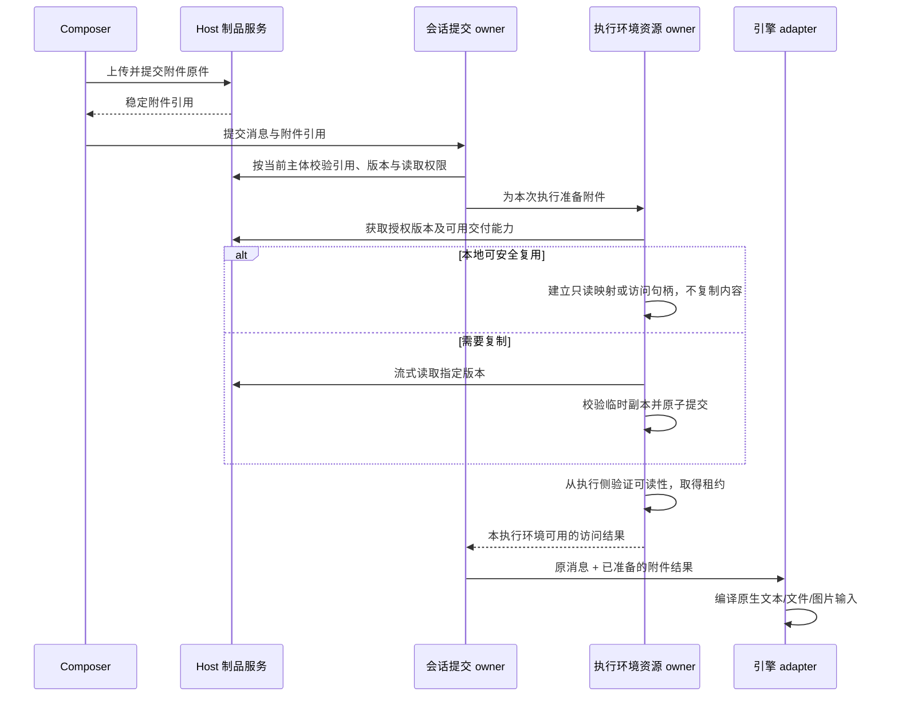

# 附件资源与执行交付

状态：目标模型与实现边界，2026-11-06。首版源码进展见文末；未在现网部署。
现有上传与历史行为见 [文件与资源](files-and-resources.md)。

资源身份、上传与 AIGC 共用入库、引用账本及 GC 的上层模型见
[统一制品库](../artifact-library.md)。本文的“附件原件”对应制品的不可变版本，
“消息附件引用”对应持久引用，“执行可读交付”对应副本/映射与租约。

## 问题与已核实的调用链

附件属于 OpenCraft 的 Host 资源，与选择 Codex、DSH、Pi 或 ACP 无关。
执行引擎适配器只负责把已授权、已准备好的附件转换成该引擎接受的输入。
存储目录名不能决定资源身份，也不能证明模型工具可以访问文件。

当前已有通用基础，不另起一套上传协议：

- `packages/appserver-protocol/src/attachments.ts` 定义 `AttachmentRef`、上传能力、分块上传与删除。
- `apps/local-agent-host/src/attachments/local-attachment-staging.ts` 保存文件、校验 manifest 并解析所属路径；`host-resources.ts` 已将上传列为独立于引擎的 Host 资源。
- `scripts/headless-application.mjs` 的本地 Codex adapter 使用 `dataDirectory/codex`；adapter 在其下创建 `attachments`。其他引擎的装配存在独立的 `agent/attachments` 配置。
- `codex-engine-adapter.ts` 的 `modelVisibleAttachmentInput()` 在本地 staging 服务验证文件后，为原生 mention 增加模型可见的文件路径文字。验证发生在 adapter 文件系统，文字却声称文件在执行 Host 可读。
- 容器装配将命令执行与文件能力交给 Hands。`docker/compose.yaml` 中 Brain 挂载完整数据目录，Hands 只挂载执行目录和工作区；`scripts/container-deployment/gateway.mjs` 接通 Hands 的文件系统 owner，`HostFileSystemTransport` 只接管 `fs/*`，没有补齐附件交付。

因此上传成功、adapter 校验成功、历史能展示，都不能推出本轮执行可读。
本次视频路径位于 `codex/attachments`，执行容器中该路径不存在；这与上述边界缺口一致。
这里尚未逐一核验所有现网引擎和部署模式，不能推断它们都以同一种方式失败。

## 附件是制品版本的消息引用

身份、引用、授权和 GC 以[统一制品库](../artifact-library.md)为唯一设计规则。
附件不是独立内容存储类型；上传、AIGC 输出和派生结果均可被引用为附件。

| 本链路对象 | 统一模型 | 本文负责的边界 |
|---|---|---|
| 上传提交内容 | 制品不可变版本及其持久副本 | 旧 staging manifest/AttachmentRef 的兼容解析 |
| 消息中的附件 | 消息槽位持有版本引用及展示名称快照 | 输入编译、排队/steer/恢复时解析；引用不自动授予权限 |
| 执行可读结果 | 副本或映射 + 消费租约 | 环境代次、路径/句柄、copy/zero-copy、失败清理 |

clientAttachmentId 不等于全局制品 ID，位置不等于身份。同一 AI 生成结果再次作为附件，
复用版本并创建独立消息引用，不重复入库。关闭页面不删除原件；草稿删除只释放本草稿引用。
源图片若在客户端已转码，当前提交版本不等于尚未上传的源照片。

## 上传可用与执行可用分开

上传仍消费已有 `pending/processing/ready/failed` 语义。`ready` 只表示原件已提交且引用可用，
不表示任意环境已挂载它。不要因为需要执行交付就让原本稳定的附件卡反复切回上传状态。

执行交付是另一项带 owner 的准备事务：

同机也必须依据装配声明验证文件可见性，不能凭路径字符串相同就跳过。
跨容器、SSH 和未来远端 sandbox 通过执行 backend 的资源端口提供挂载或流式传输；
Brain 不把自己的私有数据目录整棵挂进 Hands 来掩盖缺失的资源交付能力。

准备结果是内部语义，暂不定义新的公开 RPC 名称：

- 关联附件身份和不可变版本、执行环境身份及有效代次。
- 返回该环境实际可用的文件路径或受控访问句柄；不把原件存储路径直接冒充执行路径。
- 成功前从执行侧验证可读取性、长度和内容一致性；字节通过分块/流式端口传输，复用现有大小限制。
- 同一授权域、环境/版本的并发准备合并；取消、换环境、主体失效及执行 owner 销毁撤销旧准备，晚到结果不能进入新一轮输入。视图卸载不撤销仍在执行的交付。
- 传输失败阻止该条输入交付，保留原件和用户草稿/排队项，不把部分副本标为成功。
- 最后确认丢失属于未知结果；按原事务身份对账，不能盲目重传或提前删除可能仍在使用的副本。

排队、steer、定时发送、自动恢复和直接发送必须经过同一执行准备边界。
引擎重启或换环境后重新解析，不能重用历史里上次执行的路径。
准备成功不等于引擎接受消息；输入投递仍沿用已有未知结果和幂等契约。

## 两种交付策略：copy 与本地 zero-copy

两种策略返回同一种执行可读结果。策略由制品服务与执行 backend 协商，
依据存储可达性、隔离边界和访问能力选择，不按 Codex/Pi 或“本地/远程”标签硬编码。
这里的 zero-copy 指原件到执行环境无需再复制一份内容；不承诺磁盘读取、网络发送、
模型输入编码或媒体解码没有内存拷贝。

| 条件 | 策略 | 成功条件 |
|---|---|---|
| 原件与执行者共享可授权的本地文件域 | zero-copy：复用不可变原件的只读路径或句柄 | 执行侧能实际打开正确版本，且工具不能改写原件 |
| 同机不同容器，backend 支持限定对象的只读映射 | zero-copy：受控挂载/映射 | 映射只暴露授权对象；返回执行侧路径，不要求内外路径一致 |
| 跨机器、独立卷或无法安全映射 | copy：流式复制到执行侧管理的附件区 | 校验版本、大小及摘要后原子提交，部分文件不可被消费 |
| 执行侧已有该版本副本 | 复用已验证副本 | 重新检查当前授权与环境代次；这是缓存命中，不是原件 zero-copy |

默认先尝试可用且满足约束的 zero-copy；能力不足可回退 copy，授权拒绝和内容不一致
不能通过换策略绕过。首个闭环验证隔离文件域复制，并对实际具备只读隔离能力的本地 backend
接通复用；不具备该能力的同机环境走 copy，不虚报 zero-copy，也不为通用挂载框架延迟附件修复。

**原件不可变是前提。** 用户选择的任意本地文件还不是不可变附件原件；
如果外部程序仍可修改它，导入时需创建稳定快照（复制或 backend 支持的写时复制快照）。
只有已有受管理原件或可保证稳定版本的资源才能直接复用。
符号链接不证明可见性和授权，硬链接也不提供写隔离；同一执行身份可撤销的 chmod
不能单独作为原件保护。backend 无法提供可靠只读隔离时，交付独立副本。
写时复制快照属于 copy 策略的存储优化，不能宣称所有平台均支持物理零拷贝。

**读附件与编辑文件分开。** 原件是上传时的证据。需要修改时，在工作区创建可写工作副本，
把生成内容作为新资源处理；不能让工具通过执行路径改写历史消息引用的原件。
执行副本若可能被工具修改，就不能继续作为同版本的可信缓存供后续执行复用。

**租约约束实际消费。** zero-copy 租约固定原件版本及映射，copy 租约固定已提交副本。
原件回收需要等待持久引用和有效租约释放。输入准备成功后，租约从准备事务转交执行 owner，
持续到实际消费者不再使用；不能在 adapter 编译完提示词或页面关闭时释放。
同一副本被多条输入复用时分别计租约，取消其中一条只释放它自己的租约。
权限撤销阻止新读取并让 owner 撤销可控映射/句柄；已读入模型或进程内存的字节无法追回，
不能承诺仅删除文件就撤回已披露内容。

**校验与代价分开。** copy 在流式写入时计算摘要，再由执行侧校验提交对象；zero-copy
绑定已校验的不可变版本，并从执行侧验证对象身份和可读取性。若 backend 无法证明
映射版本一致，就重新校验内容或改用 copy，不能只凭文件名、长度或路径相同判定成功。
稳定对象可复用验证记录，但缓存键必须覆盖授权域、内容版本、backend 和环境代次。
诊断记录策略、复制字节数、缓存命中和失败阶段，便于证明本地确实没有额外内容复制。

## 流式复制可用性审计（2026-11-06，实现前基线）

结论：有可复用的流式/分块基础，但当前 Brain → Hands 没有附件接收事务，
不能将目标模型里的“流式复制”写成现网可用能力。以下为源码核查及本地测试结果。

| 链路 | 当前实现 | 可复用与缺口 |
|---|---|---|
| 客户端 → staging Host | workbench-runtime/attachment-upload 按最多 1 MiB 读取、Base64 编码，每块等待确认后再读下一块 | 正常调用方有背压，内存不需随文件总长增长；不是连续二进制流，编码有额外开销 |
| staging Host 落盘 | AttachmentUploadStore 校验 offset、逐块落盘并累计 SHA-256，完成后交给 LocalAttachmentStagingService 提交文件和 manifest | 最多 8 个活跃上传、10 分钟闲置过期；状态在内存，无持久断点续传/提交状态查询 |
| Hands → 调用方 | host-filesystem 的 GET /file 使用 ReadStream + pipeline，经 Unix socket 输出二进制；有取消、并发与等待队列限制 | 是读取方向，不能倒推支持流式写入 |
| 调用方 → Hands | fs/writeFile 整体收 JSON/Base64，最多 32 MiB；打开目标后 truncate(0) 再写 | 不支持 offset/append、上传提交或取消事务；循环调用会覆盖前一块，直接失败可能留下截断/部分文件 |
| staging → SSH Host | ssh-file-transfer 调用 SFTP put/get；分块上传先在本地完整落盘，再传远端 .part、rename、校验 | 有文件传输机制，但不是客户端到远端的贯通流；当前绑定 SSH staging，不能直接当作 Hands 接收接口 |

现有 SSH 大文件校验会将远端文件再下载到本地临时文件，然后流式算摘要。
这避免在 JS 中整体读入大文件，但额外消耗一次完整下载和临时磁盘空间；不能把它
描述成单程复制或无需落盘。当前传输取消主要是关闭整个 SFTP owner，尚无每份交付独立 signal。

AttachmentUploadStore 的串行队列也不等于全局内存上限：正常客户端等待 ACK，
但不受控调用方可以提前提交多个 chunk，队列闭包仍会持有请求数据。
执行交付入口需要在读取请求体前做准入，并限制单事务在途数据和全局字节预算。
现有计数限制不能替代背压、磁盘配额与半成品清理。

### 推荐接入方式

在现有执行资源 owner 增加附件接收事务，复用已有内部受认证传输，不新增独立守护进程。
优先在文件 owner 的内部 HTTP/Unix socket 通道提供二进制请求体接收；
源 owner 经授权打开指定附件版本后，以受背压控制的管道推送给目的 owner。
具体由哪个进程发起连接必须依装配接通，不能假设 Brain 已持有 Gateway 的文件服务客户端。
源文件读取失败、接收端断连或取消须贯通整条管道，停止继续读源文件。
如果某 backend 只提供分块 RPC，可采用严格逐块确认的实现，保持同一交付事务语义；
不要通过 shell/Base64 命令拼接绕过资源端口。

目的 owner 选择受管理的临时目录和文件名；请求携带授权附件版本、长度、摘要、事务身份与环境代次，
不接受客户端任意目标路径。接收期间限流、计数和累计摘要，超长/短读/摘要不符都不能进入 ready。
临时文件与最终对象须在同一文件系统，避免跨卷 rename 失败；完成后按存储持久性要求
提交内容和元数据，再返回执行侧定位与租约。当前 staging 的 rename 模式没有显式 fsync，
只能作为提交结构参考，不能直接承诺断电后的持久性。

第一版可从头重传，不必先做断点续传；但必须支持按稳定事务身份查询最终结果，
避免 ACK 丢失导致重复交付或误删已提交内容。重启后清理由 owner 管理的孤立临时文件，
不能只依赖进程内过期定时器。既有 staging 的身份校验、大小限制、摘要与提交思路可复用，
原件存储与执行缓存仍保留各自生命周期，不能把执行副本注册为新的消息附件原件。

### 已验证与尚未验证

本轮运行 hands-filesystem、chunked-attachment-upload、ssh-attachment-staging 三组已有测试，
19 项全部通过。覆盖本地 Unix socket 的认证读取、64 MiB 停滞下载时并发/取消、
分块写入与失败清理，以及 SSH staging 的提交和重试语义。
SSH 测试使用真实 batch runner 配合模拟 SFTP 服务边界，不是现网 SSH 验证。
没有测得现网 Brain → Hands 复制吞吐、峰值内存或磁盘不足行为，也没有修复录屏可读性。

接通后再用超过 32 MiB 的真实文件验证完整链路，并记录慢接收者情况下的内存/在途字节，
以及断流、取消、空间不足、校验失败、进程重启和最终 ACK 丢失的结果。
只有实际读取到相同摘要的执行侧文件，才能宣布流式复制交付可用。

## 引擎无关、模态有别

所有类型都应保留统一的附件引用、授权、历史与资源交付语义；输入编码按能力适配。

| 输入与消费者 | 可用形式 | 必须区分的事实 |
|---|---|---|
| 通用模型工具 | 执行侧可读文件/受控资源工具 | 文件已交付才可提供路径；提示词中的描述不能代替实际权限和字节 |
| 原生图片输入 | 经授权生成的图片字节、URL 或该引擎可读的本地图片 | 模型看见图片，不证明命令执行环境有同一文件 |
| 视频、音频及文档 | 原件文件；支持时再按能力生成帧、音轨、文本等派生资源 | 附件可读不等于模型支持视频，也不等于执行环境安装了解码器 |

Codex adapter 可以保留原生 mention 和既有 UI marker 兼容；模型可见定位文字必须来自执行准备结果。
Pi、DSH、ACP 也消费相同资源语义，不能各自拼接私有目录作为附件真源。
派生帧/文本属于原件版本的派生资源，记录转换能力和来源，不能替换原件或伪称已看过完整媒体。
用户附件内容始终作为用户数据处理，附件不能自行授予新的工具、读取范围或主体权限。

## 历史、权限及兼容

当前 `AttachmentRef.location` 和旧 Codex 原生历史已经保存物理定位；不能仅改目录就使旧消息失联。
由原 staging owner 校验自己的旧 manifest，将旧定位解析为权威附件引用，再交给执行准备。
不扫描任意绝对路径、不根据文件名猜附件，也不根据 `codexHome` 推断当前执行权限。

迁移按引用身份幂等进行，保留摘要、历史关联和必要回退信息。
无权限、原件缺失和 backend 暂不可用分别处理：不能换成另一个同名文件，也不能显示空内容为成功。
尚未执行迁移时保留旧数据；副本成功且引用核对完成后才按保留策略回收旧原件。

每次读取和执行准备都检查主体、会话资源授权及当前环境，不依赖客户端缓存的 `ready`。
私有存储路径、凭据和下载令牌不写入用户界面或通用模型文本；可提供的执行路径由资源端口明确授予。

## 实施顺序与验收

实施顺序与[统一制品库](../artifact-library.md)保持一致：

1. 最小制品目录、旧附件身份解析、消息引用保护和执行交付一起构成首个闭环。
   接通 Hands 流式接收与副本登记；适配器只消费可验证的结果，不先重命名旧目录。
2. 为实际支持附件的引擎和输入入口接入同一准备边界；只声明接通的能力。
   多附件全部准备成功再投递，失败保留引用供重试；不回退到不可读的 Brain 路径。
3. 复用该链路接 AIGC 正式输出、派生内容和旧引用迁移；不建立另一份附件资源真源。
4. 先运行 GC 对账/dry-run，持久原件清扫按统一设计的迁移与验证门槛启用。
   录屏交付可读后继续实际解码与按钮问题排查，不把入库成功当成已观看视频。

最低验收覆盖：

- 上传原件仅在存储侧可见、执行侧根目录不同：交付前明确失败，交付后从执行工具读取真实字节并比对摘要。
- 本地 zero-copy 不新增内容副本，执行侧确实可读且不能改写原件；映射路径与原件路径不同时仍然有效。
- copy 遇到断流、空间不足和校验失败不暴露半成品；并发准备及单个消费者取消不破坏其他租约。
- 外部本地文件在导入后被修改，历史附件内容仍保持原版本；可写工作副本不污染后续交付缓存。
- 相同原件经两个引擎使用，同一引用在环境重建后重新准备；原件 ID 不随引擎/容器变化。
- 图片、普通文件和视频统一可追溯；无视频解码能力时如实报告，不能宣称读过录屏。
- 直接发送、queued、steer 和恢复都在投递前准备；准备失败/取消、晚到成功、确认丢失不会误发或覆盖新事务。
- 账号切换、未授权附件 ID、同名文件、损坏内容和 symlink 越界均被拒绝。
- 旧 `codex/attachments` 消息仍能展示并经过授权重交付；分叉、归档和草稿清除不误删已发送原件。
- Gateway 重启不丢原件或正在使用的副本；执行环境回收只撤销所属租约，不删除其他会话仍引用的原件。

首版源码已接通 Host 制品目录、Hands 流式接收及 Codex/DSH/Pi 附件输入准备，保留原消息定位，
为模型提供已交付定位；新增生成图片登记。完整实现范围、保守引用/租约策略、
尚未接入的媒体生产者与迁移边界以[统一制品库的实现记录](../artifact-library.md)为准。
现网未切换，本会话旧录屏尚未通过这条新链路实际读取，不宣称按钮闪烁问题已修复。
