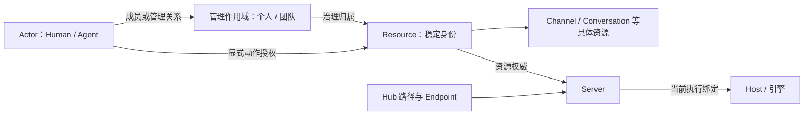

# 多 Human 资源所有权与数据库模型评审

状态：**待共同评审的候选设计，不是已批准的 schema**。本轮仅写文档，不新增表、生成迁移、改变权限行为或操作现网数据。已有发现接口修复不代表本方案已实现。

[Human 工作台](workbench/human-workbench.md) · [实施覆盖账本](identity/multi-human-server.md) · [主体纲领](identity/actor-collaboration.md) · [存储生命周期](server/sqlite-lifecycle.md)

## 1. 先固定语义，再决定 SQL

已明确的产品约束：

- 一个工作台作用域对应一个当前 Human；一个 Server 同时服务多个 Human 与 Agent。
- 桌面可同时装配 Client/Renderer、Hub 接入、Server 和 Host；headless 无本地 Renderer。客户端切换账号不改变服务端其他连接的主体。
- Actor 是行动者，Hub 是访问路径，Server 是资源权威，Host 是执行载体；组织与租户是可选的管理/隔离作用域。
- 创建者、资源归属、管理权限、读取权限和执行身份是不同事实。成员资格不自动等于读取全部内容。
- Channel 与执行 Thread 分开，消息持久接收与任务执行分别接管。本文不重新设计消息队列。

本轮要决定的是：资源由谁长期管理、授权怎样表达、旧数据怎样兼容。不是选择数据库引擎，也不是建立全局 Human 数据库。

## 2. 现有代码与数据库事实

核对入口：[`schema.ts`](../../packages/storage-node/src/server/schema.ts)、[`ActorStore`](../../packages/access-control/src/actors.ts)、[`Collaboration`](../../packages/access-control/src/collaboration.ts)、[`ThreadOrchestrationLedger`](../../packages/access-control/src/orchestration-ledger.ts)。

| 现有事实 | 可复用部分 | 不能假定的能力 |
| --- | --- | --- |
| `actors`、`actor_bindings`、`actor_credentials` | Human/Session 身份、登录绑定、代次与撤销 | 组织不是现有 Actor kind；没有全网身份自动合并 |
| `actor_members` | 实例 admin/member 准入 | 不是项目成员或每个资源的读写权限 |
| `actor_grants(actor_id, resource, action, enabled)` | 精确主体/资源/动作直接授权；复合主键 | enabled=false 是关闭该项授予，不是优先于其他路径的显式 deny；无团队继承、来源、多条独立授权到期等语义 |
| `opencraft_thread_relations` | 父子关系、生命周期与执行编排归属 | thread_id 是主键；不能作为跨 Server 的通用资源身份表；visibility 是呈现语义，不是公开权限 |
| `conversation_authorities` | 某次输入/Turn 的行动授权上下文 | 不是会话长期所有权 |
| `actor_run_bindings` | Actor 到执行 Thread 的当前绑定与 epoch | 当前绑定限制不应被固化成所有产品的一对一身份关系 |
| `conversationAllowed` | 已有归属会话的 owner / grant 检查 | 无编排关系的历史会话仍按实例共享；不能推断所有历史会话已有 owner |

服务端核心数据当前已收敛到 `opencraft-server.sqlite`。schema 在 `storage-node` 声明并生成版本 SQL，运行由唯一受管 owner 执行；repository 借用连接。不新建 `portal.sqlite` 作为第二套权限真源，也不修改已发布迁移。

## 3. 两种候选模型

### A：资源直接归 Actor

资源记录 `owner_actor_id`，其他 Actor 经现有 grant 共享。创建者记录独立且不可因转交改写。owner 具体具有哪些管理动作须明确，不能等于任意执行、读凭据或解除强制限制。

优点：贴近现有代码，个人桌面简单，第一版表少。缺点：团队资源需长期挂在某个个人/Agent 名下；其离职、禁用、删除和继任需要特例。把团队伪装为 Session Actor 会混淆可行动主体与组织关系，不建议这样补洞。

### B：资源归管理作用域，Actor 获得相应关系与权限

资源归一个稳定的管理作用域。作用域可代表个人管理集合或团队资源集合，但不是 Hub、Host、租户账号或执行沙箱；它本身不是行动者。个人默认作用域可以由可信核心自动建立，用户无需创建组织或租户。

优点：团队资源能独立于创建者存续，个人与团队使用同一关系模型，转交与管理连续性更明确。缺点：增加成员关系、管理权续接和作用域生命周期；若默认把成员权限继承给全部资源，会造成扩大授权。

建议仅让作用域承载治理关系。读取、发送和执行按明确授权决定；资源放进团队作用域不等于所有成员立即可读。首版不引入任意层级、嵌套组织、通用策略语言或隐式递归继承。

| 比较 | A：Actor 所有 | B：管理作用域所有 |
| --- | --- | --- |
| 个人本地首次使用 | 简单，直接归可信本地 Human | 自动准备默认作用域，无新增用户步骤 |
| A 离职而团队项目继续 | 必须先转交，或额外定义代理管理机制 | 归属不变，撤销 A 的成员与授权关系 |
| 人与 Agent 共同参与 | 均可获授权，owner 必须是 Actor | 均可获授权，实际行动者仍是 Actor |
| 转成团队资源 | 要迁移所有者及权限政策 | 可 CAS 更换管理作用域，授权变化另行定义 |
| 实现代价 | 较低 | 较高，须处理最后管理员与孤立作用域 |
| 未来迁移成本 | 若团队成主场景，会有所有权转换 | 若团队很少，可能承担不必要复杂度 |

**评审倾向：B 更符合长期多人协作，但目前不据此建表。** 管理作用域是 Resource 的一种，不替代既有四个核心概念。只有确认团队资源独立存续、管理与内容访问分离后，才值得引入它。

## 4. 用同一组场景推演

| 场景 | A 的处理 | B 的处理 | 两案都必须保留的约束 |
| --- | --- | --- | --- |
| 桌面离线创建，手机后来接入 | 本地 Human 所有 | 本地 Human 的默认管理作用域 | 手机证明身份/获得授权，不按名字合并；无云依赖 |
| A 创建并分享给 B，A 离开团队 | 显式转交，否则需恢复处置 | 保留团队归属，撤销 A 关系 | B 的访问来自授权，不来自“曾经看过” |
| 经两个 Hub 访问一个 Server | 同一个资源 owner | 同一个资源作用域 | 路由不同不创建资源副本或重复任务 |
| 桌面切换 Human，远端仍在工作 | 仅退休本地客户端作用域 | 同左 | 不修改 Server 全局账号，不停止他人任务 |
| 撤权时请求正在排队/执行 | 领取时复核授权 | 复核成员关系、授权及治理状态 | 已提交副作用与未知结果须对账，不伪装回滚 |
| 旧版本升级 | 明确保留旧共享或显式分配 owner | 保留旧共享或显式迁入作用域 | 不把最近作者、查看者、操作者猜成所有者 |
| 最后管理员离开/主体禁用 | owner 不可用，需独立恢复 | 作用域保留，需治理恢复 | 不自动把无主资源变成公开；禁用主体不能因该约束失效 |

## 5. 身份与权威的候选关系



资源稳定键的候选形式是 `(authority_id, kind, local_id)`。现有会话引用继续采用 `(serverId, threadId)`，由唯一映射关联，不能让 Hub ID、URL、租户 ID 或机器路径成为资源 ID。authority 指资源权威命名空间，不自动等于 Actor 的身份发行域。

物理迁移保留逻辑权威身份只在唯一写入权和恢复机制成立时允许；备份克隆不得同时成为两个同身份可写权威。跨独立权威转移与复制属于后续协议，首版不承诺透明支持。

## 6. 候选表与约束（仅用于评审）

以下名称不是迁移草案，不据此生成 SQL。共享概念也不要求统一存储资源的具体内容。

| 候选关系 | 关键字段/约束 | 唯一写入者 |
| --- | --- | --- |
| 资源登记 | 稳定资源键、kind、governance_scope_id、created_by_actor_id、lifecycle、policy_revision；稳定键唯一，创建者不可随转交改写 | 本地资源权威 |
| 管理作用域（B） | id、kind、state、revision；个人默认作用域与 Human 的关系唯一且定义范围；不自动同名合并 | 核心治理 owner |
| 作用域关系（B） | scope_id、actor_id、固定治理角色、state、revision；只操作受该权威验证的身份 | 核心治理 owner |
| 直接动作授权 | 复用现有 actor_grants 的资源键和 action 语义 | 核心授权 owner |
| 作用域动作授权（若本期需要） | scope_id、resource_key、action、state；引用真实作用域和本地权威资源；不能复制成每人一份持久 grant | 与直接授权相同的权威入口 |
| 政策变更事件 | operation_id、operator_actor、目标、前后 revision、变更类型、时间；与政策修改同事务 | 核心授权 owner |
| 执行绑定 | 继续使用既有绑定与执行 owner，关联资源/主体/epoch | 既有执行权威 |

A 以 `owner_actor_id` 替代管理作用域关系；不能同时让两个 owner 字段都可独立写。B 若提供个人默认作用域，应明确是“每个本地治理权威下的一个”，不能创建隐含全球个人库。

Agent 或外部域 Actor 的引用不能未经验证插入；物理外键只用于同库事实，跨权威引用通过受验证的身份记录关联，不能假装拥有跨服务数据库外键。

### 授权模型最容易后悔的部分

- **一个判断入口，多种明确事实来源**：直接 grant、作用域授权和治理关系可分别保存，但由同一 evaluator 解释。有效权限缓存是可重建投影，不成为第二套可写 ACL。
- **删除授予不等于禁止访问**：撤销直接 grant 后，若仍有作用域授权，权限可能继续有效。界面需解释剩余来源；“从资源彻底移除”不能只删除一行。若确实需要个体 deny，必须先定义其优先级、范围、恢复与委托语义，不能借 enabled=false 偷渡。
- **角色是动作组合**：首版固定、可解释；角色升级不能静默给旧资源扩大权限。治理管理员与内容读取者分开定义。
- **管理不默认读内容**：Server 运维、作用域管理和内容授权分离；高权限宿主能否从物理存储读取属于部署信任边界，不宣称数据库 ACL 能防 root。
- **转交是事务**：旧政策 revision CAS，验证新作用域与操作者资格，同事务更新政策与审计。跨权威操作不能伪装成本地事务。
- **删除是生命周期**：禁用/归档/删除与审计保留分开，不用级联删除历史作者、已接受执行回执和资源内容。最后管理员正常退出可被阻止；安全禁用仍须立即生效，并进入显式治理恢复。

## 7. 权限判定与撤销流程

```text
认证得到可信 ActorContext
  → 校验主体、凭据/登录和当前准入
  → 解析稳定资源身份与实际资源权威
  → 校验资源状态、适用强制限制
  → 求值明确的直接授权 / 作用域授权 / 治理动作
  → 记录可解释的授权依据和政策版本
  → 资源 owner 在可控制的接纳边界提交动作
```

资源读取：目录逐条过滤；异步读取完成后复核；订阅在后续投递边界持续复核。权限变化需要退休对应投影，不能只隐藏菜单。搜索数量、游标、附件链接、缩略图和通知也属于待审计输出面。

任务执行：接纳时保存发起者与实际执行主体；领取时复核当前资格及绑定 epoch；副作用已提交后只按执行能力取消。未知结果沿原请求标识查询。账号切换不能为旧队列换主体。

同库权威能用事务协调权限变更和请求接纳。跨进程执行须携带有期限、可撤销且可校验的资格/代次；只“执行前查一次”不足以承诺无竞态。必须明确撤销与副作用提交的线性化边界、旧进程栅栏和不可撤回部分。

权限投影复用现有缓存 owner，并覆盖 Actor、成员关系、直接 grant、作用域 grant 与资源政策 revision 的失效。多进程不能只依赖当前进程通知；应在协议实现阶段定义共享版本检查/可靠变更消费，期间不开放完整隔离承诺。

## 8. 数据迁移与回退

建议分为四步，每步都能独立核验：

1. **只读盘点**：统计已有会话来源、资源键碰撞、已存在的归属、原生接口与推送覆盖。不给历史数据自动指定新主人。
2. **附加元数据**：方案批准后生成新的受管迁移，备份与 WAL 一致性校验；复用统一 Server 库。具体内容和执行历史仍归既有 owner。
3. **影子判定**：在原授权之外只读计算新结果，记录不含私密内容的差异；影子成功不代表新访问控制已启用。
4. **按完整访问边界切换**：只有某资源所有读取、写入、订阅、下载和内部工具入口都覆盖，才允许该资源启用新政策。缺少新元数据的新资源必须拒绝或进入明确恢复态，不能回退为共享。

历史兼容至少比较：继续显式 legacy-shared，或经管理员审阅映射到新归属。不能用“没有 ACL 就共享”的永久隐式规则；兼容状态必须来源可追溯、范围有界，并保留当前升级行为。

附加表结构不自动保证可回滚：旧二进制可能忽略新 ACL 并重新暴露资源。启用新政策后，回退必须运行仍理解这些政策的兼容版本，或先停用相关入口完成受审阅恢复；不得只换旧镜像宣称安全回滚。恢复旧数据库也会丢弃迁移后写入，不能作为自动回退方案。

## 9. 评审前不应提前实现的内容

不创建 tenant 必填关系、不把团队加入 ActorKind、不改写现有 URI、不重键所有历史 Thread、不引入第二套队列、不生成新 schema、不默认给实例管理员所有内容权限。现有 attachment/route 中 tenant 的契约也不能直接删除：应核实其隔离语义后单独设计兼容映射。

## 10. 需要一起敲定的三个产品决策

1. **团队资源是否应独立于创建者持续存在？** 建议是；若确认，倾向 B。个人首次使用仍无组织/租户操作。
2. **团队成员是否默认可读团队全部资源？** 建议否；治理归属与内容访问分开，通过明确的共享授权组合提供体验。
3. **历史共享会话是否保持共享直到显式整理？** 建议保留现状并明确标注兼容范围，避免升级时猜测归属；新资源政策单独定义，不能永久走旧缺省。

这三项确认后，再形成具体表字段、固定角色/动作矩阵、授权来源撤销语义及迁移验收方案。数据库外键、索引和事务必须服务于这些决定，不能反过来用已写好的 SQL 决定产品语义。
