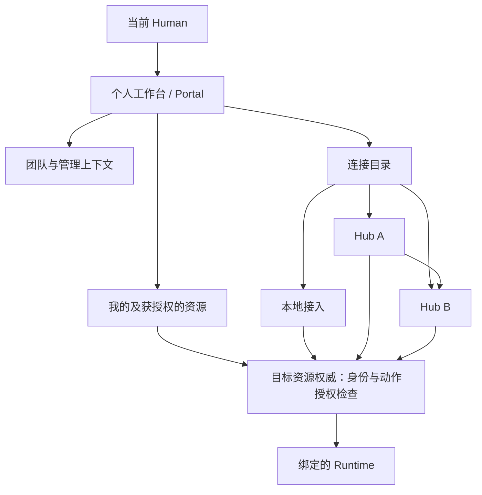

# 以 Human 身份为中心的工作台与 Portal

状态：目标设计与产品约束，依据 2026-11-07 的产品讨论整理。本文不代表跨 Hub 统一身份、身份联合或多租户执行隔离已经实现；不修改当前协议、数据结构和登录行为。

[文档索引](../../README.md) · [平台架构](../README.md) · [主体与 Hub 协作纲领](../identity/actor-collaboration.md) · [服务器登录](../identity/server-authentication.md)

## 核心决策

**一个工作台作用域围绕一个当前 Human 身份展开。** 人可以连接多个 Hub、加入多个团队、访问多个 Runtime；这些变化不改变“谁在操作”。Portal 是这个人的网络与资源入口，而非必须先选择租户才能进入的管理后台。

这里的“一个界面”指一个有明确身份边界的工作台实例，不是整台设备、整个应用进程或所有浏览器窗口。一个 Human 可以同时使用桌面、手机和网页；各设备的登录会话独立有效、独立撤销。若产品允许不同窗口使用不同账号，各窗口必须隔离身份作用域，不共享可变的全局当前账号。

尚未登录或离线未验证时，可以展示连接和恢复入口，但不能从缓存中的头像、名字或 Actor ID 推导当前身份已被认证。本地即用体验可以沿用可信宿主建立的本地 Human，不要求个人用户创建组织、租户或注册云账号。

## 核心模型与三个独立维度

沿用既有 Actor、Hub、Resource、Permission 四个核心概念；Runtime 是执行载体，不新增一套 Portal 用户体系。

| 对象 | 职责 | 不能推导出的事实 |
| --- | --- | --- |
| Human Actor | 稳定的自然人身份 | 当前连接、设备或团队不是身份 |
| Session / Agent Actor | 独立行动的持久主体 | 创建者关系不等于继承 Human 全部权限 |
| Resource | 会话、项目、文件、运行等被访问对象 | 可发现、可寻址不等于获准访问 |
| Permission | 对具体资源和动作的授权及限制 | 经过同一 Hub 不自动共享权限 |
| Hub | 接入、身份/目标解析、路由与转发 | 网络节点不是租户、组织或身份发行域 |
| Runtime | 模型、工具和文件操作的执行载体 | 执行位置不决定主体身份与资源归属 |

必须分开建模：

1. **组织与管理作用域**：个人、团队、企业怎样管理资源与权限。
2. **网络拓扑**：资源通过哪些 Hub、Endpoint 和路径可达。
3. **执行与数据隔离**：资源在哪些进程、容器、机器和存储中执行或保存。

一个组织可以使用多个 Hub，一个 Hub 可以承载多个管理作用域，一个人可以同时访问本地和远端资源。首版物理部署可以一对一，但不能把这些身份合并成一个 `tenantId` 或 Host ID。

图中的线表示访问关系，不表示 Portal 掌握全部权限，也不要求全局唯一账号中心或集中资源数据库。

## 不同产品形态使用同一模型

| 场景 | 用户入口 | 装配方式 |
| --- | --- | --- |
| 单人桌面 | 打开即用、本地会话与工具 | 可信本地身份与本地 Runtime，无租户前置步骤 |
| 手机 | 最近会话、资源和连接 | 客户端访问一个或多个授权来源；不因手机形态另建身份体系 |
| 团队服务 | 团队资源、成员和管理入口 | 增加成员关系和作用域权限 |
| 大规模 Hub 网络 | 发现并访问获准资源 | 多路径路由、逐跳转发校验与目标资源授权 |
| 托管 SaaS | 套餐、配额、账单和隔离环境 | 引入租户作为运营与隔离作用域，复用核心主体和资源权限 |

租户模型是可选的局部落地。它可以承担强制隔离、审计、配额和计费责任，但不是所有个人资源的必填上级。个人、单 Hub 和离线本地产品不应依赖先完成多租户或联邦建设。

## 身份、登录与跨 Hub 信任

自然人身份、登录会话和远端连接凭据是不同事实。身份稳定不意味着所有 Hub 自动认可它。

- 身份发行域中的稳定 Human ID 是主体标识；用户名、邮箱和显示名不是合并依据。
- 一个 Human 可以绑定多种已验证的登录方式。增加绑定须证明原主体控制权和待绑定身份，不按同名或同邮箱自动合并。
- 接入远端 Hub 时，目标须通过受信任发行方、明确的身份绑定或目标认可的证明验证调用者；随后独立检查成员资格和资源权限。
- 凭据必须限定目标受众、用途、有效期与撤销边界，不向所有 Hub 广播同一通用秘密，也不将凭据交给模型。
- 远端独立账号尚未与当前 Human 建立可信关系时，应保留清晰的连接身份标识与作用域。不能把界面聚合描述成已经完成身份联合；需要不同 Human 的操作应进入明确的账号作用域。
- Agent 以自身 Actor 身份行动。代表 Human 执行需要显式委托，记录实际行动者与委托链，不从当前查看页面的人反推执行身份。

多 Hub 信任、路由代次、环路与转发边界继续遵循[主体协作纲领](../identity/actor-collaboration.md)，不由 Portal 页面另行定义。

## 切换语义与数据所有权

| 用户操作 | 改变什么 | 保持什么 |
| --- | --- | --- |
| 切换 Hub / 连接 | 访问路径或连接上下文 | 当前 Human；资源授权仍由目标复核 |
| 切换团队 / 项目 | 导航、筛选和工作上下文 | 当前 Human；不会把全部连接改成新团队权限 |
| 切换 Human | 当前工作台身份作用域 | 旧主体的服务端资源与已接受任务不因此被删除 |
| 退出某次登录 | 当前登录证明及其适用连接资格 | 其他设备登录、Agent 身份和已接受任务按各自策略处理 |
| 撤销资源访问 | 对该资源继续读取、订阅和执行的资格 | 已发生副作用及历史审计事实 |

请求必须携带或关联服务端可验证的行动者、目标资源和授权上下文，不能依靠客户端可变的“当前团队”或“当前租户”全局变量授权。具体协议字段另行设计。

草稿、缓存、Outbox、订阅和连接租约绑定明确的身份与资源作用域。权威来源、身份、资源命名空间和连接授权关系须可区分；不能仅用显示名、URL 或当前选项作为键。连接代次用于隔离迟到结果，不替代持久资源身份。

切换 Human 时，工作台退休旧作用域的呈现与发送资格，阻止迟到响应写入新作用域。旧草稿可按既有策略隔离保存；未发送队列不能移到新身份或新目标下重放。服务端已经接管的任务继续由原权威管理，不把“退出页面”冒充取消执行。投递未知时查询和对账，不能因换连接或换账号直接重复执行。

短暂断线、明确撤权和退出账号分别处理：离线可展示哪些缓存、保留哪些草稿由现有离线和安全策略决定；任何缓存都不能为新的写入提供授权。撤权必须影响实际订阅与动作准入，不能只隐藏导航项。

## Portal 的最小责任

Portal / Shell 呈现当前身份、连接、可访问资源和管理入口，复用核心身份、权限与现有 Router。它不再拥有一套聊天状态机、执行队列或资源数据库权威。

默认入口围绕以下内容组织：最近使用、我的会话与 Agent、工作空间、共享给我的资源、连接状态，以及有权管理的团队或托管环境。团队上下文按任务进入，不强制放置全局租户选择器。

资源目录可以聚合多个来源，但须保留来源、稳定资源身份与新鲜度。目录只是发现与导航投影，打开资源时仍由目标授权。通过两条路径发现同一资源，不应创建两份会话身份；当前无法证明资源等价时，也不能仅凭同名去重。

## 最小演进闭环与验收

首个闭环：**确认身份 → 添加连接 → 发现获准资源 → 打开资源 → 撤权后停止访问。**

先复用当前本地/远端身份能力，明确显示尚未联合的身份边界；不以全球身份中心、完整租户管理或复杂组织树作为前置。后续身份信任和资源发现协议按独立切片设计，并保留旧链接和 ConversationKey 的兼容映射。

实现前至少核对以下场景：

- 单人桌面首次启动不要求创建租户，手机可从远端连接开始。
- 同一 Human 同时访问本地和两个 Hub，切换连接不丢失原草稿或改变其提交目标。
- 两个发行域的同名账号不会自动合并；未获认可的身份不能仅凭自报 Actor ID 接入。
- 切换 Human 后，旧事件、搜索结果、文件预览、缓存与队列不会泄露或发送到新作用域。
- 一台设备退出不会无依据地退出其他设备；账号禁用与凭据撤销按定义的范围生效。
- Hub 断线或路径迁移不会改变资源身份、扩散权限或重复执行未知结果的请求。
- 团队成员被撤权后，已建立的订阅和未领取执行不能沿用旧授权。
- Agent 的实际行动者与委托关系可审计，不被当前查看者身份覆盖。

当前已有的登录、Actor、成员、连接与执行所有权是演进基础；它们不证明共享 Shell、浏览器 profile、凭据、文件和数据库已经实现租户级隔离。相关实现和验收仍以[服务器登录](../identity/server-authentication.md)、[执行所有权](../execution/execution-ownership.md)及具体测试为准。

资源所有权与持久化模型另见[数据库模型评审](../resource-ownership-review.md)。该评审包含桌面作为 Server、多 Human 同时接入的装配约束，候选模型尚未决定，不改变本文已明确的身份与网络分层。
