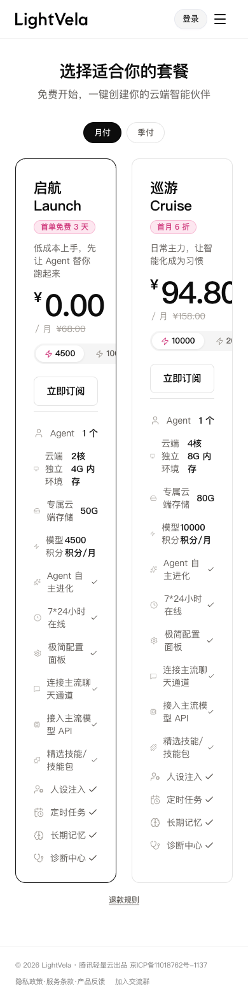
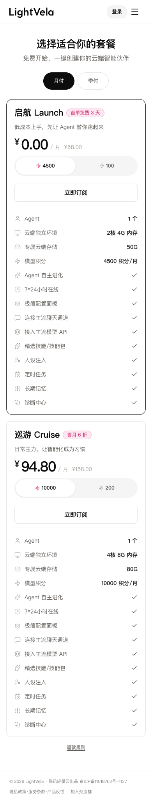

# 订阅页响应式评审证据

2026-09-23，本地 Chromium 145.0.7632.6（Playwright）、DPR 1；国内预览与国际预览分别构建运行。基线订阅源码为 `870d03dcb`，当前分支已合入 `ac1735ca0`，两者之间订阅页、共享 Card 和 DESIGN.md 无变化。

当前页面只有启航和巡游两档；本次没有新增套餐。所有图片和测量 JSON 随 MR 提交，可直接在工蜂中查看。截图等待入场动效结束后获取。

## 手机前后对照（390px）

| 修改前 | 修改后 |
| --- | --- |
|  |  |

修改后 320 / 375 / 390 / 430px 均为单列；768 / 1024 / 1440px 均为双列，无页面或卡片横向溢出。测量包含卡片矩形、圆角、阴影及 overflow 状态，详见 [after.json](after.json)。

| 320px | 375px | 430px | 768px | 1024px | 1440px |
| --- | --- | --- | --- | --- | --- |
| [截图](after-320.png) | [截图](after-375.png) | [截图](after-430.png) | [截图](after-768.png) | [截图](after-1024.png) | [截图](after-1440.png) |

## 桌面回归（含剩余名额 fixture）

为覆盖原本在未登录静态列表里不显示的名额提示，仅在本地截图时把静态 `bundle_sales_available_count` 从 100 改为 5，总量保持 100。基线和修改后应用完全相同的 fixture，截图后恢复；产品代码未更改套餐数据。

| 宽度 | 修改前 | 修改后 | 像素比较 |
| --- | --- | --- | --- |
| 1024px | [截图](before-stock-1024.png) | [截图](after-stock-1024.png) | 0 不同像素 |
| 1440px | [截图](before-stock-1440.png) | [截图](after-stock-1440.png) | 0 不同像素 |

[基线测量](before-stock.json) / [修改后测量](after-stock.json)：普通／主推圆角保持 12px／16px，卡片位置和尺寸、名额提示矩形与 `margin-top: -20px` 完全一致；指针移入普通卡的 transform 为 `matrix(1, 0, 0, 1, 0, -2)`，移出恢复为 `matrix(1, 0, 0, 1, 0, 0)`。`motion.create(Card)` 保留逐卡 fadeIn 及 stagger，卡片保留 overflow-hidden。

主题 `--radius-md` 是 1rem，上一版 rounded-md 的实测结果是 16px，并非 Tailwind 默认的 6px。本次用 Card 的 pricing／pricing-featured 变体保留原来的层级；默认 Card 外观不变，pricing 变体不继承 floatingPanelClass 的阴影。

## 三档兼容路径（仅本地 fixture）

向静态 bundle 列表临时加入一条名为“测试套餐”的 general 数据，使用已有巡游价格、200 积分、相同公共描述。第三张仅用于验证既有分组路径；未启用已下线的远航，未把 fixture 写入产品代码。

| 768px | 1023px |
| --- | --- |
| [三张同行截图](three-tier-fixture-768.png) | [三张同行截图](three-tier-fixture-1023.png) |

[测量结果](three-tier-fixture.json)包含三个卡片的坐标：同一 y，三个 x，均无横向裁切。窄平板三列的长文案沿用既有折行行为；当前两档页面不受此 fixture 影响。

## 国际站语言矩阵

7 种语言分别检查 320 / 390 / 768 / 1440px，28 组测量均无横向溢出，详见 [global-matrix.json](global-matrix.json)。为便于复核，390px 截图全部提交；截图前只在本地选择必要 Cookie。

| 英文 | 简体 | 繁体 | 印尼语 | 西语 | 日语 | 韩语 |
| --- | --- | --- | --- | --- | --- | --- |
| [截图](en-390.png) | [截图](zh-sg-390.png) | [截图](zh-hant-390.png) | [截图](id-id-390.png) | [截图](es-390.png) | [截图](ja-jp-390.png) | [截图](ko-kr-390.png) |

## 检查边界

58 个聚焦测试（订阅页 55、共享 Card 3）通过。类型基线与双站生产构建结果见任务记录。上一轮全量测试和整仓 context 门禁未全绿；本轮没有将其描述为通过，是否接受基线失败由 owner 决定。没有线上发布或真实支付操作。
