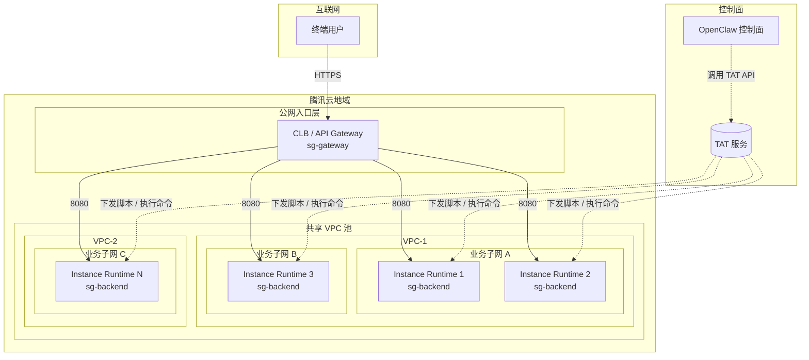

# OpenClaw SaaS MVP 架构设计决策文档

> **⚠️ 历史文档说明（2026-03-21）**：
> 
> 本文档描述的是 **原架构方案**：控制面直接调用腾讯云 API 管理 VPC、CVM、安全组、CLB、COS 等云资源。
> 
> **该方案已被废弃**。当前架构已转型为：
> - 控制面调用沙箱服务 API（基于 E2B API），由沙箱服务托管底层网络隔离和资源调度
> - 不再直接管理 VPC/子网/安全组/CLB/COS
> - 当前架构设计见：`docs/ctl-design/architecture.md`
> - 本地联调指南见：`docs/ctl-dev-setup/README.md`
> 
> 本文档仅作历史参考保留。

## 1. 文档目的

本文总结当前 OpenClaw SaaS 化方案在 MVP 阶段已经达成一致的关键设计决策，作为后续详细设计、编码实现和评审的基础。

本文聚焦：

* 实例产品模型
* 运行时抽象
* 网络与隔离设计
* 入口路由设计
* 状态机设计
* 删除与数据保留策略
* 权限模型
* MVP 范围边界
* 后续演进方向

---

## 2. 设计背景

OpenClaw 当前计划以纯 SaaS 方式提供服务。
底层初期使用腾讯云 CVM 作为运行沙箱，但产品层不直接暴露底层机器概念。

设计目标：

* 用户看到的是产品实例，不是云主机
* 控制面统一管理运行时与生命周期
* 实例之间默认隔离
* 入口统一收口
* MVP 尽量简单，但架构上保留未来替换底层运行时的能力
* 保留用户数据，删除时支持有限兜底

---

## 3. 核心设计原则

### 3.0 用户身份命名统一决策

**决策日期：2026-03-21**

ctl 内部用户身份字段统一使用 `user_id` 命名。

约束：

* 数据表用户归属字段统一为 `user_id`
* 请求上下文统一只暴露 `user_id`
* quota、任务消息、日志、脚本、文档统一使用 `user_id`
* `uin`、`sub_account_uin`、`app_id` 不再作为 ctl 业务语义的一部分

迁移说明：

* REST API 现阶段保留对旧请求头 `X-Uin` 的兼容读取，仅作为过渡
* 新接口与文档统一使用 `X-User-Id`

### 3.1 Instance 不等于 CVM

**Instance 是产品对象，CVM 只是当前 Runtime Carrier。**

也就是说：

* 用户操作的是 OpenClaw 实例
* 用户不感知底层 CVM ID、IP、网络细节
* 底层承载未来可以从 CVM 替换为其他 runtime（例如 e2b）
* 实例与底层运行时不是永久绑定关系

### 3.2 产品对象稳定，底层实现可替换

MVP 阶段底层实现可以简单，但控制面不应把业务语义直接绑定到某个云资源模型。

### 3.3 用户体验优先于云资源直出

入口、状态、删除语义等，均应以产品体验为中心，而不是直接映射腾讯云资源状态。

### 3.4 MVP 先做最小闭环，不做过度设计

MVP 阶段优先冻结核心边界，暂不引入复杂组织权限、复杂备份策略、复杂恢复流程、复杂 SG 分片等能力。

---

## 4. 核心对象模型

## 4.1 Instance

Instance 是用户看到和操作的 OpenClaw 产品实例。

职责：

* 对外承载产品语义
* 对内关联当前 runtime
* 绑定唯一实例访问入口
* 关联用户持久化数据
* 承载生命周期状态

## 4.2 Runtime

Runtime 是当前承载 Instance 的运行环境。

MVP 阶段：

* Runtime 实现为腾讯云 CVM

未来可能：

* E2B
* 其他沙箱或执行环境

Runtime 的定位：

* 是当前承载体
* 不是产品标识
* 可被替换、销毁、重建

## 4.3 Data

持久化数据范围限定为：

* `.openclaw`

原则：

* 数据属于 Instance
* 数据不应与某台具体 CVM 永久绑定
* 删除实例时可备份
* MVP 阶段不做复杂周期备份，仅做删除时备份

## 4.4 Endpoint

用户访问入口按 `instance_id` 路由。

原则：

* 不暴露 CVM ID
* 不暴露底层 IP
* runtime 重建对用户无感

---

## 5. 整体架构



---

## 6. 网络与隔离设计

## 6.1 总体策略

MVP 采用：

* 共享 VPC 池
* 共享子网池
* 统一网关入口
* 实例统一开放 `8080`
* 控制面通过 TAT 管理
* backend 实例统一使用一个安全组
* 实例之间默认零互通

不采用：

* 1 用户 1 VPC
* 1 用户 1 子网
* 1 实例 1 子网
* 每实例一套独立安全组

## 6.2 原因

选择共享 VPC / 共享子网 / 统一 SG 的原因：

* MVP 用户规模有限，不需要过早复杂化
* 腾讯云 VPC/子网配额不适合长期做“1 用户 1 VPC”
* 实例对用户不可见、不可操作 SG
* 所有实例统一暴露同一端口，便于复用一套安全组策略
* 控制面通过 TAT，无需为 SSH 单独开放入口

## 6.3 安全组模型

### sg-gateway

用于入口层：

* 对公网开放入口端口（例如 HTTPS）
* 作为后端访问来源

### sg-backend

用于所有实例 runtime：

* 只允许来自 `sg-gateway` 的 `8080`
* 不允许来自其他实例的 `8080` 访问
* 实例之间默认不可互访
* 控制面不通过安全组入站管控，而通过 TAT 管理

## 6.4 结论

在 MVP 阶段：

* 所有 backend runtime 使用一个统一安全组即可
* SG 分片不做
* 后续当实例规模接近单 SG 能力边界时，再考虑分片

---

## 7. 入口与路由设计

## 7.1 路由模型

MVP 采用：

* 按 `instance_id` 路由
* 使用路径模式
* 域名固定
* 不支持自定义域名

示意：

```text
https://<固定域名>/i/<instance_id>
```

或等价路径形式。

## 7.2 设计原则

* 用户访问的是实例，不是机器
* 路由绑定实例 ID，不绑定 runtime ID
* runtime 重建后，入口保持不变
* 实例删除后，同步清理入口映射

## 7.3 不做的能力

* 不支持用户自定义域名
* 不暴露底层机器地址
* 不暴露云资源标识

---

## 8. 初始化与运行时策略

## 8.1 重镜像策略

MVP 采用：

* **重镜像**
* **轻初始化**

### 镜像负责

* OpenClaw runtime
* 主要依赖
* agent
* 日志/监控基础能力
* 启动框架
* 升级框架

### 初始化负责

* 注入实例配置
* 绑定 `instance_id`
* 注册控制面
* 启动服务
* 健康检查
* 必要脚本执行

## 8.2 原因

采用重镜像的原因：

* 启动更稳定
* 一致性更高
* 依赖漂移更少
* 创建流程更容易控制

---

## 9. 状态机设计（MVP）

MVP 控制实例状态尽量简单，不引入过多中间态。

## 9.1 对外状态

* `Creating`
* `Running`
* `Failed`
* `Deleting`
* `Isolating`
* `Deleted`

## 9.2 状态说明

### Creating

实例创建中，包括：

* 分配 runtime
* 下发初始化
* 注册入口
* 首次健康检查

### Running

实例可正常服务。

### Failed

实例创建或运行过程中发生不可自动恢复错误。

### Deleting

用户已发起删除，系统正在异步处理：

* 停止入口
* 销毁 runtime
* 备份数据
* 清理绑定关系

### Isolating

实例对用户不可用，但相关数据备份仍保留在隔离期内。

用途：

* 承接“已删除但可兜底”的阶段
* 更符合云产品语义

### Deleted

实例及其保留数据彻底清理完成。

## 9.3 暂不单独建模的状态

以下状态不作为 MVP 的对外实例状态：

* `Updating`
* `Provisioning`
* `Starting`
* `Recovering`

这些可以留在内部任务流程中。

---

## 10. 删除与数据策略

## 10.1 删除语义

用户删除实例时，不是立刻彻底删除一切，而是分阶段处理。

建议流程：

1. 用户发起删除
2. 实例进入 `Deleting`
3. 入口停止对外服务
4. runtime 异步销毁
5. `.openclaw` 数据备份到 COS
6. 实例进入 `Isolating`
7. 备份保留 30 天
8. 超过 30 天后彻底清理，进入 `Deleted`

## 10.2 数据备份策略（MVP）

MVP 仅支持：

* **删除时备份**
* 备份范围：`.openclaw`
* 备份目标：COS
* 保留时长：30 天

MVP 不支持：

* 定期自动备份
* 用户手动备份
* 用户自助恢复
* 单文件级恢复

## 10.3 恢复策略

MVP 不产品化提供恢复功能。

但可以保留后台兜底空间：

* 隔离期内，如确有需要，可考虑人工处理

---

## 11. 权限模型（MVP）

## 11.1 产品能力

MVP 只支持最简单权限模型：

* 每个用户只能查看和操作自己的实例

不做：

* 组织
* 协作者
* 子账号
* 自定义角色

## 11.2 内部建模建议

虽然产品能力简单，但内部建议至少保留以下语义之一：

* `owner_user_id`
* `tenant_id`

原因：

* 为后续扩展团队、协作等能力预留空间
* 避免将“用户”与“租户”彻底写死为同一概念

---

## 12. Runtime Provider 抽象

## 12.1 原则

即使 MVP 只有腾讯云 CVM 一种实现，也不应让业务代码直接散落大量 CVM 细节。

建议保留最薄的一层 runtime provider 抽象。

## 12.2 MVP 能力范围

MVP 只需要最小抽象，例如：

* `CreateRuntime`
* `DeleteRuntime`
* `GetRuntimeStatus`
* `ExecCommand`

MVP 实现：

* `TencentCVMRuntimeProvider`

## 12.3 目的

这样做不是为了现在支持多 runtime，而是为了：

* 保持架构干净
* 避免产品语义和 CVM API 深度耦合
* 为未来替换 runtime 留出边界

---

## 13. 调度策略（MVP）

## 13.1 当前结论

MVP 不做复杂调度策略。

基本原则：

* 从共享 VPC 池中选择可用 VPC
* 从共享子网池中选择容量健康的子网
* 所有实例统一挂接同一 backend SG
* 不要求同用户实例必须在同一个 VPC 或子网中

## 13.2 原因

MVP 规模较小，不值得引入复杂的：

* 同用户聚合策略
* SG 分片
* 复杂容量池权重

后续如需要，再逐步补充。

---

## 14. MVP 范围内明确不做的能力

以下能力明确不作为 MVP 范围：

* 多 runtime 实现
* 定期自动备份
* 用户自助恢复
* 自定义域名
* 复杂组织权限
* SG 分片
* 独立 VPC/子网级租户隔离
* 按用户专属出口 IP
* 恢复状态机产品化
* 详细表结构设计

---

## 15. 已识别的关键风险

## 15.1 数据与 runtime 解耦不彻底

如果代码里把 instance 和 CVM 强绑定，后续替换 runtime 会非常痛苦。

## 15.2 删除流程不清晰

如果 `Deleting / Isolating / Deleted` 的边界不明确，后续会在用户体验和运维上产生歧义。

## 15.3 数据范围定义不清

必须明确 `.openclaw` 是唯一持久化范围，否则删除备份与恢复语义会混乱。

## 15.4 入口与 runtime 绑定过深

入口必须绑定 `instance_id`，不能绑定底层机器身份。

---

## 16. 后续详细设计建议

进入编码前，建议优先补齐以下内容：

### 第一优先级

* 创建时序
* 删除时序
* `.openclaw` 数据边界定义

### 第二优先级

* runtime provider 接口定义
* 内部任务流与错误处理方式
* 健康检查的最小定义

### 第三优先级

* 元数据模型
* 事件审计模型
* 后续备份/恢复扩展方案

---

## 17. 最终结论

当前 OpenClaw SaaS MVP 的核心架构已经明确：

* Instance 是产品对象，不等于 CVM
* Runtime 是当前承载体，MVP 为 CVM
* 数据范围限定在 `.openclaw`
* 网络采用共享 VPC、共享子网、统一入口、统一 backend SG
* 实例统一暴露 `8080`
* 实例之间默认零互通
* 控制面通过 TAT 管理
* 路由按 `instance_id`，使用路径模式
* 状态机保持最简
* 删除时备份 `.openclaw` 到 COS，保留 30 天
* MVP 不做复杂恢复、复杂权限、复杂网络分片

这套方案满足当前时间约束下的 MVP 目标，同时保留了后续从 CVM 演进到其他 runtime 的架构空间。
