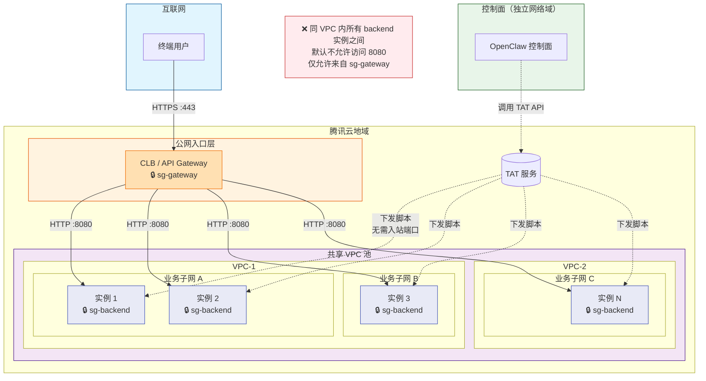

# OpenClaw SaaS 网络隔离与容量规划结论（腾讯云）

## 1. 背景与目标

OpenClaw 以纯 SaaS 方式提供服务，底层将 **CVM 作为实例沙箱** 使用。
当前讨论范围聚焦于：

* 用户不可见、不可修改云网络配置
* 控制面通过 **TAT** 统一下发脚本，不依赖 SSH / 堡垒机
* 所有实例统一暴露 **8080**
* 实例之间**默认不允许互访**
* 实例的 8080 **只能通过我们认可的对外网关/LB 访问**

TAT 支持**无需登录服务器、无需打开入站端口或 SSH** 即可执行命令，这使控制面与业务入口可以彻底分离。([腾讯云][1])

---

## 2. 最终架构决策

### 2.1 选择的默认架构

**不采用**：

* 1 用户 1 VPC
* 1 用户 1 子网
* 1 实例 1 子网

**采用**：

* **少量共享 VPC**
* **少量共享子网池**
* **统一的对外入口层（CLB / 网关）**
* **统一的后端实例安全组模型**
* **控制面通过 TAT 管理实例**
* **实例仅开放 8080，且只允许来自网关/LB**

### 2.2 为什么这样定

这样做的原因是：

1. **VPC 配额太低，不适合按租户拆分**
   腾讯云当前默认配额为：**每账号每地域 20 个 VPC**，每个 VPC **100 个子网**。([腾讯云][2])

2. **统一端口后，安全组可以标准化**
   安全组是实例级的有状态访问控制。相同防护需求的实例应复用安全组，而不是每实例一套。([腾讯云][3])

3. **控制面不需要占用入站端口**
   通过 TAT 运维，避免为 SSH/RDP 单独开入口。([腾讯云][1])

4. **实例间“零互通”可直接用 SG 表达**
   后端实例只允许来自网关/LB 的 8080 访问，不允许来自其他实例的内网访问。

---

## 3. 目标网络模型

## 3.1 设计原则

* **业务入口统一收口**
* **实例不直接暴露到公网**
* **实例间默认零互通**
* **控制面与业务流量分离**
* **安全组由平台托管，用户不可感知**

## 3.2 Mermaid 架构图



### 3.3 流量说明

| 流量类型 | 路径 | 特点 |
|---------|------|------|
| **业务流量** | 用户 → CLB → 实例 8080 | 实线，统一入口收口 |
| **控制面流量** | 控制面 → TAT → 实例 | 虚线，无需入站端口 |
| **实例间流量** | 实例 ↔ 实例 | ❌ 默认禁止 |

### 3.4 安全组边界

```
┌─────────────────────────────────────────────────────────────┐
│  sg-gateway（入口安全组）                                      │
│  入站：允许 0.0.0.0/0 → 80/443                                │
│  出站：允许 → 后端实例 8080                                    │
└─────────────────────────────────────────────────────────────┘
                              │
                              ▼
┌─────────────────────────────────────────────────────────────┐
│  sg-sandbox-backend-*（后端安全组）                           │
│  入站：仅允许 sg-gateway → 8080                               │
│  出站：允许 443、DNS、TAT                                      │
│  ❌ 禁止 VPC 内网段 → 8080                                    │
│  ❌ 禁止同子网实例 → 8080                                     │
└─────────────────────────────────────────────────────────────┘
```

---

## 4. 安全组设计

## 4.1 推荐的最小安全组集合

### SG-1：`sg-gateway`

给 CLB / 网关使用。

**入站**

* 允许公网访问 `80/443`（或你们实际入口端口）

**出站**

* 允许访问后端实例 `8080`

---

### SG-2：`sg-sandbox-backend`

给所有 OpenClaw 实例使用。

**入站**

* 仅允许 `sg-gateway -> TCP/8080`

**出站**

* 仅允许实例访问必要依赖：

  * `443`（平台依赖、对象存储、更新源等）
  * DNS
  * TAT 所需连通

**显式要求**

* 不允许 `0.0.0.0/0 -> 8080`
* 不允许 VPC 内网段 -> `8080`
* 不允许同子网/同 VPC 实例 -> `8080`

腾讯云安全组默认支持实例级访问控制；当前默认配额包括：**每项目每地域 50 个安全组**、**单个安全组最多关联 2000 个实例**、**每实例最多关联 5 个安全组**、**每个安全组规则数为入站 100 / 出站 100**。([腾讯云][2])

---

## 4.2 安全边界效果

该模型可以实现：

* 用户只能通过公网入口访问实例
* 实例 8080 只能被网关/LB 访问
* 实例 A 不能直接扫实例 B 的 `8080`
* 控制面不需要 SSH 入站

这满足当前“把 CVM 当沙箱用”的产品形态。

---

## 5. VPC / 子网 / 安全组配额评估

## 5.1 腾讯云当前关键配额

| 资源              |            默认配额 |
| --------------- | --------------: |
| 每账号每地域 VPC 数    |              20 |
| 每个 VPC 子网数      |             100 |
| 每项目每地域安全组数      |              50 |
| 单个安全组可关联实例数     |            2000 |
| 每实例可关联安全组数      |               5 |
| 每安全组规则数         | 入站 100 / 出站 100 |
| 每个 VPC 网络 ACL 数 |              50 |

以上来自腾讯云当前官方文档。([腾讯云][2])

---

## 5.2 这套架构下，真正的瓶颈在哪里

在本方案下：

* **VPC 数不是第一瓶颈**
* **子网数通常也不是第一瓶颈**
* **安全组“数量”通常也不是第一瓶颈**
* 更早碰到的通常是：

  1. **单个安全组 2000 实例关联上限**
  2. **子网 IP 地址容量**
  3. **CVM、CLB、NAT、EIP 等其他资源配额**
  4. **控制面调度与运维能力**

其中，前 1 条是当前方案里最直接的网络配额瓶颈。([腾讯云][2])

---

## 6. 规模估算

下面按当前最终设计来估算。

## 6.1 估算前提

假设：

* 所有实例统一暴露 `8080`
* 所有实例使用统一后端安全组模型
* 实例间不互访
* 业务入口统一经网关/LB
* 子网只作为容量分片，不按用户独占
* 不把“1 用户 1 子网”作为默认模型

---

## 6.2 最小可落地配置

### 建议首期配置

* **VPC：2 个**
* **子网：每个 VPC 4 个，共 8 个**
* **安全组：3 个**

  * `sg-gateway`
  * `sg-sandbox-backend-a`
  * `sg-sandbox-backend-b`

### 为什么不是只用 1 个 backend SG

因为单个安全组最多只能关联 **2000 个实例**。
如果预留两组 backend SG，就可以把实例拆分到两组中，形成更平滑的扩展空间。([腾讯云][2])

### 这一版的理论实例容量

* `sg-sandbox-backend-a`：最多 2000 实例
* `sg-sandbox-backend-b`：最多 2000 实例

**合计：约 4000 个实例**

如果按 **1 用户 = 1 实例** 计，约支持：

* **4000 用户**

如果按 **平均每用户 2 个实例** 计，约支持：

* **2000 用户**

---

## 6.3 推荐的标准生产配置

### 建议标准配置

* **VPC：4 个**
* **子网：每个 VPC 8 个，共 32 个**
* **安全组：12 个**

  * `1` 个入口安全组：`sg-gateway`
  * `10` 个后端分片安全组：`sg-sandbox-backend-01` ~ `10`
  * `1` 个保留 / 特殊用途安全组

### 理论实例容量

每个 backend SG 最多关联 **2000 实例**：

* `10 × 2000 = 20,000 实例`

即：

* 若 **1 用户 = 1 实例**：约 **20,000 用户**
* 若 **平均每用户 2 个实例**：约 **10,000 用户**
* 若 **平均每用户 5 个实例**：约 **4,000 用户**

这时仍只用了：

* **4 / 20 个 VPC**
* **32 / 400 个子网**（4 个 VPC × 100 子网）
* **12 / 50 个安全组**

从 VPC / 子网 / SG 纯配额角度看，还有余量。([腾讯云][2])

---

## 6.4 单账号单地域的理论上界（按 SG 分片估算）

如果把安全组当主扩展手段：

* 每项目每地域可建 **50 个安全组**
* 扣除：

  * 1 个 `sg-gateway`
  * 3 个运维/保留/特殊组
* 可用于后端实例分片的大约还有 **46 个 SG**

每个 SG 关联上限 **2000 实例**，则理论上：

* `46 × 2000 = 92,000 实例`

这只是**安全组维度的理论上界**。
实际落地通常会更早受以下因素限制：

* 子网 CIDR 容量
* CVM 资源配额
* CLB 后端绑定规模
* NAT / EIP / 带宽
* 日志、监控、调度、镜像分发能力

所以更现实的建议是：

* **单账号单地域目标规模：先按 2 万实例设计**
* 接近该规模时，再考虑：

  * 扩后端 SG 分片
  * 扩 VPC 池
  * 多账号分仓

---

## 7. 为什么不建议 1 用户 1 VPC / 1 子网

## 7.1 1 用户 1 VPC 的问题

默认只有 **20 个 VPC / 账号 / 地域**，即使提额，也不适合作为标准 SaaS 默认模型。([腾讯云][2])

## 7.2 1 用户 1 子网的问题

虽然理论上 20 个 VPC × 100 子网 = **2000 子网**，但这会把“租户数”直接绑到子网配额上，扩展性不够。([腾讯云][2])

## 7.3 只靠 SG 是否可接受

在当前前提下可接受，因为：

* 用户无法改 SG
* 控制面统一托管
* 实例端口统一
* 入口统一
* 实例间本来就不需要互访

因此，风险主要从“用户误配”转移为“平台编排误配”。这可以通过自动化与巡检控制。

---

## 8. 运维与风险控制建议

## 8.1 必做项

* 安全组规则全部由平台生成，禁止人工临时改线上
* 定期巡检“实例期望 SG”与“实际 SG 绑定”是否一致
* 控制面发布时校验：

  * 实例是否只挂允许的 backend SG
  * backend SG 是否只允许 gateway 来源访问 8080
* 业务入口统一经 CLB / 网关
* 禁止给实例开放 SSH 公网入站

## 8.2 可选增强项

* 在实例 OS 内用 iptables / nftables 再拒绝内网来源访问 `8080`
* 用网络 ACL 做子网级粗粒度兜底
* 把高安全客户单独放入独立 VPC 或独立账号

---

## 9. 最终结论

本次讨论的最终结论是：

### 默认架构

* **共享 VPC 池**
* **共享子网池**
* **统一入口网关 / CLB**
* **统一端口 8080**
* **统一后端实例安全组模型**
* **实例之间默认零互通**
* **控制面通过 TAT 管理**

### 首期建议规模

* **2 个 VPC**
* **8 个子网**
* **3 个安全组**
* 理论可承载约 **4000 实例**

### 标准生产建议规模

* **4 个 VPC**
* **32 个子网**
* **12 个安全组**
* 理论可承载约 **20,000 实例**

### 单账号单地域网络侧可继续扩展

* 通过增加 backend SG 分片，可进一步提升到更高规模
* 真正到达大规模后，再考虑 **多账号分仓**

---

## 10. 一句话版本

**我们最终不采用“1 用户 1 VPC / 1 子网”的重隔离方案，而采用“共享 VPC + 共享子网 + 网关收口 + SG 分片 + TAT 运维”的 SaaS 沙箱模型；在统一暴露 8080 的前提下，这套方案能以较少的 VPC/子网/安全组配额支撑数千到数万实例规模。**

如果需要，我可以继续把这份文档扩成一版更正式的 **RFC 风格 Markdown**，补上“假设、非目标、扩容策略、故障域设计、提额策略”几个章节。

[1]: https://cloud.tencent.com/product/tat?utm_source=chatgpt.com "自动化助手TAT_云服务器原生运维部署工具-腾讯云"
[2]: https://cloud.tencent.com/document/product/215/20093?utm_source=chatgpt.com "私有网络 配额限制_腾讯云"
[3]: https://cloud.tencent.com/document/product/213/112610?utm_source=chatgpt.com "云服务器 安全组概述_腾讯云"


## 调度设计

## 结论

**优先同一个 VPC，可以；优先同一个子网，不建议。**

再展开一点：

* **同一个用户优先落在同一个 VPC**：可以作为“软倾向”
* **同一个用户优先落在同一个子网**：不建议作为默认策略

---

# 为什么“同一个 VPC 优先”是合理的

因为这会带来几个实际收益。

## 1. 运维和排障更容易

同一个用户的实例如果尽量在同一个 VPC 里：

* 看拓扑更直观
* 做审计更方便
* 查流量、查配置、查路由时上下文更集中

虽然你们不强调按用户网络隔离，但“归属聚合”仍然有运维价值。

## 2. 以后如果要做用户级网络能力，更容易升级

例如将来某些大客户可能需要：

* 专属出口 IP
* 专属 NAT
* 专属网关策略
* 专属审计域
* 私网连接某个客户侧系统

如果同一用户实例大致聚集在一个 VPC，后续升级会简单很多。

## 3. 容量管理更自然

可以把 VPC 当作“用户池”或“容量池”，例如：

* VPC-1 主要承载某批用户
* VPC-2 承载另一批用户

这样在做扩容、迁移、灰度时会更顺手。

所以我的建议是：

**把“同用户尽量同 VPC”做成调度偏好，不要做硬约束。**

---

# 为什么“不建议同一个子网优先”

## 1. 子网更适合做容量分片，不适合做用户归属边界

在你们这个模型里，子网已经不是主要隔离边界了。
如果还把“同用户放同子网”当优先规则，就会把子网重新变成“租户组织单位”，这会让后面容量调度变僵硬。

## 2. 容易造成热点和碎片

假设某个用户实例很多，如果你总想把它们堆到同一个子网，会出现：

* 某些子网很快打满 IP
* 某些子网很空
* 调度器要反复平衡

这对大规模 SaaS 不划算。

## 3. 子网级事故影响面会集中

如果某个子网出现配置异常、ACL 异常、路由异常，放在同一个子网里的同用户实例会一起受影响。
这不一定是你想要的。

## 4. 你们并不需要“子网内互通”

既然实例之间默认零互通，同子网并没有明显收益。
反而跨子网也不影响你们的模型。

所以：

**子网应该优先按容量、AZ、故障域来调度，而不是按用户归属。**

---

# 推荐的调度策略

我建议你们的调度策略定成三层优先级。

## 一级：先选地域 / 可用区容量池

优先考虑：

* 可用区可用容量
* 成本
* 故障域均衡
* 子网剩余 IP

## 二级：尽量同用户落同 VPC

在一级满足后，优先把同一用户的新实例放到已有实例所在的 VPC。

但这是“尽量”，不是必须。

## 三级：子网按容量均衡分散

在确定 VPC 后：

* 优先选择容量健康的子网
* 尽量分散到不同子网
* 不追求同用户实例同子网

---

# 最实用的落地建议

可以把策略写成这样：

## 默认调度策略

* 同一用户的新实例，**优先复用已有 VPC**
* 子网选择基于：

  * 可用区
  * 剩余 IP
  * 当前实例密度
  * 故障域均衡
* 不保证同用户实例在同一子网
* 不保证同用户实例在同一可用区