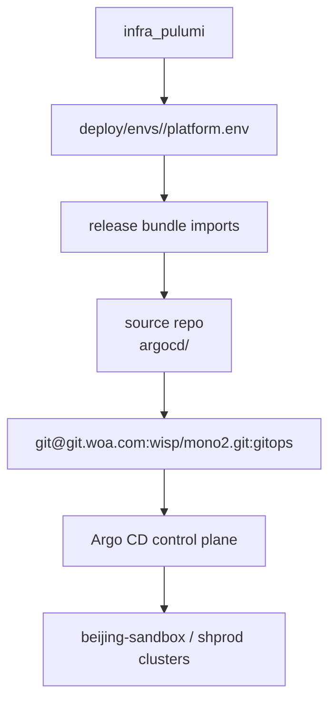

# 部署模型总览

> **一句话总结**：`infra_pulumi` 管基础设施与环境事实，`git@git.woa.com:wisp/mono2.git:gitops` 是 Argo 当前消费的 GitOps 真源，`Argo CD` 是唯一正式发布入口。

## 仓库边界

- `git@git.woa.com:wisp/mono2.git`
  - 当前源码仓
  - 也是当前 GitOps 真源
- `master`
  - 日常开发与构建触发分支
- `gitops`
  - Argo 消费的发布分支
- 修改 `argocd/`、镜像 pin、证书 ID 引用、SOPS artifact 等长期配置时，必须最终收敛到当前 repo 的 `gitops` 分支。
- 不允许在任何历史发布镜像仓保留长期差异。

## 当前正式模型



## 分层职责

### 1. 基础设施层

- `infra_pulumi`
- 职责：
  - 云资源
  - TKE / TCR
  - 数据库 / Redis
  - kubeconfig
  - `platform.env`

### 2. 服务语义层

服务目录保留：

- 源码
- `k8s/base`
- `k8s/overlays/<env>`
- Docker build 输入
- migration / seed 二进制与 SQL（如适用）

服务目录不再承担：

- 正式 `apply`
- 正式 `release`
- 正式 `kubectl apply -k`

### 3. 正式发布层

- `argocd/`
- `git@git.woa.com:wisp/mono2.git:gitops`
- Argo CD control plane

这里只承载：

- root app
- 子 `Application`
- 环境级 platform pin
- secret reference
- governance / release contract

## 镜像构建

默认统一入口：

```bash
python3 .ci/runtime/commands/build_release_image.py --service <service> --env <env> --tag <tag>
```

release bundle 源清单：

- [.ci/runtime/bundles/*.bundle](../../.ci/runtime/bundles/)

CI/runtime 会在执行时生成临时合并产物：

- `.ci/runtime/release-bundles.manifest`（不提交到 Git）

当前显式例外：

- `sandbox` 仍走 `python3 images/build-image.py`

## 数据库操作面

`DB migration / seed` 不是正式发布脚本的一部分。  
统一走平台级入口：

- [.ci/runtime/commands/run_gitops_db_job.py](../../.ci/runtime/commands/run_gitops_db_job.py)
- 历史 DB job 模板已退役
- [gitops-db-job-runbook.md](../runbooks/gitops-db-job-runbook.md)

## Promotion 与 Rollback

- `beijing-sandbox -> shprod` 只允许 promotion PR / pin bump
- 回滚只允许：
  - `git revert`
  - 或等价 promotion reverse

## 已废弃主线

以下都不再属于正式发布模型：

- service-local 正式发布脚本（已废弃）
- service-local `release` / `apply` 脚本
- 以服务目录脚本为中心的正式发布文档

## 关联文档

- [GitOps Platform Standard](../runbooks/gitops-platform-standard.md)
- [Root Mono Governance](../runbooks/gitops-root-mono-governance.md)
- [GitOps Release Contract](../runbooks/gitops-release-contract.md)
