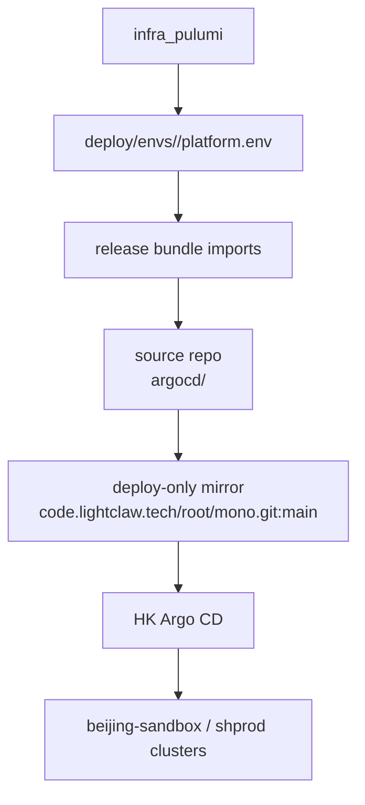

# 部署模型总览

> **一句话总结**：`infra_pulumi` 管基础设施与环境事实，source repo 管长期 GitOps 真源，`code.lightclaw.tech/root/mono.git:main` 是 Argo 消费的 deploy-only mirror，`Argo CD` 是唯一正式发布入口。

## 仓库边界

- `git.woa.com/wisp/mono`：日常开发、代码评审、长期维护的 source repo。
- `https://code.lightclaw.tech/root/mono.git`：deploy-only GitLab mirror，当前由香港 Argo CD 消费。
- `root/mono.git:main` 只作为发布消费分支使用，不作为普通开发分支。
- 修改 `argocd/`、镜像 pin、证书 ID 引用、SOPS artifact 等长期配置时，必须先同步回 source repo，再推送 deploy-only mirror。
- 不允许只在 deploy-only 仓留下长期差异；否则后续从 source repo 再同步时会覆盖线上修复。

## 当前正式模型



## 分层职责

### 1. 基础设施层

- `infra_pulumi`
- 职责：
  - 云资源
  - TKE / TCR
  - 数据库 / Redis
  - kubeconfig
  - `platform.env`

### 2. 服务语义层

服务目录保留：

- 源码
- `k8s/base`
- `k8s/overlays/<env>`
- Docker build 输入
- migration / seed 二进制与 SQL（如适用）

服务目录不再承担：

- 正式 `apply`
- 正式 `release`
- 正式 `kubectl apply -k`

### 3. 正式发布层

- `argocd/`
- `root/mono`
- HK Argo CD

这里只承载：

- root app
- 子 `Application`
- 环境级 platform pin
- secret reference
- governance / release contract

## 镜像构建

默认统一入口：

```bash
python3 scripts/build-release-image.py --service <service> --env <env> --tag <tag>
```

release bundle 清单：

- [scripts/release-bundles.yaml](../../scripts/release-bundles.yaml)

当前显式例外：

- `sandbox` 仍走 `python3 images/build-image.py`

## 数据库操作面

`DB migration / seed` 不是正式发布脚本的一部分。  
统一走平台级入口：

- [scripts/run_gitops_db_job.py](../../scripts/run_gitops_db_job.py)
- 旧 GitLab CI 模板已退役
- [gitops-db-job-runbook.md](../runbooks/gitops-db-job-runbook.md)

## Promotion 与 Rollback

- `beijing-sandbox -> shprod` 只允许 promotion PR / pin bump
- 回滚只允许：
  - `git revert`
  - 或等价 promotion reverse

## 已废弃主线

以下都不再属于正式发布模型：

- service-local 正式发布脚本（已废弃）
- service-local `release` / `apply` 脚本
- 以服务目录脚本为中心的正式发布文档

## 关联文档

- [GitOps Platform Standard](../runbooks/gitops-platform-standard.md)
- [Root Mono Governance](../runbooks/gitops-root-mono-governance.md)
- [GitOps Release Contract](../runbooks/gitops-release-contract.md)
