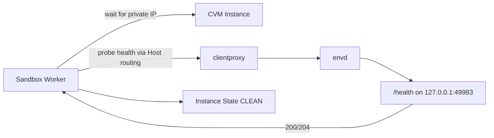

# Sandbox Runtime Agent 与执行链路说明

本文档说明 `sandbox` 运行时里 `envd`、`process.Process`、`clientproxy`、`TAT` 的职责边界，以及当前仓库实际依赖了哪些能力。

## 概览

在当前实现里，`sandbox` 不是“创建一台 CVM 就能用”的系统。

实例要真正可分配，至少需要下面这条链路成立：

```text
sandbox worker
  -> 实例启动
  -> clientproxy 访问实例内 envd
  -> envd /health 正常
  -> worker 判定实例健康
  -> 实例进入 CLEAN
```

对应的 Mermaid 图：



从职责上看：

- `envd`：运行在实例内的 runtime agent
- `process.Process`：`envd` 暴露的一组进程控制 RPC
- `clientproxy`：把外部请求转发到实例内 `envd`
- `TAT`：腾讯云侧的远程命令执行通道

## `envd` 是什么

在本仓库语境里，`envd` 更像“沙箱实例内的 agent / daemon”，而不是一个通用系统组件。

当前代码把它当成镜像契约的一部分：

- 镜像内要有可运行的 `envd`
- `envd` 需要提供 `127.0.0.1:49983/health`
- 部分运行时操作依赖 `envd` 提供的 `process.Process/*` 接口

如果镜像里没有可工作的 `envd`，常见现象是：

- CVM 创建成功
- 但 `sandbox-clientproxy -> <private-ip>:49983/health` 失败
- worker 无法把实例推进到 `CLEAN`

相关背景可参考：

- [sandbox-image-contract.md](../sandbox-image-contract.md)
- [sandbox-template.md](./sandbox-template.md)

## `process.Process` 暴露了什么

仓库里生成的 Connect client 显示，`envd` 暴露了 `process.Process` 这组 RPC：

- `List`
- `Connect`
- `Start`
- `Update`
- `StreamInput`
- `SendInput`
- `SendSignal`

代码位置：

- [process.connect.go](../../sandbox/internal/envd/process/processconnect/process.connect.go)

这说明 `envd` 不只是一个健康检查服务，它还提供了实例内进程管理能力。

## 当前 `sandbox` 实际用了哪些 `process.Process` 能力

虽然协议里定义了多种方法，但当前仓库真正看到的业务使用，主要集中在 `Start`。

### 1. 通过 `Start` 在沙箱里执行命令

`sandboxcli` 会创建 `ProcessClient`，然后通过 `process.Process/Start` 启动：

```text
/bin/bash -l -c <cmd>
```

随后消费服务端流式事件，读取：

- `stdout`
- `stderr`
- `exit_code`
- `status`

这条链路本质上是在验证“沙箱实例内的命令执行面是否可用”。

相关代码：

- [main.go#L207](../../sandbox/cmd/sandboxcli/main.go#L207)
- [main.go#L213](../../sandbox/cmd/sandboxcli/main.go#L213)
- [main.go#L340](../../sandbox/cmd/sandboxcli/main.go#L340)

### 2. reset 前对实例内 `envd` 发 HUP

在 worker 做实例 reset / reinstall 前，provider 会 best-effort 调用 `process.Process/Start` 执行：

```bash
pkill -1 envd || true
```

目的不是通用远程执行，而是尽量让旧实例上的 `envd` 不再继续返回旧的 `/health`，避免 reset 过程中出现误判。

相关代码：

- [tencent.go#L553](../../sandbox/internal/provider/tencent.go#L553)

### 3. 其他 RPC 目前基本未被业务代码使用

当前仓库里没有看到 `List`、`Connect`、`Update`、`SendInput`、`SendSignal` 的明确业务调用。

这意味着：

- 它们在协议层是存在的
- 但当前 `sandbox` 主流程并不依赖这些方法
- 当前最关键的依赖仍是 `/health` 和 `process.Process/Start`

## `clientproxy` 在链路里做什么

`clientproxy` 是对实例内 `envd` 的转发层。

在私网模式下，worker 不直接访问实例私网 IP，而是：

1. 访问 `clientproxy`
2. 通过特殊 `Host` 头指定目标实例和端口
3. `clientproxy` 再把请求转发到实例内 `envd`

健康检查就是这么走的：

```text
worker
  -> clientproxy /health
  -> Host: 49983-ip-<private-ip>
  -> 实例内 envd:49983/health
```

对应代码：

- [tencent.go#L248](../../sandbox/internal/provider/tencent.go#L248)
- [tencent.go#L525](../../sandbox/internal/provider/tencent.go#L525)

调用 `process.Process/Start` 时也走同样思路，只是路径变成：

```text
/process.Process/Start
```

并附带 Connect 协议头。

## 核心执行通道

下面这张图把当前实现里最关键的两条通道放在一起：

```mermaid
flowchart TB
    subgraph Runtime Path
        Worker[worker / sandboxcli]
        ClientProxy[clientproxy]
        Envd["envd in guest"]
        Process["process.Process/Start"]
        Shell["/bin/bash -l -c ..."]

        Worker -->|Connect RPC over HTTP| ClientProxy
        ClientProxy -->|Host routes to VM:49983| Envd
        Envd --> Process
        Process --> Shell
    end

    subgraph Cloud Path
        API[sandbox-api]
        TATAPI["/sandboxes/{id}/tat/commands"]
        TAT[Tencent TAT]
        Guest[guest instance]

        API --> TATAPI
        TATAPI --> TAT
        TAT --> Guest
    end
```



这个图要表达的核心点是：

- `envd` 通道是实例内 runtime 执行面
- `TAT` 通道是云侧 out-of-band 执行面
- 两者都能“执行命令”，但职责和路径不同

## `TAT` 在链路里做什么

`TAT` 不是 `envd` 的一部分，而是腾讯云提供的远程命令执行通道。

当前仓库里，`TAT` 对外暴露为：

- `POST /sandboxes/{sandboxID}/tat/commands`
- `GET /sandboxes/{sandboxID}/tat/commands/{invocationID}`

它主要用于“云侧 out-of-band 运维执行”，而不是 `sandbox` 正常健康判定的主通道。

可以把两者理解成：

- `envd`：实例内执行面，偏运行时
- `TAT`：云平台执行面，偏运维和补救

## 当前实现里最关键的依赖面

如果只看 `sandbox` 当前主流程，和 `envd` 直接相关的硬依赖主要是两条：

1. `49983/health`
2. `process.Process/Start`

其中第一条更关键，因为没有它，实例连 `CLEAN` 都进不了。

## 一句话总结

`envd` 在当前 `sandbox` 体系里，本质上是“实例内 runtime agent”。

当前主流程主要依赖它两种能力：

- 提供 `49983/health` 让 worker 判定实例是否可用
- 提供 `process.Process/Start` 让系统在实例内发起受控进程执行

而 `clientproxy` 负责把这些请求路由进实例，`TAT` 则是另一条云侧命令通道，不等同于 `envd`。
