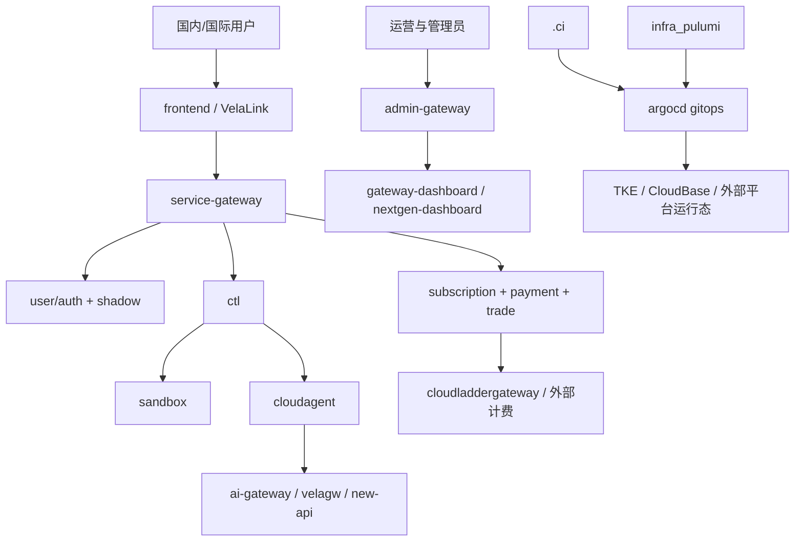

# LightVela 系统总览

LightVela 在 mono2 中由产品表面、公共入口、身份与商业化、控制与运行时、交付平台五层组成。国内生产站是 `lightvela.com`，国际生产站是 `lightvela.ai`；源码分支是 `master`，deploy-facing 期望状态由 `gitops` 分支和 Argo CD 消费。

## 五层责任

1. 产品表面：`frontend`、`velalink` 和管理 Dashboard 表达状态、发起操作、呈现客户文档；不独占鉴权、计费或实名门禁。
2. 公共入口：`service-gateway` 处理站点、鉴权与后端代理；`admin-gateway` 处理管理面入口，两者发布独立。
3. 业务状态：`user/auth` 与 `shadow` 拥有身份；`subscription`、`payment`、`trade` 拥有商业化过程的不同阶段。
4. 控制与运行时：`ctl` 编排实例和渠道，`sandbox` 管理机器池，`cloudagent` 执行 Agent，AI Gateway/LLMGateway 管理模型调用。
5. 交付平台：`.ci` 构建和晋级制品，`infra_pulumi` 产生环境事实，`argocd` 定义部署期望；真实完成还要验证运行态。

## 不能混淆的边界

- UI 状态不是后端授权事实；直连服务成功不是公共路径成功。
- 源码合入不是镜像构建完成；镜像存在不是 GitOps 已更新；GitOps 合入不是 Argo 已收敛；Argo 健康也不自动证明业务 E2E。
- `frontend/src/content/docs/` 是产品文档源，`.fumadocs-content` 是生成物。
- `new-api`、`velagw`、`velalink` 和 vendored Codex 保留上游谱系；一方文档只记录集成差异。

服务级细节见 [服务拓扑](service-topology.md)，事实优先级见 [权威与机器契约](authority-and-contracts.md)。
