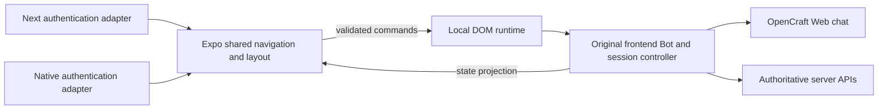

# Embedded Bot bridge

The existing Bot product UI lives in `frontend/src/mobile-dom/entry.tsx` and
is bundled into `products/<product>/native/assets/mobile-bot-runtime.html` by
the downstream product's `build:mobile-bot-runtime` command. The iOS WebView loads that local asset. It does not
navigate to a hosted Bot screen. Both sides import the single wire contract
`@opencraft/mobile-bot-bridge`.

The WebView uses the site URL as the bundled document's base URL so existing
first-party API code works. This does not turn the WebView into a strict
network sandbox. The native document policy admits that base URL only for the
first local HTML load. Every later top-level or iframe document navigation is
cancelled: Bot routes go through the bridge, approved site routes leave through
the native shell, and a redirect to the site homepage is blocked. A retry
remounts the bundled HTML rather than reloading the WebView's current URL.
Keep this policy when changing routing; a permanent allow rule for `/` can
replace the packaged UI with the live website and expose its WebView session.

Messages carry `{ protocol, runtimeId, payload }`. The protocol version
rejects incompatible shapes; the runtime ID distinguishes an old WebView or
account generation from the current one. It is a stale-message guard, not an
authentication secret. The native host validates unknown JSON before changing
state and applies Bot-selection messages only to known section IDs. The DOM
runtime validates native commands before dispatching them to the existing
frontend selection/create/delete behavior. The ready message advertises
supported commands; the host sends feature commands only after capability
handshake. A new command requires a corresponding behavior on both sides,
explicit failure semantics, and a focused protocol test.

The shared Expo navigation owns presentation; the persistent frontend controller
owns Bot permissions, mutations and session selection. It publishes validated
`bot-console-state` projections and accepts Bot-scoped session commands. Both
native and Expo Web use the same HeroUI Native navigation/session components.
The local HTML includes the actual OpenCraft Web custom element, its styles
and build assets; this Agent Console entry does not mount RN Chat or AgentChat.
Automations currently keeps the original packaged frontend panel. A staged
React Native/HeroUI implementation and target-scoped port for the original
Cron client live under `products/<product>/native/src/components/mobile-automations.shared.tsx`
and `src/runtime/native-cron-port.ts`, but are not routed into the product.
The initial native form lacked templates, 0 Token creation/editing, delivery
channels, skills, upstream bindings, effective windows and run-output details;
switching the product route to it removed existing capabilities and broke the
Automations-to-Chat return path. Route the native screen only after a complete
capability and navigation regression check. The downstream `build:native-cron-client` remains
available for that work, outside the normal Expo start/build path.
Bot catalog identity retains the physical instance/Profile pair. Session
commands reuse the existing create/select/rename/delete/pin/unread/pagination
handlers rather than create a second session store. Retired controller commands
ignore late results. External navigation passes through the host route policy.
Opening the unsent Create Bot form changes presentation, not the selected Bot
or its Chat controller lifetime. In an embedded host the existing controller
and session projection stay mounted behind a hidden, inert canvas. Chat is
inactive there; selecting an existing/new conversation clears the creation
route through the original handler and reveals the same controller and draft.
The website keeps its existing full-page creation layout. This does not grant
session commands for an unavailable or retired Bot, nor queue mutations.
Regression belongs to the downstream product: run `build:mobile-bot-runtime`
and `smoke:mobile-bot-create-return` from its workspace. The probe runs its
packaged frontend in Chromium with fixture transport/Chat APIs; set
`OPENCRAFT_PLAYWRIGHT_MODULE` and `OPENCRAFT_CHROMIUM_EXECUTABLE` as needed.
The optional native Cron client has its own product build and smoke commands;
neither private generated artifact is an input to public Expo tools.
The bootstrap publishes boolean `bot-touch-ownership` for a contact originating
in an editable/control or horizontal scroller. The native pan yields to this
contact; touch end/cancel and document reload release it. Runtime validation
rejects stale or malformed ownership messages. It is not a permission grant
and carries no content or element identifiers.
Neither host logs credentials, personal identifiers, query strings, API bodies
or raw errors. Fixed diagnostics belong in the developer log.
The bundled DOM lays out against its WebView viewport, which can be a phone,
iPad pane or foldable pane. Feature panels must shrink within that width; a
horizontal overflow hidden on the document is not proof that card and file
controls remain readable. The shared frontend components own responsive
content; `frontend/src/mobile-dom/embedded-layout.css` supplies only embedded
overrides, including a narrow fallback for older WebViews without container
queries. Layout probes should inspect inner panel width and touch controls as
well as the document width.
Section render failures include the section ID when available. The native
shell shows that section's retry state without marking the entire WebView as
failed; moving to another section lets the existing DOM error boundary recover.
If iOS terminates the WebView content process, the host reloads it at most
twice within a minute before showing the manual retry card. It keeps the Bot
selection outside that process; the Web chat runtime and draft persistence own
conversation restoration after a document restart.

Bot avatar shape definitions are shared by frontend and Expo. Once the DOM
reads a Bot profile, it sends a validated `bot-avatar` message with the Bot ID,
configured flag, shape and color. The native drawer renders that same shape;
before profile data arrives it keeps the existing image fallback. Avatar
messages are scoped to the current runtime ID and never contain image bytes.

After changing frontend Bot code, rebuild the local asset and run the DOM
smoke. After changing the bridge, run `tests/mobile/mobile-bot-bridge.test.ts`, Expo
typecheck and frontend typecheck. After changing navigation, also run
`tests/mobile-shell-model.test.mjs` and check the account/drawer return flow
in an Expo runtime. These checks are focused; this document adds no CI gate or
mandatory screenshot requirement.

## Chat panel host presentation

The packaged Chat opts into `externalPanelChrome`. Its original
`WorkbenchPanelService` remains the only owner of tab identity, active tab,
preview replacement, ordering, MRU close behavior, full-width intent and
resource lifetime. `workbench-panels/host-presentation` is a pure contract
entry; mobile bridge messages carry only a validated presentation projection
and owner-scoped commands. `chat-panel-state` also includes instance/Profile
identity. A retired runtime, Bot or conversation cannot operate the new owner.
Actions must still be in the current presentation's admitted action catalog;
this port does not expand the embedded product's renderer or backend authority.

Expo measures the native content plane and supplies shell controls and gesture input.
The embedded parent owns actual Chat/right-pane viewport allocation and motion.
The complete original `RightPanel`, including its tab bar, creation/switching
menus, empty state and file/browser contents, is portaled into a sibling outlet
of the **same local custom element and DOM runtime**. React contexts and browser
residency remain intact. There is no replacement native tab-management dialog,
second Application, iframe per tab or hosted page navigation. The legacy
`externalPanelChrome` opt-in names host layout; it does not suppress the original
DOM toolbar. Both standalone Web/Electron and Expo reuse that toolbar.

The host measures its content container after outer navigation takes space.
`chat-panel-geometry` assigns content/panel width with zero additional native
toolbar clearance: narrow containers and explicit full-width intent overlay Chat; sufficient space places
both in real sibling grid columns. The contained Chat AppShell measures its own
column; it cannot retain a document-level fixed width. In overlay mode only the underlying Chat DOM is inert,
not the WebView containing panel content. Width changes apply geometry without
remounting the runtime or resetting tabs/drafts. Hiding a panel retains its tabs;
closing a tab or releasing its conversation uses the existing owner lifecycle.
The native content plane contains one DOM runtime with both sibling viewports;
there are no independent native WebViews or new native file/browser renderers. Hardware accessibility and keyboard acceptance
must be checked separately from browser fixture and iOS bundle evidence.

`chat-panel-gesture` carries a validated contact ID, phase and finite movement/
velocity samples to the current panel owner. Start captures the displayed position;
move changes transient geometry, not service open intent; end commits via the
original command admission, and cancel restores current intent. Older contact
samples, changed geometry and retired owners cannot resume a new transaction.
Buttons, resource-originated open intents and gesture release use one motion driver.
`chat-panel-presentation` reports owner-scoped boolean activity to native arbitration
so a closing pane remains interruptible and mounted. It grants no resource authority.
Move samples are coalesced; terminal samples replace queued moves, carrying the full
displacement. Runtime replacement clears pending samples. Native/WebView bridge
latency still requires device observation; this is not an all-native UI-thread claim.

## Expo Web parallel entry

`frontend/next-site/agents-next-page-client.tsx` adapts authentication and mounts
an actual Expo Web export at `/agents-next`; `/agents` retains its current
controller and presentation. Build from `opencraft/`:

```sh
npm run build:agents-next --workspace @opencraft/mobile
```

This exports shared navigation through Metro and emits a static manifest under
`frontend/public/__expo-agents/`. Generated outputs are ignored; rebuild them
before building/deploying a frontend that exposes this experimental route.
Native loads packaged HTML in WebView; Web loads that build output into an
`iframe.srcDoc` container. Both run the original frontend code, never a hosted
feature URL. The outer Next adapter performs authentication and external navigation only;
Bot entitlement/configuration decisions stay in the packaged controller and
server APIs rather than a second independently fetched console gate.
The Web mount port exposes update/dispose so account refresh does
not rebuild the console. Width changes preserve the mounted DOM frame.
The frame validates source window, origin, protocol and runtime generation.
CSP rejects network script and stylesheet loads; API networking remains available. The frame
has same-origin capability for browser storage and is not a security boundary
against hostile code. Only trusted build code belongs in this runtime.
The Electron renderer can consume the same mount port through its host adapter;
this iteration does not replace the existing Electron entry.



## Native audio and packaged code

The product composition supplies native capture through `AudioCapturePort` and
transcription through `SpeechServicePort`. Its bootstrap-global compatibility,
account/region binding and authenticated speech-service protocol stay downstream.
The public workbench consumes these ports; it does not read product bridge globals
or instantiate that product HTTP adapter. Native and product browser regressions
belong with those adapters, while the shared recording/transient-input lifecycle
continues to be tested in the public voice plugin.

Executable modules, stylesheets and workers for the App-owned runtime come from
the build. The packaged document permits inline/data/blob code and styles, with
no network script or stylesheet source and no nested document. API responses
and media remain separate from executable resources. Account management, verification and subscription pages open the system browser;
the previous hidden remote account WebView and asset prefetch are removed.
Metro is a development
transport only; an Expo Go preview is not a release bundle.

Embedded Web retains browser capture. The iOS bootstrap explicitly supplies a
native capture capability; that capture adapter has no browser fallback. Expo
Audio owns system permission, the recorder, interruption handling and temporary
file disposal. A denied permission still requires the user's system decision.
WKWebView media capture is denied so regressions cannot add a website permission
prompt. The DOM receives bounded, ordered audio frames through the validated
runtime/request contract and normalizes actual PCM WAV before the existing ASR
service. Audio/text never enters developer diagnostics. The existing speech
provider keeps explicit same-audio retry and the original composer owns final
text insertion; no second draft or automatic send is introduced.

Cancel, background, leaving Chat, Bot disposal and document generation changes
retire capture. Outstanding permission/prepare work holds device ownership
until disposal; late frames cannot target a replacement request. App-owned
audio files are removed after delivery or cancellation. Hardware microphone
permission, interruptions and waveform quality require device acceptance.

The SDK-compatible Expo Audio module allows the iOS capture path to be bundled
for Expo Go.
