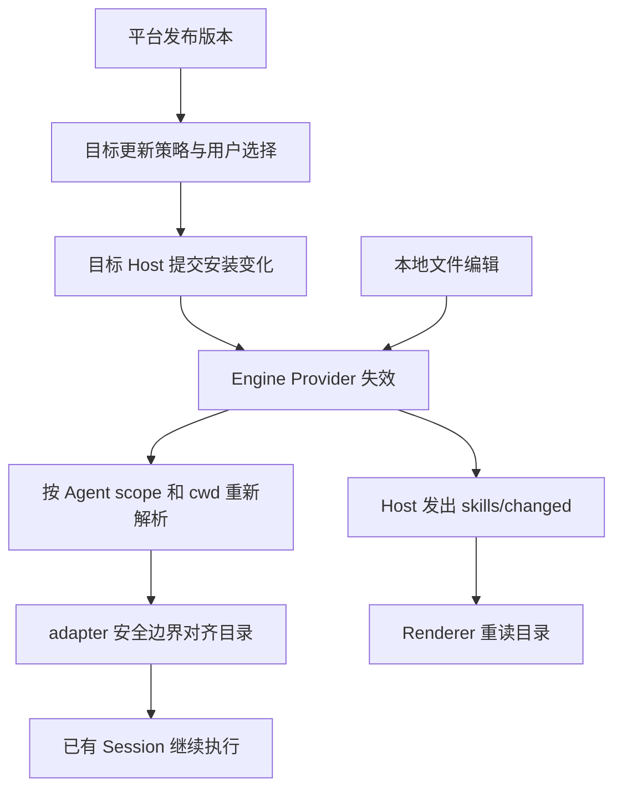

# 存量会话的 Skills 与 Connector 更新设计

状态：目录刷新已实现，进行兼容性与桌面验收收尾。  
修订：R3，取消正文版本更新及 Hermes 自动热刷新，收敛当前交付范围。  
日期：2026-09-17。  
范围：OpenCraft Workbench、Host、DSH 及 Hermes adapter。

本文规定平台能力变化后，已有会话如何发现、理解并使用最新能力。本文中的目标行为不代表已经实现；现状和参考证据见第 9 节。

本页记录已有 Skills 安装/卸载后的目录刷新、原生按需读取与失败语义。用户已明确取消已加载正文的版本失效通知、Hermes 自动热刷新及其前置改造；不修改 Hermes，不等待其可写仓库，不建设正文回执或强版本隔离。用户随后单独授权了 Connector 实施，其实际进度以 [平台 Connector](platform-connectors.md) 为准，不与这些取消项混淆。

本文细化 [Agent 能力运行时架构](agent-capability-fabric.md) 中的能力视图与调用生命周期，沿用 [平台架构](platform-architecture.md) 的 Host/Conversation/View 所有权和 [DSH 按需历史恢复](../design/dsh-jit-history.md) 的冷恢复边界。它不要求先实现完整 Capability Fabric，也不增加另一套 Session、历史或权限真源。

## 1. 用户应获得的行为

用户在同一会话中安装、更新或禁用 Skill，或者连接、断开 Connector 后，后续执行应感知变化，不需要新建会话、复制历史或重启整个应用。

“生效”必须分别满足：

1. **可发现**：目标 Host 和作用域的目录包含正确条目。
2. **模型可见**：在已声明并验证的安全执行边界，模型请求拿到新的目录、必要的更新提示和可调用工具。
3. **可执行**：调用时实际实现、资源文件、连接与授权满足当前条件。

页面显示“已安装”或“已连接”不能单独证明后两项成立。

| 操作 | 期望结果 |
|---|---|
| 市场发布新版本 | 展示可更新信息；由安装策略决定是否更新具体安装目标 |
| 本机或 Profile 安装新 Skill | 该作用域的已有会话在 adapter 声明的刷新边界发现它；DSH 目标为下一模型步骤，Hermes 单独验证 |
| 正文或资源变化，名称和描述不变 | 原生工具再次读取时获得当前文件；不承诺主动通知模型使旧正文失效 |
| 禁用或卸载 Skill | 后续目录撤销模型调用资格；旧历史仍可查看 |
| Connector 授权成功 | 按贡献类型分别准备 Skill 或工具；授权完成不代表每项贡献均已就绪 |
| 断开或撤销 Connector 授权 | 后续调用立即重新校验并拒绝失效访问；历史不删除 |
| 打开旧会话只看历史 | 保持冷恢复；无需为了读取历史启动 Agent 或连接全部 Connector |

## 2. 对象与所有权

| 对象 | Owner | 保存内容与生命周期 |
|---|---|---|
| Skill 发行物 | 平台/来源仓库 | 稳定来源身份、版本、完整文件内容与 digest |
| Skill 安装记录 | 目标 Host 的安装服务 | 安装位置、来源、安装 digest、启用状态、用户修改状态、持久化 revision |
| 有效 Skill 目录 | Engine Provider/Registry | 按当前 Agent scope、cwd/Profile 和优先级合并，缓存可失效 |
| 模型可见目录与原生加载结果 | Engine 的上下文构造与原生事件机制 | 随原生历史恢复；不新增正文版本回执 |
| Connector 定义与贡献声明 | 扩展/平台 Provider | 外部集成身份、认证方式、Skill 发行物或工具入口；不要求每个集成都有 MCP |
| Connector 凭据绑定 | 相应授权服务/Credential broker | 账号、授权范围和撤销状态；Renderer 仅消费交互结果 |
| Connector 贡献就绪状态 | 各贡献的领域服务 | Skill 安装/刷新回执或工具运行时状态；按贡献报告，不新建安装/工具真源 |
| 工具运行时连接（若需要） | 执行该连接的 Host/Daemon | 生命周期、实际工具、错误、连接 generation；不是 Connector 的唯一实现形态 |
| 会话能力选择 | Conversation 配置 | 显式选择、禁用项、继承策略及作用域；不复制凭据和物理连接 |
| 调用 | 执行 Runtime | 调用身份、所选实现、取消和结果回执；强一致阶段另绑定资源版本 |
| 页面目录缓存 | Renderer Query/Store | 从权威读取的可丢弃投影，不决定 Agent 能用什么 |

跨 Host 或账号的同名 Connector 不是同一连接。不同 Hermes Profile 的安装记录和目录必须隔离；本机 DSH 不是 Hermes Profile。

会话选择应表达“继承当前可用集合”或“显式选择集合”，不能把创建时的默认列表永久保存成用户的显式选择。新能力在既有选择策略允许时进入会话；授权可用不自动覆盖用户禁用。

### 2.1 三种版本不可混用

- **安装 revision**：持久化写入的 CAS 条件，防止并发更新覆盖用户修改。
- **内容 digest**：某个 Skill 完整发行物的内容身份，包含正文、脚本和资源；不能只散列名称、描述或 `SKILL.md`。
- **目录 revision / 连接 generation**：当前进程内缓存与连接失效依据；跨进程使用时须带 epoch，不能把进程内整数当持久版本。

实现优先复用 Engine 已有 revision，不为同一目录再维护第二个可写 generation。

### 2.2 更新授权与会话选择

市场发布、目标安装和会话使用是三个独立动作。平台发布版本只改变可选发行物；不隐式覆盖所有 Host，也不替用户授权 Connector。公共市场浏览继续不依赖登录，写入与授权按具体目标校验。

安装记录的本地修改状态区分 `unmodified / modified / unknown`。只有已知未修改且用户更新策略允许时才能静默更新；未知不能按 `false` 处理。更新前重新验证实际文件内容，不能只信旧记录；不具备跨进程/外部编辑冲突检测能力时，不宣称 CAS 可以防止任意本地编辑覆盖。

会话继承规则复用既有选择与权限机制。第一阶段不引入新的默认选择 UI，也不把刷新改成自动安装、自动启用或自动授权。

## 3. Skills 的更新与模型传播



模型路径不依赖页面是否打开、Renderer 是否收到通知或用户是否手动刷新。

### 3.1 安装更新事务

1. 在目标 Host 校验发行物、文件路径和来源，计算完整内容 digest。
2. 检查适配协议中的预期 revision、当前安装和实际文件修改状态；自动更新不得覆盖本地修改，未知状态转显式确认。`expectedRevision` 是目标语义，不能假设现有所有接口已有此参数。
3. 在 staging 中写完并验证所有文件，再发布安装记录与有效版本。更新已有非空目录必须使用明确的可恢复替换协议，不能假设一次 `rename` 就完成原子替换。
4. 提交成功后使目标 Engine Provider 失效，再通知相关客户端刷新。
5. 安装提交和运行时刷新分别确认。文件已提交但 Engine 不可达时，保留可恢复的待刷新状态；重试只补刷新，不重复安装。

安装操作的 `operationId` 和提交回执必须支持进程重启后的对账。Engine 重启后从当前安装记录重建目录；通知丢失不能永久留下旧缓存。

外部编辑通过有界文件监听补充失效；平台自己发起的写入必须直接通知 Provider，不能等待文件监听的延迟作为写后可见性的唯一保证。监听目录尚不存在、监听失败或跨进程漏事件时，应在后续读取/执行边界进行对账。

### 3.2 Provider 可见性

目录查询与实际 Agent 使用相同的有效 Provider 集合、优先级和作用域规则。

- 用户级 `.opencraft/skills` 在对应 Host 的正常 Agent scope 中可见。
- 工作区 `.opencraft/skills` 按实际 cwd 解析；原生 `.agents/skills` 规则继续保留。
- 管理页可有无需激活 Agent 的 discovery scope，但它不能成为这些 Provider 的唯一注册层。
- 同名覆盖按既有明确优先级决定。刷新不改变 Profile/cwd，也不把 discovery scope 强接成所有 Agent 的新父节点。

实现前须核对当前 DSH preset/scope composition，决定注册在共享层还是通过原生 composition 提供。验收比较管理目录和模型的实际有效目录，不能仅测管理页 list。

### 3.3 引擎原生刷新边界

统一的是“变更已提交、运行时已应用、模型已看到”的区别，不是统一 hook 名称或强制所有引擎支持步骤级热更新。adapter 应声明目录和工具分别支持的边界：模型步骤前、下一次 Turn 执行前，或不支持活动会话刷新。错误是一次应用结果，不应把暂时失败误报为永久不支持。

执行前对齐须有有界超时与可重试错误。明确不支持时报告限制，不无限等待、不悄悄新建 Thread；仅查看历史不进入该流程。已发布的工具 schema 与调用路由要对应同一就绪实现，不能为了“刷新成功”把新 schema 配给旧 handler。

DSH 优先复用原生 `agent/pre-step` 目录发布机制：读取当前 scope/cwd 的完整快照，与模型可见历史中的目录摘要比较，变化时发布替代目录。

- 无变化不重复注入。
- 发现失败或不完整时，不发布伪造的空目录；可保留上次完整目录作为上下文，但实际调用仍校验当前可用性。
- 有意删除最后一个 Skill 时发布明确的空目录，撤销旧名称的使用指引。
- 已有历史、fork、压缩后恢复均通过同一机制对齐。
- 排队消息在真正开始执行时对齐，不能把排队时目录当成执行时目录。

DSH 的步骤级保证必须覆盖自动继续、工具返回后的下一步和队列消费，不能只在 Workbench `turn/start` 放一次 hook。其他 Engine 由原生 adapter 验证其边界；只支持 Turn 边界时，当前 Turn 继续使用已准备的上下文，下一 Turn 执行前应用。权限撤销仍在实际调用处生效，不等待目录刷新。

### 3.4 正文和资源变化

本项主动更新机制已取消。名称/描述摘要变化与已加载正文失效不是同一能力：目录刷新不会抹除历史中的旧说明。原生 Skill 工具再次加载时读取当前文件，不额外追踪正文 digest、修改旧消息或注入失效提示。不能将这个限制描述为“完整正文热更新”。

### 3.5 执行中的版本一致性

仅接通目录刷新，不开放本机托管 update，也不宣称已加载正文自动失效。普通目录保持实时文件语义，已开始的脚本后续读取可能看到文件变化；不提供整个 Turn 的资源快照隔离。不可变版本目录、引用保留和回收机制不在当前计划内。

禁用/撤销在调用边界重新检查。Skill 指令已经进入模型历史后，卸载无法使模型“忘记”，更不能用卸载替代终端、网络等底层权限控制。

## 4. Connector 独立设计与后续实现

用户后续已授权平台级 Connector 实施。下列为设计原则；实际 SPI、工具执行、原生 OAuth、用户入口、逐次写审批及配置持久化以 [平台 Connector](platform-connectors.md) 为准，不涉及设置页原型。验证使用隔离授权服务，不连接真实账号。

### 4.1 外部集成及其贡献

Connector 是外部集成，不等同于 MCP Server。它可以贡献 Skill、工具，或两者；公开无需授权的贡献可跳过授权步骤。扩展/平台适配器声明贡献，账号授权服务管理绑定，目标 Host 协调准备；系统浏览器、二维码、Device Code 或 token 表单由平台呈现适配器负责。

```text
connect intent(operationId)
  → 核对目标 Host、账号、Connector 和当前连接意图
  → 在需要时获取或刷新授权
  → 分别准备贡献
      Skill → 目标安装服务 → Provider 失效与模型目录对齐
      工具  → 对应运行时适配器 → 连接/发现/路由就绪
  → 各领域发布权威状态，按贡献返回准备结果
  → 会话选择与权限过滤
  → Engine 在声明的安全边界应用有效能力
```

分别表达授权状态、贡献就绪状态、用户启用状态和本次操作。OAuth 回调成功只能确认授权阶段；Skill 就绪但 MCP 失败可部分可用，不能用一个绿色 `connected` 覆盖失败。MCP 连接仍由原有 Host/Daemon transport owner 管理，不因上收集成模型再建第二个连接管理器。

贡献使用稳定来源身份关联，不能仅按展示名称合并；断开集成不自动删除已安装文件或用户修改。授权受限的贡献停止后续使用；可独立使用的公开 Skill 按自己的安装/启用策略保留。卸载需明确目标与权限，不能把凭据嵌入 Skill 文件。

### 4.2 两类通知

| 类型 | 语义 | 消费者 |
|---|---|---|
| 授权交互通知 | 本次操作需打开地址、扫码、输入 code、补充配置 | 发起操作的 UI；绑定 operationId 和账号/Host |
| 运行状态或目录失效通知 | 连接、认证或工具集合发生变化 | Engine 能力投影与相关 Renderer |

先订阅再取快照，或用 revision 拒绝迟到快照。重连、重新订阅和页面恢复必须重取权威状态；事件是加速传播手段，不能是唯一真相。

同一 Connector 的 connect/cancel/disconnect 按操作代次协调。用户断开后，较早的 OAuth 或 connect 回调不得重新发布 connected。不同入口共享领域服务；不要把并发队列、凭据、MCP transport 和弹窗状态全部放入页面 Store。

### 4.3 存量 Session 如何使用

每次模型请求使用 adapter 在声明边界准备的有效能力视图，结合当前会话选择、授权范围和贡献就绪状态。支持步骤级刷新的 adapter 每步对齐；Turn 级 adapter 在下一个 Turn 对齐。工具结果通知和前端连接图标不能替代运行时应用确认。

每次实际调用重新验证当前授权与实现身份；需要连接的工具另验连接 generation。旧 schema 或旧句柄失效时明确拒绝并要求重新发现，不能悄悄路由到同名的新实现。授权受限 Skill 的加载同样校验绑定；已加载文本不能成为绕过执行授权的凭证。

普通暂时断线按连接策略恢复；用户主动断开或撤销授权立即停止新调用，尽力取消在途操作。已发生的外部副作用不能因为取消而宣称回滚，未知结果不能盲目重放。

如果某 Engine 不能在活动会话中更新工具，应明确标记“等待安全执行边界应用”或“不支持热更新”，由 adapter 使用其原生机制处理，不用“已连接”冒充老 Session 已获得工具。

## 5. 协议与文件拓扑

公共 AppServer 优先复用已有 `skills/list`、`forceReload`、`skills/changed` 和 Profile Skills 管理契约。`skills/changed` 的 payload 保持现有失效通知语义；DSH 的 provider revision 和控制路由属于内部适配，不塞入生成协议字段。

现有 Local DSH 声明 `update: false`。补齐安装更新事务之前继续保留该事实。若现有 `skills/update` 参数不足以表达本机 artifact/CAS，应评估现有扩展的兼容演进并同时更新两端，不能靠未声明参数启用。

建议职责拓扑如下，具体模块名在实现时确定：

```text
packages/                         仅真实跨包的声明、应用结果与窄 port
apps/local-agent-host/src/skills/ 安装事务、更新对账、Engine 失效桥
DSH runtime plugin modules       Provider composition、原生 pre-step/加载版本适配
Host integration coordinator     分派贡献准备，聚合结果；不持有另一套目录
已有 Credential / MCP services   授权与物理连接的各自 owner
plugins/<provider>/               集成声明、平台来源、Hermes Profile 适配
Workbench runtime / UI           请求、订阅与交互呈现
```

`main.ts` 和 `dsh-capability-plugin.mjs` 保留装配职责；新逻辑按上述责任拆分。已有 `ConversationBindingStore`、Credential 服务和 Engine registry 继续作为各自真源。

第一阶段仅拆出实际需要的 Provider composition 与失效桥，不先创建以上全部目录或空接口。依赖方向为 UI → 领域命令/查询 → 目标 adapter → 原生服务；UI 不能调用 DSH 私有控制接口，DSH 不能依赖 React。共用声明须经第二个真实 adapter 证明再冻结，不能把 DSH 的 pre-step、scope 对象或内部 revision 泄漏为通用协议。

## 6. 故障与竞态规则

| 场景 | 处理 |
|---|---|
| Artifact 下载或校验失败 | 旧安装版本继续有效 |
| 并发更新或用户编辑 | CAS 冲突，重读；不覆盖用户修改 |
| 文件提交后刷新失败 | 保留提交回执和待刷新状态；下次读取/执行前补齐 |
| 外部引擎未接刷新能力 | 文件操作回执说明不支持自动刷新；不创建 pending，不阻断后续聊天 |
| Engine 重启 | 从当前安装重建 Provider；历史不依赖旧内存 revision |
| 两个窗口、失效通知丢失 | 重连/读取时对账；Engine 更新不依赖任一窗口存活 |
| 目录重扫期间再次变化 | 丢弃过期扫描或标记不完整，避免旧结果覆盖新 revision |
| 新工具 schema 与实现未同时就绪 | 保持准备中，拒绝调用；历史仍可读 |
| 旧 Skill 正文仍在上下文 | 保留原生行为，不主动通知失效；再次调用工具才读取当前文件 |
| Connector 撤销后收到迟到成功 | 校验操作代次和当前意图，不能复活连接 |

## 7. 分阶段建设与完成条件

引擎边界对照已在 DSH 实现前完成：Hermes 的 Profile action 与空 `skills/list` 入口证明接口差异，不证明刷新能力。Hermes 不修改；公共协议不因 DSH 的 scope/pre-step 实现而改变。

| 阶段 | 实现范围 | 完成门槛 / 明确不包含 |
|---|---|---|
| A：DSH 目录闭环 | Provider composition、安装/卸载直接 invalidate、外部编辑监听与对账、`skills/changed` | 同一 Session 下一模型步骤获得新目录；无 UI 仍成立。保持本机 `update/enablement: false`，不声称正文热更新 |
| 收尾：兼容性与桌面 | 区分 unsupported/pending，隔离实际 Electron 的模型与 Skills 根 | 外部引擎安装后聊天不被刷新阻断；桌面原会话可读取新安装 Skill |
| 已取消 | 正文版本更新、Hermes 自动热刷新、强版本隔离 | 不列为待实现或待验收 |
| 独立实现 | Connector 执行闭环与授权/审批/持久化 | 已单独授权，范围与证据见平台 Connector 文档 |

### 7.1 阶段 A 的实施切片

1. 先加回归：真实 DSH + 临时工作区，创建 Session 后安装一个新 Skill，捕获下一模型请求。分别比较无 Agent 的管理目录与有 Agent 的有效目录，证明当前 scope/失效缺口，不只 mock `skills/list`。
2. 从 `dsh-capability-plugin.mjs` 抽出 Provider 装配模块，沿原生 scope composition 注册；保留 `.agents` 与 `.opencraft` 既有优先级，并验证 cwd 隔离。
3. `dsh-profile-skills.ts` 的成功安装/卸载调用 Host 内部的目标失效桥；Engine 未启动时不为刷新激活 Agent，下次启动直接读磁盘。Engine 已启动时等待失效确认；失败记录待应用事实，执行前有界重试或报错，不能假报已生效。
4. 平台写入直接失效，外部编辑通过有界监听/对账走同一原生 invalidate；再桥接现有 UI 通知。重复通知允许幂等合并，不增加一套可写目录缓存。
5. 覆盖缺失目录后来创建、最后一个 Skill 删除、扫描失败、双窗口、Engine 重启、fork/压缩与排队执行；确认历史读取仍不启动 Agent。

A 不修改正文回执格式、不开放本机 update、不实现 OAuth，也不重构整个 `main.ts`。若证明某个假定缺口实际上已被原生机制覆盖，只补缺失连接与回归，不另建替代实现。

每一阶段独立报告源码、模拟验证、真实 Engine 验证和桌面产物验证；不以进度百分比代替行为证据。Hermes 必须单独验收其原生加载与刷新机制，不能从 DSH 结果推定兼容。

### 7.2 当前落地证据（2026-09-17）

- `dsh-skill-catalog.mjs` 是引擎私有适配：通过公开的 `standingMountFor` 在原生 preset 同层注册 OpenCraft 根，按共享 composition 引用计数释放，不修改 Agent 的父链。独立 discovery scope 只服务无 Agent 的文件目录查询；不能把它当已激活模型的完整工具目录。
- 同层沿用 native rank：project-dsh 100、project-opencraft 150、project-agents 200、用户 OpenCraft 300；原生其他根与 scoped runtime override 保留。实际模型与 discovery 的同名覆盖已验证。
- 安装/卸载提交后直接经私有 `/skills/invalidate` 请求原生失效；Host 的 `SkillCatalogRefresh` 仅协调尚未确认的刷新，不保存第二份目录。已接入桥而暂时失败时日志记录 pending，后续执行/目录读取前有界重试；外部引擎根本没有桥则回执说明 unsupported，不创建待刷新状态、不阻断聊天。操作回执仍是既有内存语义，不宣称跨 Host 进程幂等账本已实现。
- watcher 用于 UI 失效提示，模型步骤前另做原生 invalidate 对账，覆盖立即新增与漏事件；正文内容更新提示尚未实现。此阶段每步重扫有效目录，未变化时原生 pre-step 不重复发布目录；大目录性能与 watcher 故障注入仍需专项验收，不把无变化缓存收益当作已优化。
- `skills/changed` 从原生变化经私有桥投影到现有 AppServer 通知，按逻辑客户端分发，不更改公共 payload。冷历史查询不因 Agent 未加载而报错，也不为了列出文件启动 Agent。
- `npm run smoke:skills-refresh` 先按 Electron `extraResources` 复制真实插件模块闭包，再启动隔离 DSH + 合成模型。已覆盖同一 Session 安装/原生工具读正文/卸载、同 Turn 自动继续、新建工作区目录、同名 rank、cwd 隔离、fork、双客户端通知和冷重启。
- 已通过 `test:dsh-bridge`、Local Host/Daemon/Workbench Runtime/Electron typecheck、`check:boundaries` 及消费回归。实际 arm64 ad-hoc `OpenCraft Preview.app` 已验证：通过真实 AppHost 安装临时 Skill，在同一可见会话继续发送，原生 Skill 工具返回正文且 Renderer 展示；会话 ID 未变。模型仅为本地合成服务，后台自动化使用 CDP 焦点模拟，不能冒充人工键盘或外部市场下载验收。App 深度严格签名校验通过，不是 Developer ID/公证发行包。历史压缩、扫描故障、通知丢失/乱序与大目录压力仍为补充门禁。
- 首次挂载可在 Runtime 启动前订阅 Skills 变化：订阅归 Runtime，底层通知监听随 client 初始化/失败清理；不会因尚未连接而让页面报错。提前取消订阅不在连接后复活，Runtime 销毁清空监听。

未接入私有桥的外部 DSH 不能据此宣称刷新就绪；正文版本更新与 Hermes 自动热刷新已取消，Connector 属于独立候选。实施记录见 [阶段 A 任务](../design/skills-refresh/task_plan.md)。

## 8. 验收矩阵

使用隔离 Host、临时 Skills 根和合成模型，保存模型实际收到的请求作为证据。保持同一个 Session ID，不复制真实凭据或会话。

| 输入序列 | 必须观察到的结果 |
|---|---|
| 创建 Session → 安装新 Skill → 继续 | 新目录进入模型请求，模型实际加载并使用新 Skill |
| 禁用/卸载 → 继续 | 目录撤销；再次加载被拒绝，历史保留 |
| 删除全部 Skill | 模型明确收到空目录；区别于扫描失败 |
| 平台写入后立即发送 | 不依赖文件监听延迟或页面刷新即可看到已提交变化 |
| 不同 cwd / 同名覆盖 / 两个 Profile | 只影响相应作用域，优先级不漂移 |
| Engine 重启、fork、历史压缩后继续 | 恢复当前目录，保持会话/历史身份；不增加正文失效提示 |
| 无刷新桥的外部 DSH → 安装 → 发送消息 | 回执说明限制，原生 prompt 仍能提交，不陷入永久 pending |
| 消息排队后更新，再开始执行 | 按实际执行步骤解析最新有效能力 |
| Connector OAuth 完成但连接失败 | 明确区分已授权与未就绪，模型不获得不可用工具 |
| Connector 只贡献 Skill / 两类贡献部分失败 | Skill-only 不建立 MCP；分别报告可用贡献，不把全部标成成功或失败 |
| 更新源无法提供本地修改状态 | 不静默覆盖；需要确认并在提交前重验文件 |
| adapter 只支持 Turn 级刷新 | 当前 Turn 不假报已应用；下一 Turn 前对齐，撤销立即挡住后续调用 |
| Connector 连接后原会话继续 | 选中策略允许的工具进入实际模型请求并能调用 |
| 断开/撤销与旧回调竞争 | 旧成功不能复活连接；失效调用被拒绝 |
| UI 关闭或漏通知 | Engine 仍更新；UI 恢复后从权威快照追平 |

## 9. 当前实现边界

以下为 2026-09-17 检查的实现边界。DSH 库版本变化时须重新核对。
客户端查询、配置协调和引擎执行是不同的验证范围：

- Host/CWD 的 Skill 查询缓存失效，不证明引擎每个 Turn 收到新目录或正文。
- UI 查询失效、OAuth 后重载配置或插件切换，不等于运行时完成更新或已加载正文自动替换。
- 按 Host/Thread 过滤可访问、已启用的 Apps/MCP，不证明所有会话和调用路径都自动热更新。
- Connector 的认证编排、Daemon 调用、状态回读和授权事件，不证明全部服务端连接实现或旧 Session 热更新。
- `connectorSkills` 与 `mcpServers` 可分别贡献，不证明普通 Session 都走同一路径或资源变化自动进入旧会话。
- 无法追踪用户修改的 Skill 不应静默更新；OpenCraft 的修改检测和 Host 后台更新仍须单独验证。
- prompt 前等待 Session 配置更新队列，不证明 Skill Artifact 原子更新或版本隔离。

| 实现 | 已确认 | 尚不能据此证明 |
|---|---|---|
| 实际 DSH `dsh-tool-skill` | 原生 pre-step 比较目录摘要并发布替代目录；工具调用按 scope/cwd 读取正文 | 名称/描述不变的正文更新通知、完整 Artifact 固定版本 |
| OpenCraft Local DSH | 阶段 A 的同层 Provider、直接 invalidate、步骤对账与通知已经隔离 DSH 验证，见 7.2 | 所有自定义 preset、未接桥的外部 DSH、正文热更新、本机 update 和已安装桌面包同步生效 |

实际运行时与实现入口：

- `opencraft/runtime/dsh/node_modules/@deepseek-ai/dsh-tool-skill/lib/index.js`：`agent/pre-step`、`digestCatalogEntries`
- `opencraft/runtime/dsh/node_modules/@deepseek-ai/dsh-skill/lib/index.js`：`collect`、`invalidateCache`

OpenCraft 后续实现入口：

- [DSH Provider 装配](../apps/local-agent-host/src/dsh-capability-plugin.mjs)
- [DSH 原生目录适配](../apps/local-agent-host/src/dsh-skill-catalog.mjs)
- [Host 刷新确认](../apps/local-agent-host/src/skills/catalog-refresh.ts)
- [本机安装服务](../apps/local-agent-host/src/dsh-profile-skills.ts)
- [Profile Skills 契约](../packages/appserver-protocol/src/profile-skills.ts)
- [AppServer Skills 失效通知](../packages/appserver-protocol/src/generated/v2/SkillsChangedNotification.ts)
- [Workbench Runtime](../packages/workbench-runtime/src/appserver-runtime.ts)

## 10. 剩余边界

- 本轮目录刷新与打包桌面链路验收已完成；扫描故障/压缩/漏通知与大目录属于后续专项，不因此自动扩展功能范围。
- Connector 的选择继承、账号范围和原生工具更新仅在独立需求启动时落定。
- 已取消的正文版本更新、Hermes 热刷新和版本快照不再作为阻塞项或后续自动任务。
