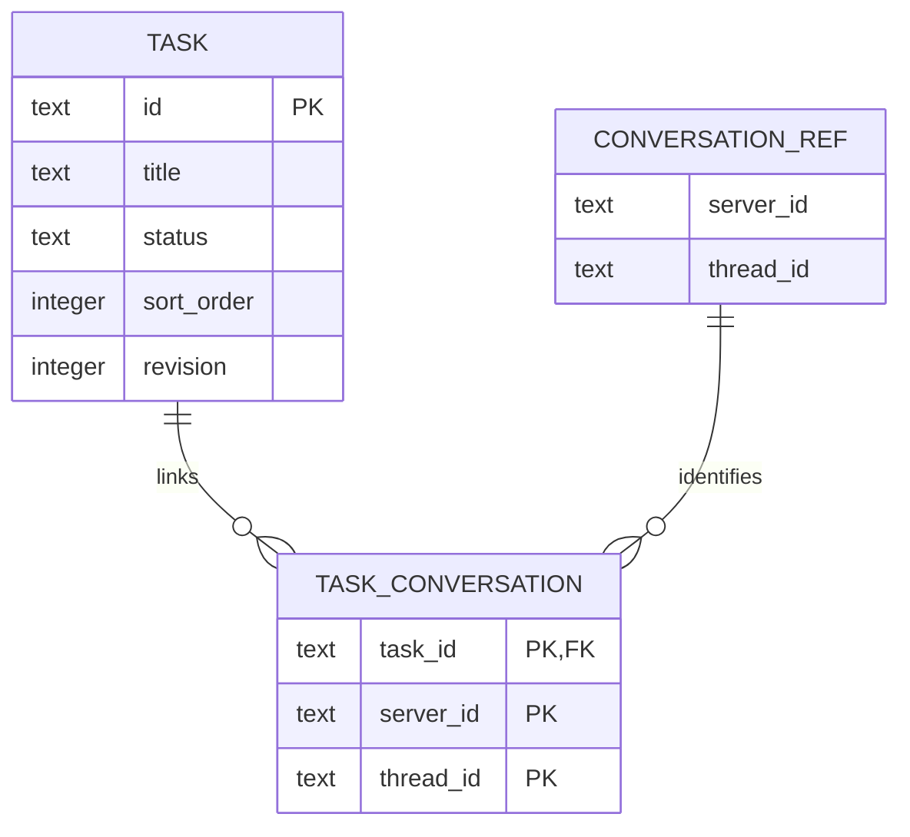

# Tasks 与看板领域模型

状态：首版源码已实现，2026-10-11；运行产物与验证状态见下游产品工作区的实现记录（不在本仓库）。

用户确认：任务是独立业务记录，看板是任务视图。用户进一步要求旧卡片不迁移、不纳入新模型，不增加迁移、兼容或其他无必要实现代码。

## 核心关系

任务与会话关系两张业务表为 `tasks` 和 `task_conversations`；v2追加轻量团队目录 `task_members`，v4追加 `task_events`。SQLite 存结构化行，后端拥有数据库；展示插件通过领域 API 读写。



`CONVERSATION_REF` 是现有会话的外部引用，不新建会话表。列表和看板读取同一批 Task；列表行、看板卡片都是投影，不另存一份记录。

## tasks

| 字段 | SQLite 类型 | 含义与约束 |
|---|---|---|
| `id` | TEXT | 不透明稳定 ID，主键；创建重试复用同一 ID |
| `title` | TEXT | 非空任务标题 |
| `description` | TEXT | 任务说明，可为空字符串 |
| `status` | TEXT | `backlog / todo / in_progress / in_review / done / canceled`；V1 全局新建默认 `backlog`，列内创建沿用该列；协议要求显式传值 |
| `project_server_id` | TEXT NULL | 可选的现有项目所属 Server |
| `project_id` | TEXT NULL | 可选的现有项目 ID；与上一字段同时为空或同时有值 |
| `sort_order` | INTEGER | 同状态内的手动顺序；项目过滤共用这一顺序 |
| `revision` | INTEGER | 正整数，内容、状态、顺序、关联发生变化时递增；独立追加进展不递增 |
| `created_at` | INTEGER | 后端生成的创建时间，Unix 毫秒 |
| `updated_at` | INTEGER | 后端生成的最近修改时间，Unix 毫秒 |
| `deleted_at` | INTEGER NULL | 删除标记；列表默认排除，ID 不可重用 |
| `kind` | TEXT | v4追加；固定事项类型，旧行默认 `unclassified` |
| `acceptance_criteria` | TEXT | v4追加；独立验收标准，旧行默认空字符串 |

没有项目归属的任务也可以存在。项目引用复用已有项目身份；任务归属项目与会话执行位置分开，可以关联另一台机器上的会话。不新建独立 Tasks 项目体系、编号前缀、标签、子任务、评论或附件表。v2根据实际需求追加负责人、优先级、截止日期与团队目录。

基础约束：STRICT 表；标题和 ID 校验；状态枚举 CHECK；项目引用成对 CHECK；revision > 0。基础读取索引为 `(status, sort_order, id)` 的未删除行索引；项目过滤确有查询需要时加对应组合索引。

## task_conversations

| 字段 | SQLite 类型 | 含义与约束 |
|---|---|---|
| `task_id` | TEXT | 本库 Task 外键 |
| `server_id` | TEXT | 已有会话身份中的稳定 Server ID |
| `thread_id` | TEXT | 对应 Server 中的 Thread ID |
| `created_at` | INTEGER | 关联建立时间，Unix 毫秒 |

复合主键为 `(task_id, server_id, thread_id)`，重复关联不会生成重复行。一个任务可关联多个会话，一个会话也可参与多个任务。通过 `(server_id, thread_id, task_id)` 索引反查当前会话的所有任务。

不复制会话标题、消息、执行结果、工具记录或运行状态。运行时 Host/profile、Hub route、lease、epoch、连接地址、凭据不进入任务关联表。`server_id` 由既有 ServerOrigin resolver 提供，插件不能自行从展示名称或机器位置推导身份；当前直接连接兼容映射仍由平台现有边界处理。

关联操作通过现有会话读取能力核实引用；断线时读取失败应保留已有关系并展示不可达。项目和会话来自外部 authority，不能设置跨数据库 FK。会话归档、删除或失联不级联删除任务；解除关联也不会删除、停止对应会话。

会话选择器与引擎无关，消费当前应用已启用的Host及其标准thread/list、thread/read；Codex Host（包含受管站点的local-codex）与DSH Host均支持。默认选择当前聊天连接，可显式切换其他连接。任务存储Host不决定可关联会话的引擎。读取期间明确显示加载状态，空结果和失败分别呈现；切换连接/搜索立即清除旧选择，迟到目录不能覆盖新连接。关联前仍核实所选Host/Thread，打开会话复用应用Router。

## 看板和列表

看板按 `tasks.status` 分列，列是上述六种状态的固定呈现。列标题走 i18n，不能把显示文字当状态 ID。卡片显示 Task 标题、关联会话数量和活动集合，不展开长说明或状态表单；标题打开任务详情，保留一个直接打开关联会话的快捷入口，完整会话列表由详情呈现。

列表使用独立紧凑行，显示标题、状态控件与活动摘要，不复用看板卡片。看板和列表不提供拖动、排序手柄或描述/验收标准提示图标。点击卡片被动区域或标题打开详情；描述与验收标准仍完整保留在详情中。状态通过详情/快速编辑或列表中的明确状态选项修改。详情使用共享模态视觉契约和 Radix Dialog 的弹窗卡片：宽容器使用内容区和属性栏，窄容器堆叠同一组字段；任务说明和关联会话位于主要内容区。标题/说明仍由显式保存提交，不增加自动保存写入者。点击弹窗外部、Esc 或关闭按钮收起详情，焦点回到仍有效的入口；写入期间禁用关闭。概览始终保留原节点、筛选与滚动，模态期间背景不可交互。关闭不保存、不丢弃输入；各任务未保存的草稿在当前扩展激活期保留，重新打开仍按原 revision 检查 CAS。跨应用导航仍由既有 Router 管理。

列表和看板复用任务查询、详情、筛选、状态修改和排序操作。一个状态下按 `sort_order, id` 排序；项目筛选或视图切换不会建立另一份排序。首版不建 `boards`、`board_columns`、`cards`、`board_tasks` 表，也不提供多看板、自定义列或保存筛选集合。后续确需保存视图时，只保存配置，仍读取同一批任务。

显式改状态通过既有 TASKS.move/CAS 事务追加到目标列末尾；后端保留排序字段与命令以兼容现有数据/API，界面不再提供拖动排序，不重写原有顺序。删除任务使其退出所有任务视图，不触碰会话。

## 两种状态

已有会话顶部的“…”菜单位于右侧面板按钮左边，提供“归属任务”。选择器可搜索现有任务、查看当前关系，并立即关联或解除；同一会话允许关联多个任务。空列表提供打开任务视图的入口。草稿尚无真实 Thread 身份，不显示此操作。

会话操作复用固定工作台后端的任务 API，每行按 task revision 写入并从 authority 重新读取确认；不迁移任务库、不修改会话、不启动执行。每行独立显示写入状态和失败结果。会话/账号切换卸载旧选择器，迟到结果不能更改新会话选择。

Task.status 表达业务进度。会话活动状态从既有 Runtime/Replica 读取，表达当前是否运行、等待交互、空闲、失败或不可达。关联表不拥有执行状态；断线不能当空闲，空闲不能当任务完成。

| 动作或事件 | Task 变化 | 会话变化 |
|---|---|---|
| 创建任务 | 默认待办 | 不自动创建会话；「新建会话」可保存任务并打开预填原生草稿 |
| 关联、解除会话 | 改关联、递增 revision | 不启动、停止或删除会话 |
| 显式改状态 | 改业务状态和顺序 | 不触发执行 |
| 会话开始、空闲、失败 | 刷新活动展示，业务状态不自动改 | 由 Runtime 更新 |
| 会话断线或不可恢复 | 保留任务和关联，显示连接状态 | 由 Runtime 投影 |
| 用户标记完成 | 改为 `done` | 不强制中断仍在运行的会话 |

多个关联会话的活动情况以集合展示；不能用“最后一个 Thread 的状态”覆盖整个 Task。读取失败可保留 Runtime 已有投影并标明不可用/过期，不在 Tasks 数据库引入第二份会话状态缓存。

## API 与所有权

首版领域操作只有：列出任务、读取详情、创建、修改、移动、删除、关联会话、解除关联，以及按会话反查任务。Task DTO 对应任务字段；关联 DTO 对应稳定会话引用；会话活动 DTO 由应用注入的只读 Runtime adapter 提供。

修改操作携带 `expectedRevision`。后端事务内校验任务未删除及版本，提交任务/关联/排序的所有变化；实际改动的任务行递增 revision。冲突返回明确错误，客户端重新读取 authority，保留用户草稿。关联插入可幂等去重，解除已不存在的关联可幂等返回。创建的同 ID、同创建内容可以确认既有结果，不同内容必须报冲突，不能复活删除记录。发送超时先重新读取，不能盲目重放。

提交成功后发领域变更通知，列表、看板和详情重新读取同一任务快照；通知与 SQLite authority 分开。没有连接时展示已有数据/不可用状态，不偷偷写入浏览器本地库。后端沿用当前身份作用域和授权边界，模型不承诺新账号隔离或跨 Server 自动同步。

任务数据使用固定的工作台后端 authority，聊天切换 Host 不切换任务库。首版使用新的 `tasks.sqlite` 和独立基线，已有 `kanban.sqlite` 不接管、不转换。物理路径由后端决定，不交给插件或 Renderer。

数据库后续正常升级遵循 [SQLite 生命周期](sqlite-lifecycle.md)；首版只创建带校验和的独立 schema 基线，不编写旧接口兼容层或旧数据转换代码，也不删除用户的旧数据库。

## 工程执行的扩展边界

Tasks 保持业务记录和会话关系。Delegate、执行重试、并发、定时、工作流及 PR 属于执行/工程层，首版不因模型设计而增加这些表或空实现。

后续接入委派时，执行层通过既有 Host/Thread 接口执行并把稳定会话引用关联回 Task。任务关联不是执行请求：不能只靠创建一行关联就声称已派工。跨数据库和远端启动不具有同一 SQLite 事务；正式提供 Delegate 前，执行层必须定义持久请求、去重及失败恢复，不在 UI 临时拼一次 spawn 当成完成。

当前手动使用流程复用原生聊天：详情选择执行连接，点击「新建会话」保存任务并打开带标题/说明的聊天草稿，由用户核对模型、工作目录后点击发送。同 Server 的任务项目传入原生项目与目录；另一 Server 的会话使用其自身工作区，不把其他机器的项目 ID/路径带过去。首次 `thread/start` 返回稳定回执即关联任务，首次 Turn 失败也保留该会话关系；打开草稿不创建 Thread、不发送 Turn、不自动改变任务业务状态。

执行连接与「新建会话」在宽容器中按控件底边对齐，标签不参与按钮对齐；窄容器中同一组控件堆叠，按钮靠起始边并保留共享触控尺寸。只改变排布，不复制控件或草稿。

应用拥有按产品/账号隔离的客户端交接记录，只保存 draftId/taskId 和已确认的 Server/Thread 回执，复用既有原生草稿持久化恢复输入。任务内容与关系仍只存 SQLite。关联失败或回执丢失先读取任务核对，再用当前 revision 重试关联；保留真实会话回执供打开和重试，不重放 thread/start 或 turn/start。账号撤销和应用销毁隔离迟到读取。卡片直接打开关联会话；详情可立即调整状态，保留尚未保存的标题/说明。新任务也能直接选择已有会话，保存与关联顺序执行，失败保留已保存任务和输入，不需要退出重进。

## 实施时验收

- 列表与看板操作同一个 Task，跨列移动可立即在列表看到同一状态。
- 同一个任务关联多个 Server/Thread，当前会话可反查所有关联任务，重复关联不会重复展示。
- 修改任务、关联变更及排序有真实 SQLite 事务和并发冲突验证；失败保留草稿。
- 切换聊天 Host 不改变任务库；断线、线程空闲或失败不自动完成任务。
- 删除任务或解除关联不停止、不删除会话；失联引用不使整个任务不可读。
- Web 在实际 Workbench 中验证；Electron 与手机真机交互需要各自产物验收。

## 参考与依据


OpenCraft 当前入口：`packages/workbench-runtime/src/client-hub-server.ts` 的 ServerOrigin；`packages/workbench-runtime/src/appserver-runtime.ts` 的会话执行接口；`plugins/tasks` 实现本模型，旧卡片不参与新模型。


## Agent维护与团队属性（v2）

`task_members(id,name,revision)`是显式维护的责任目录，不是认证账户或访问授权。稳定ID使用用户提供的员工账号、邮箱或其他标识；显示名称可修改，不能从姓名猜测真实身份。`tasks.assignee_id`引用该目录，允许为空；priority为none/low/normal/high/urgent；due_date为可空YYYY-MM-DD日历日期，无时区转换。逾期只用于提示与筛选，不改业务状态。没有迁移历史人物或猜测回填。

成员upsert与任务properties/update均携带expectedRevision；新成员用null，修改成员用当前revision。create/update可原子写内容与所提供的属性；properties/update至少提供一项，未提供的属性逐项保留原值，明确null才清空负责人或日期。旧客户端省略属性仍保留原值。每次字段修改、移动与关系写入仍在同一任务revision上竞争，冲突不盲重放。v1 SQL/name/checksum不变，v2追加schema迁移；升级前生命周期管理器备份，已有任务、删除标记、排序、时间与会话关系均保留。

看板卡片增加负责人、优先级、日期；详情弹窗保留属性栏，明确保存。概览提供搜索、负责人和逾期筛选；状态列保留各列任务数量，不展示标题标语或全局未完成/未分配/逾期统计行，列表/看板是同一数据投影。筛选与详情均展示成员稳定ID以区分同名；添加后选中该成员并收起表单。冲突/删除/失败提示在固定头部下方可见，不因手机内容滚动被藏在末尾；过期草稿保留并提供载入最新内容。未知成员展示其保存ID，不用当前登录者回填。

`plugins/tasks/src/agent.ts`由任务存储Host拥有，插件提供带专用随机token的127.0.0.1 HTTP入口，复用同一个TasksService和变更通知，不另开任务库、不暴露通用Host RPC。CLI由该插件生成并位于opencraft-tasks/scripts/tasks.mjs；默认20条简短结果，最大100，支持offset、search/status/assignee过滤，read才加载单任务详情。变更默认仅返回受影响任务摘要，成员修改只返回成员，避免整库进入模型上下文。

全局Skill通过既有DSH文件系统目录、显式本机Codex runtime skills根发现，仅名称和简短description常驻，正文与CLI help按需读取；不会给每次Turn追加说明或注入看板。应用生命周期退出撤销endpoint/token并移除自己登记的symlink；任务和成员数据不删除。不会覆盖同名用户Skill。远端SSH/外部引擎没有自动获得本机CLI访问；需要真实受支持的连接才能维护本机看板。

CLI支持list/read/create/update/properties/member/members/move/remove/link/unlink/for-conversation/conversations。list/members/for-conversation支持limit/offset，查询拒绝未知字段和无效筛选，任务搜索覆盖标题/说明但输出仍是摘要。conversations使用原生nextCursor继续查询，不把本地offset冒充引擎游标。

会话发现默认返回本机任务Host的稳定DSH Server/Thread引用；显式serverId=local-codex查询原生thread/list。一体式Headless经现有AppHost lease查询；独立DSH部署使用显式配置的Core端点/私有token文件，创建仅本次只读查询的CodexNativeCoreTransport客户端，退出只释放连接，不启动第二引擎、不打开第二份存储、不读取历史正文。管理入口复用OPENCRAFT_CODEX_CORE_ENDPOINT与OPENCRAFT_DAEMON_TOKEN_FILE；两项必须成对且路径绝对，token文件同用户私有，缺失或错误不得静默退回另一台引擎。其他Server可使用已核实的外部引用，不根据展示名猜测，也不声称本机catalog能查询所有远端Host。关联不代表执行，会议纪要不提供额外授权。

宽屏看板列及吸顶标题使用主题既有不透明 `--color-background-surface`，保证卡片滚过标题下方时不透字；标题仍留在原列滚动容器，状态、计数与新建入口不随卡片滚走。窄屏保持共享状态导航，不恢复重复列标题或额外顶部留白。

窄屏任务概览将搜索与图标视图切换保持在一行，负责人/项目/逾期与刷新收在可展开的筛选入口，活动筛选有计数和清除入口。状态用水平标签导航，不重复呈现列标题和列内新建；顶部新建沿用当前选中状态。移动详情采用紧凑的属性行、较短说明编辑区和轻量关闭/删除操作，保留44px触控目标、可访问名称、输入字号与显式保存。筛选展开只控制呈现，关闭不会清空筛选，桌面仍常驻相同控件和业务状态。 标题、工具栏和状态导航保持紧凑留白；桌面和手机均不呈现标语或全局统计，展开筛选也不恢复它们。列表模式省略状态导航，保留44px操作与16px移动输入字号。

“我的任务”复用负责人查询（assignee=mine），与搜索/项目/逾期相交，看板和列表相同；快捷入口再次点击或清除筛选恢复全部。平台仅向View投影账户提供方已验证的稳定主体ID和显式handle，Tasks仅将handle精确匹配已注册成员ID，不用显示名猜人，也不依赖企业身份实现。未匹配或匿名时用户明确选本人成员；选择只存客户端偏好，按任务authority与provider/subject隔离，匿名为独立的手动查看偏好。刷新可恢复选择，切换身份重新求值；成员移除不继续显示旧成员。筛选不会创建成员、写任务或授予权限。

## 成员头像资料

v3给`task_members`追加可空`identity_kind`和`identity_id`，成对存在；API以可选`TaskMember.identity: {kind,id}|null`投影。`members/upsert`沿用成员revision/CAS，省略identity保留，显式null解除；旧客户端和旧成员继续可用，迁移不推断身份、不改变原成员revision、任务负责人或会话关联。能力`memberIdentity:true`控制资料编辑入口，旧Host不宣告则不展示该操作。CLI `member`与负责人详情中的“头像资料”可显式维护；employee的id填写明确的员工登录账号。

看板卡片在全部内容与会话入口之后，以底部左侧头像呈现负责人，不显示姓名或“未分配”文字；悬停提示与图像可访问名称保留完整负责人语义。优先级与日期仍在底部元信息中呈现，列表与详情保留可见姓名。照片加载/失败和未分配继续使用同一头像回退槽位。

Tasks通过公共`IdentityAvatarContext`解析资料引用，由`AvatarImage`统一处理加载期间与失败回退；照片成功加载前保留姓名缩写，避免慢请求留下空白。身份缺失、未知kind、无provider（包括企业身份未启用）或图片不可达均显示姓名缩写，保持24px几何。成员不存照片URL、Cookie或凭据，不引用企业身份实现；头像资料不用于登录、权限或“我的任务”的账号匹配。迁移时已有成员保持空关联，必须显式绑定。数据库回退须保留对v3 schema的兼容，不以部署前旧库覆盖后续用户写入。

显式改状态通过既有 TASKS.move/CAS 事务追加到目标列末尾；后端保留排序字段与命令以兼容现有数据/API，界面不再提供拖动排序，不重写原有顺序。删除任务使其退出活动任务视图，进入七天回收站，不触碰会话。

## 七天回收站

复用原有 `deleted_at` 软删除行及 `task_conversations`，不新建第二份任务库，
不修改已发布的 v1 SQL/hash。任务 authority 在 capabilities 声明
`recycleBinRetentionMs`；支持时普通任务快照另带 `recycled`，仅包含
`deleted_at > serverNow - 7 days` 的行，按删除时间倒序。旧 authority 缺少
声明时客户端不展示回收入口，普通任务能力继续工作。

`opencraft/tasks/restore` 携带 id/expectedRevision，在同一 SQLite 事务校验
删除标记、服务器时间期限、revision 和 1000 个活动任务容量上限。恢复保留
ID、创建时间、状态、项目、描述和全部关联，追加到原状态列末尾，清除删除
标记并递增 revision。删除后正好七天即不可恢复。过期记录维持既有删除
tombstone/ID 不可重用约束；恢复期限不是物理清除数据库记录的承诺。

恢复不触发任何会话执行、创建或删除。多窗口冲突及响应丢失先重新读取
authority，不盲目重放恢复；领域通知仍复用 tasks/changed。回收站属于同一
任务工作区，不宣称新增租户或单人私有隔离。旧软删除行在期限内同样可恢复。

任务工具栏提供回收站与返回任务入口，说明可恢复期限，每行展示原状态、
恢复截止时间和描述展开入口。主列表与看板保持挂载以保留滚动；回收列表
是同一数据库的只读投影。异步错误通过平台注入的 reportError 进入既有
Workbench 通知，不追加撑高列表或菜单的错误块。Web 的普通 View 和设置
View 均提供同一个通知 owner；可选端口允许未承载通知的测试/其他适配器。

验证：tasks-sqlite/tasks-controller/tasks-host 测试与
`scripts/smoke/tasks/smoke-tasks-recycle.ts` 的真实 Task View + SQLite 服务边界。

Delivery on current v3 retains tasksMigrations v1/v2/v3 SQL, names and checksums unchanged. Restore updates deletion flag/order/revision/time only; all task properties, member profile identities and linked conversations remain intact. Recycle entry stays visible in the page heading in narrow and desktop layouts.
Task description has an explicit expand/collapse control; the same textarea and unsaved draft persist. Compact height is 180px; expanded height follows the available viewport. Toggling is presentation only and never saves the task.


## Tasks V1 upgrade preparation

The compatibility release recognizes exactly the declared additive v4 migration
(kinds, acceptance criteria and task events), with unchanged v1–v3 checksums and
strict full-schema validation. It leaves a v3 database at v3. This provides a
specific rollback reader before enabling the V1 writer; it does not permit
arbitrary future schemas or restore an old backup over newer task data.

## Tasks V1 planning and collaboration

V1 的写入版本启动时应用上述 v4；兼容读取版是部署过渡与保留数据的回退版本。
v1–v3 SQL、名称与 checksum 保持原样。升级只追加两列、事件表与索引，
不重写旧记录的 ID、状态、顺序、revision、时间、属性、成员或会话关系，
不解析旧描述，也不伪造历史事件。旧客户端省略新字段的更新保留原值。

固定类型为 `feature`（功能需求）、`improvement`（改进优化）、`bug`（缺陷修复）、
`engineering`（技术建设）、`harness`（Harness 建设）、`research`（调研验证）、
`documentation`（文档知识）、`operations`（发布运维）、`growth`（运营增长）、
`task`（通用任务）及 `unclassified`（未分类）。本版不提供类型配置系统。
写入仅接受已声明的类型；读取保留未知类型，界面原样显示，编辑其他字段时不回写未改变的类型。
验收标准为独立纯文本，最大 16,384 字符。模板由用户显式使用，且只填充空的描述和验收标准。

`task_events` 使用服务端递增 seq、全局唯一 event_id、Task 外键、发生时的 task_revision、
type、可信调用上下文 actor/channel、JSON payload 和服务端时间。
创建、内容/属性更新、状态变化、关联/取消关联、删除/恢复与业务写入同一事务提交。
纯排序不产生事件；事件 payload 记录变化字段或引用，不复制完整描述/验收文本。
actor 只能来自可信宿主上下文；请求不能声明操作者。当前 API 未提供已验证身份时保存 null，
Agent 通道也不把负责人或执行引擎推断为人类作者。此记录不是具备身份认证保证的审计系统。

`opencraft/tasks/events/list` 按 taskId、可选 beforeSeq 分页，默认 20、最大 100 条，
seq 倒序；`events/read` 按 taskId/eventId 精确核对，允许核对尚未清理的删除记录。
`progress/append` 接受 taskId、稳定 eventId 与 1–4096 字符纯文本，独立事务提交，
不修改 Task revision、updatedAt、业务状态或顺序。同一 ID 与内容重放返回原事件，
内容冲突拒绝。写入回执丢失先按精确 ID 核对，不能仅看最新一页后重新生成 ID。
进展不会自动启动、结束或重试会话。
分页的连续水位来自已完整读取的头页，独立于本地接受的进展事件；后者不能掩盖
两次读取间超过一页的中间活动。新头页存在缺口时保留继续补读的游标，按 eventId 去重。

列表批量投影各 Task 最近一条显式进展；卡片只摘要展示，长内容留在详情。
会话的 active/idle/error 活动仍使用原来的只读 Runtime 集合，不混入业务完成状态。
关联会话读取由当前 View 持有一轮最多 4 个请求的共享预算；轮询、任务快照和活动
通知在读取期间合并为一次后续刷新，不创建重叠批次。失败保留同作用域的已知状态；
离开页面、账号或 Host 配置作用域变化时取消旧读取，旧 worker 不再继续派发或发布。
删除任务保留七天的既有可恢复窗口；过期墓碑和关联/事件仍保留，ID 不可重用。
本版不新增物理清理任务。

Capabilities 仍为 version 1，追加可选 planning、supportedKinds、activity、progress。
UI 根据实际后端声明展示新增能力；刷新重新探测独立 Host 升级，不以 Web 版本推断后端支持。
Agent CLI 与 UI 共用 TasksService、事务和通知；CLI 新增 kind 过滤、验收字段、
events/event/progress/restore 命令，默认列表仍返回受限摘要。

新建原生会话先保存 Task，再从 authority 读取最新内容。交接上下文包含类型、状态、
描述最多 4000 字符、验收最多 3000 字符，以及最近活动页和摘要中的最多三条显式进展
（各最多 800 字符）；不把整份历史送入上下文。原有原生草稿、用户显式发送、
Thread receipt 关联和丢失回执核对流程继续负责执行，Tasks 不另建执行系统。

快速编辑、完整详情和 View 导航消费同一个 activation-scoped 草稿 owner。
只保留未保存草稿；干净卡片重开读取最新内容。窄容器用内容/活动页签，保留同一输入实例。
进展草稿与 Task 内容草稿独立；详情关闭或切换呈现不会取消已经提交但正在核对的进展。
浏览器完整重载不承诺保留普通 Tasks 草稿。

验证入口为 `test:tasks`、`smoke:tasks:v1` 和 `smoke:tasks:workbench`；
`preview:tasks:workbench` 使用独立数据与真实服务。浏览器模拟窄屏不等同物理手机或
打包 Electron 的交互验证。交付必须分别核对 Web revision 与独立 DSH Host 的运行产物/能力，
旧 Host 仍有活动工作时不以更新 Web 冒充后端升级完成。

## Retained task archives

Manual archival is independent of the six workflow statuses and soft deletion.
The additive, frozen v5 migration adds nullable `tasks.archived_at` and paging
indexes; previous columns, migrations/checksums and task revisions stay intact
on upgrade. Existing tasks default to unarchived. Completing a task never
archives it automatically. Archived records have no expiry or cleanup job.

`archive` and `unarchive` require id/expectedRevision and use the existing CAS
transaction and notifications. They retain content, kind, acceptance, owner,
priority, dates, original status, conversation associations and all activity.
They increment revision/updatedAt and append an `updated` event with
`{fields:["archivedAt"], archived:boolean}`. They do not change or execute
conversations. Unarchive appends to the original status column and checks the
active workspace capacity. Archival frees one active slot.

Ordinary snapshots, active ordering and conversation task projections exclude
archived rows. `read(id)` and activity reads retain access; content, properties,
move, progress, link/unlink and deletion reject archived tasks until restored.
Archive is not the seven-day recycle bin. IDs remain reserved.

`opencraft/tasks/archive/list` accepts optional search (up to 200 characters),
limit (default 50, max 100), and before `{archivedAt,id}`. It returns a bounded
TaskDetail page and nextCursor ordered by archived timestamp then ID descending.
Search is literal substring matching over title, description, acceptance and ID;
ASCII is case-insensitive and Chinese text is retained. Batch related data is
scoped to the selected page. Pagination is a live projection, not a historical
snapshot during concurrent archival/restores. Late query results are discarded;
failed refreshes keep already displayed rows and page cursors.

The board More menu opens Archives, with search, read-only full details,
conversation references, activity and Restore to board. Card More and a clean
saved editor expose Archive task; dirty editor content must be saved first.
Returning to the board keeps its filters, column scroll and editor draft owner.
No archive mutation is exposed until the actual authority declares optional
`archive:true` capability. CLI `archived`, `archive` and `unarchive` use the same
service. Lost mutation acknowledgements trigger a read, never a blind replay.

Rollout requires a fixed aggregate compatibility-reader package before the v5
writer, with consistent backup, old-column/ledger comparison and actual Host
capability verification. A rollback keeps the v5 database and uses the declared
v5 reader; do not restore old data over later work or run v3/v4-only readers on
v5. Web deployment alone cannot upgrade a separately running storage Host.


### Tasks archive upgrade preparation

The archive compatibility reader recognizes the exact additive v5 migration
(`task-archive`) only when the existing migration ledger already declares it.
It validates the full schema and checksums, rejects arbitrary future structures,
and does not apply v5 to older databases. It omits archived rows from active
projections, ordering and capacity checks and rejects legacy writes to archived
records. This reader supplies the rollback package before the archive writer is
enabled; rollback retains the newer database and never restores an old backup
over subsequent user work. Web and independent storage Host versions must be
verified separately.

An archive restore with a lost acknowledgement/conflict also rereads an open
read-only detail. A task already restored by another writer leaves that detail;
it is not blindly restored again. Storage startup reports the new applied v5
outcome separately from unrelated owner versions.
The Agent CLI archive query returns compact summaries (20 by default, max 100)
and the server cursor; `read` supplies full retained content on demand.


## Conversation overview

Tasks offers an optional read-only conversation statistics tab through `ConversationOverviewPort`.
It does not join only linked tasks or reuse a loaded sidebar subset: enabled sources are paginated
through native interactive Thread catalogs, including archives, with host/thread identity deduplication.
Ephemeral entries and native-default subagent exclusions stay outside this scope. A disconnected
source is explicitly incomplete, never a zero. Native pins include entries outside recent pages.

Current state is independent of the selected date range. Completion requires the latest native
turn to succeed and no active run; cold (`notLoaded`) native runtimes still require the successful
latest result. Active approval/input waits, failed/interrupted turns, missing results and empty
conversations remain distinct. Only latest-turn metadata is read, with four concurrent requests;
no message bodies, resuming, sending, or task mutation. A source/client connection change fences
late data; cancellation and unmount stop the scan. Reads occur only while this tab is mounted,
with manual refresh and a 30-second visible-document refresh.

Calendar presets/custom inclusive dates use the device zone. New counts use `createdAt`, activity
uses `updatedAt`, and completion trends count each currently completed conversation once using
the latest turn's real `completedAt`. They are not historical per-turn throughput. Missing native
completion timestamps stay out of trends. Archives are an independent retention dimension.

An optional trusted `threadParticipation` contribution supplies accepted-message participant
identities, separately from creator identity. Core never imports a private product protocol or
infers identities from badges. People analysis counts known participants of period-updated
conversations, not period message counts, effort, or individual productivity. Unknown/pending
rows remain unknown and the coverage denominator is displayed. Tasks filters/edit drafts and
SQLite authority are unaffected; light/dark and touch layouts consume design-system tokens.

A refresh that cannot read any source retains the last successful snapshot within the same account and source scope; the existing freshness status reports the failure without inserting an error block. Cold unavailable reads show unknown counts. Account/source changes still revoke the snapshot.

The statistics renderer and its styles load on first selection of the statistics
tab. The tab uses React Suspense with the existing conversation-loading status
while code arrives; read state, account scope and periodic refresh stay with the
same statistics component. Opening Tasks alone does not load this optional view. Its native read adapter
also loads only on the first read; cancellation is checked after import before
any request can begin.


## First-round AI research triage

The optional capability `aiResearch:true` exposes the board field AI research.
`aiResearch` is `unassessed`, `proactive`, `needs_context` or `needs_decision`;
`aiResearchReason` is at most 2048 characters and required for assessed modes.
It describes whether AI can initiate preliminary research, independently of task
status, ownership, priority and conversation activity. It neither starts work nor
measures decision waiting. A coordinator assesses the actual goal and available
context, identifies missing material or a precise human decision, and records a
concise rationale. Lack of an assignee alone does not prevent read-only research.

Existing tasks project unassessed with an empty reason; no historical assessment
is fabricated. API create/update/properties accept the optional fields; omission
preserves the latest pair, and a nonempty rationale is required for assessed
modes. CAS and existing archive read-only rules apply. Successful changes append
one structured created/updated event in the same transaction as task revision
and time changes. The event stores the complete small assessment pair. The latest
assessment is projected from that task's event sequence; batch snapshots fetch
latest assessments in one scoped query, not one query per card. No new schema,
column, migration checksum or second storage owner is introduced. Legacy writers
preserve the assessment; rollback readers ignore the additional event payload and
can continue to use the same v5 database. Read-only event history retains prior
judgments. Existing progress reports remain independent.

UI uses one existing task draft for the selector and rationale; save is explicit,
unknown values survive unrelated edits, filters and card/list summaries use the
same authority projection. Capability-absent Hosts hide editing/filter controls.
The CLI exposes disposition in summaries and `list {aiResearch}` filtering; read
returns the rationale and properties updates the assessment.


## Morning overview

The board heading includes a Morning overview action. It opens a read-only, whole-board projection of the current task authority, independent of browse filters; Back restores the prior browse view, filters, scroll, editor drafts and entry focus. The mounted browse view retains its owner. The four product metric cards (users, active users, instance inventory and submission level) are explicitly awaiting data. No synthetic zeroes, trends, quota or health claims are shown.

Among non-terminal tasks, existing research assessments populate needs-decision and needs-context groups with recorded rationales and a direct task-detail action; ready-for-research and unassessed items remain in a collapsed pool. A research assessment never implies a stage output, active AI execution or a decision-ready handoff. Waiting times remain explicitly unavailable until a real handoff contract is implemented. Unsupported capability, initial loading, errors and retained background snapshots follow the existing task controller; this view performs no task mutation or scheduling and adds no storage.

### AI collaboration board and compatibility

AI follow-up remains a peer of Board/List. It now displays **all active tasks** in
Todo, Working, Needs you, In review and Ready to merge. Deleted, archived, done
and canceled rows are excluded. Morning remains separate for future risks and
key exploration; this change adds no business metrics or risk workflow.

Existing task rows, six workflow statuses, research dispositions, links and
immutable migrations are unchanged. Backlog/todo maps to Todo; in_progress to
Working with execution explicitly unverified; in_review without a verified
human request maps to In review with review method unverified. Business status
alone never asserts an AI run, automatic review, passed checks or merge readiness.
Done is not Ready to merge. No drag or simulation controls change execution facts.

The original `AI_RESEARCH_HANDOFF_V1\n` envelope with exactly output, decision and
nextStep remains readable. The later server time of its first valid report in
the current review cycle and review entry remains the waiting origin. Leaving
review, deleting or restoring ends that cycle. Ordinary messages never reset it.
Old research triage alone cannot create a human request or a timer.

For explicitly recorded collaboration facts, existing progress append accepts:

```text
AI_FOLLOW_UP_V1
{"lane":"needs","phase":"方案","summary":"范围对比材料已就绪","artifact":"范围方案 v2 · 关联会话内","decision":"先完成个人闭环还是团队协作？推荐个人闭环。","roundId":"scope-round-2","judgeId":"member-id"}
```

Allowed lanes are todo / working / needs / review / ready. Required nonempty
strings are summary and artifact. Phase is optional. Needs additionally requires
a nonempty decision and roundId; judgeId is an optional explicit member ID or
null for unclaimed. Never infer the judge from the task Owner. Other fields,
client timestamps, malformed JSON and reports over the existing 4096-character
limit are not treated as facts. The material reference is descriptive text; it
never creates a URL or bypasses the existing conversation resolver.

Writers first move to the appropriate business status (todo/backlog for todo,
in_progress for working, in_review for needs/review/ready), then append a fact
using a stable event ID. A workflow status change closes the structured cycle.
Only compatible facts determine a lane. Repeating a needs report for the same
roundId or changing its judge preserves the first server timestamp; entering a
new round uses a new roundId and starts a new decision-round clock (not lane dwell). Ordinary progress is ignored
by the projection. To end a wait, record the valid response and move to todo for
work not yet started; publish working only after actual execution starts. Review
and ready must describe observed checks/readiness, never an inferred result.
This is a durable report convention, not an executor, CI integration or approval
API. Ready does not imply merged, deployed or completed. Non-code tasks need no
invented PR. Existing progress text, CAS mutations and backend actor provenance
remain authoritative; the view does not create another writable state store.

The board reads bounded lifecycle history (up to 50 pages of 100 events), reuses
unchanged rows, limits concurrent reads to four and fences stale results. Failed,
stale or incomplete history has no inferred clock, with a scoped retry. Browsing
adds no storage, migration, scheduling or write.

AI follow-up cards show **time in the current visible lane**, not time since the
last update or the original research decision round. Only active tasks with an
assigned Owner in Todo, Needs you and Ready to merge have this clock. Working
and In review, and unassigned tasks, have no clock. Owner is not the judge.
Entry comes from existing server activity; state changes/re-entry restart it,
while ordinary comments, edits, reassignment and repeated facts in the same lane
(including a new Needs round) do not. Backlog/todo share one visible Todo lane.
Deleted/restored lifecycle boundaries restart the interval. The start is the
later of verified lane entry and the product-supplied fixed rollout floor
`TasksExtensionPorts.followUpDwellSince` (Unix ms; optional, default 0).
Web assembly exposes `VITE_TASKS_DWELL_SINCE`; no date/tenant is hardcoded in the
plugin. Refreshing, navigation or rebuild never changes that origin. Needs is
sorted by the displayed dwell origin, with unknown/unassigned clocks last.
The original research handoff/round timestamps and 72-hour helper remain intact
for other consumers; this clock does not label a person overdue or claim AI execution.

Cards show the shared task-kind badge, title, a bounded decision when applicable,
current state/time and Owner. Full report and material contents stay in original
activity/conversation. Card body/title/metadata/Owner are static selectable text,
never an implicit click target. The only card action is a persistent quiet Open
chat text button with a directional arrow; multiple chats retain the original
accessible menu and exact Server/Thread resolver. No View details button or
missing-link placeholder is shown. Without a navigable chat the card has no action.
Task editing remains reachable through the ordinary Board/List workspace; those
entries are not merged in this visual update. Judge and Owner remain distinct;
avatars retain the existing profile identity resolution.

Lane headers explain each category directly above the cards, without column
borders, backgrounds, enforced empty height, or colored top edges. Cards have one
subtle outline; state and action rows have no additional separators. Owner and
chat share a lightweight bottom row. The shared quiet control owns pointer,
keyboard focus and touch density; only its text receives accent emphasis.

The view starts directly with its filters. No introductory slogan or separate
sort-order caption is displayed; the result count and Needs you ordering remain.

Owner filtering supports all, a stored member ID and unassigned. All/Needs me/My
work and material/title search apply to every lane and count. Needs me matches
only an explicit judge and the established current member, never a guessed login.
Selections persist across Board/List/conversation remounts in the same activation,
scoped to task authority and verified account. Ordinary board filters stay
independent. Needs you sorts by the displayed lane-dwell origin; other lanes use stable task
order/ID. Five columns stay in one horizontal row; only the board scrollport scrolls horizontally when the Tasks container is narrow.
Narrow layouts may hide the redundant Owner text label, never the shared select wrapper or its accessible control.
Typography, colors, focus, touch targets, shared controls and Radix behavior come
from the existing design owners. No synthetic prototype task or simulate button
is shipped.
