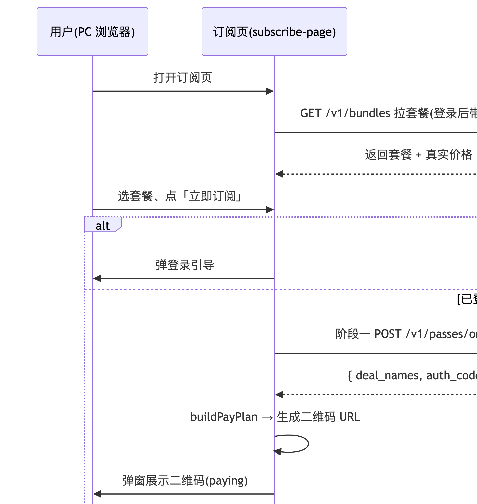
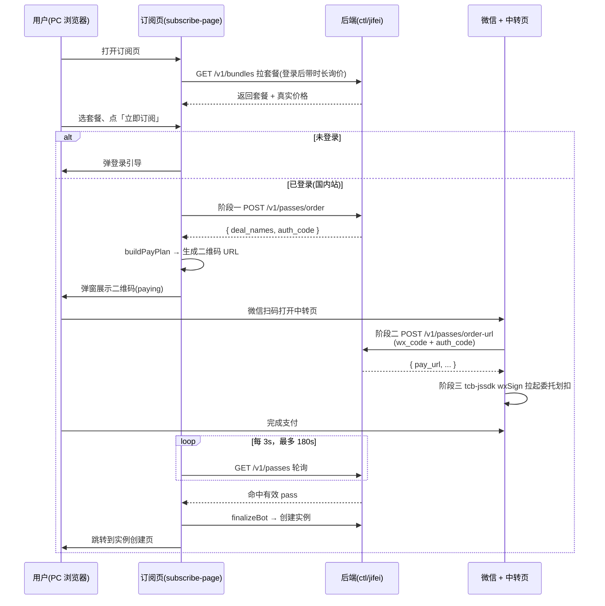

# 前端国内站计费流程说明

> 面向对象：前端 / 后端 / 产品 / 测试同学，用于快速理解 lightvela.com（国内站）的订阅计费链路。
> 代码基准：`frontend/next-site/subscribe-page.tsx`（v1.7.31 起统一 bridge 中转页二维码方案）。
> 后端接口联调细节见代码注释多处引用的《ctl-frontend-billing-api.md》（§2 新购 / §3 续费等章节号，该联调文档由后端维护，未随本仓库提交）；
> bundle 字段（含 `time_span` / `time_unit`）定义见 [`codesign/ctl-bundle-feature-fields-api.md`](../../codesign/ctl-bundle-feature-fields-api.md)。

---

## 一、一句话概述

国内站用户在订阅页选套餐 → 前端下单拿到「订单号 + 一次性鉴权码」→ 生成一张二维码 → 用户微信扫码，在**中转页**完成微信委托划扣 → PC 端轮询到权益（pass）后自动创建实例并跳转。

整条链路遵循 **CodeBuddy AuthCode 安全模型**：二维码里不含任何登录 token、不含支付 URL，只有一次性、短时效的鉴权票据。

---

## 二、几个前置概念

| 概念 | 说明 | 代码位置 |
|---|---|---|
| **站点分流** | `isGlobal=false` 为国内站；国内站才走真实计费，国际站仍是「限时免费」内测视觉 | `mapBundleToPlan` 内 `paid = paidBillingEnabled && !isGlobal` |
| **计费开关** | 运行时配置 `paidBillingEnabled`，决定是否放开真实付费 | `usePaidBillingEnabled()` / `isPaidBillingEnabled()` |
| **付费时长** | 月付 `monthly` / 季付 `quarterly`，全局作用于所有可购买套餐；默认月付 | `aiDurationKey` / `AI_DURATION_TABS` |
| **Pass（权益）** | 后端计费主体，一个 pass = 一份已生效的订阅权益 | `listMyPasses` / `createPassOrder` |
| **中转页（bridge）** | `/auth/wechat-pay`，微信内打开，负责拉支付 URL + 拉起划扣 | `NEXT_PUBLIC_WX_PAY_BRIDGE_BASE_URL` |

---

## 三、整体流程图



<details>
<summary>展开 mermaid 源码（改图时同步此处，用 <code>render-billing-flow.html</code> 重新导出 png）</summary>



</details>

---

## 四、分阶段详解

### 阶段 0：进页与拉取套餐

- 入口：`useEffect` 按 `loadKey` 触发 `listBundles`（`GET /v1/bundles`）。
- **未登录**：不请求后端，直接用前端静态定价表 `buildStaticBundles(durationKey)` 填充（匿名调用后端 price 返回 null，会全线落到「暂无报价」，体验差，故走静态）。
- **已登录**：
  - 月付（默认）：无参调用（后端约定「无参 == `time_span=1&time_unit=m`」），复用首屏结果。
  - 季付：带参询价 `{ time_span, time_unit }` 重拉，覆盖价格。
- 询价加载中（切时长、价格未回）：保留旧价 + 小 spinner，CTA 禁用，避免「旧价 + 新单位」误导。

### 阶段 1：套餐展示（价格 / 促销 / CTA）

核心函数 `mapBundleToPlan`，按「计费开关 × 站点」二维分流：

- 国内站 + 开关开启：消费后端真实价 `bundle.price.real_total_cost`（单位分，`centsToYuan` 转元）。
  - 无价（trade 故障 / 未登录）→ CTA 显示「暂无报价」并禁用。
  - 折扣：后端 `discount` 优先；无则按套餐名兜底文案（启航「首单免费 14 天」/ 巡游「首月 5 折」/ AI「首月 6 折」）。
- 远航（voyage）：强制「敬请期待」，屏蔽价格与下单。
- AI 增强版：登录后月付 / 季付均已放开（`aiReleased = isLoggedIn`）；未登录统一「敬请期待」。

CTA 文案优先级：`当前订阅` > `已售罄` > `询价中...` > `暂无报价` > `免费订阅`（0 元试用 / 引导态）> `立即订阅`。

### 阶段 2：点击订阅的调度

`executeCreateBot(plan)` 统一调度：

```
未登录            → 弹登录引导（handleSubscribe 内下沉）
国内站 / 付费开启  → startPaidPassOrder   （付费下单链路）
免费 / 国际站      → startTrialPass       （免费试用链路，POST /v1/passes）
已有有效 pass      → 直接 finalizeBot     （跳过下单，直接建实例）
```

### 阶段 3：付费下单（CodeBuddy AuthCode 两阶段）

`startPaidPassOrder`：

1. **阶段一（PC 端）**：`createPassOrder({ bundle_id, period, time_unit })` → `POST /v1/passes/order`，返回 `{ deal_names, auth_code }`。
   - 计费开关开启时，`period/time_unit` 用当前选中的全局时长；否则用 bundle 自带 `time_span/time_unit`。
2. **生成二维码**：`buildPayPlan({ dealName, authCode, bundleName })` → 拼出中转页 `bridgeUrl`（纯函数，无副作用）。
3. 弹窗切到 `paying` 状态，`PaymentPendingModal` 用 `QRCodeSVG` 渲染 `bridgeUrl`。

> PC 端**不调** `getPassOrderUrl`：因为 jifei 的 `pay_url` 生成时绑定 `wx_open_id`，PC 端没有，提前调只会拿到错误 URL。

### 阶段 4：中转页支付（微信内）

用户扫码打开 `/auth/wechat-pay`：

1. **阶段二**：中转页用 `wx_code + auth_code` 调 `getPassOrderUrl`（`POST /v1/passes/order-url`）拿 `pay_url`、`need_charge` 等。
2. **阶段三**：`@tencent/tcb-jssdk` `wxSign` 拉起微信委托划扣。
3. 零元订单（`need_charge === 0`）由中转页判定并直接显示「已完成」，PC 端继续轮询接棒。

### 阶段 5：支付完成接棒（创建实例）

有两条接棒路径，任一命中即 `finalizeBot`：

- **自动**：`paying` 阶段轮询 `listMyPasses`（间隔 `PAY_POLL_INTERVAL_MS=3s`，超时 `PAY_POLL_TIMEOUT_MS=180s`），轮询到有效 active pass → 自动 `finalizeBot`。
- **手动兜底**：用户点「我已完成支付」→ `handleManualConfirm` → 刷新 pass + `finalizeBot`。

`finalizeBot`：`addBot` 创建实例 → `subscribe()` 刷新订阅态 → 关弹窗 → `navigate` 跳转到实例创建页。同时上报大同埋点（`SUBSCRIBE_PAY_SUCCESS` / `AGENT_CREATE_SUCCESS`）。

### 二维码刷新

`handleRefreshPayment`：二维码接近/已过期，或 `auth_code` 被消费时，复用 `startPaidPassOrder` 重新下单换新 `auth_code` + 新二维码。

---

## 五、安全模型（重点）

二维码 URL（中转页 query）**只携带最小支付上下文**：

| query key | 含义 |
|---|---|
| `d` | jifei 订单号 `deal_name` |
| `ac` | 一次性鉴权票据 `auth_code` |
| `e` | 过期时间 `expires_at`（unix ms） |
| `pid` | 续费场景 pass_id（新购为空） |
| `n` | 套餐名（仅 UI 展示，无鉴权语义） |
| `sb` | 沙箱标记 |

- **不含** Bearer token、**不含** pay_url、**不含** wx_open_id。
- `auth_code` 绑定 `user_id + deal_name`，一次性，TTL ≤10 分钟（前端二维码默认 9 分钟，留 1 分钟 buffer 防时钟漂移）。
- 截图泄漏的**最坏后果**：10 分钟内攻击者替受害者发起一次支付，**无法转走资金、无法续费、无法越权**。
- PC 端主站 Bearer 鉴权链路与二维码完全独立。

---

## 六、后端接口清单

| 接口 | 方法 | 用途 | 前端调用 |
|---|---|---|---|
| `/v1/bundles` | GET | 拉套餐 + 询价 | `listBundles` |
| `/v1/passes/order` | POST | 阶段一：新购下单（返 `deal_names + auth_code`） | `createPassOrder` |
| `/v1/passes/order-url` | POST | 阶段二：拉支付 URL（中转页，带 `wx_code + auth_code`） | `getPassOrderUrl` |
| `/v1/passes` | GET | 查询当前用户权益列表 | `listMyPasses` |
| `/v1/passes` | POST | 免费试用（国际站 / 老 pass 场景） | `createPass` |
| `/v1/passes/{id}/renew/price\|order\|order-url` | POST | 续费询价 / 下单 / 拉 URL | `getRenewPrice` / `createRenewOrder` / `getRenewOrderUrl` |
| `/v1/passes/order-and-pay` | POST | 下单+支付一体化（**仅联调，现网禁用**） | `createPassOrderAndPay` |

---

## 七、关键文件索引

| 文件 | 职责 |
|---|---|
| `frontend/next-site/subscribe-page.tsx` | 订阅页主体：套餐加载、展示、下单调度、支付弹窗、轮询接棒 |
| `frontend/src/lib/wx-pay.ts` | `buildPayPlan` —— 二维码 URL 构造 + AuthCode 安全模型 + query 编码协议 |
| `frontend/src/repositories/http-repositories.ts` | 计费接口的 HTTP 实现 |
| `frontend/src/repositories/types.ts` | 计费接口定义 + 联调文档章节引用 |
| `frontend/src/contexts/runtime-config-context.tsx` | `usePaidBillingEnabled` 计费开关 |
| `ctl-frontend-billing-api.md`（代码注释引用，后端维护，未随本仓库提交） | 后端接口联调文档（§2 新购、§3 续费、§4 销毁、§5 试用） |
| `codesign/ctl-bundle-feature-fields-api.md` | bundle 字段（含 `time_span` / `time_unit`）定义 |

---

## 八、相关环境变量

> 前端读取约定：Next.js 端必须**静态引用** `process.env.NEXT_PUBLIC_*`（`typeof process !== "undefined" ? process.env.XXX : undefined`），
> 构建期 DefinePlugin 才能把值内联进 bundle；通过 `globalThis` 间接访问会导致内联失效、浏览器端读不到。

| 变量 | 使用方 | 用途 | 兜底 |
|---|---|---|---|
| `NEXT_PUBLIC_WX_PAY_BRIDGE_BASE_URL` | PC 端 `buildPayPlan` | 中转页绝对基址（会被微信 `oauth2/authorize` 当 `redirect_uri`，**必须含 https://**，相对路径会导致授权回跳失败） | `${window.location.origin}/auth/wechat-pay` |
| `NEXT_PUBLIC_MIDAS_SANDBOX` | PC 端 + 中转页 | `"true"` 时在二维码附加 `sb=1`，中转页据此让 `wxSign` 走米大师沙箱 | 关闭（非沙箱） |
| `NEXT_PUBLIC_WECHAT_PAY_AUTH_BASE_URL` | 中转页 | 后端 OAuth 起点（`/auth/oauth/wechat/start`）的域名，用于换 `wx_open_id` | `https://lightclaw.tech` |
| `NEXT_PUBLIC_WX_BUY_HOST` | 中转页 `wxSign` | 米大师 H5 购买域名（`BuyHost`）；env 优先，其次 SDK `detectAvailableBuyDomain()` 运行时探测 | `test.buy.cloud.tencent.com` |
| `NEXT_PUBLIC_WX_PAY_PRODUCT_ID` | 中转页 `wxSign` | 米大师签约模板 `ProductId`（委托划扣模板号） | 空串（缺失会导致签约失败） |
| `NEXT_PUBLIC_WX_PAY_PROCESS_VERSION` | 中转页 `wxSign` | 签约流程版本 `ProcessVersion`（当前代码已注释，预留） | 不传 |

---

## 九、状态机（弹窗 modalStep）

```
closed ──选套餐下单──▶ paying ──轮询到 pass / 手动确认──▶ finalizeBot ──▶ closed(跳转实例页)
                         │
                         └──二维码过期──▶ 刷新(重新下单)──▶ paying
```

- `finalizeBot` 失败：落错误提示，回到 `closed`。
- v1.7.30 起后端明确「前端不需要轮询支付状态」，SDK callback / 用户手动确认均走 `finalizeBot` 接棒；v1.7.31 起统一 bridge 二维码，已删除旧的 fallback 新窗口模式。

---

## 附录 A：内部接口请求 / 响应字段字典

> 数据结构真源：`frontend/src/domain/types.ts`；接口契约见 `frontend/src/repositories/types.ts`。
> 价格字段单位统一为**分（cents，CNY）**，展示前用 `centsToYuan()` 换算，再交 `formatYuan()` 渲染。

### A.1 `GET /v1/bundles` — 拉套餐 + 询价（`listBundles`）

**Query（可选）**：不传只返元数据（`price` 为 `null`，适合未登录访客）；传参才附带询价。

| query | 类型 | 含义 |
|---|---|---|
| `time_span` | number | 时长数值（如 `1` / `3`） |
| `time_unit` | `"d"｜"m"｜"y"` | 时长单位：日 / 月 / 年 |

**响应 `Bundle[]`**：

| 字段 | 类型 | 含义 |
|---|---|---|
| `bundle_id` | string | 套餐 ID（下单主键） |
| `bundle_name` | string | 套餐名（如「启航版」） |
| `bundle_type` | string? | 分组：`general` 标准 / `ai` AI 增强 / `free` 免费试用（订阅页不展示，上游过滤）。缺省/未识别归入「其他」 |
| `description` | `{Key,Value}[]` | 卖点描述键值对 |
| `bundle_state` | `ONLINE｜OFFLINE` | 上下线状态 |
| `agent_quota` | number | Agent 席位配额 |
| `credit` | number | 套餐包含的 AI 积分数 |
| `price` | `BundlePrice｜null` | 价格嵌套对象；trade 故障 / 未登录时为 `null` |
| `time_span` / `time_unit` | number / unit | 套餐自带时长（下单未指定全局时长时的兜底） |
| `bundle_sales_available_count` | number | 剩余可售数量 |
| `bundle_sales_total_count` | number | 总售卖数量 |
| `bundle_sales_state` | `AVAILABLE｜SOLD_OUT` | 售罄状态 |

**`BundlePrice`**（`bundle.price`）：

| 字段 | 类型 | 含义 |
|---|---|---|
| `price` | number（分） | 标价（划线原价） |
| `total_cost` | number（分） | 成本价 |
| `real_total_cost` | number（分） | **实付价（含折扣）**，CTA 展示用 |
| `currency` | string | 币种，固定 `"CNY"` |
| `discount` | number | 折扣率：`1.0` 不打折，`0.9` 为 9 折 |

### A.2 `POST /v1/passes/order` — 新购下单阶段一（`createPassOrder`）

**请求**：

| 字段 | 类型 | 含义 |
|---|---|---|
| `bundle_id` | string | 套餐 ID |
| `period` | number | 购买时长数值；开关开启时用当前选中全局时长，否则用 bundle 自带 `time_span` |
| `time_unit` | `"d"｜"m"｜"y"` | 时长单位 |

**响应 `CreatePassOrderResult`**：

| 字段 | 类型 | 含义 |
|---|---|---|
| `deal_names` | string[] | jifei 订单号列表（当前固定 1 元素）；**前端需缓存**，编入二维码并在阶段二回传 |
| `auth_code` | string? | 一次性鉴权 ticket（CodeBuddy AuthCode 模型），TTL ≤10min。**PC 端不存 localStorage**，只编进二维码 query；后端未实现时为空，前端回退老链路 |

> 续费下单 `POST /v1/passes/{pass_id}/renew/order`（`createRenewOrder`）请求/响应结构与此**完全一致**。

### A.3 `POST /v1/passes/order-url` — 拉支付 URL 阶段二（`getPassOrderUrl`）

**请求 `CreatePassOrderUrlInput`**：

| 字段 | 类型 | 含义 |
|---|---|---|
| `deal_names` | string[] | 阶段一返回的订单号，原样回传 |
| `platform` | `"pc"｜"mobile"` | PC 端传 `pc`（走 Bearer）；微信中转页传 `mobile` |
| `wx_code` | string? | 微信网页授权临时 code（10min 有效）。**推荐**：中转页透传，后端用 appsecret 换 `wx_open_id`，前端不持有 secret |
| `wx_open_id` | string? | 兼容旧链路：前端已换好的 openid，与 `wx_code` 二选一 |
| `auth_code` | string? | 一次性鉴权 ticket。中转页无主站 token 时作为鉴权凭证；后端据此反查 `user_id` 绕过 Bearer |

**响应 `CreatePassOrderUrlResult`**：

| 字段 | 类型 | 含义 |
|---|---|---|
| `deal_name` | string | jifei 订单号（审计用，与入参 `deal_names[0]` 一致） |
| `pay_url` | string | jifei 支付页 URL（**兜底跳转**方案；优先用 SDK 拉起） |
| `token_id` | string?｜null | 米大师支付 token，`wxSign` 必填；jifei 未返为 `null` |
| `midas_app_id` | string?｜null | 米大师商户 appid，`wxSign` 的 `AppId`；jifei 未返为 `null` |
| `order_id` | string?｜null | 米大师订单号（客服排障 / 查单用），与 `deal_name` 不同源 |
| `need_charge` | number | **`1`=需跳支付；`0`=零元订单已完成**（中转页直接显示「已完成」，PC 端轮询接棒） |
| `uin` | string? | 用户腾讯云 uin，来自 `trade_order`。**`wxSign` 的 `OpenId` 用的是它，不是 `wx_openid`**（见附录 B） |
| `app_id` | string? | 用户腾讯云 appId（**注意不是**米大师商户号，商户号是 `midas_app_id`） |

> 前端调起支付优先级：`need_charge===0` → 完成；否则 `token_id + midas_app_id` 齐备 → SDK 拉起；再否则整页跳 `pay_url` 兜底。
> 续费 `POST /v1/passes/{pass_id}/renew/order-url`（`getRenewOrderUrl`）请求/响应与此共用同一结构。

### A.4 其余计费接口

| 接口 | 方法 | 请求关键字段 | 响应关键字段 | 备注 |
|---|---|---|---|---|
| `/v1/passes` | GET | — | `Pass[]` | 查当前用户权益列表；轮询接棒依赖它 |
| `/v1/passes` | POST | `bundle_id` | `Pass` | 免费试用（国际站 / 老 pass），**不走 jifei** |
| `/v1/passes/{id}/renew/price` | POST | `period` / `time_unit` | `PassRenewPrice` | 续费询价，**无副作用**，仅展示 |
| `/v1/passes/{id}/delete` | POST | — | `{ deleted: true }` | 前置：pass 须为 `isolated`；异步销毁，需轮询列表直到消失 |
| `/v1/passes/order-and-pay` | POST | `bundle_id`/`period`/`time_unit` | `{ deal_name, big_order_id }` | **仅联调，现网禁用** |

**`Pass`（权益对象）关键字段**：

| 字段 | 含义 |
|---|---|
| `pass_id` / `user_id` / `bundle_id` / `bundle_name` | 权益 / 用户 / 套餐标识 |
| `created_time` / `expired_time` | 生效 / 到期时间 |
| `isolated_time` | 进入隔离态时间（销毁前置） |
| `agent_quota_total` / `agent_quota_available` | Agent 席位总数 / 剩余（已扣运行中实例占用） |
| `credit_total` / `credit_available` | AI 积分总量 / 剩余 |

**`PassRenewPrice`**：字段与 `BundlePrice` 同构（`price`/`total_cost`/`real_total_cost`/`currency` 均为分），差异是 `discount` 为 jifei `policyDetail.total` 拍平值，**`100` 表示无折扣**。

---

## 附录 B：计费侧 SDK 参数详解（`@tencent/tcb-jssdk` `wxSign`）

> 仅**微信支付中转页**（`/auth/wechat-pay`）调用；PC 端只生成二维码，不接触 SDK。
> 入参类型 `WXSignOption` 来自 `@tencent/tcb-jssdk/lib/saasSdk/wxSign`。

| 参数 | 必填 | 取值来源 | 含义 / 注意事项 |
|---|:---:|---|---|
| `BuyHost` | ✅ | `resolveBuyHost()` | 米大师 H5 购买域名。优先 `NEXT_PUBLIC_WX_BUY_HOST`；其次 SDK `detectAvailableBuyDomain()`（依赖动态 import `@tencent/i18n/hostPlugin` 注入 `window.i18nHostPlugin`）；再兜底 `test.buy.cloud.tencent.com` |
| `Url` | ✅ | `orderUrl.pay_url` | 阶段二返回的米大师支付 URL |
| `OpenId` | ✅ | `orderUrl.uin` | **是腾讯云 uin，不是微信 `wx_openid`**！米大师需要腾讯云体系内用户 id。缺失直接报错（否则 SDK 行为不可预期） |
| `AppId` | ✅ | `orderUrl.midas_app_id` | 米大师商户 appid |
| `ProductId` | ✅ | `NEXT_PUBLIC_WX_PAY_PRODUCT_ID` | 委托划扣签约模板号 |
| `Target` | — | 固定 `"_self"` | 走当前页跳转。**不能用 `_blank`**：iOS 微信 WKWebView 会拦截非用户手势栈里的 `window.open`，导致弹窗被静默拦截、UI 卡 loading |
| `Close` | — | 固定 `true` | 签约完成后关闭 SDK 页 |
| `Sandbox` | — | `order.sandbox` | 是否走米大师沙箱（由二维码 `sb=1` 透传） |
| `WxOpenId` | — | （当前注释未启用）微信 OAuth openid，用于米大师同时绑定微信身份，与 `OpenId` 并存 |
| `ProcessVersion` | — | （当前注释未启用）签约流程版本 |

**关键坑位**：`OpenId` 必须用 `uin`（腾讯云用户标识）而非微信 `openid`；`wx_openid` 只作为阶段二入参让后端拼装 jifei 订单绑定微信身份，**不进 `wxSign`**。

**OAuth 换 openid（中转页 `/auth/oauth/wechat/start`）参数**：`mode=official_account`、`scope=base`（snsapi_base 静默授权，不弹确认页）、`return_to=<中转页 URL + openid_auth_attempted=1>`。

---

## 附录 C：二维码 query 编码协议

> 真源：`frontend/src/lib/wx-pay.ts` `BRIDGE_QUERY_KEYS`。短键名仅为缩短二维码 URL（越短越好扫）。
> 中转页 `parseBridgeOrder` 按同名解码，**任一字段变更两处需同步**。

| 短键 | 常量名 | 必填 | 含义 |
|:---:|---|:---:|---|
| `d` | `dealName` | ✅ | jifei 订单号（阶段二回传后端拉 `pay_url`） |
| `e` | `expiresAt` | ✅ | 过期时间（unix ms）。前端 UX 提示 + 中转页 `Date.now() > e` 判过期 |
| `ac` | `authCode` | ○ | 一次性鉴权 ticket；后端未实现时可缺，中转页回退老链路 |
| `pid` | `passId` | ○ | 续费场景 pass_id；**空=新购**（走 `order-url`），**非空=续费**（走 `renew/order-url`） |
| `sb` | `sandbox` | ○ | `"1"` 表示米大师沙箱 |
| `n` | `bundleName` | ○ | 套餐名，**仅中转页标题展示，无鉴权语义** |

**安全边界**：二维码**只含上述最小上下文**，无 Bearer token、无 `pay_url`、无 `wx_open_id`。截图泄漏最坏后果 = 10min 内攻击者替受害者发起一次支付，无法转账 / 续费 / 越权。

---

## 附录 D：`buildPayPlan` 输入 / 输出（PC 端二维码构造）

> 真源：`frontend/src/lib/wx-pay.ts`。纯函数，无 SDK / 网络 / DOM 副作用。

**输入 `BuildPayPlanInput`**：

| 字段 | 必填 | 默认 | 含义 |
|---|:---:|---|---|
| `dealName` | ✅ | — | 阶段一 `deal_names[0]`；缺失抛错 |
| `authCode` | ○ | — | 阶段一 `auth_code`，编入 `ac` |
| `passId` | ○ | — | 续费必填，编入 `pid`；新购留空 |
| `ttlMs` | ○ | `9 * 60 * 1000` | 二维码有效期。默认 **9 分钟**，比后端 `auth_code` TTL（10min）**少 1 分钟**作 buffer，避免时钟漂移 / OAuth 延迟导致的临界 401 `AUTH_CODE_INVALID` |
| `bridgeBaseUrl` | ○ | env → `${origin}/auth/wechat-pay` | 中转页绝对基址（须含 https://） |
| `sandbox` | ○ | env `NEXT_PUBLIC_MIDAS_SANDBOX==="true"` | 是否附加 `sb=1` |
| `bundleName` | ○ | — | 套餐名，编入 `n`（仅展示） |

**输出 `PayPlan`**：

| 字段 | 含义 |
|---|---|
| `needCharge` | 当前 CodeBuddy 模式下 **恒 `true`**（PC 端拿不到 `need_charge`，零元判定下沉到中转页）。保留仅兼容老调用方 |
| `bridgeUrl` | 中转页绝对 URL，用作二维码 value |
| `expiresAt` | 过期时间（unix ms，= `Date.now() + ttlMs`），与 `auth_code` TTL 对齐 |
