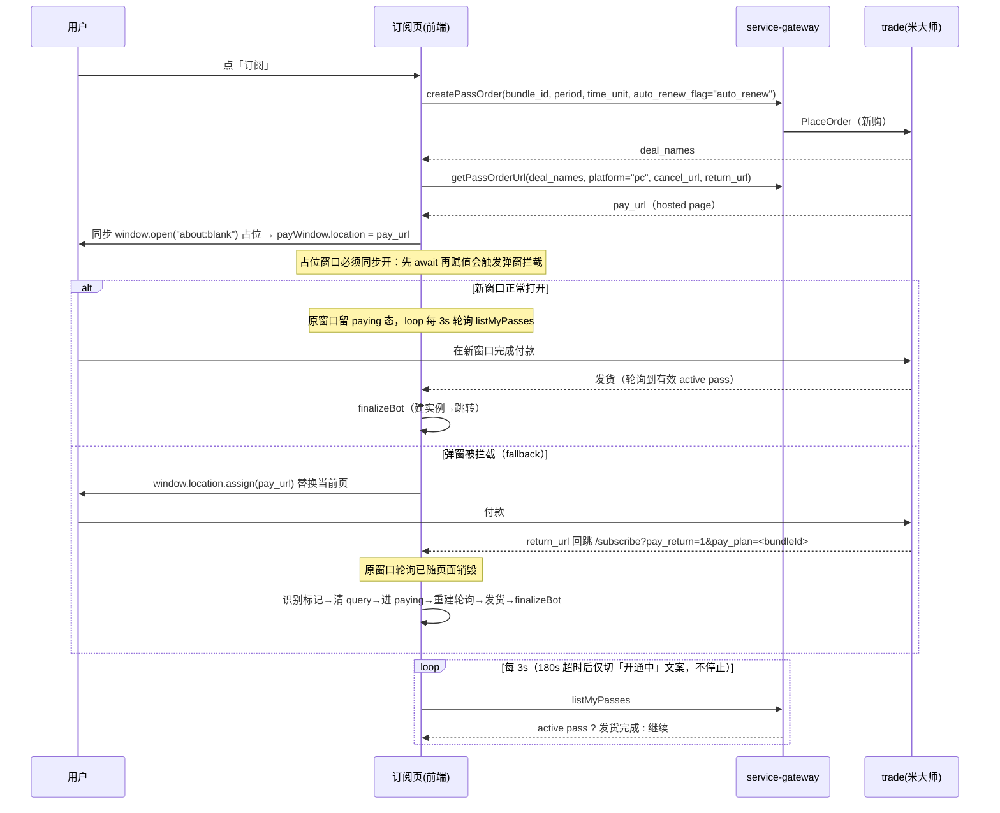

# 前端国际站计费流程说明

> 对应国内站文档：[`frontend-domestic-billing-flow.md`](./frontend-domestic-billing-flow.md)。两站共用 `subscribe-page.tsx` 同一组件，以编译期常量 `isGlobal` 分流；本文只讲差异部分。
>
> 后端接口契约见 [`codesign/ctl-frontend-billing-api.md`](../../codesign/ctl-frontend-billing-api.md)（§2 新购 / §3 续费 / 「国际站支付模式」章节）。

## 一、一句话概述

国际站走**信用卡订阅制**：前端 `createPassOrder` 下单 → `getPassOrderUrl` 换取米大师 hosted page 支付链接 → 新窗口打开付款 → 本页轮询 `listMyPasses` 等后台发货 → 自动创建实例并跳转。**强制自动续费**（无一次性购买选项），支付回跳场景由 `pay_return` 标记接棒续命轮询。

## 二、前置概念

| 概念 | 说明 | 代码位置 |
|---|---|---|
| **站点分流** | `isGlobal=true` 为国际站。编译期常量（`REGION=global` 构建），构建时折叠 | `src/lib/region.ts` |
| **计费开关** | 国际站已全量放开：与国内站口径一致，由后端 `features.paidBillingEnabled` 统一控制（可一键熔断），无本地显式开启层、无会话 reveal 门禁 | `runtime-config-context.tsx` + `lib/billing-flow.ts` |
| **强制订阅制** | 确认订单弹窗的自动续费为**只读说明**（非开关），`auto_renew_flag` 固定 `auto_renew` | `CreditCardConfirmOrderModal` |
| **价格单位** | 后端返回**分**，币种跟随 `bundle.price?.currency`（USD / KRW 等，缺失兜底 CNY），展示时按币种换算；确认订单弹窗币种符号跟随 `plan.price`（7a6bf73ee 修复，曾硬编码 `$` 导致 KRW 环境错显）；折扣仅后端有真实 `discount` 时展示 | `mapBundleToPlan` / `formatYuan` / `centsToYuan` |
| **支付回跳** | 弹窗拦截兜底走 `location.assign` 替换当前页，付款后 `return_url` 回到全新页面，需 `pay_return` 标记重建轮询 | `subscribe-page.tsx` → `PAY_RETURN_QUERY_KEY` |
| **免费试用** | 后端计费开关熔断（`paidBillingEnabled=false`）时国际站入口走 `POST /v1/passes`（直接发货，不支付） | `createPass` |

### 判定链（已全量）

```
config.features.paidBillingEnabled !== true  → 关（后端可一键熔断；国内站国际站同口径）
                ↓ true
付费下单链路（登录门控见 mapBundleToPlan 内 paid 判定）
```

关键点：

1. 后端 `features.paidBillingEnabled` 是唯一的熔断与资格开关，国内站 / 国际站口径一致；构建期环境变量默认值与 localStorage override（`lightclaw:features.paidBillingEnabled`）仍可作为本地紧急关闭通道。
2. 原「国际站显式开启（localStorage / 构建期）」层与「会话内 `show()` reveal」层已于全量放开时移除（feat/intl-billing-full-release）：`show()` 不再有任何计费含义，`sessionStorage` reveal key 已废弃。
3. 支付回跳携带 `pay_return=1` 仍用于重建发货轮询（与计费开关无关）。
4. 开关熔断时 `freeGuideAllowed` 生效：免费试用引导与 `createPass` 链路整体回归，不只是隐藏价格。

### 变量：`paidBillingEnabled` 与 `paidBillingActive`

```
paidBillingEnabled   = usePaidBillingEnabled()          // hook：构建期默认 → 后端 features → localStorage override
paidBillingActive    = isPaidBillingEnabled(paidBillingEnabled)   // 布尔化；全量后两值恒等
```

| 消费方 | 用哪个 | 控制什么 |
|---|---|---|
| `mapBundleToPlan`（形参名就叫 `paidBillingEnabled`，**实参是 `paidBillingActive`**） | Active | 卡片价格真源、`skipPayment: !paid`（CTA 是否跳支付）、促销徽章 |
| `planList` 过滤 | Active | Active → 只留付费 bundle；非 Active → 只留免费 bundle + 两张前端占位卡（并抹 `bundleType`，不出现付费分组 tab） |
| `executeCreateBot` | Active | 下单执行分流（付费/免费/点石零元）与埋点 |
| `freeGuideAllowed = !paidBillingActive && !realname` | Active | 免费引导文案——开关熔断时整体回落免费口径 |
| `PaymentPendingModal` | 都不用 | 只认 `paymentContext`（bridgeUrl/redirectUrl/provisioningOnly） |

**陷阱**：`mapBundleToPlan` 的形参名 `paidBillingEnabled` 与 hook 同名但语义不同（实参是 Active），函数内 `paid = 形参 && (!isGlobal || isLoggedIn)` 还会再叠一层登录门控。

## 三、时序图



## 四、阶段细节

### 阶段 1：确认订单（`CreditCardConfirmOrderModal`）

- **点石零元套餐**（判定 `isDianshiZeroAmountPlan = isGlobal && paidBillingActive && plan.raw.price?.real_total_cost === 0`）走 `confirm-dianshi` 特化分支：`startDianshiOrderAndPay` 一步下单并支付（`POST /v1/passes/dianshi/order-and-pay`，do_goods_and_pay），**无 hosted page 跳转**，确认弹窗不展示支付方式与自动续费；发货仍复用 paying 阶段轮询接棒。
- 自动续费为只读说明行（`RefreshCw` 图标 + 「可随时在账号管理页取消」），**无开关**——商业决策为订阅制后，不给一个点了会被拦的假开关。
- `onPay(true)`：`auto_renew_flag` 固定 `auto_renew`。
- **`auto_renew_flag` 与 `ContractOrder` 完全解耦**（契约文档「国际站支付模式」）：该字段只写入新购订单 `goodsDetail.autoRenewFlag`；是否发起签约由 trade 查用户绑卡状态决定（未绑卡 `ContractOrder=1` 签约并支付，已绑卡直接用现有卡）。前端不需要、也不应该干预签约。

### 阶段 2：下单与支付链接（`startIntlCardPay`）

```ts
// 1. 下单
createPassOrder({ bundle_id, period, time_unit, auto_renew_flag: "auto_renew" })
// 2. 换支付页 URL（PC 端 Bearer 鉴权）
getPassOrderUrl({
  deal_names, platform: "pc",
  cancel_url: payRedirectBase,          // 当前页地址
  return_url: `${payRedirectBase}?pay_return=1&pay_plan=${planId}`,
})
```

回跳地址规则：
- 用 `window.location.href.split("#")[0].split("?")[0]` 去掉 query/hash——**防止把 OAuth code / 一次性 ticket 拼进计费回跳地址**。
- 协议上 `cancel_url`/`return_url` 可选（不传时 trade 用环境兜底 `TRADE_BILLING_PAY_REDIRECT_URL`），但显式传可避免被兜底带到别的页面。
- 账号页续费同理（`renew-pass-modal.tsx` 国际站分支），否则 KR 兜底写死 `/subscribe`，用户付完被从账号页扔到订阅页。

### 阶段 3：两条接棒路径

| 路径 | 触发条件 | 接棒方式 |
|---|---|---|
| ① 新窗口轮询 | 占位窗口成功打开，原窗口留 `paying` 态 | 原窗口轮询命中 pass → `finalizeBot` |
| ② 支付回跳 | 弹窗被拦截，`location.assign` 替换当前页 | 回跳页识别 `pay_return=1` → 清 query → 进 `paying` → 重建轮询 → `finalizeBot` |

路径②的守卫：
- `payReturnHandledRef`：只接管一次，标记用完立即从 URL 清除（`history.replaceState`），防刷新重复触发。
- 前置条件：`authReady && isAuthenticated && planList.length > 0`——`planList` 为空找不到 plan 无法 finalize。
- `pay_plan` 解析失败（链接被改 / 套餐下架）：不进 paying，仅 `refreshPasses()` 刷当前订阅，避免卡在永远等不到结果的弹窗里。

### 阶段 4：轮询与超时

- 间隔 `PAY_POLL_INTERVAL_MS=3s`，超时 `PAY_POLL_TIMEOUT_MS=180s`。
- **超时后不停止轮询**，仅将弹窗切为「开通稍有延迟，本页会自动完成，请勿关闭」——「我已完成支付」手动确认按钮已移除（`onManualConfirm`/`handleManualConfirm` 同步删除），轮询是唯一自动接棒途径，停了发货慢的用户永远等不到自动开通。轮询随弹窗关闭（effect cleanup）终止。
- **`provisioningOnly` 模式**（正式标志位）：支付回跳接棒时 `paymentContext.provisioningOnly = true`，`PaymentPendingModal` 据此渲染纯开通等待态——标题「正在开通套餐」+ `Loader2`，无二维码、无 `pay_url`、不渲染「重新打开支付页」死按钮。点石零元链路（一步完成支付）同样以此模式等发货。

### 阶段 5：finalizeBot（幂等）

```
闸门① finalizingRef（同步 ref，finally 复位）→ 拦并发
闸门② botsRef.current[0] 已有实例 → 只跳转不创建
addBot → 埋点 → subscribe() → 关弹窗 → navigate(/agents?creating=<botId>)
```

两道闸门防的是路径①原窗口与路径②回跳页**双开导致重复建实例**（用户要为多余实例付费）。

**已知局限**：两 tab 各自独立 React 实例、独立 `finalizingRef`，闸门①拦不住跨 tab 并发；闸门②依赖 `bots` 新鲜度，双 tab 同时通过检查仍可能各建一个。彻底解决需后端按 `pass_id` 幂等——已多次提醒跟进。

## 五、状态机

```
closed ──选套餐下单──▶ paying ──轮询到 pass──▶ finalizeBot ──▶ closed(跳转实例页)
                         │
                         ├──弹窗被拦截──▶ assign(pay_url) ──付款──▶ 回跳(pay_return=1)──▶ paying[provisioningOnly]
                         ├──点石零元──────▶ paying[provisioningOnly]（一步下单即支付，纯等发货）
                         └──轮询超 180s──▶ 文案切「开通中」（轮询继续）
```

## 六、与国内站的差异速查

| 维度 | 国内站 | 国际站 |
|---|---|---|
| 支付方式 | bridge 中转页 + 微信扫码 | 信用卡 hosted page 新窗口 |
| 自动续费 | 米大师签约模板 | 强制订阅制（只读说明） |
| 实名 | 手机号实名（`realnamePhoneVerificationEnabled`） | 无 |
| 计费开关 | 全量开启 | 同口径全量开启（后端 `features.paidBillingEnabled` 统一熔断） |
| 免费试用 | 走 `createPassOrder` 真实下单 | 开关熔断时走 `createPass` 直接领 |
| 轮询超时 | 同左 | 同左（两站共用同一 effect） |

## 七、已知遗留与坑点

| # | 问题 | 现状 |
|---|---|---|
| 1 | 跨 tab 重复建实例风险（见阶段 5） | 待后端按 `pass_id` 幂等 |
| 2 | `agent-settings-page.tsx` 存在 `isCN &&` 硬守卫 | 国际站全量后该页付费 UI 仍不展示（订阅页/账号页正常） |
| 3 | 开关熔断态 = 整套老逻辑回归 | 需实测确认免费试用文案与 `createPass` 行为 |
| 4 | `realnamePhoneVerificationEnabled` 的 localStorage override 与付费开关共用一把钥匙体系 | 本地熔断调试时注意别误开实名 |
| 5 | 国际站曾用 staging 构建期 `PAID_BILLING_ENABLED=true` | 已在 `release-matrix.json` 移除，四环境统一跟随后端开关 |
| 6 | 灰度期的「显式开启」层与 `show()` reveal 层已移除 | 全量放开（feat/intl-billing-full-release）；遗留的 localStorage reveal key（`lightvela:features.intlPaidBillingRevealed`）不再被读取，用户侧无需清理 |

## 八、文件索引

| 文件 | 职责 |
|---|---|
| `next-site/subscribe-page.tsx` | 主流程：`startIntlCardPay` / 支付回跳 / 轮询 / `finalizeBot` / `CreditCardConfirmOrderModal` |
| `src/pages/marketing/renew-pass-modal.tsx` | 账号页续费（国际站分支：`createRenewOrder` + `getRenewOrderUrl` + 回跳地址） |
| `src/contexts/runtime-config-context.tsx` | 付费开关 `resolvePaidBillingEnabled`（后端 features 布尔化，国内/国际同口径） |
| `src/lib/billing-flow.ts` | `isPaidBillingEnabled` 布尔化（`paidBillingActive = isPaidBillingEnabled(paidBillingEnabled)`） |
| `release-matrix.json` | 各环境构建期环境变量（付费开关已全部 unset） |
| `src/lib/region.ts` | `isGlobal` 编译期站点常量 |
| `src/repositories/http-repositories.ts` | `createPassOrder` / `getPassOrderUrl` / `createRenewOrder` / `getRenewOrderUrl` / `listMyPasses` / `createPass` |
| `codesign/ctl-frontend-billing-api.md` | 后端契约（支付 URL 接口 / 字段说明 / 国际站支付模式 / 透传关系） |
