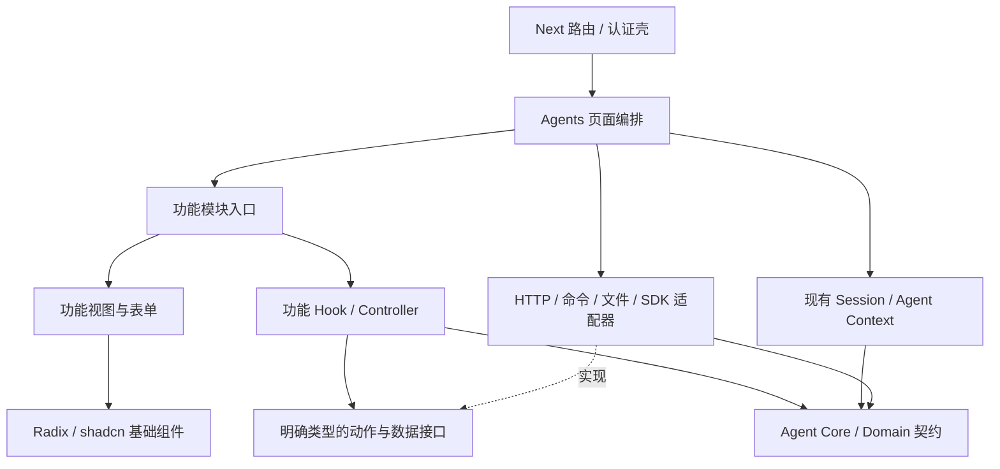

# Agents 重构：模块依赖、职责与实施约束

状态：用户已明确批准实施；Native build/revision 2，按批次迁移与验证。
源码基线：`08b9cf568`；分支：`frontsandbox/agents-radix-refactor`。

范围增补（2026-09-16）：用户在实施中明确“成就不用管，页面已经去掉了”。成就页面及入口不再重构或验收，不恢复该页；其余已批准范围继续实施。Native brief 保留批准时的历史内容，不手改其 hash。
范围收缩（2026-09-16，后续）：用户明确“浏览器、终端、workbench可以先不用管”。这些模块及 `/agents/session` 别名暂不实施或做页面验收；下表关于其资源所有权保留为保护边界，不代表仍有迁移任务。DSH/chat继续，已修改共享组件的OpenCraft必要生成/消费检查保持。

## 规范依据

- 根/前端 AGENTS、`frontend/docs/README.md`、`docs/engineering/architecture/authority-and-contracts.md`：源码和契约权威、类型边界、后端最终执行权。
- `shared/lightvela-agent-core/AGENTS.md` 与 README：中立 core、身份组合、port 注入、消费者测试。
- `frontend/DESIGN.md`：组件、浮层、列表与响应式行为。
- `opencraft/AGENTS.md`、`opencraft/MONO2_MIGRATION.md`：生成闭包、独立 workspace 与下游验证。
- 用户指定的 `feai-workflow`：实施任务记录在 frontend OpenSpec，runtime 保持当前批次与验证证据，完成后等待验收。

最新主干 `.codebuddy/commands/feai-start.md` 已指向 Native；旧 `.workflow/rules/global.md`、planning/implementation gate 在原工作区存在，在本 worktree 缺失。本轮读取用户指定 Skill 所在原工作区的相关规则作为明确请求的流程依据，不复制旧工具或改引擎。按用户本轮要求补充 OpenSpec 计划和 runtime，保留当前 Native 的 shape 批准记录；这是本任务的产物安排，不是仓库工作流升级。

## 依赖方向

箭头表示允许的依赖方向，虚线表示实现接口。功能入口组装视图和 controller；避免把全部模块统一成新全局 Context。已有调用关系按批次收敛，图不宣称当前所有文件已经完成分层。

## 层级责任与禁止依赖

| 层级 | 职责与入口 | 允许依赖 | 禁止或必须隔离 |
| --- | --- | --- | --- |
| 路由/认证壳 | `src/app/.../agents`、`next-site/agents-page-client.tsx` | 页面入口、路由契约、既有认证壳 | 直接拼远端命令、加载配置 SDK 的副作用、复制鉴权规则 |
| 页面编排 | `agent-settings-page.tsx`；提取的 shell/navigation/maintenance 组件 | 现有 Context、公开功能入口、身份契约、注入适配器 | 模块内部表单状态；对业务规则建立第二份实现 |
| 功能入口/controller | 现有模型、通道、Skills、定时任务等模块 | 公开类型、自己模块的 client/hook、现有 core 与注入 port | 导入其他模块私有组件/setter；低层反向依赖页面 |
| 功能视图 | 模块内列表、字段、编辑/确认弹窗 | 有界 view-model、明确 action callback、UI、展示文案 | 直接获取 token、操作账户存储、读取完整 Repository 或调用 SDK 方法 |
| 基础 UI | `components/ui`；Agents 专属视图按需放 `components/agents` | React、Radix、CVA、cn、纯样式 | `pages/`、Context、Repository、产品权限和网络 |
| 接入层 | 既有 Repository、model client、debug executor、TSSH、SDK host | 服务/SDK 类型、core/Domain、注入参数 | 反向依赖 React 视图或把 SDK 类型散落所有模块 |
| 纯业务契约 | `@lightvela/agent-core`、既有 Domain 类型 | 纯 TS 与无副作用依赖 | React、Next、DOM、网络/存储/时钟、i18n、产品文案、埋点 |

保持强类型：共享身份从现有定义派生，常用能力采用 `Pick<BotRepository, ...>` 或已有函数类型；不以 `any`、任意键字典或大一统 context 替代模块接口。API 原始响应先由现有适配层校验与映射，视图消费稳定类型。

## 各模块的输入、动作和资源归属

| 模块 | 输入与输出契约 | 状态/资源所有者 | 跨模块边界 |
| --- | --- | --- | --- |
| Console/导航/Bot 管理 | 派生 Bot 身份、route、eligibility；选择/创建/维护意图 | 既有 Agent Context + 页面编排；menu 开关属于视图 | 主 Bot、实例、Profile 不合并为模糊 id；切路由保留 bot query |
| 模型 | `useModelConfig`、`HermesModelConfigExecDebugCommand` 与 Snapshot | hook 持有 requestRevision、probeRevision、操作 token；client 解析结果 | 保留 `useAutomationAwareModelSwitch` 协调，不让模型组件直接改定时任务 state |
| 通道 | 现有 `agent-config` props、productConfig、commandExecutor | `useChannelOperations` / `useAgentInternals` 管理请求与二维码流程 | 使用模块公开 exports；微信占用提示通过宿主传入 |
| Skills/Experts/Packages | bot/profile/exec、初始子视图与安装动作 | 原模块管理来源查询、批量进度、取消剩余任务与学习资源 | 共用真实列表/安装契约；不互读私有组件状态或生成新 registry 真源 |
| 人设 | 现有模板、配额、Bot 身份与用户动作 | 原 controller/hook 负责数据和次数，视图仅展示 | 不更改模板文件/本地化数据/抽取与保存规则；成就已按用户要求排除 |
| 记忆 | Snapshot、activeTab、limit state、refresh/save callback | 原读取/保存函数与宿主状态 | `MemoryPanel` 可单独提取；不得反向 import `agent-settings-page` 取类型或状态 |
| 定时任务 | instance/profile、gateway 状态、原调度与历史动作 | 原模块负责时区、有效期、轮询、取消和网关依赖 | 列表/表单/历史视图分开；弹窗不自行重复注册同一轮询 |
| 文件 | 路径、列表、selection、上传/下载/删除意图 | 原 TSSH client/controller 负责连接、传输和释放 | UI 不拼 shell，不通过新增全局 store 共享文件连接 |
| 诊断/高级设置 | 既有 reset/repair/backup action props、状态与日志 | 宿主维护流程与模块 client | 保持 reset/backup 等真实作用域与确认规则，不根据页面名称推断 Profile 级执行 |
| 对话 | launch token、refresh callback、multiSession 和 commandExecutor | 现有 AgentChat adapter 锁定首帧引用；SDK 管消息；宿主管会话选择 | 保留语言重挂、首 token、单会话回退、CSS lazy chunk；UI 只调用公开会话动作 |
| 浏览器/终端（暂缓） | 当前 broker/session、连接状态和 toolbar callbacks | broker/xterm adapter 管连接、监听器和 resize | 本次不改；保留 iframe/terminal 内容和资源所有权 |
| DSH | botId、region、命令执行能力；Provider 保存/删除与安装/修复意图 | `AgentDeepSeekHarnessPanel` 管安装任务 ID、轮询和恢复；模型模块管草稿与保存 | taskId 按 Bot 保存；卸载只停本地轮询，不取消远端任务；repair 与 Provider 删除保留各自关闭顺序 |
| 网站与分享 | 账户级 capability/sites；`ShareDialogSite` 最小字段、关闭与 `onChanged` 回调 | `AgentWebsitePanel` 管每 SiteID 删除操作/轮询；分享入口管有效期、临时明文码和复制 | 不引入 Bot/Profile；DELETE accepted 仅关闭确认并锁目标行，操作完成后才收敛列表；重置分享码成功不等于复制成功 |
| Workbench（暂缓） | Bot/loading/error、`BotRepository` 中 exec/session 两项能力、刷新动作 | `VelaWorkbenchDesktopHost` 管 transport/启动重试；velachat 管 session controller 与专用 surface | 本次不改；保留 lazy/CSS、draft/attachments/action 和迟到 transport cleanup，不为验收触发自动启动 |

## 抽取与迁移规则

1. 优先复用已存在的 `agent-model-config`、`agent-config` 等模块，不为整齐目录重写业务层。按“入口/视图/控制逻辑/适配器/契约”的真实职责提取，不按任意行号切割。
2. 模块外只消费公开入口与契约。`agent-config/index.ts` 已约定“外部经出口、内部相对导入”；实施中核对现有 deep import，并保留公开 API 兼容。
3. 带动态加载或样式副作用的视图保留独立入口；纯类型使用 `import type`。避免一个 barrel 同时导出 contracts 与重型 SDK，导致非聊天页加载 SDK CSS。
4. 视图抽取和 state/请求迁移分开验证。每次抽取保持原 key、受控 value、回调引用与 cleanup；所有 async 请求继续有唯一所有者，过期结果不能更新新 Bot/Profile。
5. 每个可中断资源明确创建/释放位置：订阅、轮询、监听器、上传、下载 URL、terminal、iframe broker。卸载、关闭弹窗、切 Bot、切 locale 的预期行为写进相关测试。
6. 新共享组件至少有两个真实使用点，或已明确用于多个本轮模块；特定业务逻辑留在所属模块。需要跨模块动作时由宿主调用已存在业务接口协调。
7. 旧入口如果有现有消费者，保留薄兼容导出直到所有调用方验证完毕。重命名历史 Tea 命名需检查测试/同步脚本/下游，不与行为调整合成不可审阅的大 diff。

实施中已确认的窄例外：B4-P 引入 Radix Tooltip 后，旧 `appliedSlug` 清理 effect 在中间 commit 中误清空复制来的真实 SOUL 摘要。HEAD/当前/内存替换 Tooltip 三组独立对照已证实提交时序差异；不能作为基线失败豁免。允许仅把展示状态的清理条件收敛为“同 Bot 原卡确实从集合移除”，恢复原已测试的空卡 SOUL 摘要行为；注入/保存/请求顺序、远端命令、配额和取消契约不变。必须补真实移除、失败保留、初始空卡和切 Bot 迟到结果测试并独立复审。

## 下游与样式依赖

OpenCraft 的同步 seeds 已包含模型、通道、Skills、定时任务、记忆、诊断和文件管理。共享 UI 的导入闭包会进入下游，不能把页面重构看作只有 Web 消费。

- `opencraft/scripts/sync-mono2-agent-console.mjs` 当前对 Dialog/Select/Popover 的具体 class 字符串做 Portal 适配。更改这些定义后，必须验证适配仍生效，必要时在该生成脚本集中更新；禁止手改生成文件。
- 新增 Radix 包先核对 frontend 与 OpenCraft 的消费依赖。按实际导入闭包在各自 package/lockfile 中声明；两个 workspace 保持独立。
- 保持 canonical source、生成文件、manifest 和标准同步检查一致；不创建第二份手写组件。
- 本次只读 `--check` 已确认基线缺少生成文件 `domain/instance-bot-errors.ts`。首批实施记录同步前后差异，区分补齐旧缺失与本次 UI 变更；不得用扩大忽略规则掩盖问题。
- 同步导致跨服务影响时，加载相应 OpenCraft 规范并补受影响消费测试/必要 gate；按 change-impact 映射更新正式设计文档。实际实施和验证边界见下方 B6 记录。

## 可执行验收

| 检查项 | 通过条件 |
| --- | --- |
| 导入方向 | 修改模块无新增运行时循环；UI 不导入业务层，contracts 不加载视图/SDK 副作用；type-only 与 runtime 分别核验 |
| 模块接口 | 每模块明确输入/动作/错误/资源所有者；不存在使用对方内部 setter、私有组件或复制业务契约 |
| 业务保持 | 相同 fixture/操作调用相同请求、参数与关键顺序；pending 防重、迟到结果与 Bot/Profile 切换测试通过 |
| 身份与 core | 现有 core 边界/身份契约/创建测试保持通过；不新增 renderer/网络/存储依赖 |
| 样式与专用 SDK | Portal token 与裁剪边界有效；非聊天页未提前拉入 AgentChat；稳定引用/语言切换/卸载行为无回归 |
| 共享消费者 | OpenCraft 标准同步检查及命中的消费门禁通过，必要依赖明确声明；记录已有基线失败 |
| 文档与证据 | 每批记录文件 owner、模块契约、实际测试、生成影响与未验证项；最终不以目录变多或文件变短作为完成依据 |

本轮源码审计覆盖 231 个本地 TS/TSX/JS 文件、752 条依赖，排除 node_modules、locale 生成物和 CSS 图；该范围内未发现运行时循环或指定反向依赖。静态结果不证明全仓无循环，也不证明 UI 行为已经通过。

## 实施分批

| 批次 | 角色 / 路径归属 | 交付与检查 |
| --- | --- | --- |
| B1：边界基线与公共组件 | 实现：`components/ui`、按需 `components/agents`、相关边界测试；审查：依赖/接口 | 标注公开入口、建立风险行为与样式基线，按真实用例引入 Radix 原语；检查生成闭包影响 |
| B2：Console 编排 | 实现：`agent-settings-page` 的 shell/navigation/maintenance 展示及相邻文件；审查：身份/生命周期 | 拆清视图和宿主动作、完成桌面/移动导航与会话操作；保留路由/Bot/异步所有权 |
| B3：配置与维护 | 实现：模型、通道、诊断、高级设置；审查：调用契约 | 各模块公开接口、视图与 controller 分离，调用/确认/重启/保存测试保持通过 |
| B4：能力内容 | 实现：Skills/Experts/Packages、人设、记忆；审查：跨模块状态 | 逐模块更新控件和视图，保留安装/取消/配额/保存规则与多语言；成就排除 |
| B5：运行与专用区域 | 实现：定时任务、文件、网站、DSH、chat宿主；审查：资源释放/SDK | 替换手写浮层，统一反馈和外围布局；browser/terminal/workbench按后续要求暂缓 |
| B6：整体验证 | 实现者提供证据；审查者核对全路由/公开接口/共享消费 | 双站构建、多尺寸键盘回归、完整覆盖表与必要下游检查；等待用户验收 |

具体写入任务在 `frontend/openspec/plan.md` 跟踪；每批不超过 3 个任务。实现阶段由 developer 串行写入业务代码，Leader 维护文档与执行核验，reviewer 独立只读审查；每次派发明确文件归属。

## 实施记录

### B5-H：DSH 与聊天宿主

- DSH运行纯view只消费状态、进度、显示URL、焦点ref和动作；原controller继续拥有Bot任务持久化/恢复/轮询与安装/修复关闭顺序。Provider Select、表单与删除确认只调整交互和焦点；controller helpers/effects经独立HEAD对照保持。
- 手机长选中值回归来自Radix SelectValue新增外层flex子项无收缩约束；用asChild保留唯一带valueId的min-w-0/flex-1/truncate子项，完整ARIA和值回调不变。失败守卫先RED，390真实宽375/375后独立关闭P2；不改共享Select或全局溢出策略。
- Chat新状态view不消费token、SDK或Repository，loading/error/retry由原宿主传入；首ready API对象、刷新TTL、session透传、lazy CSS和自动发送器保持。两站Leader DSH56+Chat14、开发70/check0new与独立审查均通过；真实组件/合成SDK验证不代表实际WebSocket或会话发送。

### B5-R：账户级网站与复制的 DOM 边界

- `WebsiteSiteRowView` 与 `WebsiteShareDialogView` 消费格式化展示值、明确操作资格与回调；不获取 Repository、token 或 Bot/Profile。原网站入口继续拥有账户级请求、每 SiteID 的删除轮询、超时和卸载处理；DELETE accepted 不表示远端删除完成。
- 分享公开 `site/onClose/onChanged` API 保持。有效期、临时明文码、enable/reset/stop 和两条复制流程仍由原入口管理；新增 Dialog/Select 只处理受控交互、焦点及 pending 控件状态。
- 独立审查提出复制 fallback 风险后，真实浏览器同 fixture 对照发现：已有明文码的第二次复制，旧 body 临时 textarea 会被新增 Dialog 的焦点限制移走焦点并清空文档选区，HEAD 旧组件保留选区。允许唯一窄兼容修改：视图提供显式 Dialog DOM ref，原 helper 在该范围内创建/清理 textarea，只有它仍持焦且原控件仍存在时恢复焦点。未取消焦点限制、增加全局查询或改变 reset/copy/Changed 顺序。
- 修复后新增测试先 RED 后 GREEN，Leader 与独立 reviewer 在 CN/global 各4文件24项通过；真实浏览器两次完整选区、临时节点清理、第二次返回复制按钮及单次 reset/Changed 已验证。剪贴板 API 和 execCommand 均为替身，不声明系统剪贴板实际写入通过。
- 文件纯视图仅接收名字、图标、大小/时间、单选/目录标记、行内编辑内容与动作。原入口保留client、托管根路径、重连一次、上传/下载与ACK/取消/卸载；取消焦点意图携带Bot ID。HEAD失效的brand颜色变量替换为已定义展示token，不改变选择身份。R整体Leader CN/global各7文件70项和check通过；独立Files各44项与3个附加时序用例通过，390/1024/1440视觉/键盘复验完成。R已放行；B5-H及下游验证仍在途。

### B5-A：嵌套原语依赖一致性

- 原安装Popover1.1.17使用focus-scope1.1.10/dismissable-layer1.1.13，Dialog1.1.15/Select2.2.6及新增浮层原语使用scope1.1.7/layer1.1.11，各自的模块级焦点栈和层级集合分裂。无业务组件的最小复现已失败，不能归因于定时任务状态或只在展示层豁免焦点限制。
- Leader浏览器与reviewer独立三用例对照：仅统一scope可获焦但关闭/点击仍错；仅统一layer仍焦点失败；同时统一两者后输入、子层Esc与返回焦点恢复。诊断alias仅用于证明因果，已从浏览器样例撤销，不进入产品或锁文件。
- 允许developer只将Popover精确对齐1.1.15，与当前Dialog/Select闭包一致，保留其他依赖resolution；无alias复验后才能称修复。额外回归公开账户菜单（当前另一个Popover消费点），不改变其业务源码或扩大成全量依赖更新。
- DropdownMenu仅兼容新增标准CheckboxItem导出用于周/月多选；checked/onCheckedChange和是否关闭由原宿主控制，现有公开API与默认样式保持。

### B4-M：记忆视图与数值编辑焦点

- `agent-memory-views.tsx` 接收 typed snapshot 展示数据、限额草稿/状态、tabs 与明确动作；原 MemoryPanel 编排仍在宿主。视图不 import 页面、Context、Repository 或命令拼接函数。
- MemoryLimitCardView 仅负责可访问字段、焦点、数值输入/键盘和调用动作；校验、双限额互斥、部分成功保留草稿、重启与回读仍由原宿主/保存函数持有。相邻旧命令断言已更新为真实 Profile 契约，未修改执行命令。
- CommonSettingRowView 的数值输入进入编辑时聚焦；明确取消/Esc 返回 Edit。未新增请求或改变受控值、确认/提交时点；真实组件测试立即断言焦点以避免 user.type 隐式聚焦掩盖缺陷。
- Leader 独立 Memory/Common 六文件100项通过；生产 views+虚构数据经手机/桌面视觉和键盘检查。批次最终放行仍需独立审查与B4整体门禁。

### B1：纯展示组件与交互原语

- `components/agents` 公开 `AgentSection`、`AgentToolbar`、`AgentField`、`AgentState` 和 Agents 专属样式常量。展示组件仅依赖 React、UI 和工具函数，不接收完整 Repository/Context，不拥有远端请求。
- `AgentField` 通过 render prop 提供稳定字段 ID、`aria-describedby`、`aria-invalid`；值与提交行为留在调用方。`AgentState` 只呈现传入的 loading/empty/error/success，重试动作由宿主注入。
- 新增 AlertDialog、DropdownMenu、Checkbox、Switch、Tooltip、Sheet 的 Radix 封装；Sheet 复用既有 Dialog。Portal 可显式携带 `.agents-ui` 作用域，未改变其他页面默认样式。
- 确认弹窗的关闭策略仍归业务宿主：模型删除成功才关、通道断开原本 await 后关闭、高级设置原本先关再提交。基础原语不决定业务成败、重试、重启或资源释放。
- 新增 Radix 依赖精确锁定；保留此前所有锁文件 resolution。OpenCraft 的依赖与生成适配尚待消费迁移后处理，不把 frontend 安装成功等同下游验证通过。

### B2：Console 展示边界

- `agents-console/index.ts` 为 Shell、BotProfile、SidebarTabs、Navigation、SessionList、ConfirmDialog、EditDialog、Tooltip 的公开入口。各 view 接收 DTO、文案和动作，不持有 Repository、Context 或 SDK 对象；宿主继续拥有身份、路由、资格和维护请求。
- Shell 只渲染一份导航；移动端使用 Sheet，重内容位于 Sheet 外且不会因抽屉开关重挂。路由/Bot/断点变化时关闭由宿主处理。
- SessionList 接受空字符串作为合法默认会话 ID。菜单转编辑/确认弹窗保留稳定触发器引用，Esc 恢复焦点；重命名明确确认提交，不把失焦视为保存。
- 所有 Portal 明确携带 Agents 样式作用域；可操作 Tooltip 使用原生按钮作为唯一 Tab 停靠点，禁用动作才增加可聚焦原因说明。原生选文不拦截 pointerdown。
- Leader 宿主/路由/core/SDK 边界等 23 文件 167 测试通过，check 无新增诊断；静态可达导入图更新为 250 文件/812 边，无范围内循环/指定反向依赖。真实 SDK 网络资源仍未执行端到端验证。

### B6：OpenCraft 共享消费实现

- 原 seeds 保持，标准脚本收集154文件闭包；不加入整个 `agent-settings-page` / `agents-console` 或本次暂缓模块，不引入frontend全局CSS。生成内容与UPSTREAM只由标准sync写入并逐文件check。
- 原语适配集中在脚本：Dialog/AlertDialog/Popover/Select/Dropdown/Tooltip携带宿主Portal作用域与角色class；Button使用实际resolvedVariant及宿主inline颜色，Tabs/Checkbox/Switch基于真实Radix状态。必要锚点按预期出现次数失败关闭；原SkillsDataLayer、地区与Repository接缝成功输出保持不变。
- 宿主CSS设置Dialog遮罩240/内容241、确认遮罩245/内容246、浮层250；body Portal独立继承宿主深浅色token。Checkbox只保留Radix Indicator，Switch保留16px thumb位移；没有全局取消焦点限制或跨workspace强制覆盖依赖。
- OpenCraft独立声明7个缺失直接依赖，新增Checkbox1.3.11、Switch1.3.7、Tooltip1.2.16三条锁记录，原有包记录无修改/删除；六类浮层实际共用scope1.1.16/layer1.1.19，frontend仍保持自身已验证闭包。
- 诊断消费者仅新增现有account.execDebugCommandStream转发（botId/command/onChunk/120s）；账户层继续拥有authority、native/SSE和资源取消。未改核心、账户实现、认证或传输协议。
- 开发及Leader各7文件104项、Hermes/Web/Expo类型检查、sync/check154文件通过；Leader真实生成控件+ModalSurface/宿主CSS的1280深浅主题、嵌套焦点和390布局通过。独立review27/27且无P1/P2；真正clean install1298包后完整gate exit0，各组累计1273通过与Web/Expo Web/iOS JS构建完成。此前分批“在途/待验证”为阶段记录，最终以本节及验证报告为准。mock和JS构建不代表原生桌面、iOS或真实远端操作已验收。
