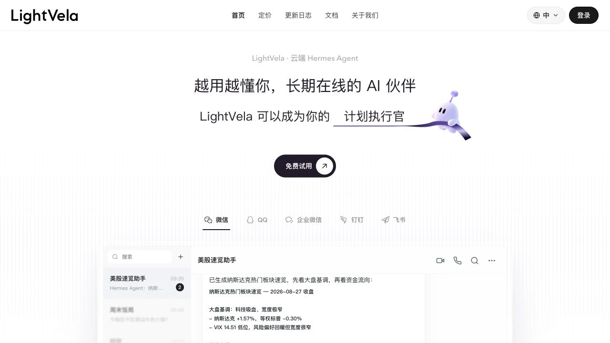
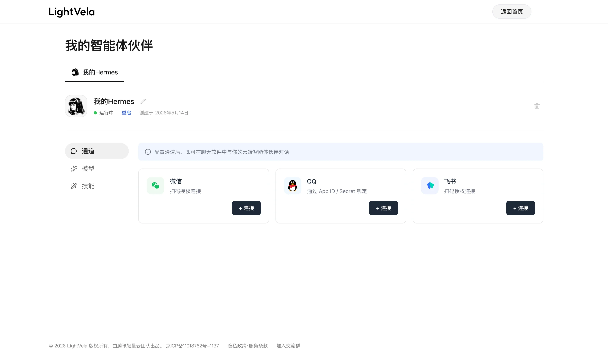

# LightVela 是什么

## 摘要

**LightVela 是腾讯轻量云团队推出的云端 Agent 托管产品，当前提供的产品是 Hermes Agent。它把 Agent 的部署、运维与 7×24 小时运行全部放在云端托管，你无需服务器、容器或 API 鉴权知识，在网页可视化面板上点选即可完成配置，然后在微信、QQ、企业微信、飞书、钉钉里直接与自己的 Agent 对话。它跨会话持续记忆，模型、工具、人设都由你决定。当前四档套餐月付原价为启航 Launch ¥45 / 月、巡游 Cruise ¥95 / 月、启航 Launch AI ¥68 / 月、巡游 Cruise AI ¥158 / 月，首次开通任意套餐前需完成实名认证；公测阶段首次注册用户可免费体验启航版 14 天。**

---

> 云端托管 Hermes Agent，越聊越懂的智能伙伴。

> ℹ️ **公测阶段说明**
>
> LightVela 现已进入公测阶段，产品功能、服务方案与相关文档将持续迭代优化，部分内容可能随版本更新调整，敬请理解。
>
> 为感谢用户支持，公测阶段首次注册 LightVela 的用户可免费体验启航版 14 天。
>
> 套餐权益、服务方案及后续收费规则，请以 [LightVela 付费版本公告](./announcements/public-beta.md) 为准。

LightVela 是腾讯轻量云团队推出的云端 Agent 托管产品，致力于让每个人都能拥有一个**真正属于自己的 AI 伙伴**——不是每次打开都要重新自我介绍的工具，而是**认识你、记得你、越聊越懂你**的长期存在。

你的 Agent 7×24 小时在线、独立运行、随时可对话。模型、工具、人设都由你自己决定。

我们通过可视化面板把配置门槛降到最低：无需写配置文件、无需登录服务器，在网页上点选即可完成搭建。

LightVela 目前提供的产品是 **Hermes Agent**，一个基于大语言模型的 AI Agent，未来会扩展到更多开箱即用的产品。本文档围绕 Hermes Agent 展开。



***

## 适合谁

* 希望使用 AI Agent，但不具备服务器、容器、API 鉴权等技术背景的用户

* 希望通过日常聊天软件（微信 / QQ / 企业微信 / 飞书 / 钉钉）与 AI 交互，而非独立 App 的用户

* 偏好使用国内大语言模型服务商的用户（支持 MiniMax、DeepSeek、Kimi、豆包、千问、智谱、文心、MiMo 等）

* 需要跨会话持续记忆、而非每次从零对话的用户

## 不适合

* 要求完全本地运行、数据不离开终端的用户

* 需要训练或微调底层模型的用户

* 需要将 Agent 集成到自有网站或应用中的开发者

***

## 产品特性

* **全托管部署**：云端自动完成环境配置与运行时管理，无需掌握服务器运维、容器镜像等基础设施知识

* **独立运行环境**：每个 Hermes Agent 实例拥有独立的运行环境，资源隔离，7×24 小时在线，不依赖本地设备

* **多模型支持**：支持接入国内主流大语言模型、各家 Coding Plan 包月套餐，以及任何 OpenAI 兼容端点，具体见 [配置模型](./configuration/model.md)

* **多通道接入**：支持通过微信、QQ、企业微信、飞书、钉钉与 Hermes Agent 进行对话

* **技能扩展**：通过 [SkillHub](https://skillhub.tencent.com) 安装技能包，扩展 Hermes Agent 的能力边界

* **开箱即用**：启航套餐预置体验积分，开通后无需额外配置模型即可对话

* **专属云端存储**：对话与记忆数据独立保管

***

## 工作原理

LightVela 在云端为用户运行一个专属的 Hermes Agent 实例，并通过适配层接入用户指定的聊天平台。

```
用户（在微信 / QQ / 企业微信 / 飞书 / 钉钉中发送消息）
      ↓
LightVela 云端的 Hermes Agent 实例（用户专属）
      ↓
调用用户配置的大语言模型（MiniMax / DeepSeek / ...）
      ↓
响应经由原通道返回至用户
```

完成一次对话闭环需配置三项：

1. **模型**：Hermes Agent 调用的大语言模型。启航套餐预置体验积分，可直接使用；也可配置自有 API Key

2. **通道**：与 Hermes Agent 对话的聊天平台（微信 / QQ / 企业微信 / 飞书 / 钉钉）

3. **技能**（可选）：扩展 Hermes Agent 的能力



***

## 关于套餐

LightVela 采用套餐化计费。开通一个套餐即获得一个可用的 Hermes Agent 实例，并附带该套餐规定的资源、存储与模型积分。

当前上线套餐：

| 套餐 | 月付原价 | 季付原价 | 主要权益 |
|---|---|---|---|
| 启航 Launch | ¥45 / 月 | ¥135 / 季 | 1 个 Agent、2 核 4G、50G 存储、100 积分 / 月 |
| 巡游 Cruise | ¥95 / 月 | ¥285 / 季 | 1 个 Agent、4 核 8G、80G 存储、200 积分 / 月 |
| 启航 Launch AI | ¥68 / 月 | ¥204 / 季 | 1 个 Agent、2 核 4G、50G 存储、4500 积分 / 月 |
| 巡游 Cruise AI | ¥158 / 月 | ¥474 / 季 | 1 个 Agent、4 核 8G、80G 存储、10000 积分 / 月 |

四个套餐都包含 7×24 小时在线、管理面板访问权限、模型 / 通道 / 技能 / 自动任务等核心能力。新用户首购可享启航版免费体验 14 天、巡游版首月 5 折、AI 版首月 6 折，季付另享 8.5 折 / 9 折。完整优惠价、实时价格与套餐管理规则详见 [套餐管理](./plans.md)。

> ℹ️ **套餐活动说明**
>
> 当前订阅页可能展示首单免费、首月折扣、季付折扣等活动。活动权益、价格与名额可能随版本和后端配置调整，请以 [订阅页](/subscribe/) 和支付页最终展示为准。

> ⚠️ **开通套餐需先完成实名认证**
>
> 首次开通任意套餐前，账号需完成实名认证。认证为一次性操作，之后再开通其他套餐无需重复认证。详见 [账号与实名认证](./03-account.md)。

***

## 与 Lighthouse 的关系（可选了解）

对熟悉腾讯云的用户：LightVela 可以理解为腾讯轻量云（Lighthouse）云端 Agent 部署能力的开箱化包装——LightVela 移除了腾讯云账号、资源管理、云资源操作等概念，只保留「配置 Agent → 接入聊天软件」两个核心动作。

对首次接触云端 Agent 的用户，本小节可以忽略。

***

## 下一步

* **[快速开始](./02-quickstart.md)** — 5 分钟跑通第一个对话

* **[账号与实名认证](./03-account.md)** — 账号管理与实名认证流程

* **[核心概念](./04-core-concepts.md)** — Hermes Agent、模型、通道、技能四项核心概念说明

* **[配置总览](./05-configuration.md)** — 管理台功能与配置流程
