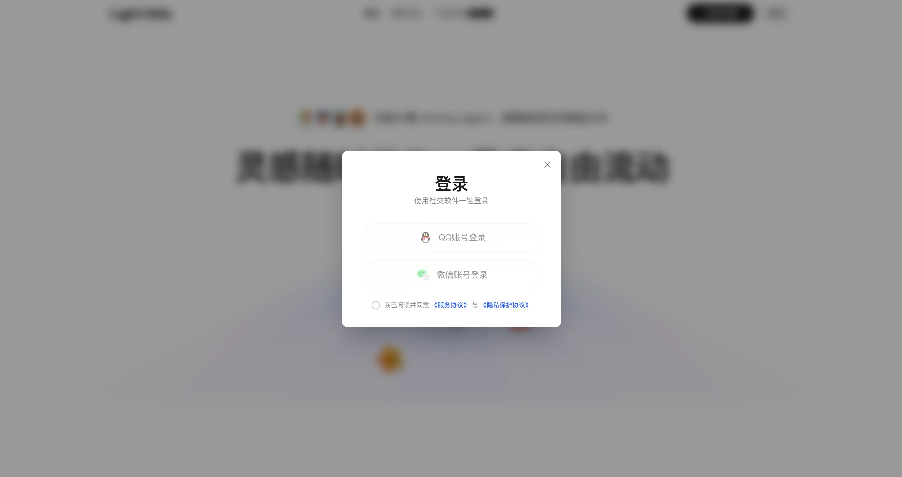
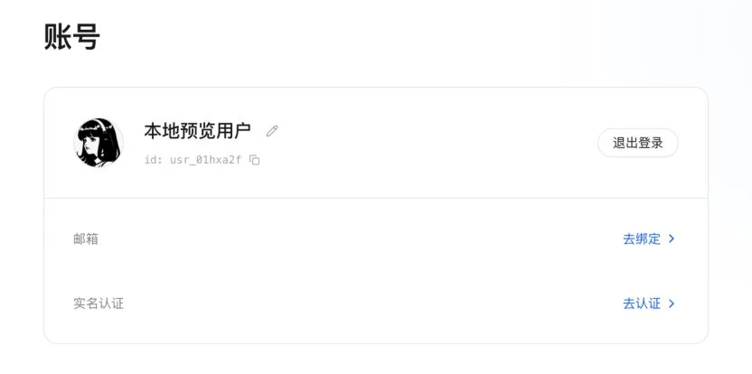
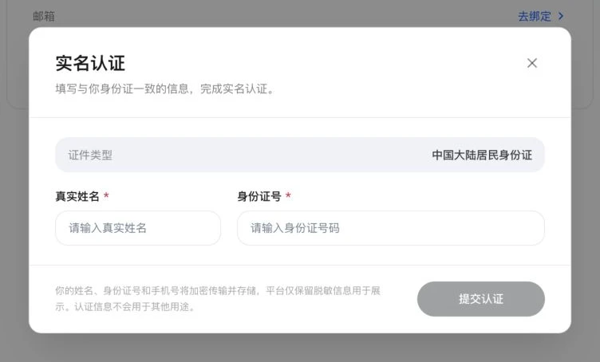
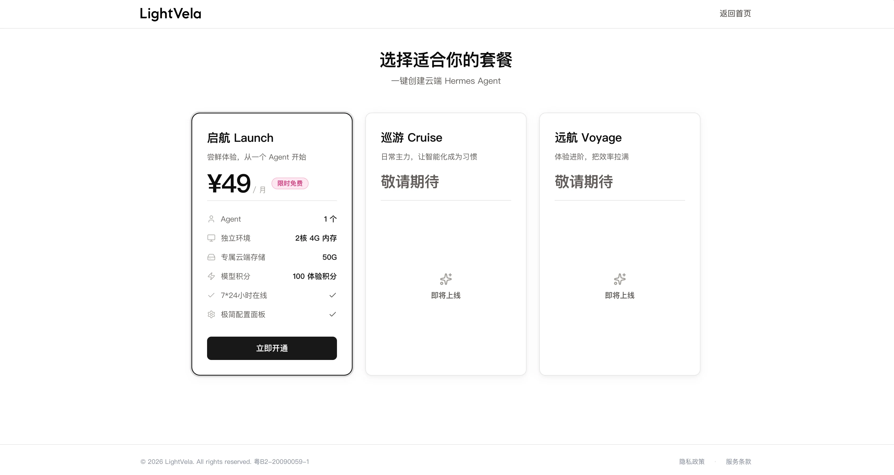
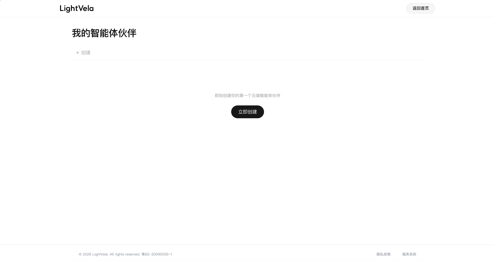
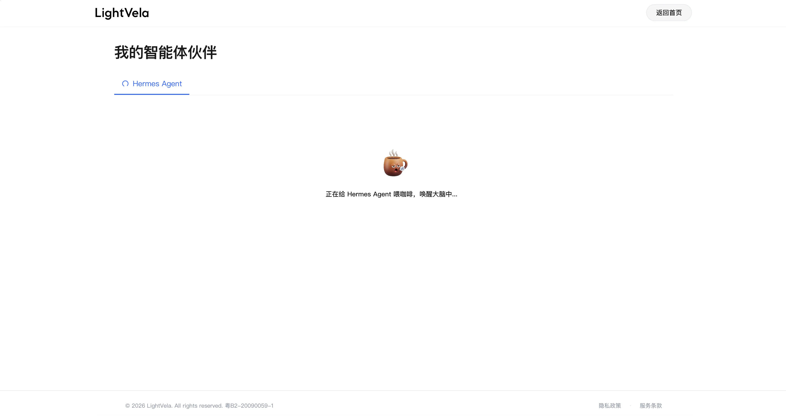
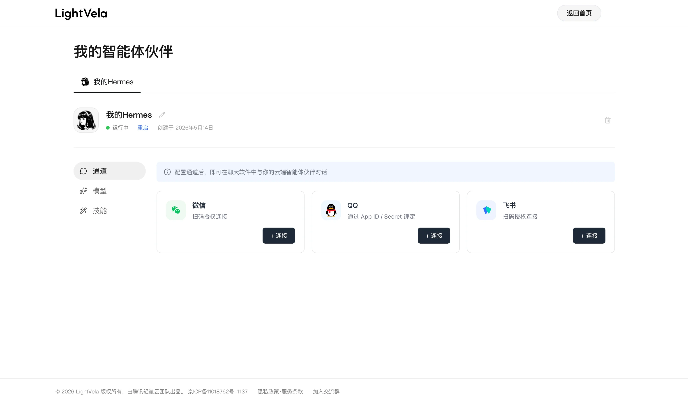
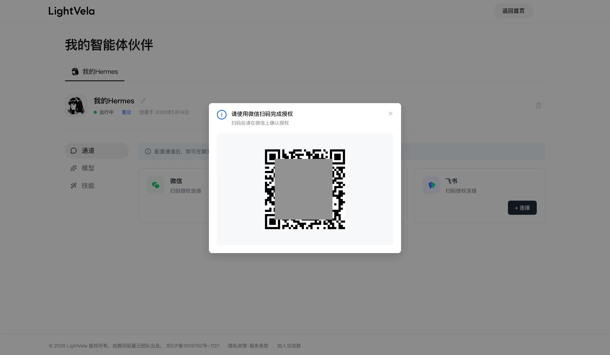
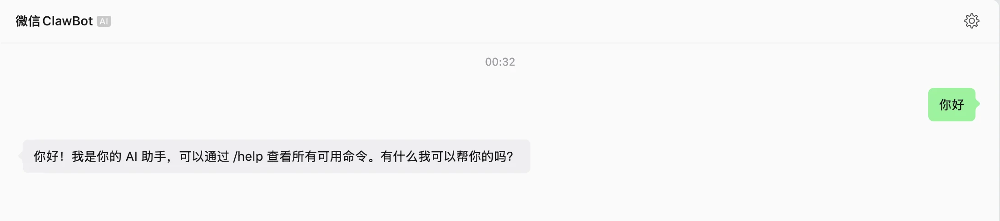

# 快速开始

本教程介绍从登录到在微信中收到 Hermes Agent 回复的完整流程，预计耗时约 5 分钟。

## 本页覆盖

- 登录 LightVela

- 完成实名认证（首次必做）

- 开通启航套餐并创建 Hermes Agent 实例

- 接入微信通道

- 在微信中发送消息并接收回复

> 💡 **准备工作**
>
> - 一个 QQ 或微信账号
>
> - 一张中国大陆居民身份证（用于实名认证）
>
> 启航套餐预置 100 体验积分，无需预先申请大语言模型 API Key 即可开始对话。

---

## 1. 登录 LightVela

访问 [lightvela.com](https://lightvela.com)，点击右上角「登录」。在登录对话框中选择 QQ 或微信账号，勾选协议后完成授权。



---

## 2. 完成实名认证

首次开通任意套餐前，账号必须完成实名认证；认证为一次性操作，后续开通其他套餐无需重复。

点击右上角头像 → 「账号管理」进入账号信息页，在「账号基本信息」卡片中，实名认证一行右侧点击「去认证 →」，在弹出的对话框中填写证件类型、真实姓名与身份证号，提交后弹窗自动关闭。





> ℹ️ **数据保护**
>
> 姓名和身份证号加密传输并存储，平台仅保留脱敏信息用于展示，认证信息不会用于其他用途。

更多细节请参见 [账号与实名认证](./03-account.md)。

---

## 3. 开通启航套餐

回到首页点击「立即创建」进入套餐页面，选择「启航 Launch」并点击「立即开通」。



> ⚠️ **启航套餐当前限时免费**
>
> 原价 ¥49/月，目前限时免费开通。若名额已满或活动结束，请关注官方动态。

开通成功后，顶部导航出现「我的 Hermes」入口，页面自动跳转至管理台。套餐包含内容详见 [LightVela 是什么 - 关于套餐](./01-overview.md#关于套餐)。

---

## 4. 创建 Hermes Agent 实例

进入管理台时，页面显示未创建 Hermes Agent 的空白状态。



点击「立即创建」，页面显示创建过渡动画「正在给 Hermes Agent 嘀咖啡，唤醒大脑中…」，等待约十几秒。



创建完成后，管理台顶部显示 Hermes Agent 基本信息卡，状态为 ● 运行中，下方出现模型、通道、技能三个配置按键。



> 💡 **修改名字**
>
> 点击名字或旁边的铅笔图标，输入新名字后按 Enter 保存。名字仅作标识用途，不影响 Agent 行为。

---

## 5. 接入微信通道

进入「通道」按键，下拉框中选择「微信」，点击「+ 连接」，页面弹出二维码。



使用手机微信的「扫一扫」扫描二维码，按手机提示完成授权。授权成功后弹窗自动关闭，「已接入通道」区域新增「微信」记录，同时微信联系人中会自动添加一个机器人账号。

> ⚠️ **扫码后操作**
>
> 扫码后，微信会提示添加一个机器人账号。添加该账号后，与其对话即等同于与 Hermes Agent 对话。

更多细节请参见 [配置通道 - 微信](./configuration/channel-wechat.md)。

---

## 6. 发送第一条消息

在微信中找到已添加的机器人账号，发送测试消息：

```
你好
```



几秒内即可收到 Hermes Agent 的回复，至此 Hermes Agent 已可通过微信进行对话。

> 💡 **消息计费说明**
>
> 默认使用启航套餐预置的 100 体验积分进行模型调用，无需额外配置；积分耗尽后需在「1. 模型」卡片配置自有 API Key，详见 [配置模型](./configuration/model.md)。

---

## 进阶：配置自有模型（可选）

如需使用特定厂商的模型，或在积分耗尽后继续使用，进入管理台「模型」按键，选择来源与具体模型、填入 API Key 并点击「添加为默认」即可。完整流程见 [配置模型](./configuration/model.md)。

---

## 常见问题

| 现象 | 可能原因 | 处理方式 |
|---|---|---|
| 点击「立即开通」提示「请前往 我的账号 进行实名」 | 账号尚未完成实名认证 | 按 [账号与实名认证](./03-account.md) 完成认证后返回 |
| 实名提交后长时间无响应 | 网络波动或后台繁忙 | 稍后重试 |
| 无法领取启航套餐 | 限时免费名额已满 | 关注官方动态，等待下次放量 |
| 创建 Hermes Agent 长时间卡在过渡页 | 云端初始化慢或网络波动 | 刷新页面；超过 1 分钟无响应时重新点击「+ 创建 Hermes Agent」 |
| 微信扫码后管理台无响应 | 二维码已过期 | 关闭弹窗，重新点击「授权接入」生成新二维码 |
| 消息发送后未收到回复 | 体验积分耗尽或通道未接入 | 检查「已接入通道」状态；积分耗尽后需配置自有 API Key |
| 微信中机器人联系人消失 | 授权被撤销或接入被解除 | 回管理台「通道」卡片重新授权接入 |

---

## 下一步

- [账号与实名认证](./03-account.md) — 账号管理与实名认证详情

- [核心概念](./04-core-concepts.md) — Hermes Agent、模型、通道、技能四项核心概念说明

- [配置总览](./05-configuration.md) — 管理台整体结构

- [配置技能](./configuration/skill.md) — 通过 SkillHub 扩展 Hermes Agent 能力
