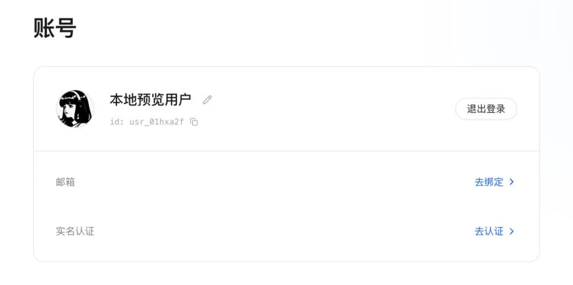
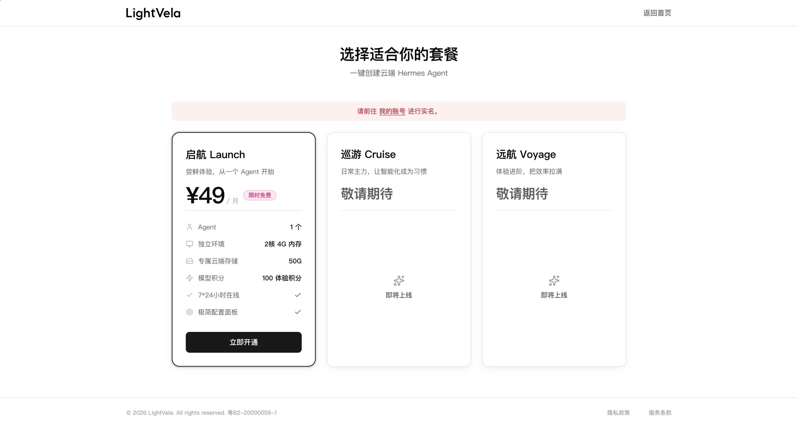
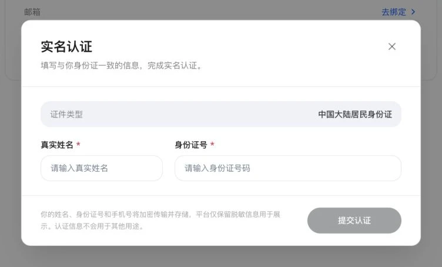

# 账号与实名认证

本页介绍 LightVela 的账号体系、账号信息页的功能以及实名认证流程。

## 本页覆盖

- LightVela 账号体系与登录方式

- 账号信息页的结构与功能

- 实名认证流程、适用场景与数据保护

- 退出登录与账号注销说明

---

## 账号体系

LightVela 使用社交账号一键登录，无需单独注册密码：

- QQ 账号登录

- 微信账号登录

账号基于 QQ / 微信的 OpenID 识别。同一用户若分别使用 QQ 与微信登录，会产生两个独立账号，数据不互通，建议固定使用一种登录方式。

---

## 账号信息页

登录后，点击右上角头像，选择「账号管理」进入账号信息页。页面由两个卡片组成：

### 1. 账号基本信息

- 头像与账号名

- 实名认证入口（未认证时显示「去认证 →」）

- 退出登录按钮

### 2. 订阅套餐

- 查看当前订阅状态

- 未订阅时显示「立即创建」按钮，点击跳转至套餐页

---

## 实名认证

### 何时需要认证

**首次开通任意套餐前**，账号必须完成实名认证。登录后浏览首页、阅读文档无需认证；但点击「立即开通」领取套餐时，若未认证，页面顶部会出现提示条：「请前往 我的账号 进行实名。」

### 为什么要认证

实名认证为 LightVela 账号解锁完整功能，覆盖以下两个目的：

- **合规要求**：符合国内 SaaS 服务的实名制要求

- **功能解锁**：实名后可开通套餐、发布技能、参与社区活动

### 认证状态一次生效，可更新信息

实名认证状态完成后会持续生效：

- 开通启航 / 巡游 / 远航等任意套餐均无需再次认证

- 未来购买 LightVela 其他产品亦无需再次认证

- 如果真实姓名或身份证信息需要更正，可回到账号页点击「修改」重新提交；新信息通过核验后会覆盖当前实名信息，后台保留变更记录。

### 认证流程

#### 1. 进入账号信息页

两种方式：

- 从套餐页提示条中点击「我的账号」链接

- 右上角头像 → 账号管理

#### 2. 点击「去认证」或「修改」

在账号基本信息卡中，未认证时点击「去认证 →」，已认证时点击「修改 →」，弹出认证对话框。

#### 3. 填写认证信息

| 字段 | 说明 |
|---|---|
| 证件类型 | 当前仅支持身份证 |
| 真实姓名 | 与证件一致的真实姓名 |
| 身份证号 | 18 位身份证号 |

#### 4. 提交认证

点击「提交认证」。认证成功后弹窗自动关闭，账号基本信息卡的「去认证」状态变更为已认证。此时返回套餐页，即可正常开通套餐。

> ℹ️ **数据保护**
>
> 姓名和身份证号加密传输并存储，平台仅保留脱敏信息用于展示，认证信息不会用于其他用途。

---

## 常见问题

### 支持哪些证件类型

当前仅支持中国大陆居民身份证，其他证件类型暂未开放。

### 未成年能否使用

未成年用户可以使用 LightVela 的基础功能，但部分功能（如发布技能、参与社区活动）对账号年龄存在限制，具体限制以认证时平台的提示为准。

### 认证失败如何处理

| 现象 | 可能原因 | 处理方式 |
|---|---|---|
| 提示姓名与身份证号不匹配 | 填写错误 | 核对后重新提交 |
| 提交后长时间无响应 | 网络波动或后台繁忙 | 稍后重试 |
| 提示姓名与身份证号已被他人绑定 | 该身份信息已绑定其他账号 | 联系官方渠道协助处理 |

### 实名后能否修改账号显示名或 Hermes 名字

可以。实名认证绑定的是真实姓名与身份证号，与账号显示名、Hermes 实例名称无关，后两者可在账号信息页或管理台随时修改。

### 实名后能否注销账号

当前管理台暂未开放自助注销入口，如需注销账号并清除实名信息，请通过官方渠道提交申请。

---

## 退出登录

在账号信息页的账号基本信息卡中点击退出按钮，可退出当前登录会话。退出后账号数据保留，下次登录即可继续使用；退出登录**不会**清除实名信息与已开通的套餐。

---

## 下一步

- [快速开始](./02-quickstart.md) — 完整的接入流程

- [核心概念](./04-core-concepts.md) — Hermes、模型、通道、技能四项核心概念说明

- [配置总览](./05-configuration.md) — 管理台功能说明
