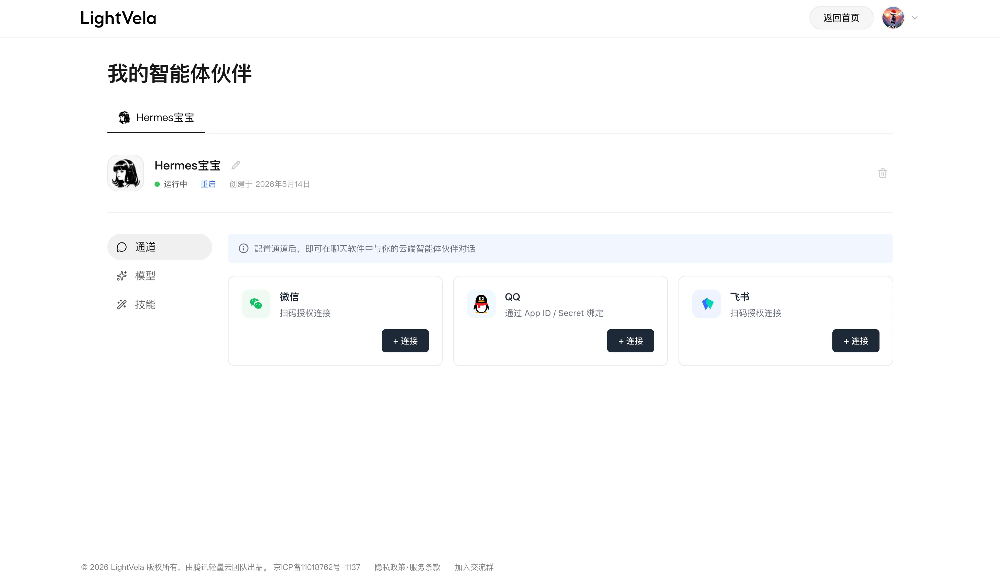

# 核心概念

LightVela 涉及四个核心概念：Hermes Agent、模型、通道、技能。本页对四者进行说明，具体的配置流程请参见对应的配置子页。

## 本页覆盖

- 四者之间的概念关系

- Hermes Agent 实例的特性

- 模型、通道、技能各自的定位与配置入口

- 一次完整对话的内部流程

---

## 概念关系

```
           ┌──────────────────────────────────┐
           │        Hermes Agent              │
           │  （LightVela 云端运行的 Agent）  │
           └──────────────────────────────────┘
                 │              │            │
           ┌─────┘              │            └──────┐
           ▼                    ▼                   ▼
       ┌───────┐           ┌────────┐          ┌────────┐
       │ 模型   │           │  通道  │          │  技能   │
       └───────┘           └────────┘          └────────┘
        模型服务商          微信/QQ/飞书         SkillHub
```

| 概念 | 角色 | 说明 |
|---|---|---|
| Hermes Agent | 对话主体 | AI Agent 实例本身 |
| 模型 | 语言能力 | Hermes Agent 调用的大语言模型 |
| 通道 | 交互入口 | 用户与 Hermes Agent 对话的平台 |
| 技能 | 能力扩展 | Hermes Agent 可调用的附加能力包 |



---

## Hermes Agent

Hermes Agent 是 LightVela 中的 AI Agent 实例，创建一个 Hermes Agent 等同于在云端启动一个独立的 Agent 实例。

Hermes Agent 具有以下特性：

- **独立运行环境**：每个 Hermes Agent 运行在专属环境中，与其他实例资源隔离

- **持续记忆**：对话内容跨会话保存，Agent 响应时会综合历史上下文

- **持续在线**：7×24 小时运行，不依赖用户本地设备

当前已上线套餐均支持创建 1 个 Hermes Agent 实例。

---

## 模型（Models）

模型指驱动 Hermes Agent 思考与响应的大语言模型（LLM）。LightVela 不自训模型，而是由用户在管理台「模型」卡片中选择调用方式：

| 方式 | 计费模式 | API Key 来源 | 适用场景 |
|---|---|---|---|
| 模型 Coding Plan | 包月 | 服务商 | 高频使用 |
| 模型 API | 按量 | 服务商 | 低频或试用 |
| 自定义模型 | 取决于端点 | 用户自备 | 接入国外模型或 OpenAI 兼容端点 |

此外，套餐会按月发放模型积分，无需任何配置即可开箱对话；积分额度因套餐而异，耗尽后再配置自有 API Key 也可以。

具体支持的模型列表、API Key 获取方式、选型建议等详见 [配置模型](./configuration/model.md)。

> ⚠️ **单模型生效**
>
> 当前版本每个 Hermes Agent 仅支持配置并生效一个模型，切换模型需通过「添加为默认」覆盖原配置。

---

## 通道（Channels）

通道指用户与 Hermes Agent 进行对话的聊天平台入口。LightVela 当前支持三个通道：

| 通道 | 接入方式 | 适用场景 |
|---|---|---|
| 微信 | 扫码自动绑定 | 日常个人使用 |
| 飞书 | 扫码自动绑定 | 办公场景，支持富文本消息 |
| QQ | 填写 AppID 与 AppSecret | 需要一定配置能力的场景 |

微信与飞书选择通道后点击「授权接入」生成二维码，使用手机扫码完成授权即可；QQ 则需先在 [QQ 开放平台](https://q.qq.com) 创建一个机器人，再将获得的 AppID 与 AppSecret 填回 LightVela。

各通道的详细接入步骤见 [配置通道 - 微信](./configuration/channel-wechat.md) / [飞书](./configuration/channel-feishu.md) / [QQ](./configuration/channel-qq.md)。

> 💡 **多通道并存**
>
> 多个通道可同时接入同一个 Hermes Agent 实例，共享记忆与 Agent 行为。无论从哪个通道发送消息，对话对象均为同一 Hermes Agent。

---

## 技能（Skills）

技能是 Hermes Agent 可调用的附加能力包，在基础对话之外扩展 Hermes Agent 处理具体任务的能力，例如自动整理待办、生成日报、浏览网页、图像生成等。

所有技能均来自 [SkillHub](https://skillhub.tencent.com)——腾讯推出的独立技能市场。在 SkillHub 可以浏览已上架的技能，查看其功能说明与使用示例。

在管理台「3. 技能 (Skills)」卡片中输入 SkillHub 上记录的技能名称，点击「安装技能」即可完成安装；也可以直接通过对话让 Hermes Agent 代为安装或删除。详见 [配置技能](./configuration/skill.md)。

> ⚠️ **安装前的安全确认**
>
> 技能运行时具有调用 Hermes Agent 能力的权限，安装前请确认技能作者可信，优先选择下载量高、评价良好的技能。

---

## 交互流程

一次完整对话的内部流程如下：

1. 用户通过通道（如微信）发送消息给 Hermes Agent

2. Hermes Agent 根据消息内容判断是否需要调用技能

3. 调用模型处理上下文并生成响应

4. 响应通过原通道返回至用户

---

## 下一步

- [配置总览](./05-configuration.md) — 管理台完整功能说明

- [快速开始](./02-quickstart.md) — 未创建 Hermes Agent 时的入门流程
