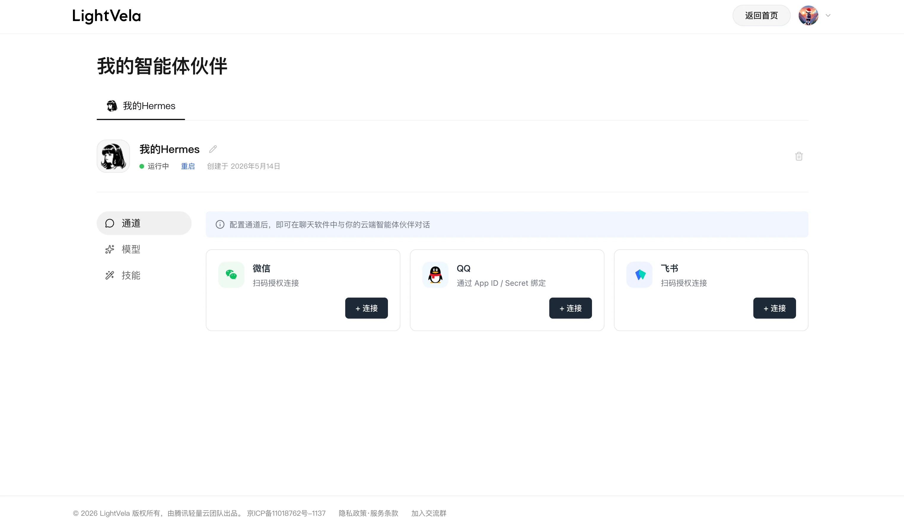
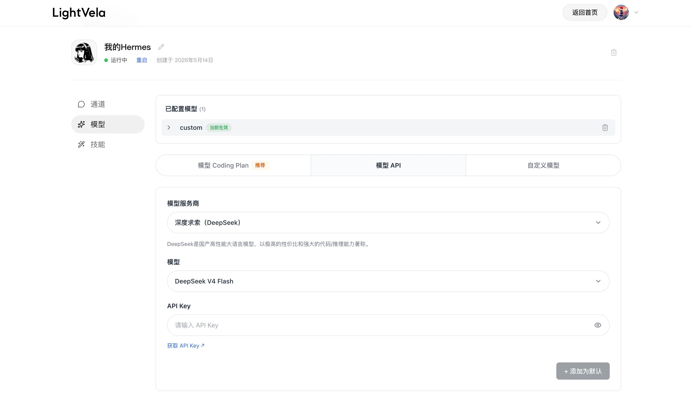
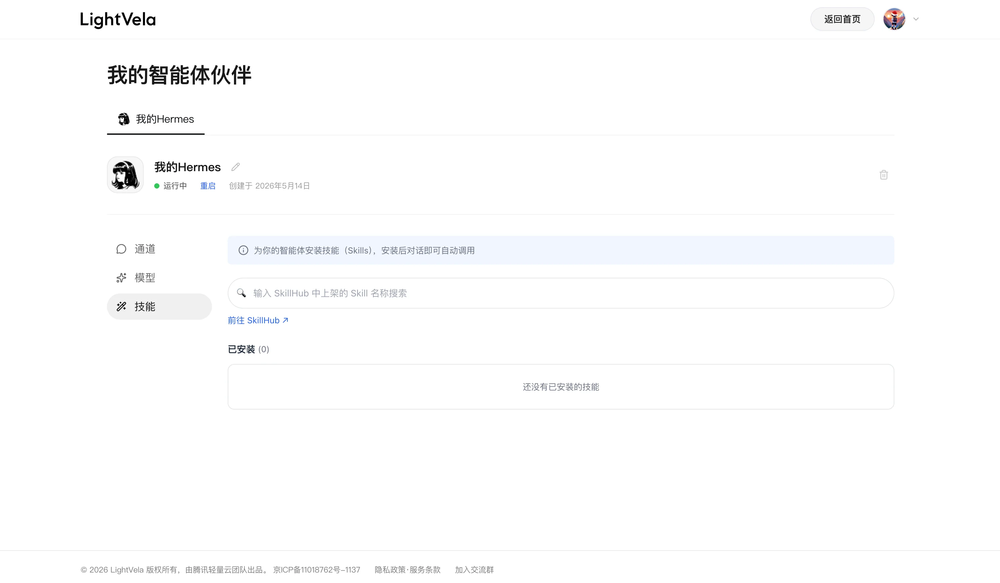

# 配置总览

## 摘要

**LightVela 的所有配置集中在「我的 Hermes」管理台，登录后点右上角进入。管理台顶部是 Hermes Agent 实例页签（当前已上线套餐均支持 1 个实例），下方由三个配置卡片组成：模型（选择模型 Coding Plan 包月、模型 API 按量或自定义 OpenAI 兼容端点，当前每个 Agent 仅一个模型生效）、通道（微信、企业微信、飞书扫码授权接入，QQ 需填写 AppID 与 AppSecret，多通道可同时接入并共享同一份记忆）、技能（按名称从 SkillHub 安装可复用能力）。三项配置完成后 Agent 即可在聊天通道中对话；常用操作还包括切换模型、接入多个通道与重建 Hermes Agent 实例。**

---

LightVela 的所有配置集中在「我的 Hermes」管理台中，由三个配置卡片组成：

1. 模型（Models）

2. 通道（Channels）

3. 技能（Skills）

本页介绍管理台的整体结构与各卡片的功能，各模块的详细操作请参见对应子页。

## 本页覆盖

- 进入管理台的方式

- Hermes Agent 实例信息卡

- 三个配置卡片的功能与配置入口

- 完成配置后的成功状态

- 切换模型、接入多个通道、重建 Hermes Agent 等常用操作

---

## 进入管理台

登录后，点击页面右上角「我的 Hermes」进入管理台。顶部提供「返回首页」按钮。

---

## Hermes Agent 实例信息

管理台顶部为 Hermes Agent 切换页签，每个页签代表一个 Hermes Agent 实例。当前已上线套餐均支持 1 个实例，右侧「+ 创建」按钮在达到实例上限后不可用。

选中某个 Hermes Agent 后，下方显示其基本信息：

- 头像

- 名字（点击名字或铅笔图标可修改，按 Enter 保存）

- 状态（● 运行中 / ● 未知）

- 创建时间

- 删除按钮（右侧垃圾桶图标）

> ⚠️ **删除为不可逆操作**
>
> 点击垃圾桶将永久删除该 Hermes Agent 实例，包括所有对话记忆、已接入通道与已安装技能。删除后若仍在套餐配额内可重新创建。

---

## 三个配置按键

三个卡片自左向右排列，建议按 1 → 2 → 3 的顺序配置。

### 1. 通道（Channels）

**用途**：将 Hermes Agent 接入聊天平台，为用户提供对话入口。

**各通道接入方式**：

| 通道 | 接入方式 | 所需条件 |
|---|---|---|
| 微信 | 扫码授权 | 一台装有微信的手机 |
| 飞书 | 扫码授权 | 一台装有飞书的手机 |
| QQ | 填写 AppID 与 AppSecret | 在 [QQ 开放平台](https://q.qq.com) 创建机器人 |

**卡片提供**：通道下拉、「授权接入」按钮、所选通道的介绍与「查看详情」链接、「已接入通道」列表。

详细操作请参见 [配置通道 - 微信](./configuration/channel-wechat.md) / [飞书](./configuration/channel-feishu.md) / [QQ](./configuration/channel-qq.md)。

---

### 2. 模型（Models）

**用途**：为 Hermes Agent 配置大语言模型。套餐自带模型积分时，也可跳过此步骤直接使用，待积分耗尽后再配置。

**卡片提供**：来源下拉（模型 Coding Plan / 模型 API / 自定义模型）、具体模型下拉、API Key 输入框、服务商介绍与获取 API Key 的外链、「当前模型」列表。

> ⚠️ **单模型生效**
>
> 当前版本每个 Hermes Agent 仅支持配置并生效一个模型，新的「添加为默认」将覆盖原有配置。

详细操作请参见 [配置模型](./configuration/model.md)。

---

### 3. 技能（Skills）

**用途**：扩展 Hermes Agent 的能力，例如整理待办、生成日报、联网搜索等。

**卡片提供**：技能名称搜索框、「安装技能」按钮、「前往 SkillHub」外链、「已安装技能」列表。安装前需先在 [SkillHub](https://skillhub.tencent.com) 确定目标技能的准确名称。

> ⚠️ **仅安装可信来源的技能**
>
> 技能运行时具有调用 Hermes Agent 能力的权限，请只安装可信来源的技能。

详细操作请参见 [配置技能](./configuration/skill.md)。

---

## 配置完成的状态

完成配置后，管理台应呈现以下状态：

- 「已接入通道」至少有一条记录（如「微信」）

- 「当前模型」可选配置；若使用套餐积分则无需配置

- 「已安装技能」按需配置，可为空

满足「已接入通道」这一条件即可在对应聊天平台中查找机器人并发起对话，Hermes Agent 将通过默认模型或套餐积分生成回复。

---

## 常用操作

### 切换模型

在「模型」卡片重新选择来源与模型，填入 API Key 并点击「添加为默认」，新的配置将覆盖原有记录。切换模型不会影响对话记忆。

### 接入多个通道

在「通道」卡片依次切换下拉选项并点击「授权接入」。多个通道指向同一 Hermes Agent，共享记忆与 Agent 行为。

### 重建 Hermes Agent

点击基本信息卡右侧的垃圾桶删除当前 Hermes Agent，再点击「+ 创建 Hermes Agent」重新创建。**所有对话记忆将丢失**。

---

## 下一步

各模块的详细配置：

- [配置模型](./configuration/model.md) — 模型来源、API Key 获取、选型建议

- [配置通道 - 微信](./configuration/channel-wechat.md) / [飞书](./configuration/channel-feishu.md) / [QQ](./configuration/channel-qq.md)

- [配置技能](./configuration/skill.md) — SkillHub 使用与技能安装

相关参考：

- [核心概念](./04-core-concepts.md)

- [快速开始](./02-quickstart.md)
