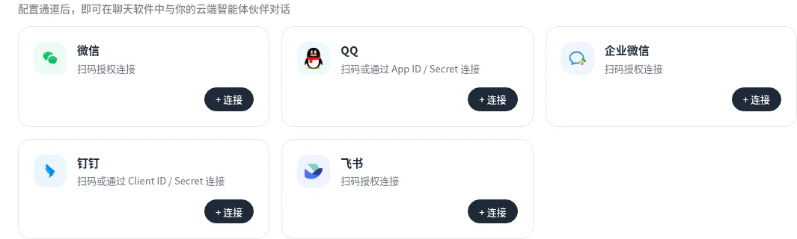
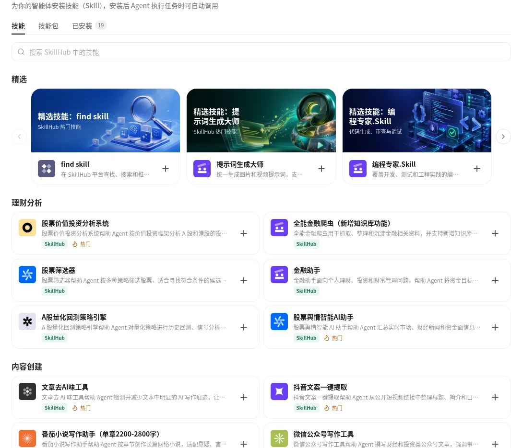
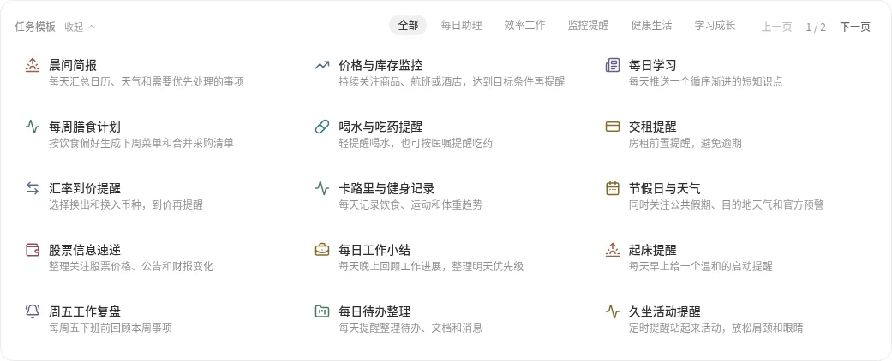

# 配置总览

## 摘要

**「我的 AI 伙伴」管理台提供「日常」与「探索」两个导航页签；日常包含通道、技能、定时任务及对话等入口。Bot 在线且套餐模型积分可用或已配置模型时，可先在「日常 → 对话」发送消息；微信等外部通道、技能、人设和定时任务都可按需配置。具体入口以当前管理台为准。**

## 从哪里开始

1. 进入「我的 AI 伙伴」，选择要使用的 Bot。首次创建需先完成外观、名字和配置引导，再点击 **开始旅程**；已有 Bot 后，再次创建或复制的步骤见[管理与切换 Bot](./configuration/bots-switching.md)。
2. 确认套餐模型积分可用，或按[配置模型](./configuration/model.md)添加自有模型。
3. 在「日常 → 对话」新建会话并发送测试消息；网页对话无需接入外部通道，操作见[对话](./configuration/agent-chat.md)。
4. 需要在聊天软件中使用 Bot 时，再按下节连接对应通道；技能、人设和定时任务按需配置。

## 连接聊天通道

国内站通道页面展示微信、QQ、企业微信、钉钉和飞书五个接入入口。不同通道的授权要求以相应指南和管理台提示为准：

| 通道 | 基础接入方式 | 指南 |
|---|---|---|
| 微信 | 扫码授权 | [配置微信](./configuration/channel-wechat.md) |
| QQ | 扫码或 App ID / Secret | [配置 QQ](./configuration/channel-qq.md) |
| 企业微信 | 扫码授权 | [配置企业微信](./configuration/channel-wecom.md) |
| 飞书 | 扫码授权 | [配置飞书](./configuration/channel-feishu.md) |
| 钉钉 | 扫码或 Client ID / Secret | [配置钉钉](./configuration/channel-dingtalk.md) |

多个通道可以连接到同一个 Bot。配置前先选择目标 Bot；通道连接不会随复制 Bot 自动继承。连接成功后，可以在已连接通道卡片点击 **测试**；“测试消息已发送”只表示发送命令被接受，需要到目标聊天软件确认实际收到。随后从聊天软件发送简短消息，确认 Agent 能回复。

## 管理台功能地图

| 使用目的 | 文档入口 |
|---|---|
| 设置模型或切换当前模型 | [配置模型](./configuration/model.md)、[模型切换](./configuration/multiple-models.md) |
| 扩展任务能力 | [配置技能](./configuration/skill.md) |
| 在网页中与当前 Bot 对话 | [网页对话](./configuration/agent-chat.md) |
| 定时执行与通知 | [定时任务](./configuration/automation.md) |
| 调整角色和长期上下文 | [人设](./configuration/personality.md)、[记忆管理](./configuration/memory.md) |
| 管理文件 | 在左下角账号菜单选择 **云存储**；操作见[云存储](./configuration/files.md) |
| 排查异常 | [诊断中心](./configuration/diagnostics.md) |
| 调整高级选项 | [高级设置](./configuration/advanced-settings.md) |
| 管理和切换 Bot | [管理与切换 Bot](./configuration/bots-switching.md) |
| 使用实验功能 | [DeepSeek Harness](./configuration/deepseek-harness.md)、[我的工作台](./configuration/workbench.md) |

模型入口在不同套餐下可能显示在侧栏「使用」分组或左下角账号菜单中。实验功能及新增 Bot 的可用性受账户、套餐和功能开放状态限制。

## 技能与定时任务

在「日常 → 技能」可查看「技能」「技能包」和「已安装」页签。国内站技能市场为 SkillHub；添加技能后，到「已安装」核对结果。完整步骤见[配置技能](./configuration/skill.md)。

在「日常 → 定时任务」可选择任务模板或按需设置任务。下图展示模板列表，不表示模板已经为当前 Bot 创建任务；请按页面提示完成配置，再检查任务是否已启用。

## 没有收到回复

网页对话无回复时先核对 Bot 状态、模型积分或自有模型额度。聊天软件无回复时，再确认对应通道已连接，并用 **测试** 按钮检查测试消息是否到达。仍无法回复时，到[诊断中心](./configuration/diagnostics.md)查看近期日志；常见问题也可在 [FAQ](./07-faq.md) 中查找。
