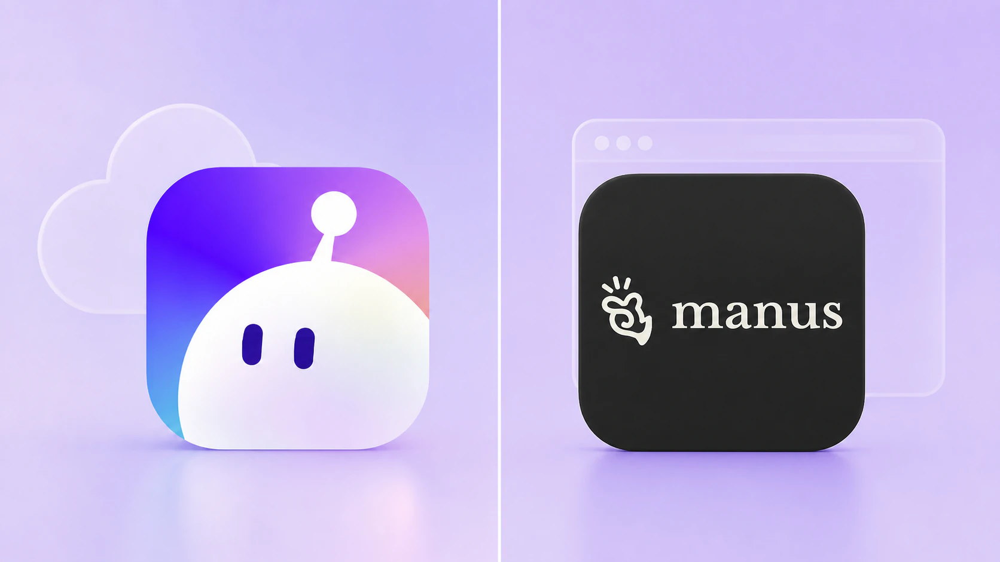

# LightVela vs Manus：哪个更适合托管你的 AI Agent？

## 摘要

**如果你想要一个长期在线、记得你的设置，并存在于日常消息通道中的个人 Hermes Agent，可以选择 LightVela。** 如果你希望把一个明确的任务——研究、浏览器操作、报告或工作流——交给 Agent，并让它朝着可交付结果执行，可以选择 Manus。两者都被称为“Agent”，但在日常使用中，它们的出发点完全不同。

## 快速对比

| 你关心的方面 | LightVela | Manus |
| --- | --- | --- |
| **起点** | 你持续使用的云端 Hermes Agent | 你希望 Agent 完成的目标或任务 |
| **日常使用入口** | 消息通道和配置管理台 | 虚拟电脑和浏览器工作区 |
| **运行方式** | 始终在线的独立 Hermes Agent | 默认是任务沙箱，也可使用持久化 Cloud Computer |
| **主要控制方式** | 选择模型、通道、人设和技能 | 描述目标，需要时介入 |
| **适合场景** | 每天都会回来的个人 Agent | 自主研究和多步骤执行 |

## 两种不同的出发点

LightVela 采取的是更个人化的路径。它在云端托管独立的 Hermes Agent，让 Agent 长期在线，并通过微信、QQ、企业微信、飞书、钉钉等已配置通道与你对话。[LightVela 概览](../01-overview.md) 介绍了这种托管模式，以及 Agent 如何保持与你日常工具的连接。

Manus 将自己定位为拥有虚拟电脑的自主通用 AI Agent：你给出一个结果目标，它负责规划、执行并返回工作成果。它的 [Cloud Browser](https://manus.im/docs/features/cloud-browser) 可以访问网站、填写表单、提取信息，并完成多步骤浏览器工作流。

> **LightVela 从一个你会持续使用的 Agent 开始；Manus 从一个任务开始。**

## 日常使用会有什么不同

在普通的一天里，这种差异最容易被感受到。

使用 LightVela 时，你可能会说：“持续关注这个主题”“明天提醒我”“帮我推进这个项目”，或者只是问：“我们上次最后决定了什么？”重点不是交付一份单独的成品，而是让同一个 Hermes Agent 长期在身边，并保留你选择的上下文和设置。

使用 Manus 时，你可能会说：“研究 30 家竞争对手，整理它们的价格，然后写成一份简短的市场报告。” Agent 可以通过浏览器完成研究、收集信息并整理结果。这很适合边界清晰的工作，因为它有明确的完成标准。

因此，两者需要你思考的配置问题也不同。在 LightVela 中，你可以通过管理台选择要使用的[模型](../configuration/model.md)，连接需要的[通道](../05-configuration.md)，并添加适合自己习惯的[技能](../configuration/skill.md)。在 Manus 中，结果质量往往首先取决于你是否清楚描述任务、约束条件，以及“完成”具体意味着什么。

## 哪些情况下 LightVela 更适合

如果你想长期保留的是 Agent 本身，而不只是某一个任务，LightVela 会更合适。

云端 Hermes Agent 适合这样一种需求：你希望有一个熟悉的地方可以随时回来，使用同一个已配置的模型、同一组连接通道、同样的技能，以及持续保留的对话上下文。你不用为了让 Agent 在线而一直开着笔记本，也不用自己维护服务器。

这和“帮我完成这个任务”带来的便利不同。它更像一个始终在身边的助手，当你想到什么时，随时可以发消息给它。

如果你希望围绕自己的习惯塑造 Agent，LightVela 也更合适：你可以配置模型、选择对话发生的通道，并通过技能扩展 Hermes。如果还有重复性工作，也可以设置定时任务，让它按固定星期或间隔触发，而不是每次都把请求当成一个全新的项目。

## 哪些情况下 Manus 更适合

如果你有一项边界清晰、需要通过浏览器完成并产出结果的任务，Manus 会更合适。它的 [Cloud Browser](https://manus.im/docs/features/cloud-browser) 可以跨网站和你授权的登录状态执行操作；CAPTCHA 或短信验证等环节仍需要你介入。

- **研究或报告：** 将明确的任务说明整理成对比或报告。
- **网页操作：** 在多个网页应用中完成具体工作流。
- **持续执行：** 对需要长期运行的任务使用 Cloud Computer，详见[帮助文档](https://help.manus.im/en/articles/15392111-what-is-the-cloud-computer)。

## 用一项真实工作验证选择

假设你每周要整理五个竞品的更新，周一上午发给同事。先把工作拆成三步：收集官网和公开资料、筛选真正有变化的内容、把摘要送到你平时查看的地方。再记录两项约束：网站是否需要登录，以及任务结束后是否还要继续追踪。这样能避免仅凭一次漂亮的演示，推断某个产品已经覆盖你的整个工作流。

如果核心难点是跨多个网站操作、读取登录后内容、形成一份完整报告，可以先让 Manus 执行一次。它的 [Cloud Browser](https://manus.im/docs/features/cloud-browser) 支持在云端浏览网站并使用你授权的登录状态；遇到验证码、短信或多因素验证时，需要你接管相应步骤。检查报告时，逐条核对来源、时间和遗漏的网站。对于不允许数据中心 IP 访问的网站，也要提前验证可访问性，不能假设所有页面都能由云端浏览器顺利打开。

如果关键需求是每周固定时间收到一份简报，并且随时能在微信、QQ 或飞书继续追问，可以在 LightVela 先完成一轮普通对话，再配置[智能定时任务](../configuration/automation.md)。任务能否正确获取资料，取决于模型、工具、技能以及你提供的数据来源；设置了定时任务本身不会自动获得某个网站的访问权限。保存后同时查看任务执行记录和目标聊天软件中收到的消息。管理台出现“测试成功”只说明测试命令执行，实际送达还需到聊天软件确认。

这两条路径也可以组合：先用适合多步骤网页操作的工具生成经过核对的材料，再把摘要或待办交给长期使用的 Hermes Agent。组合之前先明确资料如何传递、谁负责更新、重复内容怎样去除，以及失败时由谁补发；产品名称无法替你完成这些交接条件。

## 对比时容易忽略的边界

**长期在线与长期任务不是同一个概念。** LightVela 托管的是可持续配置和联系的 Hermes 环境；Manus 的 Cloud Computer 也提供持久化计算环境，不能把它描述成只能运行一次性任务。你应比较的是自己需要保留什么：聊天关系、模型和通道设置，还是某个任务使用的文件与工作环境。若业务需要同时保留两者，应分别验证各自的保存和继续执行方式。

**浏览器自动化不等于任何网站都能自动完成。** 登录、验证码、权限和网站限制会影响执行。Manus 官方文档说明了用户接管及云端网络边界。LightVela 的技能或工具同样需要对应授权和可用的数据来源；在文档里看到“可以加技能”，并不代表默认就能访问你公司的系统。涉及内部资料时，先用低敏样例核对授权路径，再决定是否接入真实工作数据。

**消息通道不等于结果一定送达。** LightVela 国内站提供微信、QQ、企业微信、飞书、钉钉等通道，但具体接入步骤、消息类型和平台限制不同。连接后发送一条真实消息，并从对话窗口检查回复。Manus 的结果交付方式应以你使用的当前功能和账号权益为准；若你需要在指定聊天软件里接收内容，把这一点列为验收条件，而不是只比较 Agent 的生成质量。

**定价要按实际工作量核算。** LightVela 的[套餐与积分说明](../plans.md)区分订阅权益、模型积分和可另购的积分包；智能任务调用模型会消耗积分。Manus 的价格与任务额度也可能随套餐调整。用同一项任务估算每月次数、每次需要的资料量和人工介入时间，再查看两边当前的官方价格页。本文只比较使用方式，不承诺固定价格或哪个产品一定更省钱。

**数据保存方式需要单独确认。** 对于需要持续追踪的主题，列出你希望一个月后仍能找到的内容：原始网页、生成的文件、对话记录、已配置的通道和任务执行记录。分别在两个产品中查找这些内容的入口，并试一次修改与删除。若资料需要交给其他人接续处理，也要确认导出形式和权限。仅凭“有记忆”或“有云端电脑”的功能名称，无法判断它是否满足你对资料留存的要求。

## 做决定前的核对表

| 要验证的问题 | 建议怎么试 | 满足什么条件再继续 |
| --- | --- | --- |
| 能否取得必需资料 | 用真实但低敏的页面和账号跑一轮 | 所需来源都可访问，引用能复核 |
| 是否符合时间要求 | 设置一次实际执行并看记录 | 在预期时间产出，而非只保存了计划 |
| 人要介入多少次 | 记录验证码、授权、修改提示词和审核步骤 | 人工成本可以接受 |
| 结果在哪里接收 | 到目标页面或聊天软件查收 | 收件人能找到完整结果 |
| 下周如何继续 | 修改一次目标或资料来源后再运行 | 不必从头重建整个工作流程 |

如果你主要交付的是一份边界清楚的研究或网页操作结果，先试 Manus；如果你更在意日常通道中的长期联系与可调整的 Hermes 配置，先试 LightVela。通过同一项任务的两轮实际执行来决定，比把所有 Agent 都归为一个类别更可靠。

最后，把试运行记录留给真正使用结果的人看：他们能否找到原始来源、能否指出一条错误并要求重做、下周是否能按照相同标准复核。Agent 在后台完成了许多步骤，不代表交付物自然可信。还可以请另一位成员只凭交付物复核一次，记录他能否重现关键数据；如果不能，就要求保留原始页面链接、采集时间和你的审核结论。若工作涉及对外发送、购买或修改账户设置，先限定允许自动执行的动作和需要人工确认的节点，再按实际权限验证。这样选出的工具，才会与团队的工作方式匹配。

## 你应该如何选择

如果符合以下情况，可以选择 LightVela：

- **你看重持续使用：** 希望 Hermes Agent 不只服务于单个任务，而是长期在线。
- **你更喜欢消息沟通：** 希望通过日常使用的通道联系 Agent。
- **你希望持续塑造 Agent：** 想长期控制模型、通道、技能和人设。
- **你不想处理基础设施：** 希望拥有长期在线 Agent，同时不承担服务器设置或本地设备维护。

如果符合以下情况，可以选择 Manus：

- **你需要一份完成的结果：** 希望 Agent 接手明确的多步骤任务并返回结果。
- **你的工作依赖浏览器：** 经常使用网页工具和研究工作流。
- **你更喜欢任务说明：** 更愿意描述一项工作，而不是长期维护个人 Agent。

说实话，它们也可以互相配合。**LightVela 可以是你留在身边的 Hermes Agent——你会持续与它对话、配置它，并围绕它建立使用习惯；Manus 则可以是你派出去处理大型浏览器任务的专注型执行者。**
