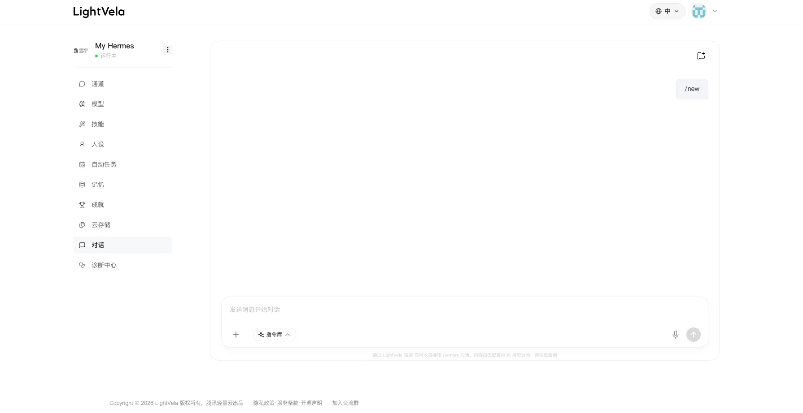

# 对话

## 摘要

**登录 LightVela 并开通套餐后，可在「我的 AI 伙伴」侧栏的「日常 → 对话」直接与当前 Bot 聊天，无需先接入微信等外部通道。对话列表保留当前 Bot 的会话；可从侧栏新建对话或继续已有会话。发送消息前，确认 Bot 在线，且套餐模型积分可用或已配置模型。**

## 开始对话

1. 登录后进入「我的 AI 伙伴」，确认侧栏顶部选中要使用的 Bot。
2. 在「日常」中展开「对话」，点击「新建对话」。也可从总览页对应 Bot 卡片进入该 Bot 的新对话。
3. 在「聊聊你的想法，或交给我一件事」输入框中写下问题或任务，然后发送。
4. 在页面中查看回复。首次加载时可能短暂显示「你的 AI 伙伴，马上就来」，请等待输入框出现后再操作。

网页对话不要求先配置聊天通道。若想在微信、QQ 或飞书中继续使用当前 Bot，再到「通道」接入相应平台。

## 继续或管理会话

「对话」下方列出当前 Bot 的最近会话。点击标题可继续；点击「查看更多」可显示更早的会话。会话右侧的操作菜单可重命名或删除会话。切换 Bot 后，侧栏显示所选 Bot 的会话。

对话中的长期偏好和项目信息由 Hermes 按需沉淀。可在[记忆管理](./memory.md)查看当前 Bot 的长期记忆；新建对话不会清除这些记忆。

## 结果校验与问题处理

- **正常结果**：消息发送后出现在当前会话中，Bot 返回回复，刷新或重新进入后可从侧栏继续该会话。
- **仍显示加载提示**：先确认 Bot 已在线，再刷新页面；不要在加载提示尚未消失时判断对话不可用。
- **无法发送或没有回复**：检查套餐模型积分或[模型配置](./model.md)，并确认 Bot 没有暂停。外部通道是否接入不影响网页对话入口。
