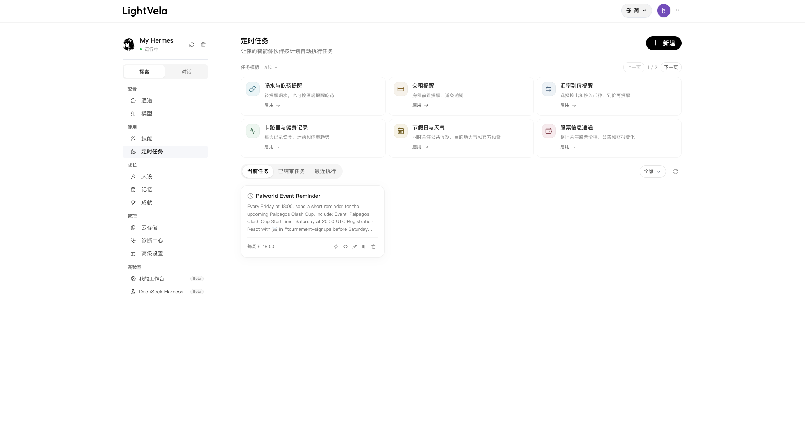
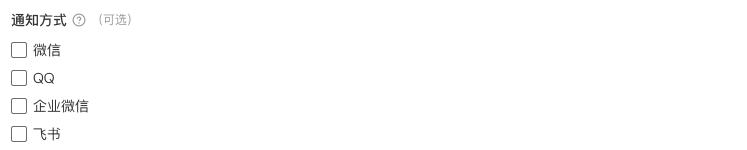
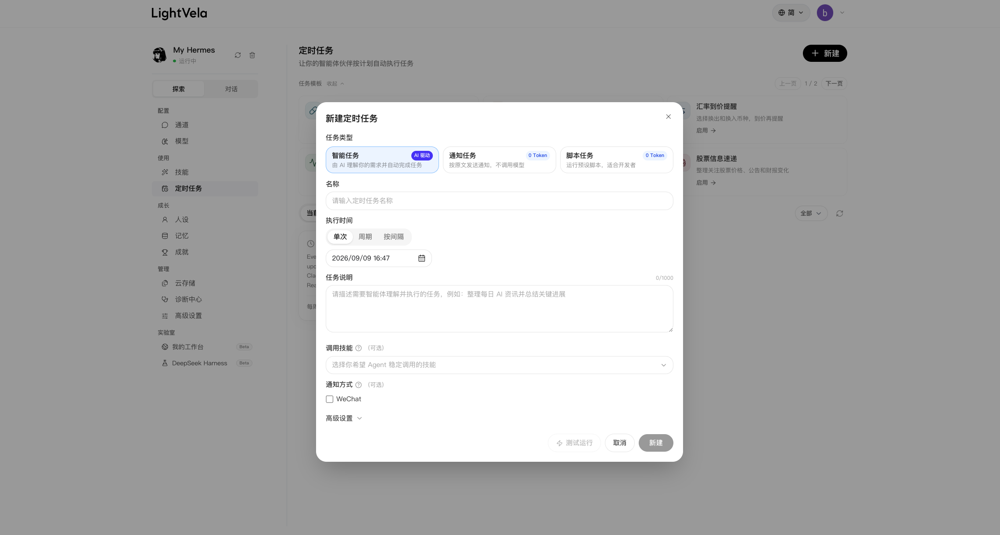
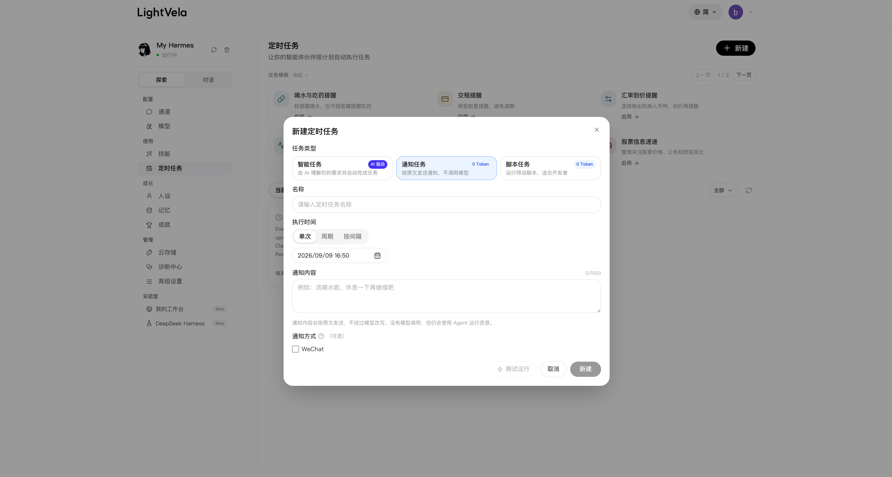
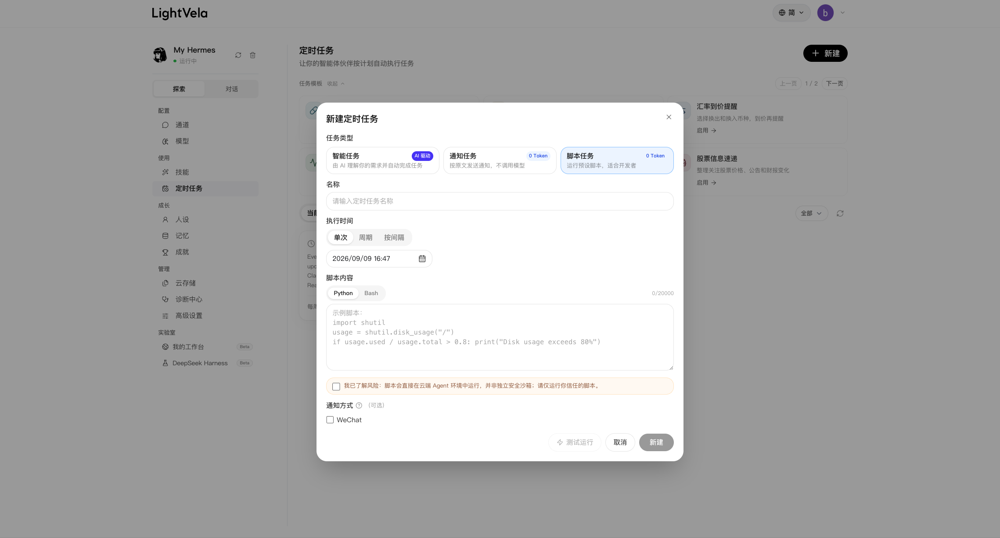
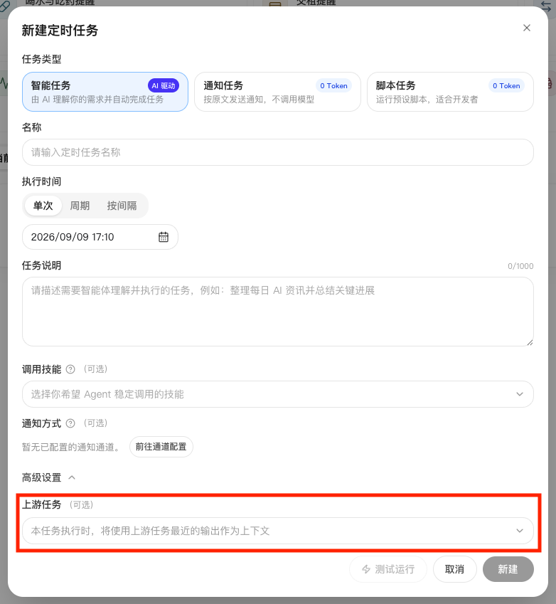
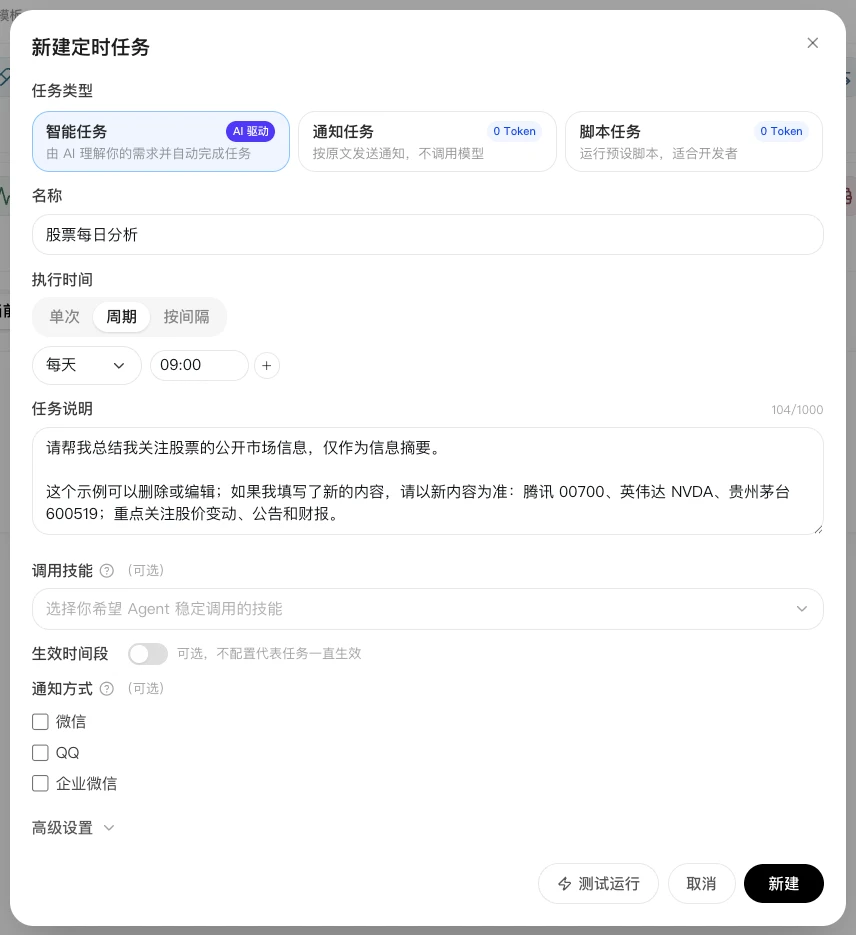

# 定时任务

## 摘要

**定时任务让 Hermes Agent 无需手动提示即可主动开始工作。需要 AI 理解、分析或生成内容时，选择智能任务；需要按原文发送固定消息时，选择通知任务；需要用 Bash 或 Python 完成确定性检查时，选择脚本任务。三种类型共用单次、周期和按间隔执行方式，以及生效时间段和通知设置。**

## 选择任务类型

根据任务在到点后需要完成的工作选择类型。

| 任务类型 | 适合的场景 | 需要填写的内容 | 到点后如何执行 |
| --- | --- | --- | --- |
| **智能任务** | 需要理解、总结、研究、分析、撰写或其他判断的工作 | 任务说明，以及可选的 Skill 或上游任务 | Hermes Agent 启动由模型驱动的任务。 |
| **通知任务** | 固定提醒、通知和例行消息 | 通知正文 | LightVela 管理的任务按原文发送正文，不调用模型。 |
| **脚本任务** | 面向开发者的检查和确定性自动化 | Bash 或 Python 脚本 | 脚本不创建 Agent 会话，也不调用模型；非空标准输出可作为通知发送。 |

任务类型与执行时间是两个独立维度。
每种类型都可以单次执行、按天/周/月周期执行，或按固定间隔执行。

## 新建前的准备

确认 Hermes Agent 处于可用状态，需要发送结果时选择通知通道，并在保存脚本任务前检查脚本内容。

## 新建智能任务

当 Hermes Agent 需要理解你的要求并生成结果时，选择**智能任务**。
例如，智能任务可以每天收集 AI 资讯、筛选最相关的内容，并整理成简洁简报。

设置以下字段：

- **名称**：给任务设置便于识别的名称。
- **执行时间**：选择单次、周期或按间隔执行。
- **任务说明**：写清目标、范围、来源约束和输出格式。
- **Skill**：当任务需要对应能力时，可选择一个可用的 Skill。
- **上游任务**：可选，使用另一个智能任务最近一次完成输出作为额外上下文。
- **生效时间段**：可选，限制任务允许执行的时间范围。
- **通知方式**：可选，选择任务结果需要发送到的通道。

到达执行时间后，Hermes Agent 会创建 Agent 任务并调用所选模型。
结果可以发送到选定的通知通道，也会记录在最近执行中。

## 新建通知任务

当消息需要完全按原文发送时，选择**通知任务**。
例如，可以创建每日喝水提醒、每月房租提醒或简短的团队通知。

设置任务名称、执行时间、通知内容、生效时间段和通知通道。
通知内容可以包含普通标点、换行、Emoji 和多语言文本。

到达执行时间后，LightVela 会按原文发送通知内容。
它不会让模型起草、改写、总结、翻译或解释这条消息。
因此，这类任务的模型 Token 消耗为 0 Token。

如果没有选择通知通道，任务会在后台运行并写入记录，而不会发送消息。
不同通知通道仍可能按自己的文本协议渲染换行和字符。

## 新建脚本任务

当需要确定性的 Bash 或 Python 工作流时，选择**脚本任务**。
例如，脚本可以检查磁盘使用率、检查服务响应，或仅在超过阈值时输出告警。

设置任务名称、执行时间、脚本语言、脚本内容、生效时间段和通知通道。
创建前需要确认脚本安全提示，并确认你信任这段代码。

脚本任务不会创建 Agent 会话、调用模型、使用任务说明或调用 Skill。
它的模型 Token 消耗为 0 Token，但仍会使用云端 Agent 运行资源。

| 脚本结果 | 任务结果 | 通知行为 |
| --- | --- | --- |
| 退出码为 `0`，且标准输出非空 | 成功 | 按原文把标准输出发送到选定通知通道。 |
| 退出码为 `0`，且标准输出为空 | 静默成功 | 不发送结果通知。 |
| 非零退出码 | 失败 | 记录失败，并按任务失败处理流程反馈。 |
| 超时或无法启动 | 失败 | 记录失败类型，并按任务失败处理流程反馈。 |

不要把脚本任务当作由 AI 自动修复、解释或总结失败的工具。
它保持确定性：空输出仍保持静默，脚本失败也不会触发模型兜底。

## 关联上游智能任务

当一个智能任务需要为另一个智能任务准备上下文时，可以关联上游任务。
下游任务会获得上游任务最近一次完成的输出，同时保留自己的执行时间、任务说明、生效时间段和通知设置。

上下游任务之间应留出足够的执行时间，并在下游任务说明中写清楚如何使用上游输出。
上游上下文、模型执行和 Skill 只适用于智能任务。

## 设置共用执行时间和通知规则

三种任务类型共用相同的执行时间和通知控制项。

- **单次**：在选择的日期和时间执行一次。
- **周期**：按天、周或月，在选择的时间执行。
- **按间隔**：每隔选择的分钟、小时或天数执行。
- **生效时间段**：限制周期或按间隔任务允许执行的时间范围；留空则全天保持生效。
- **通知方式**：选择需要接收成功结果或任务通知的通道。

在创建任务时切换类型，不会清空这些共用设置。
任务创建后不能切换类型；如果需要改变执行模式，请新建一个任务。

## 使用任务模板

如果不确定如何开始创建智能任务，可以使用定时任务页面中的任务模板。
选择喝水与吃药提醒、交租提醒、汇率到价提醒或股票信息速递等卡片，再在创建任务前检查生成的执行时间和说明。

打开模板后，新建任务表单会预填内容。
例如，“股票信息速递”模板会带入任务名称、每日执行时间和市场信息整理说明，创建或测试前仍可继续调整。

自定义通知任务或脚本任务时，应从新建弹窗开始，而不是尝试把模板任务改成另一种类型。

## 管理定时任务

创建任务后，可在定时任务页面查看当前任务、已结束任务和最近执行。
当前任务视图可按智能任务、通知任务和脚本任务筛选。

已结束任务会收纳已完成、失败和已过期任务。
持续运行的任务保留在当前任务中。

可在任务列表中查看详情、修改允许修改的设置、暂停任务或删除任务。
删除有关联关系的智能任务前，应检查是否仍有下游任务依赖它最近一次完成输出。

## 验证新建任务

创建或编辑任务后，不要只看“保存成功”。

1. 确认任务出现在正确的类型筛选中，且状态符合预期。
2. 检查执行时间、生效时间段和通知设置。
3. 运行测试或等待一次真实执行，然后检查最近执行。
4. 对于智能任务，确认结果遵循任务说明，并在配置时使用了选定的上游任务输出。
5. 对于通知任务，确认收到的文本与填写的内容一致。
6. 对于脚本任务，检查退出结果，以及标准输出是否按预期发送或保持静默。

## 常见失败处理

| 现象 | 可能原因 | 建议处理 |
| --- | --- | --- |
| 任务没有按预期执行 | 执行时间、生效时间段或任务状态未启用 | 检查执行时间和生效时间段，确认任务已启用，然后查看最近执行。 |
| 智能任务结果偏离目标 | 任务说明不清晰、所需 Skill 不可用，或缺少上游上下文 | 写清目标、范围、输出格式和来源约束，并在下一次执行前检查 Skill 与上游任务。 |
| 通知任务执行了但没有收到消息 | 没有选择通知通道，或目标通道不可用 | 选择并验证通知通道，然后重新测试任务。 |
| 脚本任务执行后没有消息 | 脚本成功退出但没有标准输出 | 这是静默成功。需要发送消息时，让脚本在条件满足时输出准确文本。 |
| 脚本任务失败 | 脚本报错、超时或无法启动 | 检查执行记录，修正可信脚本后重新测试。不要期待 AI 自动修复或解释脚本。 |
