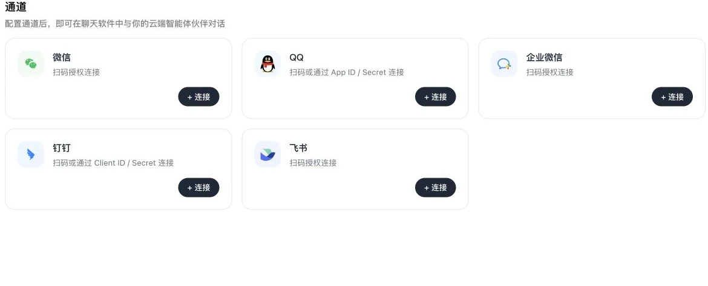
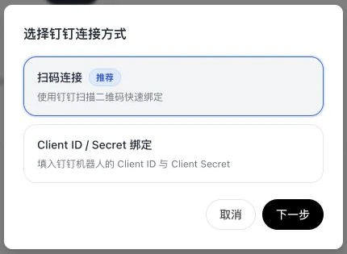

# 配置通道 - 钉钉

## 摘要

**钉钉是 LightVela 国内站已支持的通道。当前国内站管理台支持两种接入方式：推荐使用钉钉扫码快速绑定；如果已有可用的钉钉应用或机器人，也可以填写 Client ID 与 Client Secret 手动绑定。** 连接完成后，不要只看页面提示“测试消息已发送”，还需要回到钉钉会话里确认收到测试消息，并主动发送“你好”验证 Hermes Agent 能正常回复。

## 开始前

1. 已开通 LightVela 套餐，并已创建至少一个 Hermes Agent / Bot。
2. 已登录钉钉，并确认有权使用要绑定的钉钉账号、组织或应用。
3. 当前 Bot 已有可用模型：可以使用套餐内模型积分，也可以在[配置模型](./model.md)中接入自有模型。
4. 如果选择手动绑定，提前准备钉钉应用的 **Client ID** 与 **Client Secret**。

凭证属于敏感信息。不要把 Client Secret 粘贴到聊天、工单公开内容、长期记忆、文档示例或代码仓库中。

## 选择连接方式

1. 登录 LightVela 国内站。
2. 打开「我的 Hermes」，选择要接入钉钉的 Bot。
3. 在左侧设置导航进入「通道」。
4. 找到「钉钉」卡片并点击连接。
5. 在「选择钉钉连接方式」弹窗中选择一种方式：
   - **扫码连接**：推荐方式，使用钉钉扫码完成授权。
   - **Client ID / Secret 绑定**：适合已经有可用钉钉应用凭证的用户。





如果当前页面没有显示钉钉卡片，先确认你访问的是国内站「我的 Hermes」和当前 Bot 的通道页。

## 方式一：扫码连接

扫码方式适合首次接入，通常不需要手动复制凭证。

1. 在连接方式弹窗中选择「扫码连接」。
2. 页面生成钉钉授权二维码。
3. 打开钉钉，用「扫一扫」扫描页面二维码。
4. 在钉钉中按提示确认授权。
5. 回到 LightVela 管理台，等待钉钉卡片显示为已连接。

二维码有时效。二维码过期时，关闭弹窗后重新发起连接即可。

## 方式二：Client ID / Secret 绑定

如果你已经有可用于接入的钉钉应用或机器人，可以使用手动绑定。

1. 在连接方式弹窗中选择「Client ID / Secret 绑定」。
2. 打开钉钉开发者后台，找到目标应用的 Client ID 与 Client Secret。
3. 回到 LightVela 管理台，填写 Client ID。
4. 填写 Client Secret。
5. 点击「绑定钉钉机器人」。
6. 等待页面提示绑定成功，并确认钉钉卡片显示为已连接。

钉钉应用类型、权限与回调配置可能随平台策略变化。本页不复制第三方平台的创建应用步骤；需要新建应用时，以钉钉开放平台当前要求和 LightVela 管理台即时提示为准。

## 验证连接是否可用

连接成功后，按下面两步验证，不要只看管理台状态：

1. 在 LightVela 的钉钉通道卡片上点击「测试」，然后到钉钉里确认是否收到来自 LightVela 的测试消息。
2. 在对应钉钉会话里主动发送：

```text
你好
```

如果 Hermes Agent 能在钉钉中回复，说明当前 Bot 的钉钉收发链路、模型和积分状态基本可用。

页面提示“测试消息已发送”只表示发送命令被接受，不等于钉钉侧一定收到，也不等于 Agent 一定能回复真实用户消息。

## 常见失败处理

| 现象 | 可能原因 | 处理方式 |
| --- | --- | --- |
| 找不到钉钉卡片 | 不在国内站、不是当前 Bot 的通道页，或前端区域配置不一致 | 回到国内站「我的 Hermes」并选择目标 Bot；若仍没有，记录页面环境后反馈。 |
| 二维码无法扫码或已过期 | 二维码超时、网络异常或授权流程未完成 | 关闭弹窗，重新点击连接并生成新的二维码。 |
| 钉钉授权被组织拦截 | 组织管理员限制应用授权或机器人能力 | 联系钉钉组织管理员核对授权策略。 |
| 手动绑定失败 | Client ID / Client Secret 错误、首尾有空格或凭证已失效 | 重新复制凭证；凭证失效时在钉钉侧重置后再绑定。 |
| 管理台显示测试已发送，但钉钉未收到 | 当前 Bot 与钉钉连接不一致，或钉钉侧消息被折叠 / 拦截 | 确认连接的是当前 Bot；在钉钉中搜索机器人会话；必要时重新连接。 |
| 收到测试消息，但发送“你好”没有回复 | 模型未配置、套餐积分不足、Agent 暂时不可用或通道回调异常 | 检查[配置模型](./model.md)、AI 积分和[诊断中心](./diagnostics.md)近期日志。 |

## 能力边界

- 钉钉只在国内站通道页提供；如果页面没有该卡片，以当前通道页实际展示为准。
- 同一个 Bot 可与其他已连接通道共享人格、记忆、技能和模型配置。
- 本页只确认管理台提供的扫码连接、Client ID / Secret 绑定、测试消息和普通会话收发流程。
- 本轮未确认钉钉群聊、自动入群欢迎、未提及机器人的被动回复或成员加入事件，不应把这些场景写成已支持能力。

## 下一步

- 如需先理解所有通道入口，查看[配置总览](../05-configuration.md)。
- 如需排查 Agent 不回复，查看[诊断中心](./diagnostics.md)。
- 如需让 Agent 定时向钉钉发送结果，先确认钉钉卡片已连接，再配置[定时任务](./automation.md)。
