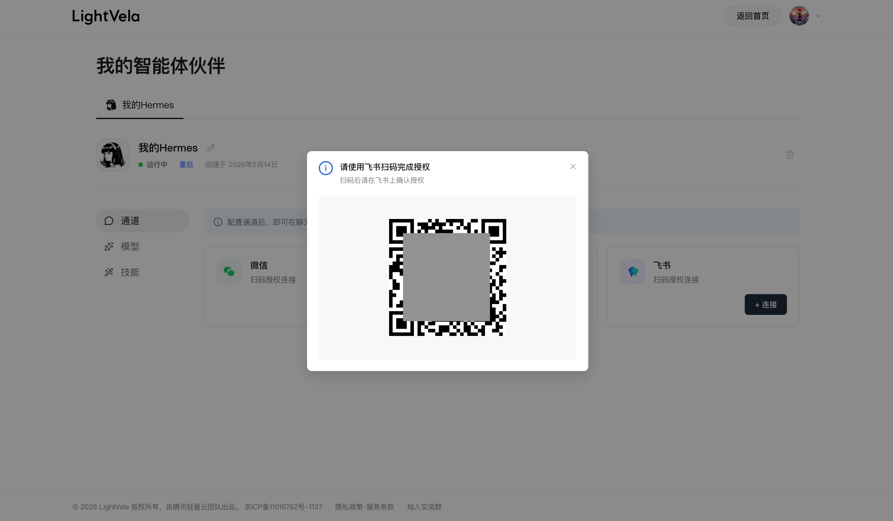
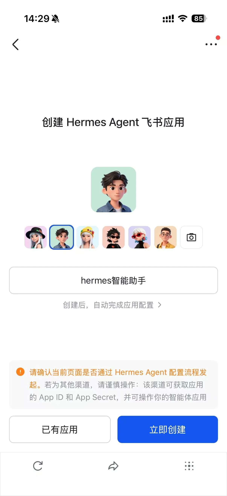
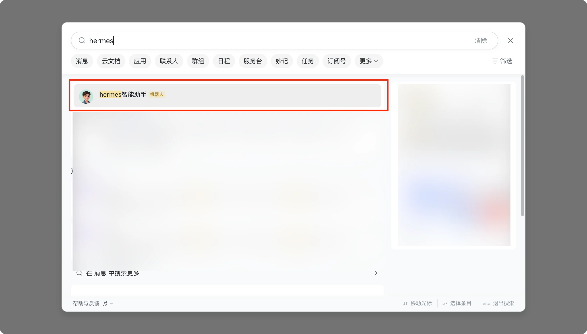
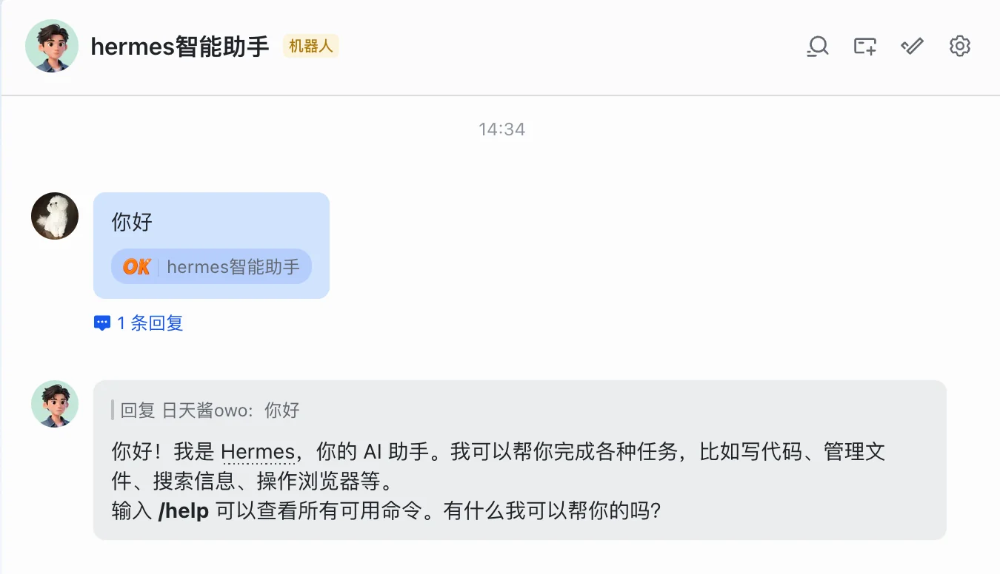

# 配置通道 - 飞书

飞书通道适用于办公场景，支持富文本消息与群聊 @机器人。接入方式与微信一致，使用扫码授权。

## 本页覆盖

- 在 LightVela 生成飞书接入二维码
    
- 使用飞书扫码授权
    
- 在飞书中与 Hermes Agent 进行对话
    

> 💡 **准备工作**
> 
> -   一台装有飞书的手机（或已登录飞书的桌面端）
>     
> -   完成 [模型配置](./model.md)（或使用套餐自带模型积分）
>     

---

## 操作步骤

### 1. 进入管理台

登录 LightVela，点击右上角「我的 Hermes」进入管理台，找到「通道 」按键。

### 2. 选择飞书通道

点击下拉框，选择「飞书」。下方显示飞书通道介绍。

### 3. 点击「授权接入」

页面弹出二维码。



### 4. 使用飞书扫码

**手机端**：

1. 打开飞书
    
2. 点击右上角「+」→「扫一扫」
    
3. 对准电脑屏幕上的二维码扫描
    
4. 按提示完成授权
    



### 5. 在飞书中查找 Hermes Agent

扫码成功后：

- 管理台「已接入通道」列表新增"飞书"记录
    
- 飞书自动添加机器人至联系人
    

飞书搜索创建的飞书应用名称



进入该机器人的对话窗口，发送测试消息：

```
你好
```



## 成功状态

- 管理台「已接入通道」列表中出现"飞书"
    
- 飞书搜索中可查找到对应机器人
    
- 发送消息后能收到 Hermes Agent 回复
    

---

## 支持的消息类型

接入成功后，飞书机器人除了能够接收、回复基础文本信息外，还支持更多消息类型，详情如下：

| 飞书机器人支持的消息类型和功能 | 是否支持 |
| --- | --- |
| 接收文本信息 | ✅ 已支持 |
| 接收图片 | ✅ 已支持 |
| 接收文件 | ✅ 已支持 |
| 接收音频、视频 | ✅ 已支持 |
| 回复文本信息 | ✅ 已支持 |
| 回复图片 | ✅ 已支持 |
| 回复文件 | ✅ 已支持 |
| 回复音频 | ✅ 已支持 |
| 回复内容支持 Markdown 格式 | ✅ 已支持 |
| 主动发送消息（如定时发送提醒） | ✅ 已支持 |
| 操作飞书文档、Wiki 知识库、飞书云盘 | ✅ 已支持 |

> ℹ️ **实际处理能力取决于模型**
> 
> 上表仅代表飞书机器人在消息通道层面支持接收、回复的类型。能否实际完成处理图片、文件等任务，还取决于 Hermes Agent 所接入的大语言模型是否具备对应的处理能力。

---

## 常见问题

| 现象 | 可能原因 | 处理方式 |
| --- | --- | --- |
| 扫码提示"应用未授权" | 飞书租户管理员限制第三方应用 | 联系所在租户管理员放行，或改用个人租户 |
| 找不到机器人联系人 | 飞书默认折叠机器人 | 在飞书顶部搜索 Hermes Agent 名称 |
| 如何将机器人添加至群聊 | — | 在群设置的「添加群成员」中搜索该机器人并添加 |
| 二维码过期 | 超过有效期未扫码 | 关闭弹窗，重新点击「授权接入」 |
| 发送消息后无回复 | 模型未配置或体验积分耗尽 | 检查「当前模型」状态 |
| 富文本格式渲染异常 | 部分 Markdown 语法飞书不支持 | 纯文本对话不受影响 |

---

## 通道说明

- **消息类型**：支持文本、富文本、图片、文件、音频、视频等多种类型，详见上方「支持的消息类型」
    
- **群聊支持**：支持将机器人添加至群聊并 @机器人发起对话
    
- **租户限制**：企业飞书下是否支持接入外部机器人取决于租户管理员策略
    

---

## 下一步

- [配置通道 - 微信](./channel-wechat.md) — 日常个人场景
    
- [配置通道 - QQ](./channel-qq.md) — 需手动创建机器人
    
- [配置技能](./skill.md) — 扩展 Hermes Agent 能力
