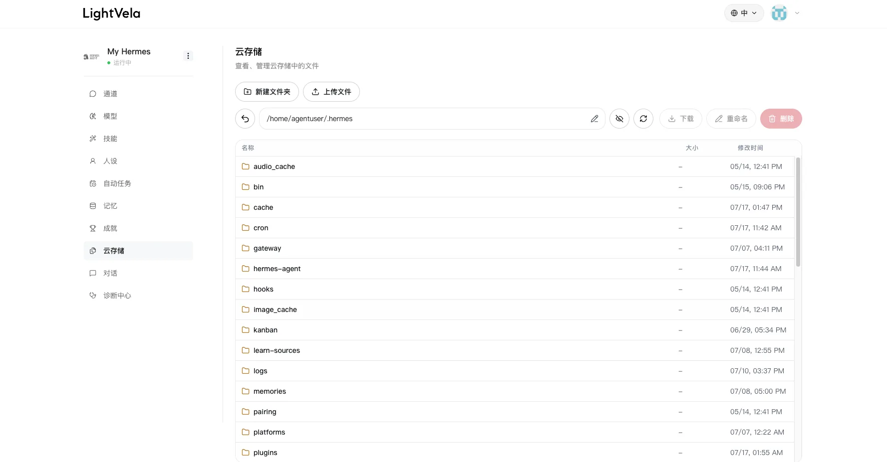

# 云存储

## 摘要

**云存储是当前 Hermes Agent 专属的文件工作区，用于上传资料、创建文件夹、整理任务输入并下载 Agent 产出。** 打开[云存储页面](/agents/files)后先核对当前 Bot 或实例；单个文件的上传和下载上限均为 1 GB，文件夹不能直接下载。

---

云存储是 Hermes Agent 的文件工作区。你可以在 Agent 控制台中集中保存任务资料、上传和整理文件，或将需要的文件下载到本地，无需离开 LightVela。

## 本页覆盖

- 打开指定 Agent 的云存储
- 上传文件、创建文件夹并整理工作资料
- 下载、重命名和删除文件
- 确认文件工作区已可供 Agent 使用

> **说明：** 云存储归属于当前选中的 Agent。需要管理哪一个 Agent 的文件，就打开哪一个 Agent 的控制台。

## 什么时候使用云存储

当 Agent 需要参考资料、工作文档，或需要一个清晰的位置保存任务产出时，就可以使用云存储。例如，先上传项目简报，再让 Agent 提炼重点；也可以为周期性工作建立文件夹并持续维护。

云存储与 Agent 的长期上下文不同。如需管理 Agent 跨会话保留的信息，请查看[记忆](./memory.md)。

## 开始前

1. 确认你可以打开要操作的 Agent。
2. 准备好需要添加的文件。单个文件上传和下载都不得超过 1 GB。
3. 如果要添加多份相关资料，先想好简单的文件夹结构。

## 打开云存储

1. 打开「我的 Hermes」，选择需要管理文件的 Agent。
2. 打开[云存储页面](/agents/files)。当前侧栏没有独立的云存储菜单项，可从本文档链接直接进入。
3. 等待文件列表加载完成，再开始上传或新建操作。

如果列表未能加载，先刷新页面后重试。问题持续出现时，可先在[诊断中心](./diagnostics.md)查看 Agent 的近期日志，再进行更大范围的操作。

## 上传文件和新建文件夹

### 上传文件

1. 选择 **上传文件**。
2. 从电脑中选择一个或多个文件。
3. 保持页面打开，等待上传完成，并确认文件出现在当前文件夹中。

建议使用清晰的文件名，方便你和 Agent 后续识别。文件超过 1 GB 时，请先压缩或拆分再上传。

### 新建文件夹

1. 进入目标位置，选择 **新建文件夹**。
2. 输入容易识别的名称。
3. 确认操作后，打开新项目继续处理。

通常不需要复杂目录：可以分别建立“资料”“处理中”“完成”三个文件夹。只有在确实能提升查找效率时，再增加更多层级。

## 管理已有文件

在文件列表中选择文件或文件夹后，可以使用对应操作：

- **打开**文件夹，浏览其中内容。
- **下载**单个文件，保存一份本地副本；当前不能直接下载文件夹。
- **重命名**项目，让用途更清楚。
- **删除**不再需要的文件或文件夹。

> **注意：** 删除会移除当前 Agent 云存储中的项目。非空文件夹不能直接删除；删除前，请先下载你之后可能还会需要的文件。

如果你使用的工具会生成隐藏文件，只在需要检查时开启隐藏文件视图。日常管理时关闭它，文件列表会更清晰。

## 确认文件工作区可用

满足以下情况时，云存储已准备就绪：

- 文件或文件夹出现在预期位置；
- 你可以正常打开或下载文件；
- 目录名称能清楚说明资料对应的任务。

现在可以回到[聊天](./agent-chat.md)，告诉 Agent 如何使用这些文件。需要把同类工作固定下来时，可继续结合[定时任务](./automation.md)或[技能](./skill.md)。

## 常见问题

### 为什么无法上传或下载文件？

先核对单个文件是否超过 1 GB，并确认网络连接稳定。文件夹当前不能直接下载。刷新云存储页面后再重试；如果仍然失败，请记录页面报错并通过[联系我们](../contact-us.md)反馈。

### 一个 Agent 的文件可以直接给另一个 Agent 使用吗？

云存储在所选 Agent 的控制台中管理。请打开你实际要使用的 Agent，再将文件添加进去，让每个工作区保持清晰可控。

### 删除云存储中的文件会删除电脑里的原文件吗？

不会。删除的是该 Agent 云存储中的托管副本，不会删除你电脑上的原始文件。

## 下一步

- 在[聊天](./agent-chat.md)中使用已准备好的文件。
- 当 Agent 需要保留上下文而不只是文件时，查看[记忆](./memory.md)。
- 云存储操作反复失败时，使用[诊断中心](./diagnostics.md)排查。
